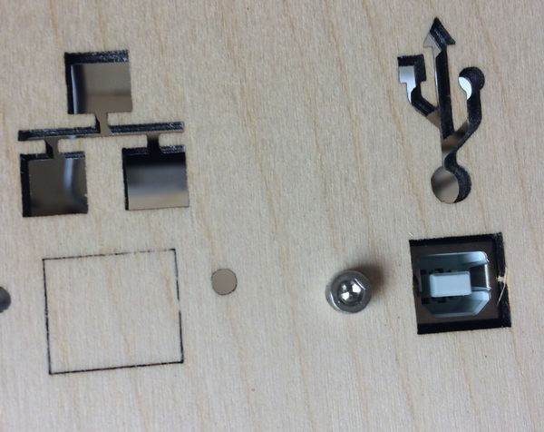
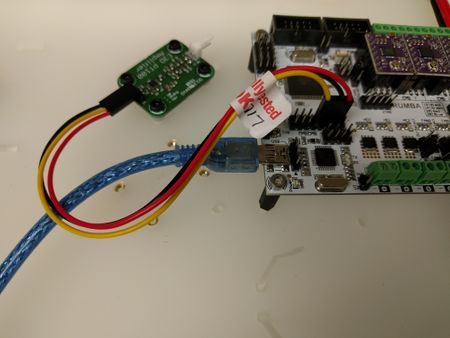

# BigBox Firmware Flashing Guide

Archived 20201204013533 · source: wiki.e3d-online.com/wiki/BigBox_Firmware_Flashing_Guide

NEVER try to flash the firmware while the printer is printing!

Also disconnect any other processes accessing the printer like OctoPrint or any other host applications!

Do NOT cut the power while flashing this can damage your RUMBA board!

# Flashing a new firmware

Firmwares for the BigBox come as hex files.

The official source for firmware images is the release page of the official source repository: [BigBox Firmware Releases](https://github.com/BigBox3D/Marlin/releases).

Flashing a new firmware may reset your stored settings and it is recommended to reset the settings too. So if you changed specific values like E steps, other steps settings, or other settings which can be stored be sure to note them down **before** you flash a new firmware.

## Determining your BigBox version

To determine which version of the BigBox go to [BigBox Version Overview](BigBox_Version_Overview.md "BigBox Version Overview").

## Connecting to the BigBox

You don't have to change anything on the RUMBA board in order to flash a new firmware!

The box should be switched on!

### Without OctoPrint/OctoPi upgrade

To connect to your BigBox use the USB port on the backside of the box. For this you need an USB cable with a Type B plug on one end.

### With OctoPrint/OctoPi upgrade

If you have the upgrade there is no USB port on the backside of your box but only a network port which cannot be used to flash a new firmware.

If you don't want to flash from your OctoPi as described in \#Flashing with OctoPrint plugin then you have to open the electronics cover on the bottom inside the box. On the front left side of the RUMBA is the USB port where the RaspberryPI is connected to.

To connect to your RUMBA temporarily for flashing you have to unplug the RPi from the RUMBA, the blue cable in the picture. Then you can connect your PC to that port. For this you need an USB cable with a Mini-B plug on one end.

## Flashing on Windows

### Driver Installation

The Windows driver for the RUMBA board can be downloaded from the RepRap wiki:

[http://reprap.org/wiki/RUMBA#RUMBA_USB_Driver_for_Windows](http://reprap.org/wiki/RUMBA#RUMBA_USB_Driver_for_Windows)

*\[image not archived: Windows_RUMBA_Drivers_extracted.png\]*

Windows RUMBA Drivers extracted

Download the ZIP file, extract the installer and run it. Follow the installer steps until completion accepting any default options.

*\[image not archived: Windows_RUMBA_Drivers_installation_1.png\]*

Windows RUMBA Drivers installation 1

*\[image not archived: Windows_RUMBA_Drivers_installation_2.png\]*

Windows RUMBA Drivers installation 2

### Flashing a new firmware

*\[image not archived: Windows_Device_Manager_connected_RUMBA.png\]*

Windows Device Manager connected RUMBA

After you installed the driver and connect the RUMBA over USB it should be listed in the device manager.

Take note of the COM port.

*\[image not archived: Windows_XLoader.png\]*

Windows XLoader

Get [XLoader](http://russemotto.com/xloader/XLoader.zip), unzip then start it.

*\[image not archived: Windows_XLoader_setup.png\]*

Windows XLoader setup

Point it to the desired hex file you want to flash, select the appropriate device for the RUMBA (Mega(ATMEGA2560)), the COM port you noted in the device manager and the correct BAUD rate (115200).

*\[image not archived: Windows_XLoader_uploading.png\]*

Windows XLoader uploading

Click "Upload" and if everything goes right your new firmware will be flashed to the RUMBA.

*\[image not archived: Windows_XLoader_finished.png\]*

Windows XLoader finished

After writing and if all went well the screen will look like this.

After process is complete the RUMBA automatically resets and starts up.

To complete the process go to [\#After flashing a new firmware](#after-flashing-a-new-firmware) and follow the steps there!

## Flashing on OS X (Mac)

Get [HexUploader](http://paulkaplan.me/HexUploader/) and start it.

*\[image not archived: HexUploader_setup.png\]*

HexUploader setup

Select the appropriate device for the RUMBA (Mega - ATMega 2560), the "Serial Port" (usbmodem1421 in my case) and the correct "Baud Rate" (115200)

*\[image not archived: HexUploader_file_selection.png\]*

HexUploader file selection

Click "Upload a Hex File" and select the desired hex file you want to flash and click "Open".

*\[image not archived: HexUploader_writing.png\]*

HexUploader writing

HexUploader writes the the file to the RUMBA board.

*\[image not archived: HexUploader_finished.png\]*

HexUploader finished

After writing it will verify the upload and if all went well the screen will look like this.

After process is complete the RUMBA automatically resets and starts up.

To complete the process go to [\#After flashing a new firmware](#after-flashing-a-new-firmware) and follow the steps there!

## Flashing on Linux

To flash from Linux you can use the console and "avrdude". avrdude is available in most of the big distributions' package repositories like Ubuntu, Debian, RedHat.

For a Debian based distribution and using apt as package manager **sudo apt-get install avrdude** should do it.

To flash a hex file with avrdude you can use the following:

/usr/bin/avrdude -C/etc/avrdude.conf -v \\\
-patmega2560 -cwiring -P/dev/ttyACM0 \\\
-Uflash:w:\[insert path to hex file\]:i

After process is complete the RUMBA automatically resets and starts up.

To complete the process go to [\#After flashing a new firmware](#after-flashing-a-new-firmware) and follow the steps there!

## Flashing on an RaspberryPi/OctoPi

Flashing on an RPi depends on the used distribution, if you use OctoPi then this is Debian based and you can refer to [\#Flashing on Linux](#flashing-on-linux).

## Flashing with "Firmware Updater" (OctoPrint plugin)

### Installing and setting up "Firmware Updater"

Refer to [\#Flashing on Linux](#flashing-on-linux) to install "avrdude" on your OctoPi. This is a prerequisite to use this Octoprint plugin.

Unfortunately the plugin is not listed in the OctoPrint plugin repository but this is not a real problem.

*\[image not archived: OctoPrint_Plugin_Manager_dialog.png\]*

OctoPrint Plugin Manager dialog

Open OctoPrint settings dialog and go to "Plugin Manager" section.

*\[image not archived: OctoPrint_install_FirmwareUpdater_plugin.png\]*

OctoPrint install FirmwareUpdater plugin

Insert the URL for the "Firmware Updater" plugin into the "...from URL" input box and click "Install". The process will tell you what to do.

At the time of writing this is [https://github.com/OctoPrint/OctoPrint-FirmwareUpdater/archive/master.zip](https://github.com/OctoPrint/OctoPrint-FirmwareUpdater/archive/master.zip)

The repository URL on Github is [https://github.com/OctoPrint/OctoPrint-FirmwareUpdater](https://github.com/OctoPrint/OctoPrint-FirmwareUpdater)

*\[image not archived: OctoPrint_FirmwareUpdater.png\]*

OctoPrint FirmwareUpdater

After a successful installation and a restart of OctoPrint you can select the plugin from the settings menu.

*\[image not archived: OctoPrint_FirmwareUpdater_configuration.png\]*

OctoPrint FirmwareUpdater configuration

It is recommended to tell the plugin where "avrdude" is installed. On a normal OctoPi installation "avrdude" will be at "/usr/bin/avrdude".

Open the configuration for the plugin by clicking the wrench in the upper right corner and enter that path in the input field.

### Flashing a new firmware

Do NOT use the "Check for updates" or check the option "Check for firmware updates after connecting to printer" because this won't work for the BigBox or Marlin at the time of writing!

*\[image not archived: OctoPrint_FirmwareUpdater.png\]*

OctoPrint FirmwareUpdater

To flash a firmware file with the plugin disconnect OctoPrint from the printer, and open the plugin via the settings dialog.

*\[image not archived: OctoPrint_FirmwareUpdater_flash_firmware.png\]*

OctoPrint FirmwareUpdater flash firmware

Point the plugin to a file on local drive with the "Brose" button or copy and paste a link to a hex file in the "...from URL" input field.

Select the serial port your printer is connected to, normally there should be only one.

If you are using the "Autoselect" plugin which can automatically select the port you may have "AUTO" in the list too. This does not work for the firmware update! You have to explicitly select the correct port for the firmware update to work!

Hit the corresponding button for the input field you used and the firmware will be flashed.

After process is complete the RUMBA automatically resets and starts up.

To complete the process go to [\#After flashing a new firmware](#after-flashing-a-new-firmware) and follow the steps there!

## Flashing with "BigBox Firmware" (Octoprint plugin)

Thanks to a member of the community (tohara) there is another Octoprint plugin available. While created especially for the BigBox this plugin should also work with other electronics using Marlin firmware.

### Installing and setting up "BigBox Firmware"

Unfortunately the plugin is not listed in the OctoPrint plugin repository but this is not a real problem.

*\[image not archived: OctoPrint_Plugin_Manager_dialog.png\]*

OctoPrint Plugin Manager dialog

Open OctoPrint settings dialog and go to "Plugin Manager" section.

*\[image not archived: OctoPrint_install_BigBox_Firmware_plugin.png\]*

OctoPrint install BigBox Firmware plugin

Insert the URL for the "BigBox Firmware" plugin into the "...from URL" input box and click "Install". The process will tell you what to do.

At the time of writing this is [https://github.com/tohara/OctoPrint-BigBoxFirmware/archive/master.zip](https://github.com/tohara/OctoPrint-BigBoxFirmware/archive/master.zip)

The repository URL on Github is [https://github.com/tohara/OctoPrint-BigBoxFirmware](https://github.com/tohara/OctoPrint-BigBoxFirmware)

*\[image not archived: OctoPrint_BigBox_Firmware.png\]*

OctoPrint BigBox Firmware

After a successful installation and a restart of OctoPrint you can select the plugin from the settings menu.

### Flashing a new firmware

This plugin is Git and profile based. That means you created profiles with settings for the firmware based on a Git repository with a Marlin firmware source in it.

The plugin has several default profiles you can take as a base to create your own special profile with setting for your box or with features you want to use.

Please refer to the Git repository of the plugin for its usage.

If you have a profile ready you simply click the "Flash firmware button" of the profile. Then the firmware is setup with the settings of the profile, compiled and flashed right away to your box.

At the time of writing the plugin works with the original Marlin firmware repository on Github, [tohara](https://github.com/tohara) has also a Marlin repository up with different Marlin releases and so does [Alex9779](https://github.com/Alex9779).

# Building from source and flashing

## Arduino IDE Setup

To connect the RUMBA board from your Windows PC you have to follow the directions in [\#Driver Installation](#driver-installation) to install the drivers for the RUMBA board to be recognized by Windows.

The installer can be downloaded from the Arduino website:

[https://www.arduino.cc/en/Main/Software](https://www.arduino.cc/en/Main/Software)

At the time of writing the current version is 1.6.9. Marlin requires at least 1.6.0 since RC6, it will produce warnings and fail to compile if you use lower versions. When installing choose the default component installation and installation location.

Arduino IDE is now installed, however, before we can build a new firmware there are some extra libraries required. These come bundled with the source code so will be setup in the next step.

## Install additional libaries

To be able to compile Marlin for the RUMBA board and the BigBox you have to install two additional libraries.

Fortunately the Arduino IDE includes a library manager for some versions now.

*\[image not archived: Arduino_include_library.png\]*

Arduino include library

Go to the menu "Sketch" -\> "Include library" -\> "Manage Libraries..." to open the library manager.

Add the following libraries to your installation:

- LiquidCrystal_I2C
- U8glib

## Get the source code

The official source code repository for the BigBox is located on Github [BigBox3D Github repository](https://github.com/BigBox3D/).

**REMEMBER:** the code is for the **current** version of the BigBox, if you have changed something, built differently or have an older version, like the Kickstarter BigBox you have to do changes in the source to make it work for your BigBox!

There is also an unofficial repository with a lot of branches for most of the available factory BigBoxes with additional features enabled also hosted on Github: [https://github.com/Alex9779/Marlin](https://github.com/Alex9779/Marlin)

Either clone one of the repositories locally, fork it and clone your fork locally or download the source as a ZIP file and unpack.

## Setting up the Arduino project

The source code for the firmware is stored in the Marlin folder. Navigate to the Marlin folder and double-click Marlin.ino. This should open Arduino IDE.

Select the following options from the menu to make sure the correct board and processor options are set:

**Tools \> Board \> "Arduino/Genuino Mega or Mega 2560"**

**Tools \> Processor \> "ATmega2560 (Mega 2560)"**

# After flashing a new firmware

It is recommended to reset the EEPROM of the RUMBA board after you flashed a new version. There have been reports of strange behaviours and a reset solved these issues.

**ATTENTION:** resetting the EEPROM will read the default values from the firmware. Bed leveling, motor steps, offsets and other settings are back to the firmware defaults!

If you have special values set, note them down and set them again after resetting.

To reset the EEPROM use the LCD.

1.  Push the knob to get to leave the info screen and open the menus.
2.  Scroll to the "Control" menu entry and push the knob.
3.  Scroll to the "Load failsafe defaults" menu entry and push the knob.
4.  Scroll to the "Save settings" menu entry and push the knob.

## Troubleshooting

If your RUMBA board does not appear in the Windows device manager for example even you have installed the drivers or if uploading a new firmware fails with strange errors it may be due to a damaged USB2Serial firmware.

Try the steps described [here](http://reprap.org/wiki/RUMBA#USB_connection_.28Writing_in_progress.29) to flash a ware to the programmer.
