# BigBox Parts Preparation

Archived 20221201075921 · source: wiki.e3d-online.com/wiki/BigBox_Parts_Preparation · [archive link](https://web.archive.org/web/20221201075921/https://wiki.e3d-online.com/BigBox_Parts_Preparation)

**Contents**

- [(1) Y-Axis Rear Brackets (Left & Right)](#1-y-axis-rear-brackets-left--right)
- [(2) Y-Axis Front Brackets (Left & Right)](#2-y-axis-front-brackets-left--right)
- [(3) Y-Axis Belt Idlers](#3-y-axis-belt-idlers)
- [(4) Non-Titan Single & Dual Extruder Filament Idlers](#4-non-titan-single--dual-extruder-filament-idlers)
- [(5) X-Axis Idler Carriage](#5-x-axis-idler-carriage)
- [(6) X-Axis Motor Mount](#6-x-axis-motor-mount)
- [(7) Pro & Lite X-Carriage](#7-pro--lite-x-carriage)
- [(8) Dual X-Carriage](#8-dual-x-carriage)
- [(9) Hybrid X-Carriage](#9-hybrid-x-carriage)
- [(10) Heated Bed Corners](#10-heated-bed-corners)
- [(11) Outer Spools Rear (Left & Right)](#11-outer-spools-rear-left--right)
- [(12) Spool Holder Outer Fronts](#12-spool-holder-outer-fronts)
- [(13) Print Cooling Fan (v1.0)](#13-print-cooling-fan-v10)
- [(14) Y-Axis Motor Mount](#14-y-axis-motor-mount)
- [(15) Single & Dual Direct-Drive IR Sensor Bracket](#15-single--dual-direct-drive-ir-sensor-bracket)
- [(16) Hybrid IR Sensor Bracket](#16-hybrid-ir-sensor-bracket)
- [(17) Spool Carrier Clamp](#17-spool-carrier-clamp)
- [(18) Z-Axis Drag Chain Anchors](#18-z-axis-drag-chain-anchors)
- [(19) IEC Socket](#19-iec-socket)
- [Where next?](#where-next)

**For a full list of Fixings, including Bag Numbers please refer to the [Fixings Section](Bill_Of_Materials.md#fixings "Bill Of Materials") of the [Bill Of Materials](Bill_Of_Materials.md "Bill Of Materials").**

## (1) Y-Axis Rear Brackets (Left & Right)

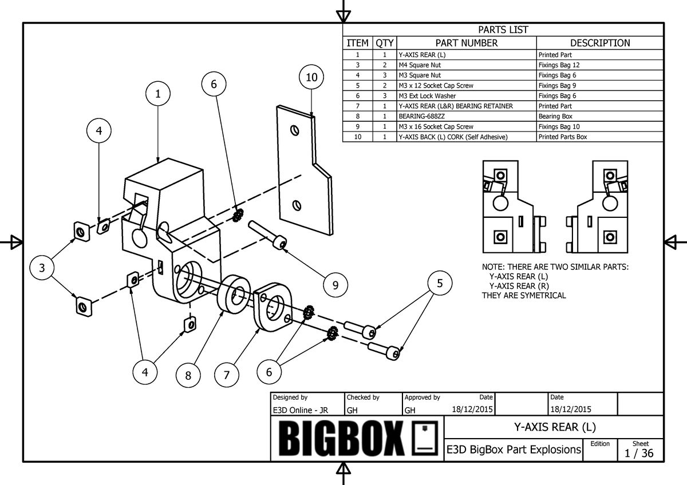

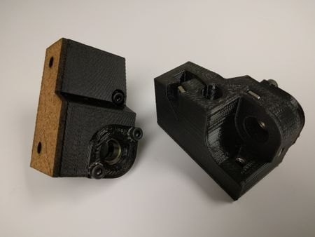

*BigBox Y-Axis Rear Brackets*

Take care when fitting the 688-ZZ (*8mm ID x 16mm OD x 5mm W*) bearings into the Y-Axis rear brackets, check there is no plastic obstructing the recess. Secure with the bearing retainer. They can be a very tight fit and are easily pressed into the part by pushing against a flat surface, a desk for example.

**Note :** These bearings are the two with the larger hole.

The M4 Square Nuts can be easily fitted using an M4 x 30mm screw. Wind the nut on the screw and gently tap into place using a hammer. It is also recommended to use an M4 16mm screw the pull the nuts into position from behind.

Once in place check they are seated securely by shaking gently. If they come loose they are not seated correctly. These nuts will be inaccessible later on so it is vital to ensure they do not become dislodged.

Remove the backing from the Cork and affix to the printed part.

**Note :** Do not fit the Cork Pad until all other components have been fitted.

**Do not tighten the M3 x 16mm screw. This is done at a later stage.**

## (2) Y-Axis Front Brackets (Left & Right)

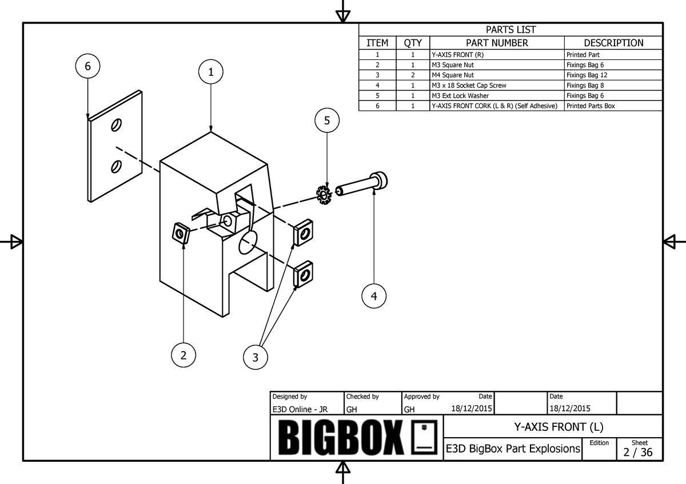

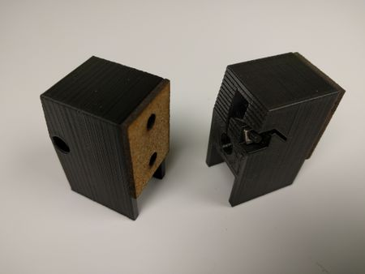

*BigBox Y-Axis Brackets*

The M4 Square Nuts can be easily fitted using an M4 x 30mm screw. Wind the nut on the screw and gently tap into place using a hammer. It is also recommended to use an M4 16mm screw the pull the nuts into position from behind.

Note that the lower nut does go into the round hole - internally it opens up to be a square hole.

Once in place check they are seated securely by shaking gently. If they come loose they are not seated correctly. These nuts will be inaccessible later on so it is vital to ensure they do not become dislodged.

Remove the backing from the Cork and affix to the printed part.

**Note :** Do not fit the Cork Pad until all other components have been fitted.

**Tip :** To get the nut through the round hole drop it in the hole, then use the end of an allen key to level it and use a fixing from the rear to pull it into place.

**Do not tighten the M3 x 18mm screws. This is done at a later stage.**

## (3) Y-Axis Belt Idlers

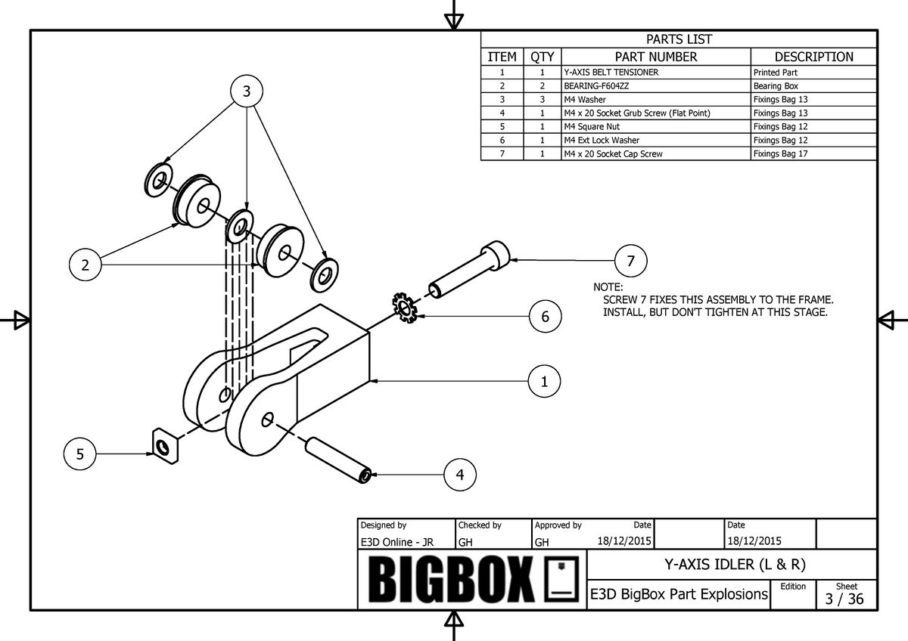

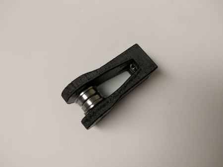

*BigBox Y-Axis Belt Idler*

Part-thread the 20 mm grub screw through the idler arms. Carefully, fit the washers and F-604-ZZ (*4mm ID x 12mm OD x 4mm W x 1mm F*) bearings over the screw between the arms of the printed part, in this order: *Washer-Bearing-Washer-Bearing-Washer.* Squash the part between your fingers when doing up the grub screw.

Use the M4 20mm Bolt to pull the M4 Square nut into the recess at base of idler 'legs'. Do this without the lock-washer fitted and remove after assembly.

**Note :** You are required to assemble two idlers for your BigBox.

**Note :** Do not ream-out the holes for the grub-screw.

## (4) Non-Titan Single & Dual Extruder Filament Idlers

If you are building an older **Non-Titan** version and require Idlers arms \| [Click Here](Non-Titan_Idler_Arms.md "Non-Titan Idler Arms")

## (5) X-Axis Idler Carriage

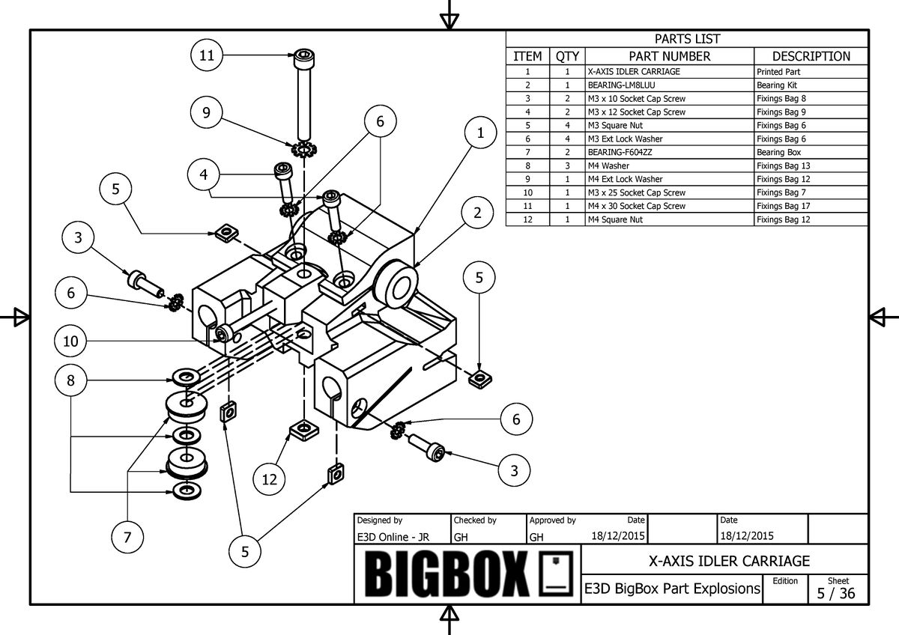

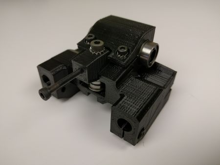

*X-Axis Idler*

Centre the LM8LUU (*8mm ID x 15mm OD x 45mm W*) bearing in the Idler.

Do not tighten the M3 x 10mm (3) or the M3 x 12mm (4) screws, this will done at a later stage.

Follow image guidelines when fitting the F-604-ZZ (*4mm ID x 12mm OD x 4mm W x 1mm F*) Idler bearings *Washer-Bearing-Washer-Bearing-Washer*.

When fitting the M3 x 25 screw, lightly screw this in (it will self tap). This is used during the commissioning stage to set the X endstop point, so it's not being used in the typical fashion in which a screw is used. Do not screw it all the way in. It should protrude as per the above diagram.

**Note**: Using needle-nose pliers can help when installing the M3 Square nuts.

**Note**: If you are building a Hybrid X-Carriage replace the M3 x 25mm Bolt (Item 10 in the exploded diagram) with an M3 x 10mm Bolt.

Do not hit the bearing with a hammer.

## (6) X-Axis Motor Mount

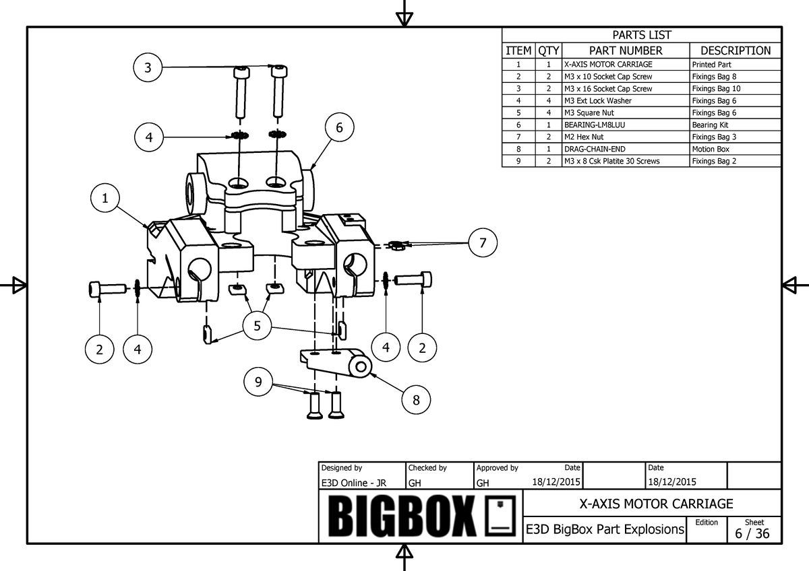

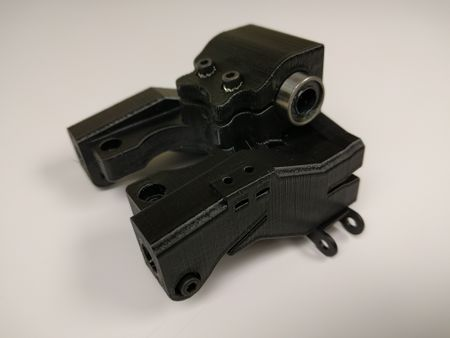

*X-Axis Motor Mount*

Centre the LM8LUU (*8mm ID x 15mm OD x 45mm W*) bearing in the Idler.

Do not tighten the M3 x 10mm or the M3 x 16mm screws, this will be done at a later stage.

**Note :** Drag-Chain-End is from the drag chain which has only one end-cap, remove this end-cap and fit it to the mount.

Do not hit the bearing with a hammer.

## (7) Pro & Lite X-Carriage

If you are building an older **Non-Hybrid** Pro & Lite X-Carriage \| [Click Here](Pro_%26_Lite_X-Carriage.md "Pro & Lite X-Carriage")

## (8) Dual X-Carriage

If you are building an older **Non-Hybrid** Dual X-Carriage \| [Click Here](Dual_X-Carriage.md "Dual X-Carriage")

## (9) Hybrid X-Carriage

Assemble the Hybrid X-Carriage in the same way for both Hybrid Dual & Pro BigBoxes.

[800px](/index.php?title=Special:Upload&wpDestFile=V1.1_x_carriage.jpg "File:V1.1 x carriage.jpg")

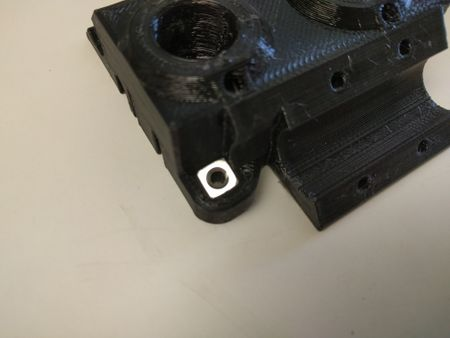

*Nut.*

- 2 x M4 Square Nut (Bag 12).
- 1 x Hybrid X-Carriage (Printed Parts).

Fit the nuts into the recesses in the X-Carriage.

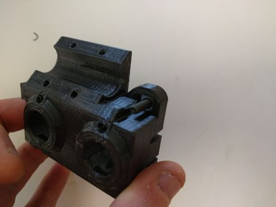

*Pull through.*

You can use an M4 16mm bolt to pull the nut into the recess.

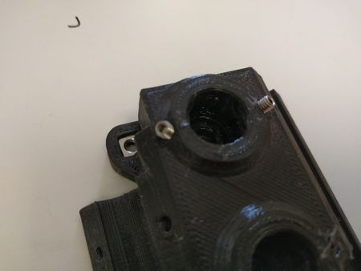

*Grub Screws.*

- 4 x M4 Square Nut (Bag 12).
- 4 x M4 12mm Grub Screw (Bag 14).

Insert the four M4 Square nuts into the holes before screwing in the Grubs.

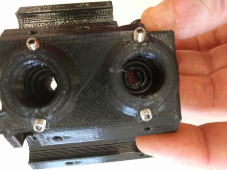

*O'Ring(s).*

- 2 x O-Ring (Extruder Box).

Fit the rings inside the X-Carriage.

**Note**: If you are building a BigBox Pro you can install a single ring if you wish.

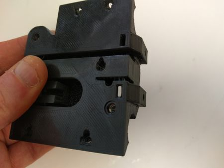

*Nuts.*

- 2 x M3 Square Nut (Bag 6).

Insert the nuts into the two holes on the X-Carriage.

**Note**: Check the nuts have gone all the way down as far as they can go.

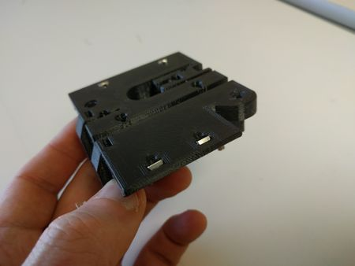

*More Nuts.*

- 4 x M3 Square Nut (Bag 6).

Fit four nuts into the openings as shown.

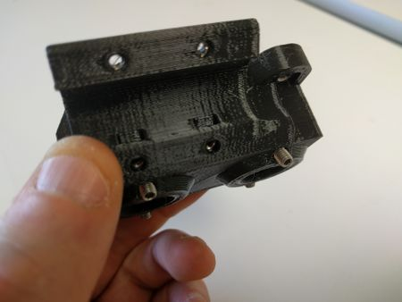

*Even More Nuts.*

- 4 x M3 Square Nut (Bag 6).

Fit four nuts into the openings as shown.

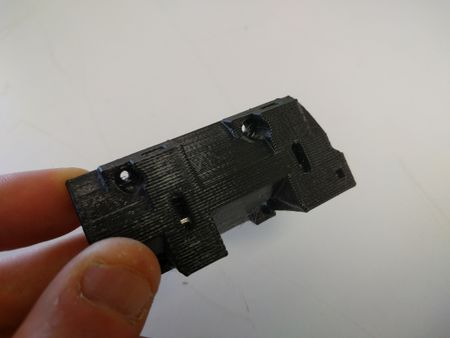

*Clamp.*

- 2 x M3 Square Nut (Bag 6).
- 1 x Hybrid X-Carriage Rear Bearing Clamp (Printed Parts).

Insert the two M3 square nuts into the holes on the top of the X-Carriage Rear Bearing Clamp.

## (10) Heated Bed Corners

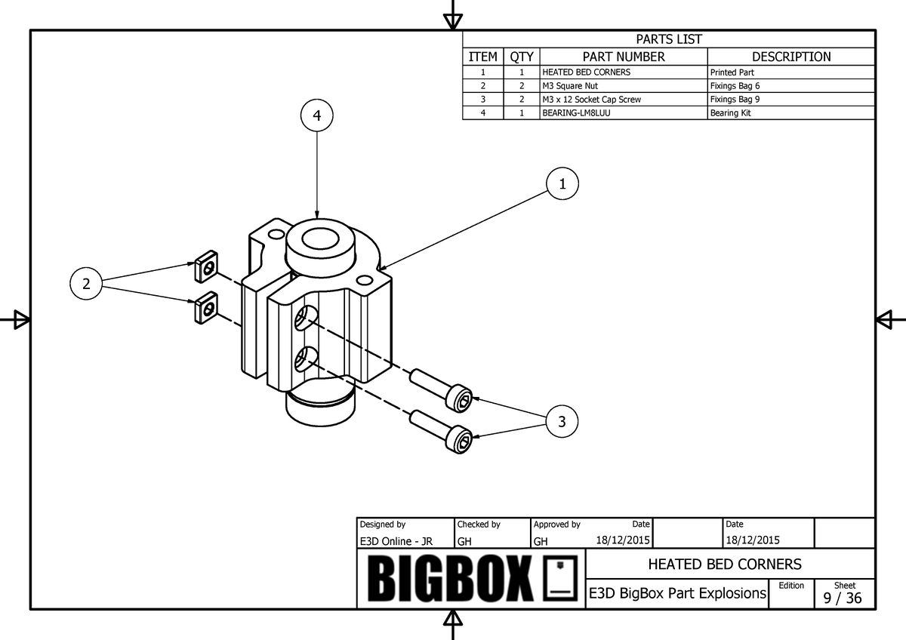

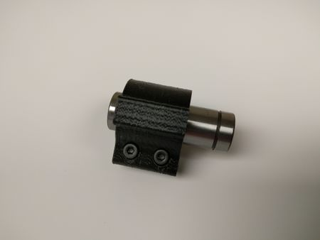

*A Heated bed corner.*

Push the LM8LUU (*8mm ID x 15mm OD x 45mm W*) bearing into the printed part of the . It does not need to be centered.

Affix with M3 x 12mm screws and square nuts. Do not fully tighten. There are four to assemble.

Do not hit the bearings with a hammer.

## (11) Outer Spools Rear (Left & Right)

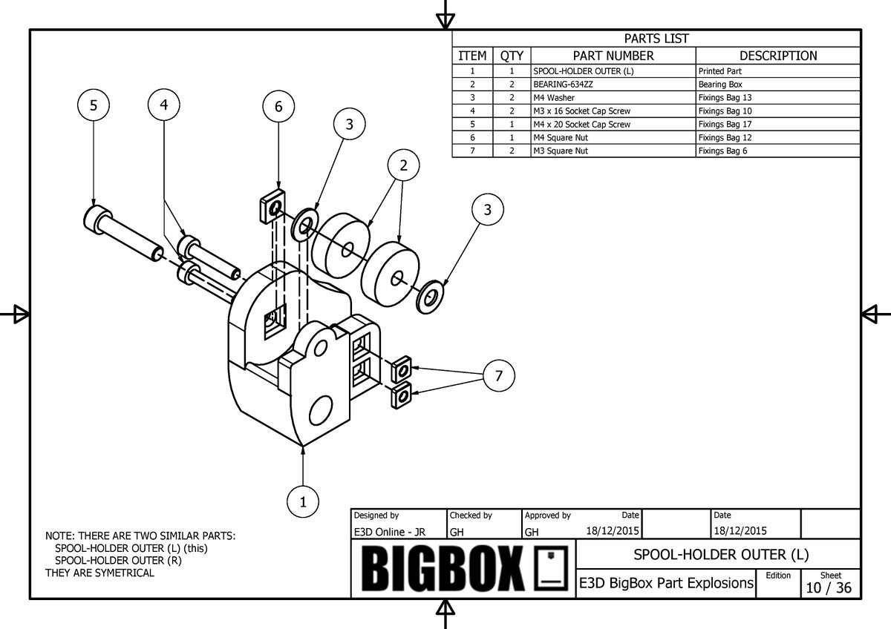

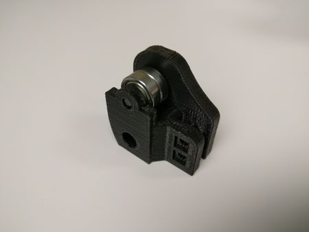

*Spool Holder.*

Add 634-ZZ (*4mm ID x 16mm OD x 5mm W*) bearings to the slot on each printed part *(Washer bearing bearing washer)*.

Build each side of the spool holder.

**Note :** You will require two sets for the BigBox Dual.

## (12) Spool Holder Outer Fronts

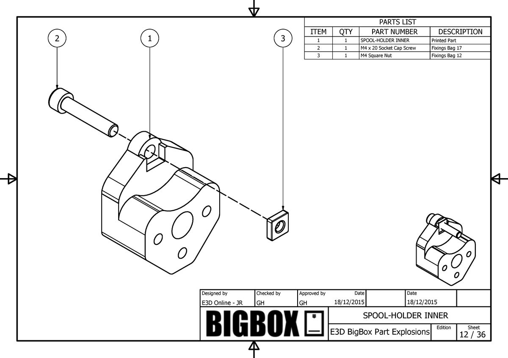

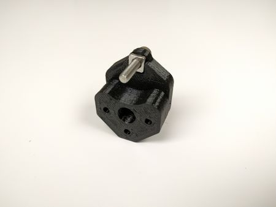

*An assembled holder.*

**Note :** Requires **x2** for lite & Pro and **x4** for dual

## (13) Print Cooling Fan (v1.0)

If you are building an older **Non-Hybrid** Print Cooling Fan(s) \| [Click Here](Print_Cooling_Fan.md "Print Cooling Fan")

## (14) Y-Axis Motor Mount

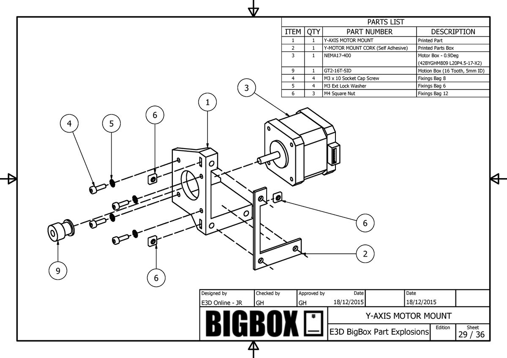

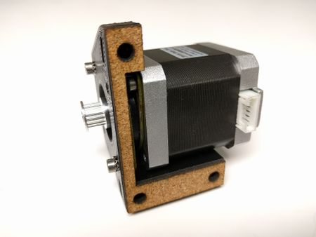

*The completed Y-Axis Motor assembly.*

Note the location of the Stepper Motor cable connector and the orientation of the pulley. Take care when removing the backing from the cork.

**Note :** Check you are fitting the 16T GT2 Pulley and **NOT** the 20T.

If you have an Astrosyn damper, now is as good a time as any to fit it. Before mounting to the motor to the motor mount, place the damper over the motor shaft. There's only one way to do this properly as the damper is keyed. Look for the holes without threads to be laid against the motor. If your motor didn't come with screws, you'll need to find two M3x6 screws to connect the damper to the motor. There will be only two screws connecting the damper to the mount. Next, connect the motor/damper assembly to the motor mount. Ideally you want two M3 x 8 screws for the job, but two of the original M3x10 indicated above will do the job. The most important thing is that the screws which connect the damper to the motor mount do not continue all the way to the motor. The point of the damper is to create a complete separation between motor vibrations and the case.

## (15) Single & Dual Direct-Drive IR Sensor Bracket

If you are building an older **Non-Hybrid** Single & Dual Direct-Drive IR Sensor Bracket \| [Click Here](Single_%26_Dual_Direct-Drive_IR_Sensor_Bracket.md "Single & Dual Direct-Drive IR Sensor Bracket")

## (16) Hybrid IR Sensor Bracket

[800px](/index.php?title=Special:Upload&wpDestFile=V1.1_ir_sensor_bracket "File:V1.1 ir sensor bracket")

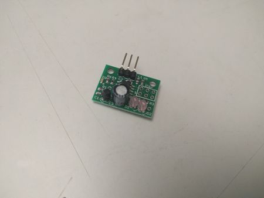

*IR Sensor.*

The IR Sensor.

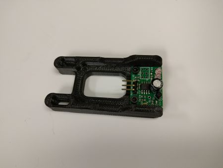

*IR Sensor Bracket.*

Assemble as shown.

## (17) Spool Carrier Clamp

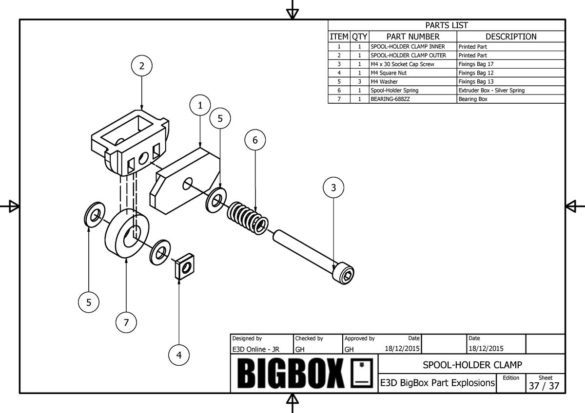

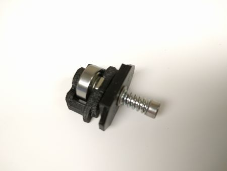

*Picture of an Spool Clamp.*

You will require two for a Dual BigBox, the extra 634-ZZ (*4mm ID x 16mm OD x 5mm W*) is in the Dual Extruder Box.

**Note :** The screw only needs to be finger tight. Do not over-tighten the clamp.

## (18) Z-Axis Drag Chain Anchors

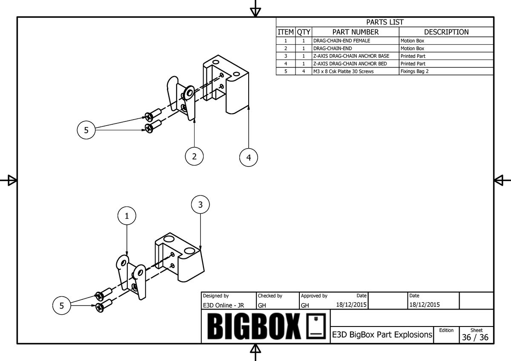

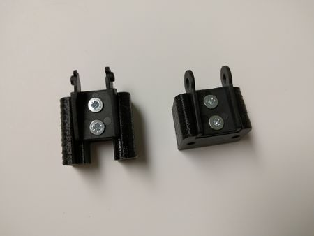

*Z-Axis Drag Anchors.*

**Note :** These are from the other drag chain, which has both ends attached.

## (19) IEC Socket

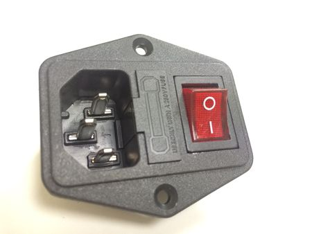

*IEC Socket, Fuse & Switch.*

**If you are not comfortable or 100% certain of how to wire the IEC socket please seek the help and advice of a professional electrician.**

**Do not guess.**

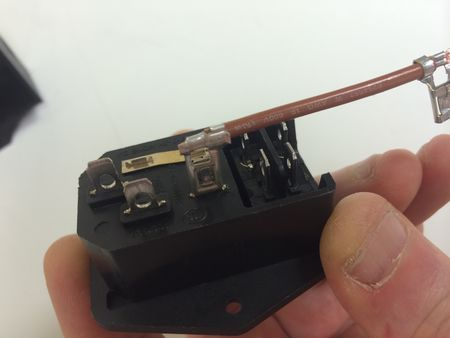

*IEC & Link.*

Plug the short Link Cable onto the IEC plug at the position marked L.

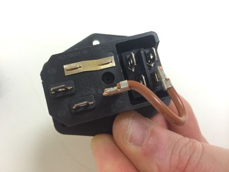

*Link Cable Connected.*

Plug the other end of the Link Cable onto the switch as shown.

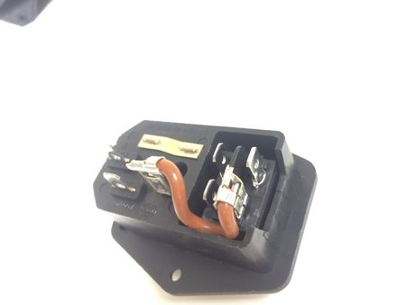

*Link cable tucked in.*

Tuck the Link Cable into the IEC Housing as shown.

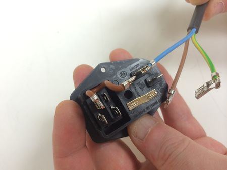

*The blue cable connected.*

Plug the blue Neutral IEC-PSU cable onto the IEC connector marked N as shown.

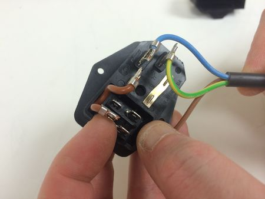

*The earth cable connected.*

Plug the yellow/green earth IEC-PSU cable onto the IEC connector as shown.

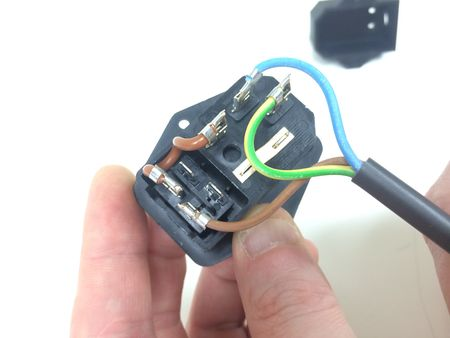

*Live connected.*

Plug the brown IEC-PSU cable onto the switch as shown.

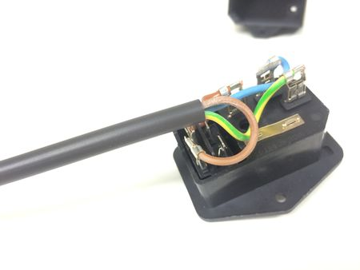

*The correct orientation.*

Position the IEC-PSU cable as shown.

## Where next?

Back to the [BigBox Pre-Build](BigBox_Pre-Build.md "BigBox Pre-Build")

Continue to the [BigBox Sub-Assemblies](BigBox_Printer_Sub-assemblies.md "BigBox Printer Sub-assemblies")

Home to the [BigBox Build Manual Main Index](BigBox_Build_Manual.md "BigBox Build Manual")
