# BigBox Printer Sub-assemblies

Archived 20210415233707 · source: wiki.e3d-online.com/wiki/BigBox_Printer_Sub-assemblies

**Contents**

- [(1) Single Direct-Drive Extruder](#1-single-direct-drive-extruder)
- [(2) Dual Direct-Drive Extruders](#2-dual-direct-drive-extruders)
- [(3) Hybrid Titan Extruder (Direct)](#3-hybrid-titan-extruder-direct)
- [(4) Hybrid Titan Extruder (Bowden)](#4-hybrid-titan-extruder-bowden)
- [(5) Hybrid Non-Titan Extruder (Direct)](#5-hybrid-non-titan-extruder-direct)
- [(6) Hybrid Non-Titan Extruder (Bowden)](#6-hybrid-non-titan-extruder-bowden)
- [(7) X-Axis Assembly](#7-x-axis-assembly)
- [(8) Electronics Cover](#8-electronics-cover)
- [(9) Spool Carrier](#9-spool-carrier)
- [(10) Z-Axis Bed Assembly](#10-z-axis-bed-assembly)
- [(11) Z-Axis Drag Chain Assembly](#11-z-axis-drag-chain-assembly)
- [(12) Base Assembly](#12-base-assembly)
  - [(12.1) Microbarb Brass Inserts](#121-microbarb-brass-inserts)
  - [(12.2) Feet](#122-feet)
  - [(12.3) Power Supply Unit (PSU)](#123-power-supply-unit-psu)
  - [(12.4) Rumba](#124-rumba)
  - [(12.5) PT100 Amplifier(s)](#125-pt100-amplifiers)
    - [(12.5.1) Single Extruder](#1251-single-extruder)
    - [(12.5.2)Dual Single Extruder](#1252dual-single-extruder)
  - [(12.6) PSU - Rumba Wiring](#126-psu---rumba-wiring)
  - [(12.7) PT100 Wiring](#127-pt100-wiring)
    - [(12.7.1)Single Extruder](#1271single-extruder)
    - [(12.7.2) Dual Extruders](#1272-dual-extruders)
  - [(12.8) OctoPrint Upgrades](#128-octoprint-upgrades)
  - [(12.9) Z-Axis Cables](#129-z-axis-cables)
- [(13) Frame Assembly](#13-frame-assembly)
  - [(13.1) A Note on Nut-Traps](#131-a-note-on-nut-traps)
  - [(13.2) Main Frame](#132-main-frame)
  - [(13.3) The LCD Enclosure](#133-the-lcd-enclosure)
- [Where next?](#where-next)

## (1) Single Direct-Drive Extruder

If you are building an older **Non-Hybrid** Single Direct-Drive Extruder \| [Click Here](Single_Direct-Drive_Extruder.md "Single Direct-Drive Extruder")

## (2) Dual Direct-Drive Extruders

If you are building an older **Non-Hybrid** Dual Direct-Drive Extruders \| [Click Here](Dual_Direct-Drive_Extruders.md "Dual Direct-Drive Extruders")

## (3) Hybrid Titan Extruder (Direct)

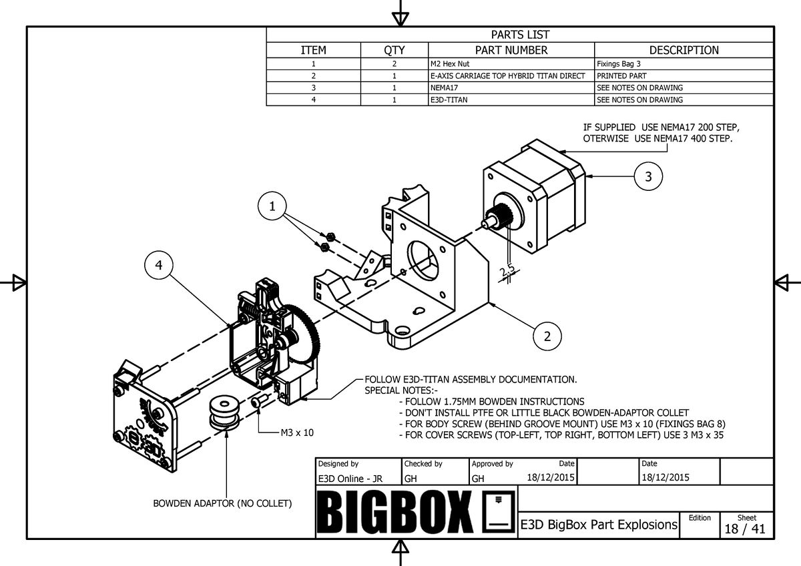

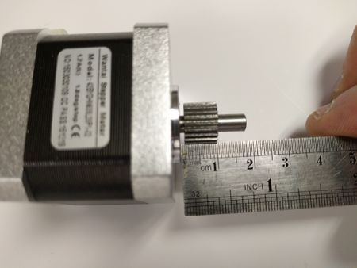

Gear.

Please refer to E3D's [Titan Assembly](Titan_Assembly.md "Titan Assembly") instructions.

**Leave 1.5mm Between the gear and the motor chassis.**

**Note**: The Grub Screw needs to be positioned towards the motor.

Tighten the grub screw to secure the gear.

## (4) Hybrid Titan Extruder (Bowden)

Because we assemble this onto the frame, this step will be saved until the frame is assembled.

## (5) Hybrid Non-Titan Extruder (Direct)

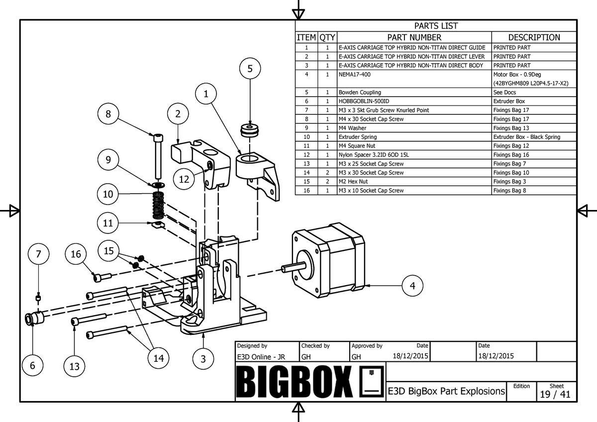

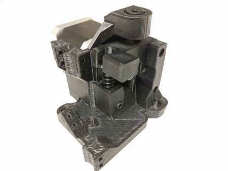

Non-Titan Direct Extruder.

## (6) Hybrid Non-Titan Extruder (Bowden)

Because we assemble this onto the frame, this step will be saved until the frame is assembled.

## (7) X-Axis Assembly

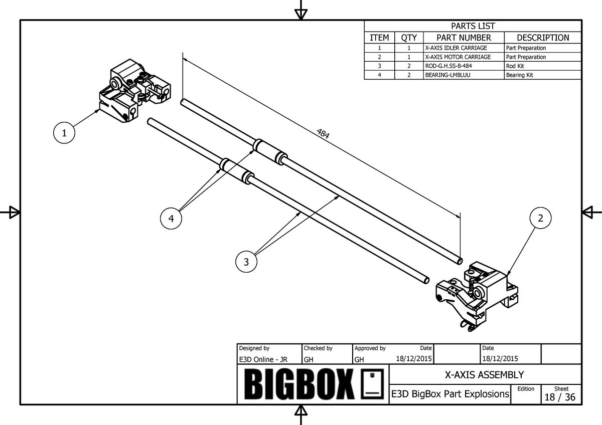

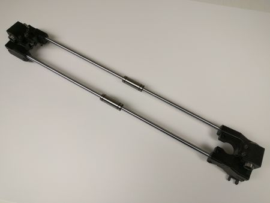

The assembled X-Axis.

Place the previously assembled *[X-Axis Idler Carriage](BigBox_Parts_Preparation.md "BigBox Parts Preparation")* on it's back with the two holes facing upwards and into each of the two holes insert a 484mm rod.

Slide an LM8LUU (*8mm ID x 15mm OD x 45mm W*) bearing onto each rod. Now slide the *[X-Axis Motor Mount](BigBox_Parts_Preparation.md "BigBox Parts Preparation")* onto the rods, checking the orientation is correct before you do so.

**Do not tighten the screws in the rod clamps. This is done at a later stage.**

## (8) Electronics Cover

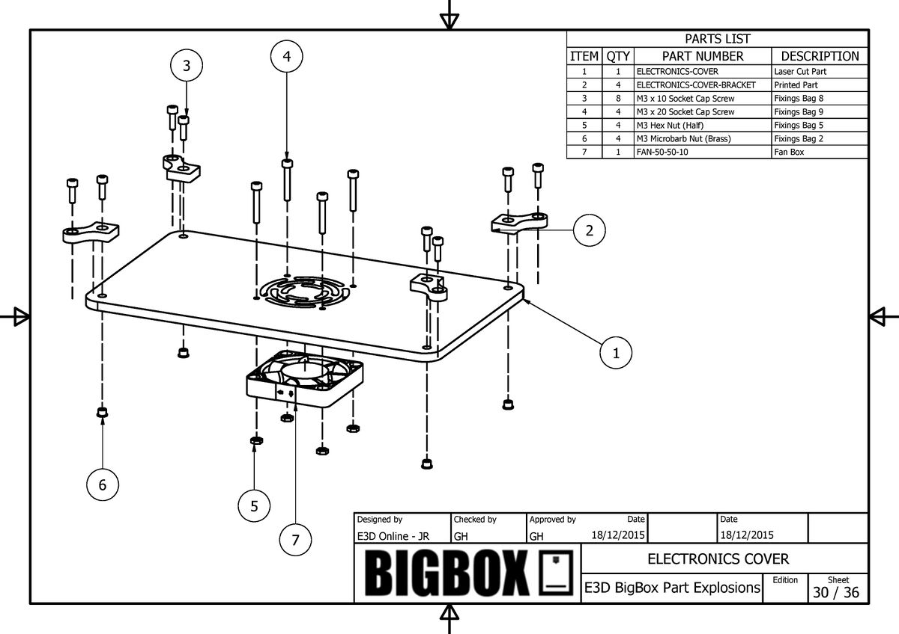

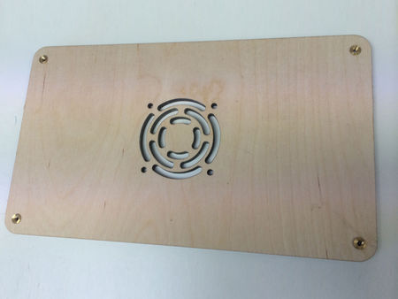

M3 Microbarbs.

Press the M3 Microbarbs into the Electronics Cover.

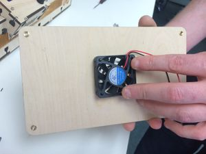

Attach the fan.

Secure the fan to the electronics cover so air is drawn through the laser cut part.

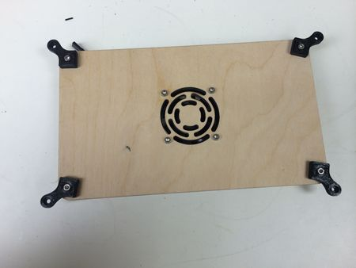

The completed cover.

Attach the corners to the cover.

## (9) Spool Carrier

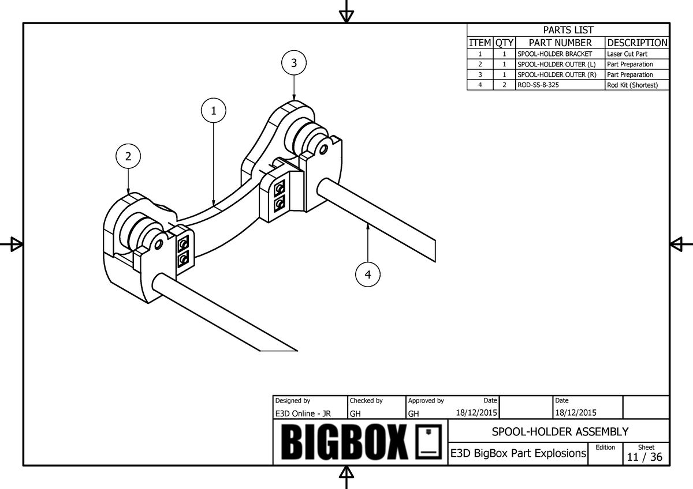

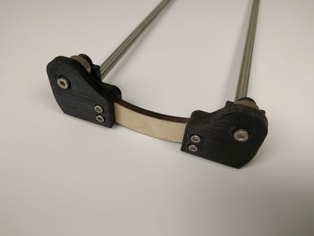

A complete Spool Carrier

**Note :** The Dual BigBox requires two Spool Carriers.

## (10) Z-Axis Bed Assembly

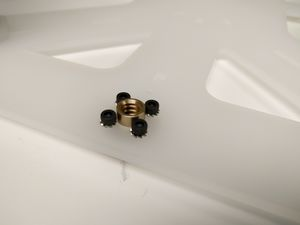

Brass Nut. Shown with engraved text down.

- 2 x Brass Nuts (Motion Box).
- 8 x M3 10mm Screws (Bag 8).
- 8 x M3 Lock-Washers (Bag 6).

Before starting this step please read through [this post on google+](https://plus.google.com/101981424292504602513/posts/AxB4jxjbyMM). This only applies to the first 20-30 kits which were sent out before we paused shipping. If you are unsure please visit the forum at [forum.e3d-online.com](http://forum.e3d-online.com/).

Install the two Brass Nuts to the Top layer of the heated bed.

**Insert the Brass Nuts from the underneath side of the Top Layer of the heated bed (The flange should be on the side with the engraved text).**

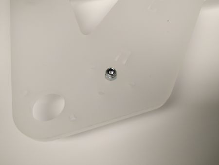

M3 Nyock Nut.

- 1 x M3 Nylock Nut (Bag 15).

Place the nylock nut onto the top of the heated bed (the opposite side to the brass nuts).

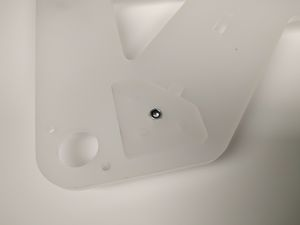

Corner Nut Trap.

- 1 x Corner Nut Traps (Laser Cut Part).

Place the Corner Nut Trap over the nylock nut.

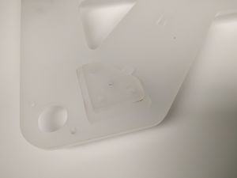

Corner Top.

- 1 x Corner Top (Laser Cut Part).

Place the Corner Top over the Corner Nut Trap.

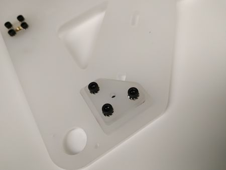

Screwed corner.

- 3 x M3 18mm Screws (Bag 8).
- 3 x M3 Lock-Washers (Bag 6).
- 3 x M3 Half Nuts (Bag 5).

Secure the corner with the M3 screws, washers and nuts.

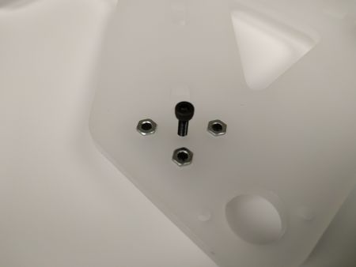

M3 20mm.

- 1 x M3 20mm Screw (Bag 9).

Insert the M3 screw from the underneath of the Top layer.

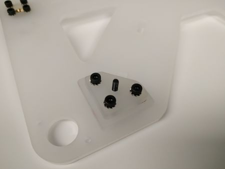

The Screw coming out the corner.

Tighten the M3 screw so the top protrudes from the corner.

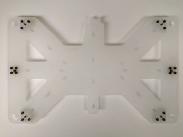

The finished top layer.

Repeat the process for the other three corners.

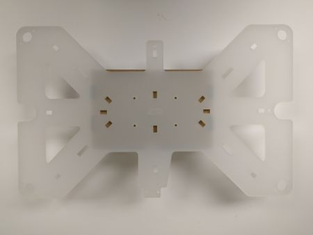

Bottom Layer.

Place the bottom layer onto a small box or other item to raise it off your worktop.

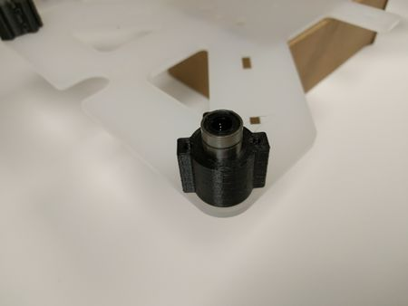

Corners.

- 4 x *[Bed Corners](BigBox_Parts_Preparation.md "BigBox Parts Preparation")*.

Insert the four corners into the bottom layer.

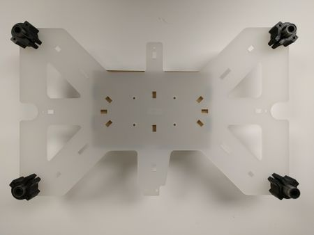

Four Corners.

Align the corners as shown.

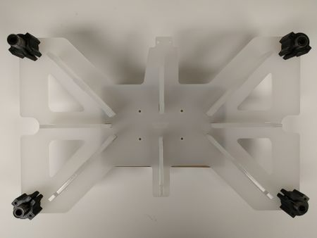

Supports.

- 4 x Large Struts (Laser Cut Part).
- 2 x Medium Struts (Laser Cut Part).
- 2 x Small Struts (Laser Cut Part).

Slot the struts into the bottom layer.

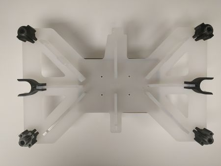

Centres.

- 2 x Drive Supports (Printed Parts).

Place the two Drive Supports so they slot into the two Struts.

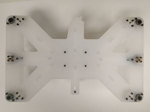

Screws.

- 1 x Completed Top layer.
- 15 x M3 35mm Screws (Bag 11).
- 15 x M3 Lock Washers (Bag 6).
- 15 x M3 Half Nuts (Bag 5).

Place the Top Layer onto the struts making sure the alignment is correct.

Check the top layer matches the same orientation as the Bottom Layer.

Fit the M3 screws through the bed, from the top. **Do not over-tighten the screws**. Leave the two screw holes free at the back of the bed where the drag chain will eventually connect.

**Note :** Leave the two M3 35mm Screws in each corner, which screw through the *[Bed Corners](BigBox_Parts_Preparation.md "BigBox Parts Preparation")*, lose for now. They will be tightened later in the build manual.

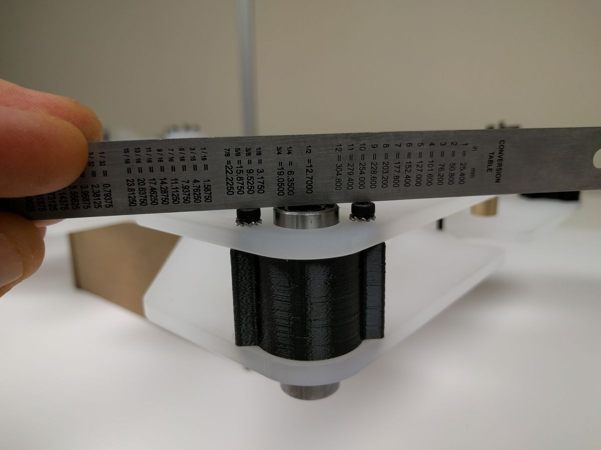

Leveling the bearings.

The four bearings need to be moved so that the top of the bearings are level with the top of the screws. Using a ruler can help with the alignment.

By placing a 3mm Allen key between the slots on the bearing holder and carefully applying a small amount of GENTLE pressure it allows the bearings to move more freely.

When in position tighten the bearing clamps.

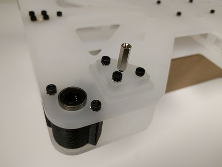

Stand-Off.

- 4 x M3 15mm Female-Female Stand-Offs (Bag 16).

Screw four 15mm Stand-Off on each corner. Do not screw them all the way down, leave a 2-3mm gap at the bottom.

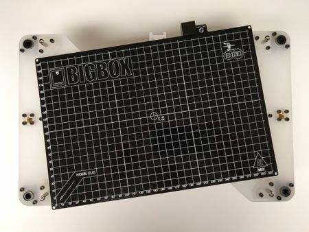

Bed.

- 1 x Variable Power Density Heated Bed PCB.

Place the Heated Bed PCB onto the Bed assembly.

**Note :** Check the orientation of the PCB Bed and the Z-Axis Assembly.

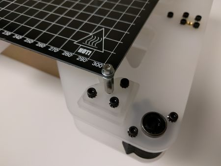

Bed Corner.

- 8 x M3 Washers (Bag 7).
- 4 x M3 6mm Screws (Bag 7).

Secure each corner of the PCB to the Bed assembly using 2 x M3 washers and a M3 6mm screw. The order should be *Washer-PCB-Washer-Screw*.

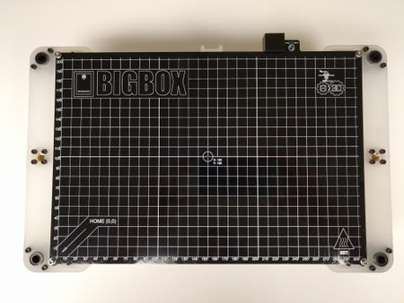

Secured PCB.

The Heated Bed PCB correctly installed to the Z-Axis Bed assembly.

## (11) Z-Axis Drag Chain Assembly

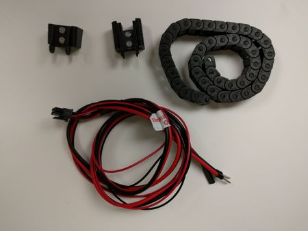

Components.

- 1 x Drag Chain (Motion Box).
- 2 x *[Z-Axis Drag Chain Anchors.](BigBox_Parts_Preparation.md "BigBox Parts Preparation")*
- 1 x Heated Bed Wiring (Electronics Box).

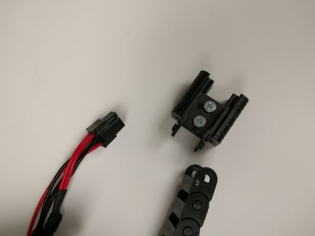

Match Ends.

Select the Heated Bed Drag Anchor (shown in the image) and match it to the corresponding end of the Drag Chain.

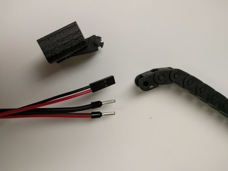

Cable Ends.

Feed the end of the wires through the Drag Chain.

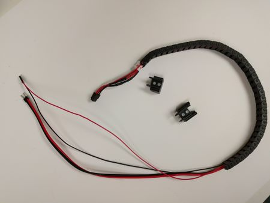

Wires through the Drag Chain.

Pull the cable fully through.

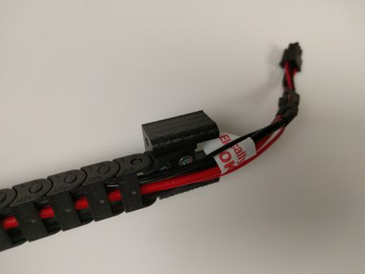

End attached.

Reattach the Heated Bed Drag Chain Anchor.

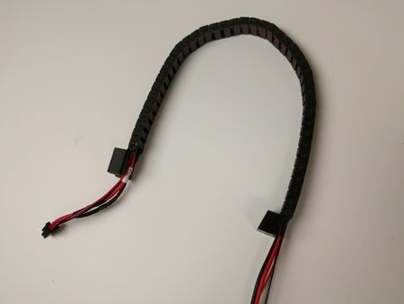

Finished.

To finish the Drag Chain reattach the remaining anchor to the chain.

## (12) Base Assembly

### (12.1) Microbarb Brass Inserts

Before you can start to build the base plate you will need to install a selection of Microbarbs Brass Inserts. Please refer to the guides below when fitting the inserts. There are three different sizes.

**You will be fitting inserts from either side of the base plate. The side of the sheet with engraving / text on it is referred to as the top.**

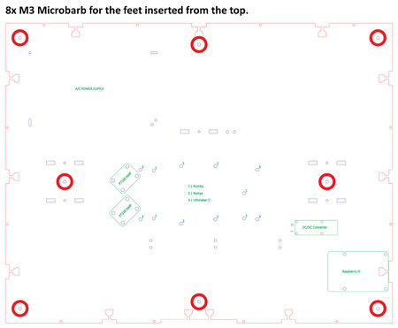

Microbarb feet fitment positions.

Fitment pattern for the Feet.

M3 Microbarbs (Bag 5)

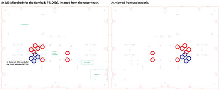

Microbarb Rumba & PT100 fitment positions.

Fitment pattern for the Rumba & PT100(s).

M3 Microbarbs (Bag 5)

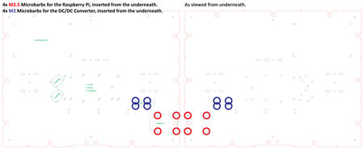

Microbarb Raspberry Pi & DC/DC Converter.

Fitment pattern for the Raspberry Pi & DC/DC Converter, only applicable if you have the OctoPrint upgrade.

M2 Microbarbs (Bag 2), M2.5 Microbarbs (Bag 4)

Don't worry if the smallest inserts don't stay put (found to happen with acrylic). Put them aside and then use your hand to hold them in place when it comes time to screw into them when the Pi is fitted.

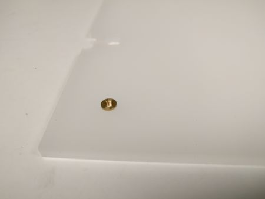

Microbarb inserted.

Be careful hammering the microbarbs into place, it is possible to crack the acrylic. You can use a nylon spacer and an appropriate size screw to pull them into place. A 3/16 socket is ideal in place of a nylon spacer.

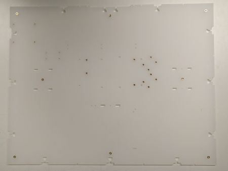

All fitted.

All brass inserts fitted.

**Note :** Inserts are fitted to both sides of the base.

### (12.2) Feet

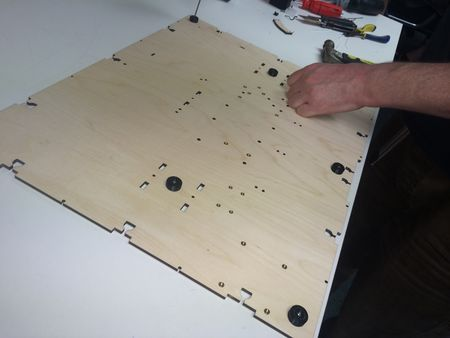

Adding the feet

- 8 x M3 10mm Screws (Bag 8).
- 8 x Printed Feet (Printed Parts Box).

Begin by fixing the feet to the base with 8 x M3 10mm screws.

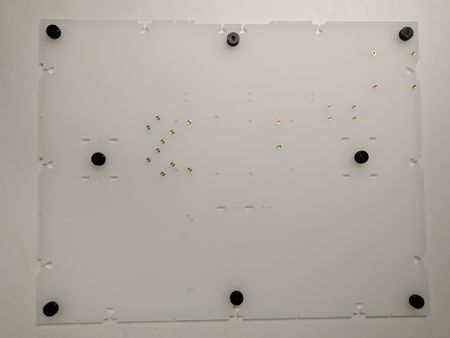

Fully Booted.

All eight Feet attached to the base.

### (12.3) Power Supply Unit (PSU)

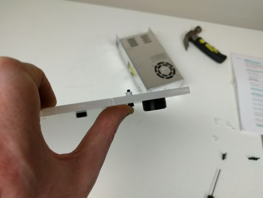

Screw the PSU.

- 4 x M3 12mm (Bag 9).
- 4 x 5mm Nylon Spacers (Bag 1).

Push the screws from the underside of the base through the nylon spacer and into the screw hole in the PSU

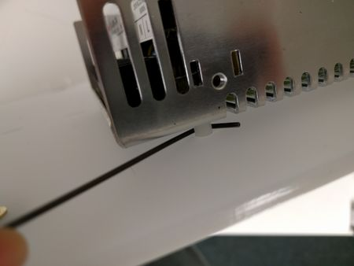

Nylon Spacer.

Use an Allen Key to help position the spacers between the PSU and Base.

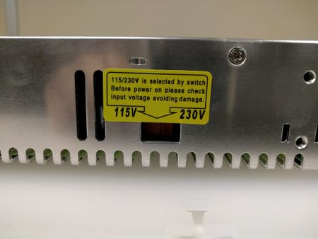

Power Selector.

Check the [mains A/C power supply in your country](https://en.wikipedia.org/wiki/Mains_electricity_by_country) and move the switch to match.

**Note :** The PSU is set to 230V by default.

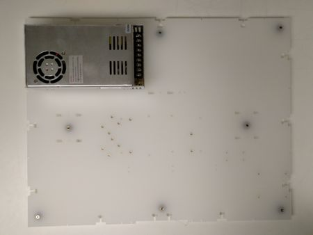

Mounted PSU.

PSU Completed.

### (12.4) Rumba

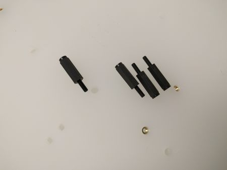

Mounted PSU.

- 4 x M3 20mm Black Nylon Stand-Off.

Mountings for the Rumba (Bag 1).

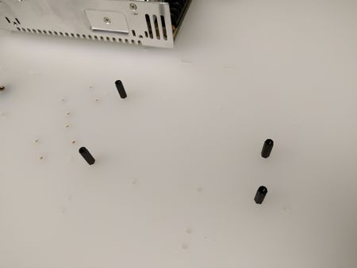

Rumba Posts.

Mountings for the Rumba.

Rumba Posts.

- 4 x M3 6mm Screws (Fixings correction bag, in the Stretch box).

Fix the Rumba to the posts.

### (12.5) PT100 Amplifier(s)

#### (12.5.1) Single Extruder

PT100 & Cable.

A PT100 Amplifier Board. (Extruder Box)

Single Amplifier Cable. (Extruder Box)

A fitted PT100 Amp.

- 4 x M3 12mm (Bag 9).
- 4 x 5mm Nylon Spacer (Bag 1).

Fit the Amplifier to the Base board with the white PT100 Cable connector facing towards the PSU.

##### (12.5.2)Dual Single Extruder

Dual PT100 & Cable.

Two PT100 Amplifier Board.

Dual Amplifier Cable.

A fitted PT100 Amp.

- 8 x M3 12mm (Bag 9).
- 8 x 5mm Nylon Spacer (Bag 1).

Fit the Amplifier to the Base board with the white PT100 Cable connector facing towards the PSU.

### (12.6) PSU - Rumba Wiring

Cable Tie.

- 1 x Cable Tie (Bag 1).

Fit a cable tie through the base board.

Cables.

- 2 x IEC to Rumba Cable (Electronics Box).

Tinned Ends.

Check the Polarity of the cables. Red / Positive + \| Black / Negative -

Screw Terminals.

Clamp down the wires by tightening the screw terminals.

Both wires.

Both power cables fitted.

Terminal Ends.

Terminals ends.

Connected to the PSU.

Connect the cable to the PSU.

**Be very careful to check the polarity**

Both cables.

Check the cables are correctly positioned.

Cable Tied.

Secure the cables with the Cable Tie.

### (12.7) PT100 Wiring

#### (12.7.1)Single Extruder

Single PT100.

Connect the cable to the PT100.

Plugged to Rumba.

Connect the cable to the Rumba.

**Check the cable is correctly plugged to the Rumba**

, refer to the Rumba Schematic (COMING SOON).

#### (12.7.2) Dual Extruders

Single PT100.

Connect the cable to the PT100. Note the different colours of the two cables connected to the PT100 boards

Plugged to Rumba.

Connect the cable to the Rumba.

**Check the cable is correctly plugged to the Rumba**

, refer to the Rumba Schematic (COMING SOON).

### (12.8) OctoPrint Upgrades

**If you do not have the Raspberry Pi Upgrade skip to the *[Z-Axis Cables install](BigBox_Printer_Sub-assemblies.md "BigBox Printer Sub-assemblies")***

Raspberry Pi.

- Raspberry Pi.
- DC/DC Converter.

Remove the Raspberry Pi and DC/DC Converter from their packaging.

**The 8gb SD Card is in the same bag as the Raspberry Pi, keep it somewhere safe for a later stage.**

DC/DC Converter.

- 4 x M2 12mm (Bag 3).
- 4 x 5mm Nylon Spacers (Bag 1).

Attach the DC/DC Converter to the Base with the screw terminals facing towards the Rumba.

Raspberry Pi.

- 4 x M2.5 12mm (Bag 4).
- 4 x 5mm Nylon Spacers (Bag 1).

Attach the Raspberry Pi to the Base with the USB Ports facing towards the Rumba.

Cables.

- 1 x USB A To Micro B.
- 1 x USB A To Mini B.
- 1 x Red\|Black Wire.

Cables for the Pi installation.

Cable Ties.

- 3 x Cable Ties (Bag 1).

Pass cable ties through the holes in the base at the front near the Rumba.

USB Mini B to Rumba.

Plug the USB Mini B into the Rumba.

USB A to Pi.

Plug the other end into the Raspberry Pi.

USB A to Micro USB.

Connect the white USB A to Micro B between the Raspberry Pi and DC/DC Converter.

Red & Black Wire.

Plug the Red\|Black Wire onto the Rumba.

The Red wire plug to the outer pin with the Black wire inwards. The printing on the Rumba can look like the pin should be negative (-), but this is for the screw terminals and not the pin header. If in doubt refer to the Rumba Schematic (COMING SOON).

**Be exceptionally diligent when connecting the wire. Putting this cable on incorrectly** ***will*** **fry the DC/DC Convert and the Raspberry Pi.**

Wires in the DC/DC Converter.

Affix the other end of the cable to the DC/DC Converter.

**Be exceptionally diligent when connecting the wire. Putting this cable on incorrectly** ***will*** **fry the DC/DC Convert and the Raspberry Pi.**

Cable Management.

Strap down the cables using the three previously fitted Cable Ties.

### (12.9) Z-Axis Cables

Motor Cables.

Due to an unfortunate miss-communication the cables for the Z-Axis Motors have not been prepared correctly.

Luckily this isn't too much of a problem to fix and we'll show you how to do it!

Plug one in.

Get a spare Stepper Motor and plug one of the cables into it. (1.8 Degree, 200 Step)

Pairs.

Split the pairs.

Black & Green.

Red & Blue.

Twist.

Twist the first pair together.

You might find it easier to wedge the motor somewhere while you twist.

Hold Twist.

Leave the end of the wires un-twisted.

A little tape.

Wrap a little bit of tape around the end to stop the wires coming undone.

Finished Cable.

Repeat with the other pair.

Two Cables.

Make another cable.

Twisted together.

Now take the two Motor Cable and twist similarly coloured wires together.

Unscrew.

On the Rumba undo the 9th, 10th, 11th and 12th screw terminals. They are for the Z-Axis.

Fit Black.

Insert the black wires in the connector.

The rest.

Insert the remaining wires in the connector and tighten down the screws.

Cables.

Route the Z-Axis Motor Cables under the Rumba with a cable running out from underneath each side.

They will be plugged into the Stepper Motors at a later stage.

Completed.

All done.

## (13) Frame Assembly

### (13.1) A Note on Nut-Traps

The frame is held together using **M3 x 18 Screws** and matching **M3 Square Nuts**. These square nuts don't go directly into the frame, instead they live inside little black injection molded Nut-Traps. Their job is to remove stress-concentrations in the frame. They can be a little tricky at first, we have found that a little tape on the back can help to hold the nuts in place.

There is a bit of a technique for using these lugs. Push a nut into the lug on the bench, then take it and slide it into the hole in the frame. Holding the lug in place with one hand, use the other to screw in the M3 x 18 screw through the hole in the mating frame part. As soon as the screw and nut are mated the rest is easy.

**Do not over-tighten the nut-traps. As soon as you feel them tighten up, an extra quarter of a turn is all you need. Over-tightening can lead to failure of the part(s).**

**Tip :** there are approximatly 150 NUT traps used in the frame assembly. It is recommended that the nuts are held in place by either superglue or tape. doing this in advance save a lot of time and expletives later on.

The Nut Traps are available to download from *[Thingiverse](https://www.thingiverse.com/thing:1272287)*.

An M3 Square Nut Pressed into a Nut Trap.

### (13.2) Main Frame

Laser cut frame parts.

If you have opted to upgrade to an Acrylic frame you will need to remove the protective covering on each part as you come to use it.

the right side support has square hole in rear right corner

Ensure you have the correct pieces (they will only fit one way into the frame sides).

joining left upper support to left side panel (marked 'L'

hold square nut into place in frame lug, and affix with 18mm screw

Attach the left upper-support to the left-side panel at the 4 frame connection points.

right upper support and right side of BigBox frame

Attach the right upper-support to the right-side panel. (There are 5 connections on this side.).

right upper support and right side of BigBox frame

Place the two sides front-face down on the worktop. Attach the lower-support to the right-side. Attach the left-side to the lower-support.

caption

Once attached, it should look like this.

Attach back panel - numbers facing inward

Attach the back-panel to the frame. Overhang the edge of the worktop slightly to attach the first few frame lugs to hold into position..

caption

Pick the frame up and set it upright on the worktop.

frame front parts - Left and Right - 'belt tensioner' text faces outwards

Don't attach frame lugs above lower support.

Attach the right-front to the frame. Do not put screws into the frame above the level of the lower-support. Attach the left-front to the frame.

Do take care after this to remember that this front section is NOT fully attached. We don't attach it until the X carriage assembly is fitted, so until that point be cautious when moving the printer around, and hold the frame closed when moving.

**Do not fit Nut Traps into the frame above the level of the Lower Support.**

### (13.3) The LCD Enclosure

LCD laser-cut parts.

Gather the 5 Laser Cut parts which compose the LCD panel.

LCD cable plugs.

Newer screen have already had their sockets swapped around. Please compare with the image below to see if they have already been swapped for you.

Open the bag containing the LCD. Remove the cables and turn the two black sockets on the rear by 180°, carefully pulling them off the connectors before replacing.

You can use a flat-tip screwdriver to help ease them up.

Correctly orientated plugs.

This is how the plugs should be orientated.

LCD.

Remove the tag on the buzzer and peel off the protective film from the LCD. Refit the cables to the back of the LCD.

The LCD front panel.

- 4 x M3 25mm (Bag 7)
- 4 x M3 8mm Spacers (Bag 1).

Fit the screws in the LCD mounting holes and place the LCD-front face-down on your worktop. Slide over the Nylon spacers over the screws.

The LCD secured to the LCD front panel.

- 4 x M3 Lock Washer (Bag 6).
- 4 x M3 Hex half Nuts (Bag 5).

Fit the LCD to the front panel and secure using 4 x M3 Lock washers and 4 x M3 Half nuts. Be careful not to over tighten the screws as you will bend the LCD PCB.

The LCD cables can be removed for assembly.

The LCD sides.

- M3 Square Nuts Fit into the Nut Traps (Bag 6).
- M3 18mm Screws Secure the Nut Traps to the frame (Bag 8).

Fit the sides, top and lower sections to the LCD front. Note the opening for the SD card on the left.

The LCD showing the SD slot.

Fit the Top and Bottom panels to the LCD Enclosure.

Check the position of the left side to ensure the opening lines up with the SD slot.

The completed LCD.

The LCD is now complete.

You can now mount the LCD to the Frame.

## Where next?

Back to the [BigBox Parts Preparation](BigBox_Parts_Preparation.md "BigBox Parts Preparation")

Continue to the [BigBox Main Assembly Process](Printer_main_assemblies_Step_By_Step_Assembly_Process.md "Printer main assemblies: Step By Step Assembly Process")

Home to the [BigBox Build Manual Main Index](BigBox_Build_Manual.md "BigBox Build Manual")
