# Bill Of Materials

Archived 20210416002713 · source: wiki.e3d-online.com/wiki/Bill_Of_Materials · [archive link](https://web.archive.org/web/20210416002713/https://wiki.e3d-online.com/Bill_Of_Materials)

**Contents**

- [Frame Components](#frame-components)
- [Electronics](#electronics)
- [Fans](#fans)
- [Motors](#motors)
- [Rods](#rods)
- [Bearings](#bearings)
- [E3D HotEnd(s)](#e3d-hotends)
- [Wiring](#wiring)
- [Printed Parts](#printed-parts)
- [Fixings](#fixings)
- [OctoPrint Upgrade Extras](#octoprint-upgrade-extras)
- [Where next?](#where-next)

## Frame Components

- 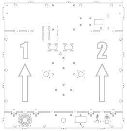

  *Back Panel.*

- 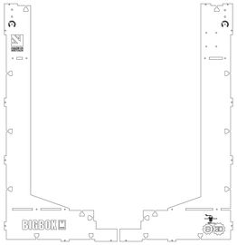

  *Front Panels.*

- 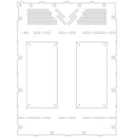

  *Left Panel.*

- 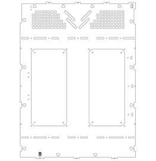

  *Right Panel.*

- 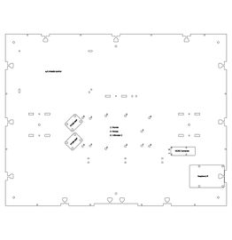

  *Base Panel.*

- 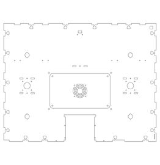

  *Lower Support.*

- 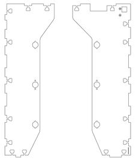

  *Upper Supports.*

- 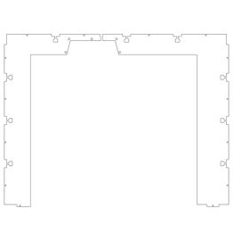

  *Top Panels.*

- 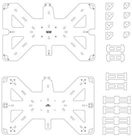

  *Heated Bed.*

- 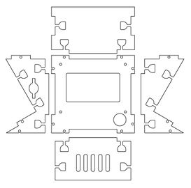

  *LCD Parts.*

- 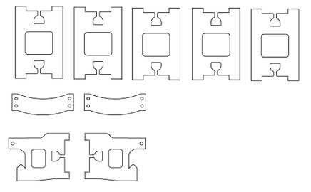

  *Miscellaneous.*

1 x Back Panel.

2 x Front Panels, left and right sides.

1 x Left Panel.

1 x Right Panel.

1 x Base Panel.

1 x Lower Support.

2 x Upper Supports, left & right sides.

18 x Heated Bed Parts, 1 x Top 1 x Bottom, 4 x Large Struts, 2 x Medium Struts, 2 x Small Struts, 4 x Corner Nut Traps, 4 x Corner Tops.

2 x Top Panels, left & right sides.

5 x LCD Parts, front, top, bottom, left (with SD Card Slot) & right.

9 x Miscellaneous parts, 5 x Base Struts, 2 x Spool Holder Brackets, 2 x Ooze Bucket Brackets.

## Electronics

Rumba with fitted Stepper Drivers. 4x for Pro & Lite and 5x for Dual.

PT100 Amplifier board, two PT100 boards for Dual.

IR Sensor Probe for Z-Axis.

24v Variable-Power-Density Heated Bed.

A/C PSU 400W.

## Fans

1 x 24v 60x60x10 Exhaust Fan.

1 x 24v 40x40x20 Blower Print Fan, 2 x for Dual.

1 x 24v 30x30x10 HotEnd Fan, 2 x for Dual.

1 x 12v 50x50x10 Electronics Fan.

## Motors

3 x 400-Step Stepper Motors (4 x for Dual), X-Axis, Y-Axis, Extruder(s).

2 x 200-Step Stepper Motors, Z-Axis.

## Rods

- 1 x 532mm - Y-Axis Rear-Bar.
- 2 x 484mm - X-Axis.
- 2 x 384mm - Y-Axis.
- 4 x 364mm - Z-Axis.
- 2 x 325mm Spool Carrier (4 included for the BigBox Dual).

## Bearings

## E3D HotEnd(s)

V6 Heatsink.

V6 Heatbreak.

V6 Block.

V6 0.4mm Nozzle.

V6 Fan Duct.

PT100 with 1700mm leads.

24v Heater Cartridge with 1700mm leads.

Plastic Bowden Clip, single part.

Embedded Plastic Bowden Coupler, two parts.

## Wiring

## Printed Parts

*This list is not from the wiki page, which left it empty. It is compiled from the parts lists in the [exploded drawings PDF](../docs/files/EXPLODED_DRAWINGS.pdf) (EXPLODED_DRAWINGS.pdf, sheets 1 to 29) and the drawing images on the wiki. Each row links to the drawing, with its sheet number in the PDF. Sheets marked (image) exist only as pictures on the wiki; they were read by OCR and checked by a person, or entered by hand from the drawing and the manual where the drawing has no parts list.*

| Part | Qty | Source | Drawing | Build section |
| --- | --- | --- | --- | --- |
| Y-AXIS REAR (L) | 1 | printed | [y-axis rear](../docs/images/Y-AXIS_REAR.jpg) (sheet 1) | [(1) Y-Axis Rear Brackets (Left & Right)](BigBox_Parts_Preparation.md#1-y-axis-rear-brackets-left--right) |
| Y-AXIS REAR (L&R) BEARING RETAINER | 1 | printed | [y-axis rear](../docs/images/Y-AXIS_REAR.jpg) (sheet 1) | [(1) Y-Axis Rear Brackets (Left & Right)](BigBox_Parts_Preparation.md#1-y-axis-rear-brackets-left--right) |
| Y-AXIS BACK (L) CORK (Self Adhesive) | 1 | from the Printed Parts Box | [y-axis rear](../docs/images/Y-AXIS_REAR.jpg) (sheet 1) | [(1) Y-Axis Rear Brackets (Left & Right)](BigBox_Parts_Preparation.md#1-y-axis-rear-brackets-left--right) |
| Y-AXIS FRONT (R) | 1 | printed | [y-axis front](../docs/images/Y-AXIS_FRONT.jpg) (sheet 2) | [(2) Y-Axis Front Brackets (Left & Right)](BigBox_Parts_Preparation.md#2-y-axis-front-brackets-left--right) |
| Y-AXIS FRONT CORK (L & R) (Self Adhesive) | 1 | from the Printed Parts Box | [y-axis front](../docs/images/Y-AXIS_FRONT.jpg) (sheet 2) | [(2) Y-Axis Front Brackets (Left & Right)](BigBox_Parts_Preparation.md#2-y-axis-front-brackets-left--right) |
| Y-AXIS BELT TENSIONER | 1 | printed | [y-axis idler](../docs/images/Y-AXIS_IDLER.jpg) (sheet 3) | [(3) Y-Axis Belt Idlers](BigBox_Parts_Preparation.md#3-y-axis-belt-idlers) |
| E-AXIS IDLER | 1 | printed | [extruder idler](../docs/images/EXTRUDER_IDLER.jpg) (sheet 4) | [Non-Titan Idler Arms](Non-Titan_Idler_Arms.md) |
| X-AXIS IDLER CARRIAGE | 1 | printed | [x-axis idler carriage](../docs/images/X-AXIS_IDLER_CARRIAGE.jpg) (sheet 5) | [(5) X-Axis Idler Carriage](BigBox_Parts_Preparation.md#5-x-axis-idler-carriage) |
| X-AXIS MOTOR CARRIAGE | 1 | printed | [x-axis motor carriage](../docs/images/X-AXIS_MOTOR_CARRIAGE.jpg) (sheet 6) | [(6) X-Axis Motor Mount](BigBox_Parts_Preparation.md#6-x-axis-motor-mount) |
| X-CARRIAGE SINGLE | 1 | printed | [x-carriage single](../docs/images/X-CARRIAGE_SINGLE.jpg) (sheet 7) | [Pro & Lite X-Carriage](Pro_%26_Lite_X-Carriage.md) |
| HEATED BED CORNERS | 1 | printed | [heated bed corners](../docs/images/HEATED_BED_CORNERS.jpg) (sheet 9) | [(10) Heated Bed Corners](BigBox_Parts_Preparation.md#10-heated-bed-corners) |
| SPOOL-HOLDER OUTER (L) | 1 | printed | [spool-holder outer](../docs/images/SPOOL-HOLDER_OUTER.jpg) (sheet 10) | [(11) Outer Spools Rear (Left & Right)](BigBox_Parts_Preparation.md#11-outer-spools-rear-left--right) |
| SPOOL-HOLDER INNER | 1 | printed | [spool-holder inner](../docs/images/SPOOL-HOLDER_INNER.jpg) (sheet 11) | [(12) Spool Holder Outer Fronts](BigBox_Parts_Preparation.md#12-spool-holder-outer-fronts) |
| PRINT FAN BRACKET | 1 | printed | [print fan duct](../docs/images/PRINT_FAN_DUCT.jpg) (sheet 12) | [Print Cooling Fan](Print_Cooling_Fan.md) |
| PRINT FAN DUCT | 1 | printed | [print fan duct](../docs/images/PRINT_FAN_DUCT.jpg) (sheet 12) | [Print Cooling Fan](Print_Cooling_Fan.md) |
| IR-SENSOR HOUSING | 1 | printed | [ir sensor assembly](../docs/images/IR_SENSOR_ASSEMBLY.jpg) (sheet 13) | [Single & Dual Direct-Drive IR Sensor Bracket](Single_%26_Dual_Direct-Drive_IR_Sensor_Bracket.md) |
| EXTRUDER BODY (SINGLE) | 1 | printed | [extruder single](../docs/images/EXTRUDER_SINGLE.jpg) (sheet 14) | [Single Direct-Drive Extruder](Single_Direct-Drive_Extruder.md) |
| EXTRUDER CABLE BRACKET | 1 | printed | [extruder single](../docs/images/EXTRUDER_SINGLE.jpg) (sheet 14) | [Single Direct-Drive Extruder](Single_Direct-Drive_Extruder.md) |
| X-AXIS CARRIAGE BEARING CLAMP | 2 | printed | [sheet 22 of the PDF](../docs/files/EXPLODED_DRAWINGS.pdf#page=22) | – |
| X-AXIS BELT-TENSIONER | 1 | printed | [sheet 22 of the PDF](../docs/files/EXPLODED_DRAWINGS.pdf#page=22) | – |
| SPINE-LARGE | 1 | printed | [spine](../docs/images/SPINE.jpg) (sheet 24) | [(16) Cable Spine](Printer_main_assemblies_Step_By_Step_Assembly_Process.md#16-cable-spine) |
| SPINE-MED | 2 | printed | [spine](../docs/images/SPINE.jpg) (sheet 24) | [(16) Cable Spine](Printer_main_assemblies_Step_By_Step_Assembly_Process.md#16-cable-spine) |
| SPINE-SMALL | 2 | printed | [spine](../docs/images/SPINE.jpg) (sheet 24) | [(16) Cable Spine](Printer_main_assemblies_Step_By_Step_Assembly_Process.md#16-cable-spine) |
| SPINE-Y | 2 | printed | [spine](../docs/images/SPINE.jpg) (sheet 24) | [(16) Cable Spine](Printer_main_assemblies_Step_By_Step_Assembly_Process.md#16-cable-spine) |
| Y-AXIS MOTOR MOUNT | 1 | printed | [y-axis motor](../docs/images/Y-AXIS_MOTOR.jpg) (sheet 27) | [(14) Y-Axis Motor Mount](BigBox_Parts_Preparation.md#14-y-axis-motor-mount) |
| Y-MOTOR MOUNT CORK (Self Adhesive) | 1 | from the Printed Parts Box | [y-axis motor](../docs/images/Y-AXIS_MOTOR.jpg) (sheet 27) | [(14) Y-Axis Motor Mount](BigBox_Parts_Preparation.md#14-y-axis-motor-mount) |
| ELECTRONICS-COVER-BRACKET | 4 | printed | [electronics cover](../docs/images/ELECTRONICS_COVER.jpg) (sheet 28) | [(8) Electronics Cover](BigBox_Printer_Sub-assemblies.md#8-electronics-cover) |
| RRB-CABLE-CONDUIT | 3 | printed | [rear-right-back cable conduit](../docs/images/REAR-RIGHT-BACK_CABLE_CONDUIT.jpg) (sheet 29) | [(12) X-Axis Cable Conduits](Printer_main_assemblies_Step_By_Step_Assembly_Process.md#12-x-axis-cable-conduits) |
| DOCK-BRACKET | 1 | printed | [dock-bracket (image)](../docs/images/DOCK-BRACKET.jpg) | [(14) Frame Top](Printer_main_assemblies_Step_By_Step_Assembly_Process.md#14-frame-top) |
| EXTRUDER BODY (DUAL) | 1 | printed | [extruder dual (image)](../docs/images/EXTRUDER_DUAL.jpg) | [Dual Direct-Drive Extruders](Dual_Direct-Drive_Extruders.md) |
| E-AXIS CABLE BRACKET (DUAL)(R) | 1 | printed | [extruder dual (image)](../docs/images/EXTRUDER_DUAL.jpg) | [Dual Direct-Drive Extruders](Dual_Direct-Drive_Extruders.md) |
| E-AXIS CABLE BRACKET (DUAL)(L) | 1 | printed | [extruder dual (image)](../docs/images/EXTRUDER_DUAL.jpg) | [Dual Direct-Drive Extruders](Dual_Direct-Drive_Extruders.md) |
| E-AXIS CARRIAGE TOP HYBRID NON-TITAN DIRECT GUIDE | 1 | printed | [extruder hybrid non-titan direct (image)](../docs/images/EXTRUDER_HYBRID_NON-TITAN_DIRECT.jpg) | [(5) Hybrid Non-Titan Extruder (Direct)](BigBox_Printer_Sub-assemblies.md#5-hybrid-non-titan-extruder-direct) |
| E-AXIS CARRIAGE TOP HYBRID NON-TITAN DIRECT LEVER | 1 | printed | [extruder hybrid non-titan direct (image)](../docs/images/EXTRUDER_HYBRID_NON-TITAN_DIRECT.jpg) | [(5) Hybrid Non-Titan Extruder (Direct)](BigBox_Printer_Sub-assemblies.md#5-hybrid-non-titan-extruder-direct) |
| E-AXIS CARRIAGE TOP HYBRID NON-TITAN DIRECT BODY | 1 | printed | [extruder hybrid non-titan direct (image)](../docs/images/EXTRUDER_HYBRID_NON-TITAN_DIRECT.jpg) | [(5) Hybrid Non-Titan Extruder (Direct)](BigBox_Printer_Sub-assemblies.md#5-hybrid-non-titan-extruder-direct) |
| E-AXIS CARRIAGE TOP HYBRID TITAN DIRECT | 1 | printed | [extruder hybrid titan direct (image)](../docs/images/EXTRUDER_HYBRID_TITAN_DIRECT.jpg) | [(3) Hybrid Titan Extruder (Direct)](BigBox_Printer_Sub-assemblies.md#3-hybrid-titan-extruder-direct) |
| BB_FRAME_M3_NUT_TRAP-1 | ~150 | printed | [frame-lug drawing (image)](../docs/images/FRAME-LUG_DRAWING.jpg) | [(13.1) A Note on Nut-Traps](BigBox_Printer_Sub-assemblies.md#131-a-note-on-nut-traps) |
| SPOOL-HOLDER CLAMP INNER | 1 | printed | [spool-holder clamp (image)](../docs/images/SPOOL-HOLDER_CLAMP.jpg) | [(17) Spool Carrier Clamp](BigBox_Parts_Preparation.md#17-spool-carrier-clamp) |
| SPOOL-HOLDER CLAMP OUTER | 1 | printed | [spool-holder clamp (image)](../docs/images/SPOOL-HOLDER_CLAMP.jpg) | [(17) Spool Carrier Clamp](BigBox_Parts_Preparation.md#17-spool-carrier-clamp) |
| Z-AXIS BASE BRACKET LOWER | 1 | printed | [z-axis base brackets (image)](../docs/images/Z-AXIS_BASE_BRACKETS.jpg) | [(17.5) Z-Axis Lower Rod Brackets](Printer_main_assemblies_Step_By_Step_Assembly_Process.md#175-z-axis-lower-rod-brackets) |
| Z-AXIS BASE BRACKET UPPER | 1 | printed | [z-axis base brackets (image)](../docs/images/Z-AXIS_BASE_BRACKETS.jpg) | [(17.5) Z-Axis Lower Rod Brackets](Printer_main_assemblies_Step_By_Step_Assembly_Process.md#175-z-axis-lower-rod-brackets) |
| Z-AXIS DRAG-CHAIN ANCHOR BASE | 1 | printed | [z-axis drag chain (image)](../docs/images/Z-AXIS_DRAG_CHAIN.jpg) | [(18) Z-Axis Drag Chain Anchors](BigBox_Parts_Preparation.md#18-z-axis-drag-chain-anchors) |
| Z-AXIS DRAG-CHAIN ANCHOR BED | 1 | printed | [z-axis drag chain (image)](../docs/images/Z-AXIS_DRAG_CHAIN.jpg) | [(18) Z-Axis Drag Chain Anchors](BigBox_Parts_Preparation.md#18-z-axis-drag-chain-anchors) |
| Z-AXIS TOP BOTTOM | 1 | printed | [z-axis top brackets (image)](../docs/images/Z-AXIS_TOP_BRACKETS.jpg) | [(32.2) Z Bed](Printer_main_assemblies_Step_By_Step_Assembly_Process.md#322-z-bed) |
| Z-AXIS TOP TOP | 1 | printed | [z-axis top brackets (image)](../docs/images/Z-AXIS_TOP_BRACKETS.jpg) | [(32.2) Z Bed](Printer_main_assemblies_Step_By_Step_Assembly_Process.md#322-z-bed) |
| Z-AXIS TOP CAP | 1 | printed | [z-axis top brackets (image)](../docs/images/Z-AXIS_TOP_BRACKETS.jpg) | [(32.2) Z Bed](Printer_main_assemblies_Step_By_Step_Assembly_Process.md#322-z-bed) |

## Fixings

*This list is not from the wiki page, which left it empty. It is compiled from the parts lists in the [exploded drawings PDF](../docs/files/EXPLODED_DRAWINGS.pdf) (EXPLODED_DRAWINGS.pdf, sheets 1 to 29) and the drawing images on the wiki. Each row links to the drawing, with its sheet number in the PDF. Sheets marked (image) exist only as pictures on the wiki; they were read by OCR and checked by a person, or entered by hand from the drawing and the manual where the drawing has no parts list.*

| Fixings bag | Fixing | Drawings |
| --- | --- | --- |
| Fixings Bag 2 | M3 Microbarb Nut (Brass) | [electronics cover](../docs/images/ELECTRONICS_COVER.jpg) (sheet 28), [dock-bracket (image)](../docs/images/DOCK-BRACKET.jpg) |
| Fixings Bag 2 | M3 x 8 Csk Platite 30 Screws | [x-axis motor carriage](../docs/images/X-AXIS_MOTOR_CARRIAGE.jpg) (sheet 6), [z-axis drag chain (image)](../docs/images/Z-AXIS_DRAG_CHAIN.jpg) |
| Fixings Bag 3 | M3 Hex Nut | [x-axis motor carriage](../docs/images/X-AXIS_MOTOR_CARRIAGE.jpg) (sheet 6), [rear-right-back cable conduit](../docs/images/REAR-RIGHT-BACK_CABLE_CONDUIT.jpg) (sheet 29), [extruder hybrid non-titan direct (image)](../docs/images/EXTRUDER_HYBRID_NON-TITAN_DIRECT.jpg), [extruder hybrid titan direct (image)](../docs/images/EXTRUDER_HYBRID_TITAN_DIRECT.jpg) |
| Fixings Bag 4 | M2.5 Square Nut | [ir sensor assembly](../docs/images/IR_SENSOR_ASSEMBLY.jpg) (sheet 13) |
| Fixings Bag 5 | M2.5 x 6 Socket Cap Screw | [ir sensor assembly](../docs/images/IR_SENSOR_ASSEMBLY.jpg) (sheet 13) |
| Fixings Bag 5 | M3 Hex Nut (Half) | [spine](../docs/images/SPINE.jpg) (sheet 24), [mount spool-holder outer](../docs/images/MOUNT_SPOOL-HOLDER_OUTER.jpg) (sheet 25), [electronics cover](../docs/images/ELECTRONICS_COVER.jpg) (sheet 28), [z-axis base brackets (image)](../docs/images/Z-AXIS_BASE_BRACKETS.jpg), [z-axis top brackets (image)](../docs/images/Z-AXIS_TOP_BRACKETS.jpg) |
| Fixings Bag 6 | M3 Ext Lock Washer | [y-axis rear](../docs/images/Y-AXIS_REAR.jpg) (sheet 1), [y-axis front](../docs/images/Y-AXIS_FRONT.jpg) (sheet 2), [x-axis idler carriage](../docs/images/X-AXIS_IDLER_CARRIAGE.jpg) (sheet 5), [x-axis motor carriage](../docs/images/X-AXIS_MOTOR_CARRIAGE.jpg) (sheet 6), [x-axis motor install](../docs/images/X-AXIS_MOTOR_INSTALL.jpg) (sheet 21), [y-axis motor](../docs/images/Y-AXIS_MOTOR.jpg) (sheet 27) |
| Fixings Bag 6 | M3 Square Nut | [y-axis rear](../docs/images/Y-AXIS_REAR.jpg) (sheet 1), [y-axis front](../docs/images/Y-AXIS_FRONT.jpg) (sheet 2), [x-axis idler carriage](../docs/images/X-AXIS_IDLER_CARRIAGE.jpg) (sheet 5), [x-axis motor carriage](../docs/images/X-AXIS_MOTOR_CARRIAGE.jpg) (sheet 6), [x-carriage single](../docs/images/X-CARRIAGE_SINGLE.jpg) (sheet 7), [heated bed corners](../docs/images/HEATED_BED_CORNERS.jpg) (sheet 9), [spool-holder outer](../docs/images/SPOOL-HOLDER_OUTER.jpg) (sheet 10), [print fan duct](../docs/images/PRINT_FAN_DUCT.jpg) (sheet 12), [ir sensor assembly](../docs/images/IR_SENSOR_ASSEMBLY.jpg) (sheet 13), [sheet 22 of the PDF](../docs/files/EXPLODED_DRAWINGS.pdf#page=22) |
| Fixings Bag 7 | M3 x 25 Socket Cap Screw | [x-axis idler carriage](../docs/images/X-AXIS_IDLER_CARRIAGE.jpg) (sheet 5), [extruder single](../docs/images/EXTRUDER_SINGLE.jpg) (sheet 14), [rear-right-back cable conduit](../docs/images/REAR-RIGHT-BACK_CABLE_CONDUIT.jpg) (sheet 29), [extruder dual (image)](../docs/images/EXTRUDER_DUAL.jpg), [extruder hybrid non-titan direct (image)](../docs/images/EXTRUDER_HYBRID_NON-TITAN_DIRECT.jpg) |
| Fixings Bag 8 | M3 x 10 Socket Cap Screw | [x-axis idler carriage](../docs/images/X-AXIS_IDLER_CARRIAGE.jpg) (sheet 5), [x-axis motor carriage](../docs/images/X-AXIS_MOTOR_CARRIAGE.jpg) (sheet 6), [extruder single](../docs/images/EXTRUDER_SINGLE.jpg) (sheet 14), [x-axis motor install](../docs/images/X-AXIS_MOTOR_INSTALL.jpg) (sheet 21), [sheet 22 of the PDF](../docs/files/EXPLODED_DRAWINGS.pdf#page=22), [y-axis motor](../docs/images/Y-AXIS_MOTOR.jpg) (sheet 27), [electronics cover](../docs/images/ELECTRONICS_COVER.jpg) (sheet 28), [dock-bracket (image)](../docs/images/DOCK-BRACKET.jpg), [extruder dual (image)](../docs/images/EXTRUDER_DUAL.jpg), [extruder hybrid non-titan direct (image)](../docs/images/EXTRUDER_HYBRID_NON-TITAN_DIRECT.jpg) |
| Fixings Bag 8 | M3 x 18 Socket Cap Screw | [y-axis front](../docs/images/Y-AXIS_FRONT.jpg) (sheet 2), [sheet 22 of the PDF](../docs/files/EXPLODED_DRAWINGS.pdf#page=22) |
| Fixings Bag 9 | M3 x 12 Socket Cap Screw | [y-axis rear](../docs/images/Y-AXIS_REAR.jpg) (sheet 1), [x-axis idler carriage](../docs/images/X-AXIS_IDLER_CARRIAGE.jpg) (sheet 5), [heated bed corners](../docs/images/HEATED_BED_CORNERS.jpg) (sheet 9), [ir sensor assembly](../docs/images/IR_SENSOR_ASSEMBLY.jpg) (sheet 13), [z-axis base brackets (image)](../docs/images/Z-AXIS_BASE_BRACKETS.jpg), [z-axis top brackets (image)](../docs/images/Z-AXIS_TOP_BRACKETS.jpg) |
| Fixings Bag 9 | M3 x 20 Socket Cap Screw | [spine](../docs/images/SPINE.jpg) (sheet 24), [mount spool-holder outer](../docs/images/MOUNT_SPOOL-HOLDER_OUTER.jpg) (sheet 25), [electronics cover](../docs/images/ELECTRONICS_COVER.jpg) (sheet 28) |
| Fixings Bag 10 | M3 x 16 Socket Cap Screw | [y-axis rear](../docs/images/Y-AXIS_REAR.jpg) (sheet 1), [x-axis motor carriage](../docs/images/X-AXIS_MOTOR_CARRIAGE.jpg) (sheet 6), [spool-holder outer](../docs/images/SPOOL-HOLDER_OUTER.jpg) (sheet 10) |
| Fixings Bag 10 | M3 x 30 Socket Cap Screw | [print fan duct](../docs/images/PRINT_FAN_DUCT.jpg) (sheet 12), [extruder hybrid non-titan direct (image)](../docs/images/EXTRUDER_HYBRID_NON-TITAN_DIRECT.jpg) |
| Fixings Bag 11 | M3 x 22 Socket Cap Screw | [print fan duct](../docs/images/PRINT_FAN_DUCT.jpg) (sheet 12) |
| Fixings Bag 11 | M3 x 35 Socket Cap Screw | [extruder single](../docs/images/EXTRUDER_SINGLE.jpg) (sheet 14) |
| Fixings Kit 11 | M4 Hex Nut (Half) | [spine](../docs/images/SPINE.jpg) (sheet 24) |
| Fixings Bag 12 | M4 Ext Lock Washer | [y-axis idler](../docs/images/Y-AXIS_IDLER.jpg) (sheet 3), [x-axis idler carriage](../docs/images/X-AXIS_IDLER_CARRIAGE.jpg) (sheet 5), [mount y-axis motor](../docs/images/MOUNT_Y-AXIS_MOTOR.jpg) (sheet 23) |
| Fixings Bag 12 | M4 Square Nut | [y-axis rear](../docs/images/Y-AXIS_REAR.jpg) (sheet 1), [y-axis front](../docs/images/Y-AXIS_FRONT.jpg) (sheet 2), [y-axis idler](../docs/images/Y-AXIS_IDLER.jpg) (sheet 3), [x-axis idler carriage](../docs/images/X-AXIS_IDLER_CARRIAGE.jpg) (sheet 5), [x-carriage single](../docs/images/X-CARRIAGE_SINGLE.jpg) (sheet 7), [spool-holder outer](../docs/images/SPOOL-HOLDER_OUTER.jpg) (sheet 10), [spool-holder inner](../docs/images/SPOOL-HOLDER_INNER.jpg) (sheet 11), [extruder single](../docs/images/EXTRUDER_SINGLE.jpg) (sheet 14), [y-axis motor](../docs/images/Y-AXIS_MOTOR.jpg) (sheet 27), [extruder dual (image)](../docs/images/EXTRUDER_DUAL.jpg), [extruder hybrid non-titan direct (image)](../docs/images/EXTRUDER_HYBRID_NON-TITAN_DIRECT.jpg), [spool-holder clamp (image)](../docs/images/SPOOL-HOLDER_CLAMP.jpg) |
| Fixings Bag 13 | M4 Washer | [y-axis idler](../docs/images/Y-AXIS_IDLER.jpg) (sheet 3), [extruder idler](../docs/images/EXTRUDER_IDLER.jpg) (sheet 4), [x-axis idler carriage](../docs/images/X-AXIS_IDLER_CARRIAGE.jpg) (sheet 5), [spool-holder outer](../docs/images/SPOOL-HOLDER_OUTER.jpg) (sheet 10), [extruder single](../docs/images/EXTRUDER_SINGLE.jpg) (sheet 14), [mount spool-holder outer](../docs/images/MOUNT_SPOOL-HOLDER_OUTER.jpg) (sheet 25), [extruder dual (image)](../docs/images/EXTRUDER_DUAL.jpg), [extruder hybrid non-titan direct (image)](../docs/images/EXTRUDER_HYBRID_NON-TITAN_DIRECT.jpg), [spool-holder clamp (image)](../docs/images/SPOOL-HOLDER_CLAMP.jpg) |
| Fixings Bag 13 | M4 x 20 Socket Grub Screw (Flat Point) | [y-axis idler](../docs/images/Y-AXIS_IDLER.jpg) (sheet 3) |
| Fixings Kit Bag 13 | M4 x 8 Skt Grub Screw Flat Point | [sheet 22 of the PDF](../docs/files/EXPLODED_DRAWINGS.pdf#page=22) |
| Fixings Bag 13 | Nylon Washer 8 x 16 x 1.6 | [y-axis rear assembly](../docs/images/Y-AXIS_REAR_ASSEMBLY.jpg) (sheet 18) |
| Fixings Bag 14 | M4 x 12 Socket Grub Screw (Flat Point) | [extruder idler](../docs/images/EXTRUDER_IDLER.jpg) (sheet 4) |
| Fixings Bag 14 | M4 x 16 Socket Cap Screw | [spine](../docs/images/SPINE.jpg) (sheet 24) |
| Fixings Bag 15 | M3 x 8 Socket Cap Screw | [print fan duct](../docs/images/PRINT_FAN_DUCT.jpg) (sheet 12) |
| Fixings Bag 16 | Nylon Spacer 3.2ID 6OD 15L | [extruder idler](../docs/images/EXTRUDER_IDLER.jpg) (sheet 4), [extruder hybrid non-titan direct (image)](../docs/images/EXTRUDER_HYBRID_NON-TITAN_DIRECT.jpg) |
| Fixings Bag 17 | M3 x 3 Skt Grub Screw Knurled Point | [extruder single](../docs/images/EXTRUDER_SINGLE.jpg) (sheet 14), [extruder dual (image)](../docs/images/EXTRUDER_DUAL.jpg), [extruder hybrid non-titan direct (image)](../docs/images/EXTRUDER_HYBRID_NON-TITAN_DIRECT.jpg) |
| Fixings Bag 17 | M4 x 20 Socket Cap Screw | [y-axis idler](../docs/images/Y-AXIS_IDLER.jpg) (sheet 3), [x-carriage single](../docs/images/X-CARRIAGE_SINGLE.jpg) (sheet 7), [spool-holder outer](../docs/images/SPOOL-HOLDER_OUTER.jpg) (sheet 10), [spool-holder inner](../docs/images/SPOOL-HOLDER_INNER.jpg) (sheet 11), [mount y-axis motor](../docs/images/MOUNT_Y-AXIS_MOTOR.jpg) (sheet 23) |
| Fixings Bag 17 | M4 x 30 Socket Cap Screw | [x-axis idler carriage](../docs/images/X-AXIS_IDLER_CARRIAGE.jpg) (sheet 5), [extruder single](../docs/images/EXTRUDER_SINGLE.jpg) (sheet 14), [extruder dual (image)](../docs/images/EXTRUDER_DUAL.jpg), [extruder hybrid non-titan direct (image)](../docs/images/EXTRUDER_HYBRID_NON-TITAN_DIRECT.jpg), [spool-holder clamp (image)](../docs/images/SPOOL-HOLDER_CLAMP.jpg) |

Fixing List pdf \| `https://dl.dropboxusercontent.com/u/54348751/BigBox_Fixings.pdf` *(dead link)*

## OctoPrint Upgrade Extras

Raspberry Pi 2 & 8GB MicroSD Card.

DC/DC Converter.

75cm 15-Pin Flat Flexible Cable (FFC).

50cm USB A to Mini B Cable.

10cm USB A To Micro B Cable.

35cm Rumba to DC/DC Converter Cable.

## Where next?

Return to the [BigBox Pre-Build](BigBox_Pre-Build.md "BigBox Pre-Build")

Home to the [BigBox Build Manual Main Index](BigBox_Build_Manual.md "BigBox Build Manual")
