# Bill Of Materials

Archived 20210416002713 · source: wiki.e3d-online.com/wiki/Bill_Of_Materials · [archive link](https://web.archive.org/web/20210416002713/https://wiki.e3d-online.com/Bill_Of_Materials)

**Contents**

- [Frame Components](#frame-components)
- [Electronics](#electronics)
- [Fans](#fans)
- [Motors](#motors)
- [Rods](#rods)
- [Bearings](#bearings)
- [E3D HotEnd(s)](#e3d-hotends)
- [Wiring](#wiring)
- [Printed Parts](#printed-parts)
- [General](#general)
- [Fixings](#fixings)
- [OctoPrint Upgrade Extras](#octoprint-upgrade-extras)
- [Where next?](#where-next)

## Frame Components

- 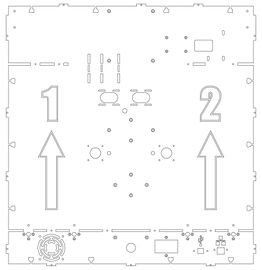

  *Back Panel.*

- 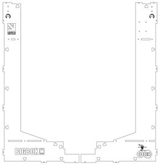

  *Front Panels.*

- 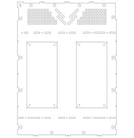

  *Left Panel.*

- 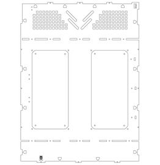

  *Right Panel.*

- 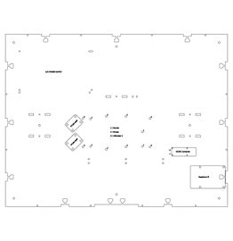

  *Base Panel.*

- 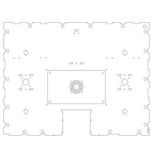

  *Lower Support.*

- 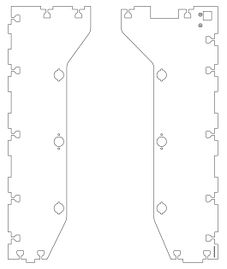

  *Upper Supports.*

- 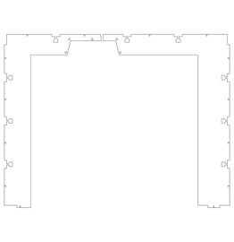

  *Top Panels.*

- 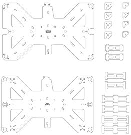

  *Heated Bed.*

- 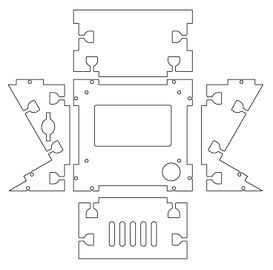

  *LCD Parts.*

- 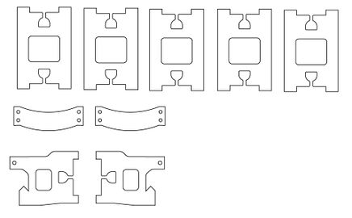

  *Miscellaneous.*

1 x Back Panel.

2 x Front Panels, left and right sides.

1 x Left Panel.

1 x Right Panel.

1 x Base Panel.

1 x Lower Support.

2 x Upper Supports, left & right sides.

18 x Heated Bed Parts, 1 x Top 1 x Bottom, 4 x Large Struts, 2 x Medium Struts, 2 x Small Struts, 4 x Corner Nut Traps, 4 x Corner Tops.

2 x Top Panels, left & right sides.

5 x LCD Parts, front, top, bottom, left (with SD Card Slot) & right.

9 x Miscellaneous parts, 5 x Base Struts, 2 x Spool Holder Brackets, 2 x Ooze Bucket Brackets.

## Electronics

Rumba with fitted Stepper Drivers. 4x for Pro & Lite and 5x for Dual.

PT100 Amplifier board, two PT100 boards for Dual.

IR Sensor Probe for Z-Axis.

24v Variable-Power-Density Heated Bed.

A/C PSU 400W.

## Fans

1 x 24v 60x60x10 Exhaust Fan.

1 x 24v 40x40x20 Blower Print Fan, 2 x for Dual.

1 x 24v 30x30x10 HotEnd Fan, 2 x for Dual.

1 x 12v 50x50x10 Electronics Fan.

## Motors

3 x 400-Step Stepper Motors (4 x for Dual), X-Axis, Y-Axis, Extruder(s).

2 x 200-Step Stepper Motors, Z-Axis.

## Rods

- 1 x 532mm - Y-Axis Rear-Bar.
- 2 x 484mm - X-Axis.
- 2 x 384mm - Y-Axis.
- 4 x 364mm - Z-Axis.
- 2 x 325mm Spool Carrier (4 included for the BigBox Dual).

## Bearings

## E3D HotEnd(s)

V6 Heatsink.

V6 Heatbreak.

V6 Block.

V6 0.4mm Nozzle.

V6 Fan Duct.

PT100 with 1700mm leads.

24v Heater Cartridge with 1700mm leads.

Plastic Bowden Clip, single part.

Embedded Plastic Bowden Coupler, two parts.

## Wiring

## Printed Parts

*This list is not from the wiki page, which left it empty. It is compiled from the parts lists in the [exploded drawings PDF](../docs/files/EXPLODED_DRAWINGS.pdf) (EXPLODED_DRAWINGS.pdf, sheets 1 to 29) and the drawing images on the wiki. Each row links to the drawing, with its sheet number in the PDF. [All the drawings are on one page.](Exploded_Drawings.md)*

*The STEP files were sourced from the BigBox design files listed on [Downloads](Downloads.md). SPOOL-HOLDER OUTER (R) was made by mirroring the (L) part; Y-AXIS REAR (R) is the mirror image of the (L) part.*

| Part | Qty | Drawing | Build section | STEP |
| --- | --- | --- | --- | --- |
| Y-AXIS REAR (L) | 1 | [y-axis rear](../docs/images/Y-AXIS_REAR.jpg) (sheet 1) | [(1) Y-Axis Rear Brackets (Left & Right)](BigBox_Parts_Preparation.md#1-y-axis-rear-brackets-left--right) | [STEP](../downloads/printed-parts/parts/Y-AXIS-REAR-L.step); [STEP (R, the mirror image)](../downloads/printed-parts/parts/Y-AXIS-REAR-R.step) |
| Y-AXIS REAR (L&R) BEARING RETAINER | 1 | [y-axis rear](../docs/images/Y-AXIS_REAR.jpg) (sheet 1) | [(1) Y-Axis Rear Brackets (Left & Right)](BigBox_Parts_Preparation.md#1-y-axis-rear-brackets-left--right) | [STEP](../downloads/printed-parts/parts/Y-AXIS-REAR-L-R-BEARING-RETAINER.step) |
| Y-AXIS FRONT (R) | 1 | [y-axis front](../docs/images/Y-AXIS_FRONT.jpg) (sheet 2) | [(2) Y-Axis Front Brackets (Left & Right)](BigBox_Parts_Preparation.md#2-y-axis-front-brackets-left--right) | [STEP](../downloads/printed-parts/parts/Y-AXIS-FRONT-R.step) |
| Y-AXIS BELT TENSIONER | 1 | [y-axis idler](../docs/images/Y-AXIS_IDLER.jpg) (sheet 3) | [(3) Y-Axis Belt Idlers](BigBox_Parts_Preparation.md#3-y-axis-belt-idlers) | [STEP](../downloads/printed-parts/parts/Y-AXIS-BELT-TENSIONER.step) |
| E-AXIS IDLER | 1 | [extruder idler](../docs/images/EXTRUDER_IDLER.jpg) (sheet 4) | [Non-Titan Idler Arms](Non-Titan_Idler_Arms.md) | [STEP](../downloads/printed-parts/parts/E-AXIS-IDLER.step) |
| X-AXIS IDLER CARRIAGE | 1 | [x-axis idler carriage](../docs/images/X-AXIS_IDLER_CARRIAGE.jpg) (sheet 5) | [(5) X-Axis Idler Carriage](BigBox_Parts_Preparation.md#5-x-axis-idler-carriage) | [STEP](../downloads/printed-parts/parts/X-AXIS-IDLER-CARRIAGE.step) |
| X-AXIS MOTOR CARRIAGE | 1 | [x-axis motor carriage](../docs/images/X-AXIS_MOTOR_CARRIAGE.jpg) (sheet 6) | [(6) X-Axis Motor Mount](BigBox_Parts_Preparation.md#6-x-axis-motor-mount) | [STEP](../downloads/printed-parts/parts/X-AXIS-MOTOR-CARRIAGE.step) |
| X-CARRIAGE SINGLE | 1 | [x-carriage single](../docs/images/X-CARRIAGE_SINGLE.jpg) (sheet 7) | [Pro & Lite X-Carriage](Pro_%26_Lite_X-Carriage.md) | [STEP](../downloads/printed-parts/parts/X-CARRIAGE-SINGLE.step) |
| HEATED BED CORNERS | 1 | [heated bed corners](../docs/images/HEATED_BED_CORNERS.jpg) (sheet 9) | [(10) Heated Bed Corners](BigBox_Parts_Preparation.md#10-heated-bed-corners) | [STEP](../downloads/printed-parts/parts/HEATED-BED-CORNERS.step) |
| SPOOL-HOLDER OUTER (L) | 1 | [spool-holder outer](../docs/images/SPOOL-HOLDER_OUTER.jpg) (sheet 10) | [(11) Outer Spools Rear (Left & Right)](BigBox_Parts_Preparation.md#11-outer-spools-rear-left--right) | [STEP](../downloads/printed-parts/parts/SPOOL-HOLDER-OUTER-L.step); [STEP (R, the mirror image)](../downloads/printed-parts/parts/SPOOL-HOLDER-OUTER-R.step) |
| SPOOL-HOLDER INNER | 1 | [spool-holder inner](../docs/images/SPOOL-HOLDER_INNER.jpg) (sheet 11) | [(12) Spool Holder Outer Fronts](BigBox_Parts_Preparation.md#12-spool-holder-outer-fronts) | [STEP](../downloads/printed-parts/parts/SPOOL-HOLDER-INNER.step) |
| PRINT FAN BRACKET | 1 | [print fan duct](../docs/images/PRINT_FAN_DUCT.jpg) (sheet 12) | [Print Cooling Fan](Print_Cooling_Fan.md) | [STEP](../downloads/printed-parts/parts/PRINT-FAN-BRACKET.step) |
| PRINT FAN DUCT | 1 | [print fan duct](../docs/images/PRINT_FAN_DUCT.jpg) (sheet 12) | [Print Cooling Fan](Print_Cooling_Fan.md) | [STEP](../downloads/printed-parts/parts/PRINT-FAN-DUCT.step) |
| IR-SENSOR HOUSING | 1 | [ir sensor assembly](../docs/images/IR_SENSOR_ASSEMBLY.jpg) (sheet 13) | [Single & Dual Direct-Drive IR Sensor Bracket](Single_%26_Dual_Direct-Drive_IR_Sensor_Bracket.md) | [STEP](../downloads/printed-parts/parts/IR-SENSOR-HOUSING.step) |
| EXTRUDER BODY (SINGLE) | 1 | [extruder single](../docs/images/EXTRUDER_SINGLE.jpg) (sheet 14) | [Single Direct-Drive Extruder](Single_Direct-Drive_Extruder.md) | [STEP](../downloads/printed-parts/parts/EXTRUDER-BODY-SINGLE.step) |
| EXTRUDER CABLE BRACKET | 1 | [extruder single](../docs/images/EXTRUDER_SINGLE.jpg) (sheet 14) | [Single Direct-Drive Extruder](Single_Direct-Drive_Extruder.md) | [STEP](../downloads/printed-parts/parts/EXTRUDER-CABLE-BRACKET.step) |
| X-AXIS CARRIAGE BEARING CLAMP | 2 | [x-carriage assembly](../docs/images/X-CARRIAGE_ASSEMBLY.jpg) (sheet 22) | – | [STEP](../downloads/printed-parts/parts/X-AXIS-CARRIAGE-BEARING-CLAMP__regular.step) |
| X-AXIS BELT-TENSIONER | 1 | [x-carriage assembly](../docs/images/X-CARRIAGE_ASSEMBLY.jpg) (sheet 22) | – | [STEP](../downloads/printed-parts/parts/X-AXIS-BELT-TENSIONER.step) |
| SPINE-LARGE | 1 | [spine](../docs/images/SPINE.jpg) (sheet 24) | [(16) Cable Spine](Printer_main_assemblies_Step_By_Step_Assembly_Process.md#16-cable-spine) | [STEP](../downloads/printed-parts/parts/SPINE-LARGE.step) |
| SPINE-MED | 2 | [spine](../docs/images/SPINE.jpg) (sheet 24) | [(16) Cable Spine](Printer_main_assemblies_Step_By_Step_Assembly_Process.md#16-cable-spine) | [STEP](../downloads/printed-parts/parts/SPINE-MED.step) |
| SPINE-SMALL | 2 | [spine](../docs/images/SPINE.jpg) (sheet 24) | [(16) Cable Spine](Printer_main_assemblies_Step_By_Step_Assembly_Process.md#16-cable-spine) | [STEP](../downloads/printed-parts/parts/SPINE-SMALL.step) |
| SPINE-Y | 2 | [spine](../docs/images/SPINE.jpg) (sheet 24) | [(16) Cable Spine](Printer_main_assemblies_Step_By_Step_Assembly_Process.md#16-cable-spine) | [STEP](../downloads/printed-parts/parts/SPINE-Y.step) |
| Y-AXIS MOTOR MOUNT | 1 | [y-axis motor](../docs/images/Y-AXIS_MOTOR.jpg) (sheet 27) | [(14) Y-Axis Motor Mount](BigBox_Parts_Preparation.md#14-y-axis-motor-mount) | [STEP](../downloads/printed-parts/parts/Y-AXIS-MOTOR-MOUNT.step) |
| ELECTRONICS-COVER-BRACKET | 4 | [electronics cover](../docs/images/ELECTRONICS_COVER.jpg) (sheet 28) | [(8) Electronics Cover](BigBox_Printer_Sub-assemblies.md#8-electronics-cover) | [STEP](../downloads/printed-parts/parts/ELECTRONICS-COVER-BRACKET.step) |
| RRB-CABLE-CONDUIT | 3 | [rear-right-back cable conduit](../docs/images/REAR-RIGHT-BACK_CABLE_CONDUIT.jpg) (sheet 29) | [(12) X-Axis Cable Conduits](Printer_main_assemblies_Step_By_Step_Assembly_Process.md#12-x-axis-cable-conduits) | [STEP](../downloads/printed-parts/parts/RRB-CABLE-CONDUIT.step) |
| DOCK-BRACKET | 1 | [dock-bracket (image)](../docs/images/DOCK-BRACKET.jpg) | [(14) Frame Top](Printer_main_assemblies_Step_By_Step_Assembly_Process.md#14-frame-top) | [STEP](../downloads/printed-parts/parts/DOCK-BRACKET.step) |
| EXTRUDER BODY (DUAL) | 1 | [extruder dual (image)](../docs/images/EXTRUDER_DUAL.jpg) | [Dual Direct-Drive Extruders](Dual_Direct-Drive_Extruders.md) | [STEP](../downloads/printed-parts/parts/EXTRUDER-BODY-DUAL.step) |
| E-AXIS CABLE BRACKET (DUAL)(R) | 1 | [extruder dual (image)](../docs/images/EXTRUDER_DUAL.jpg) | [Dual Direct-Drive Extruders](Dual_Direct-Drive_Extruders.md) | [STEP](../downloads/printed-parts/parts/E-AXIS-CABLE-BRACKET-DUAL-R.step) |
| E-AXIS CABLE BRACKET (DUAL)(L) | 1 | [extruder dual (image)](../docs/images/EXTRUDER_DUAL.jpg) | [Dual Direct-Drive Extruders](Dual_Direct-Drive_Extruders.md) | [STEP](../downloads/printed-parts/parts/E-AXIS-CABLE-BRACKET-DUAL-L.step) |
| E-AXIS CARRIAGE TOP HYBRID NON-TITAN DIRECT GUIDE | 1 | [extruder hybrid non-titan direct (image)](../docs/images/EXTRUDER_HYBRID_NON-TITAN_DIRECT.jpg) | [(5) Hybrid Non-Titan Extruder (Direct)](BigBox_Printer_Sub-assemblies.md#5-hybrid-non-titan-extruder-direct) | [STEP](../downloads/printed-parts/parts/E-AXIS-CARRIAGE-TOP-HYBRID-NON-TITAN-DIRECT-GUIDE.step) |
| E-AXIS CARRIAGE TOP HYBRID NON-TITAN DIRECT LEVER | 1 | [extruder hybrid non-titan direct (image)](../docs/images/EXTRUDER_HYBRID_NON-TITAN_DIRECT.jpg) | [(5) Hybrid Non-Titan Extruder (Direct)](BigBox_Printer_Sub-assemblies.md#5-hybrid-non-titan-extruder-direct) | [STEP](../downloads/printed-parts/parts/E-AXIS-CARRIAGE-TOP-HYBRID-NON-TITAN-DIRECT-LEVER.step) |
| E-AXIS CARRIAGE TOP HYBRID NON-TITAN DIRECT BODY | 1 | [extruder hybrid non-titan direct (image)](../docs/images/EXTRUDER_HYBRID_NON-TITAN_DIRECT.jpg) | [(5) Hybrid Non-Titan Extruder (Direct)](BigBox_Printer_Sub-assemblies.md#5-hybrid-non-titan-extruder-direct) | [STEP](../downloads/printed-parts/parts/E-AXIS-CARRIAGE-TOP-HYBRID-NON-TITAN-DIRECT-BODY.step) |
| E-AXIS CARRIAGE TOP HYBRID TITAN DIRECT | 1 | [extruder hybrid titan direct (image)](../docs/images/EXTRUDER_HYBRID_TITAN_DIRECT.jpg) | [(3) Hybrid Titan Extruder (Direct)](BigBox_Printer_Sub-assemblies.md#3-hybrid-titan-extruder-direct) | [STEP](../downloads/printed-parts/parts/E-AXIS-CARRIAGE-TOP-HYBRID-TITAN-DIRECT.step) |
| BB_FRAME_M3_NUT_TRAP-1 | ~150 | [frame-lug drawing (image)](../docs/images/FRAME-LUG_DRAWING.jpg) | [(13.1) A Note on Nut-Traps](BigBox_Printer_Sub-assemblies.md#131-a-note-on-nut-traps) | [STEP](../downloads/printed-parts/parts/BB-FRAME-M3-NUT-TRAP-1.step) |
| SPOOL-HOLDER CLAMP INNER | 1 | [spool-holder clamp (image)](../docs/images/SPOOL-HOLDER_CLAMP.jpg) | [(17) Spool Carrier Clamp](BigBox_Parts_Preparation.md#17-spool-carrier-clamp) | [STEP](../downloads/printed-parts/parts/SPOOL-HOLDER-CLAMP-INNER.step) |
| SPOOL-HOLDER CLAMP OUTER | 1 | [spool-holder clamp (image)](../docs/images/SPOOL-HOLDER_CLAMP.jpg) | [(17) Spool Carrier Clamp](BigBox_Parts_Preparation.md#17-spool-carrier-clamp) | [STEP](../downloads/printed-parts/parts/SPOOL-HOLDER-CLAMP-OUTER.step) |
| Z-AXIS BASE BRACKET LOWER | 1 | [z-axis base brackets (image)](../docs/images/Z-AXIS_BASE_BRACKETS.jpg) | [(17.5) Z-Axis Lower Rod Brackets](Printer_main_assemblies_Step_By_Step_Assembly_Process.md#175-z-axis-lower-rod-brackets) | [STEP](../downloads/printed-parts/parts/Z-AXIS-BASE-BRACKET-LOWER.step); [STEP (alternate, for the newer screw)](../downloads/printed-parts/parts/Z-AXIS-BASE-BRACKET-LOWER-4-hole.step) |
| Z-AXIS BASE BRACKET UPPER | 1 | [z-axis base brackets (image)](../docs/images/Z-AXIS_BASE_BRACKETS.jpg) | [(17.5) Z-Axis Lower Rod Brackets](Printer_main_assemblies_Step_By_Step_Assembly_Process.md#175-z-axis-lower-rod-brackets) | [STEP](../downloads/printed-parts/parts/Z-AXIS-BASE-BRACKET-UPPER.step); [STEP (alternate, for the newer screw)](../downloads/printed-parts/parts/Z-AXIS-BASE-BRACKET-UPPER-4-hole.step) |
| Z-AXIS DRAG-CHAIN ANCHOR BASE | 1 | [z-axis drag chain (image)](../docs/images/Z-AXIS_DRAG_CHAIN.jpg) | [(18) Z-Axis Drag Chain Anchors](BigBox_Parts_Preparation.md#18-z-axis-drag-chain-anchors) | [STEP](../downloads/printed-parts/parts/Z-AXIS-DRAG-CHAIN-ANCHOR-BASE.step) |
| Z-AXIS DRAG-CHAIN ANCHOR BED | 1 | [z-axis drag chain (image)](../docs/images/Z-AXIS_DRAG_CHAIN.jpg) | [(18) Z-Axis Drag Chain Anchors](BigBox_Parts_Preparation.md#18-z-axis-drag-chain-anchors) | [STEP](../downloads/printed-parts/parts/Z-AXIS-DRAG-CHAIN-ANCHOR-BED.step) |
| Z-AXIS TOP BOTTOM | 4 | [z-axis top brackets (image)](../docs/images/Z-AXIS_TOP_BRACKETS.jpg) | [(32.2) Z Bed](Printer_main_assemblies_Step_By_Step_Assembly_Process.md#322-z-bed) | [STEP](../downloads/printed-parts/parts/Z-AXIS-TOP-BOTTOM.step) |
| Z-AXIS TOP TOP | 4 | [z-axis top brackets (image)](../docs/images/Z-AXIS_TOP_BRACKETS.jpg) | [(32.2) Z Bed](Printer_main_assemblies_Step_By_Step_Assembly_Process.md#322-z-bed) | [STEP](../downloads/printed-parts/parts/Z-AXIS-TOP-TOP.step) |
| Z-AXIS TOP CAP | 4 | [z-axis top brackets (image)](../docs/images/Z-AXIS_TOP_BRACKETS.jpg) | [(32.2) Z Bed](Printer_main_assemblies_Step_By_Step_Assembly_Process.md#322-z-bed) | [STEP](../downloads/printed-parts/parts/Z-AXIS-TOP-CAP.step) |
| Hybrid X-Carriage | 1 | – | [(9) Hybrid X-Carriage](BigBox_Parts_Preparation.md#9-hybrid-x-carriage) | [STEP](../downloads/printed-parts/parts/Hybrid-X-Carriage.step) |
| Hybrid X-Carriage Rear Bearing Clamp | 1 | – | [(9) Hybrid X-Carriage](BigBox_Parts_Preparation.md#9-hybrid-x-carriage); [(8) Hybrid X-Carriage](Printer_main_assemblies_Step_By_Step_Assembly_Process.md#8-hybrid-x-carriage) | [STEP](../downloads/printed-parts/parts/Hybrid-X-Carriage-Rear-Bearing-Clamp.step) |
| Drive Supports | 2 | – | [(10) Z-Axis Bed Assembly](BigBox_Printer_Sub-assemblies.md#10-z-axis-bed-assembly) | [STEP](../downloads/printed-parts/parts/Drive-Supports.step) |
| Printed Feet | 8 | – | [(12.2) Feet](BigBox_Printer_Sub-assemblies.md#122-feet) | [STEP](../downloads/printed-parts/parts/Printed-Feet.step) |
| Z-Axis Driver Bottoms | 2 | – | [(1.4) Leadscrews](Printer_Commissioning.md#14-leadscrews) | [STEP](../downloads/printed-parts/parts/Z-Axis-Driver-Bottoms.step) |
| Z-Axis Driver Tops | 2 | – | [(1.4) Leadscrews](Printer_Commissioning.md#14-leadscrews) | [STEP](../downloads/printed-parts/parts/Z-Axis-Driver-Tops.step) |
| Hybrid X-Carriage Front Bearing Clamp | 1 | – | [(8) Hybrid X-Carriage](Printer_main_assemblies_Step_By_Step_Assembly_Process.md#8-hybrid-x-carriage) | [STEP](../downloads/printed-parts/parts/Hybrid-X-Carriage-Front-Bearing-Clamp.step) |
| Spool Inner Brackets | 2 | – | [(17.2) Spool Inner Brackets](Printer_main_assemblies_Step_By_Step_Assembly_Process.md#172-spool-inner-brackets) | [STEP](../downloads/printed-parts/parts/Spool-Inner-Brackets.step) |
| IEC Back Cover | 1 | – | [(17.6) A/C IEC Socket](Printer_main_assemblies_Step_By_Step_Assembly_Process.md#176-ac-iec-socket) | |
| Non-Titan Direct-Drive Bowden Main Block | 1 | – | [(21.11.2) Non-Titan Direct-Drive Bowden System](Printer_main_assemblies_Step_By_Step_Assembly_Process.md#21112-non-titan-direct-drive-bowden-system) | |
| Y-Axis Endstop | 1 | – | [(29) Y-Axis Frame Endstop](Printer_main_assemblies_Step_By_Step_Assembly_Process.md#29-y-axis-frame-endstop) | [STEP](../downloads/printed-parts/parts/Y-Axis-Endstop.step) |
| X-AXIS CARRIAGE BEARING CLAMP DUAL | 2 | – | [Dual Direct-Drive X-Carriage](Dual_Direct-Drive_X-Carriage.md) | [STEP](../downloads/printed-parts/parts/X-AXIS-CARRIAGE-BEARING-CLAMP__dual.step) |
| Bottom Camera Bracket | – | – | [(22) OctoPrint Upgrade Camera Install](Printer_main_assemblies_Step_By_Step_Assembly_Process.md#22-octoprint-upgrade-camera-install) | [STEP](../downloads/printed-parts/parts/Bottom-Camera-Bracket.step) |
| Camera Arm | – | – | [(22) OctoPrint Upgrade Camera Install](Printer_main_assemblies_Step_By_Step_Assembly_Process.md#22-octoprint-upgrade-camera-install) | [STEP](../downloads/printed-parts/parts/Camera-Arm.step) |
| Camera Mount | – | – | [(22) OctoPrint Upgrade Camera Install](Printer_main_assemblies_Step_By_Step_Assembly_Process.md#22-octoprint-upgrade-camera-install) | [STEP](../downloads/printed-parts/parts/Camera-Mount.step) |
| Drag Anchor Bracket | – | – | [(13) X-Axis Drag Chain](Printer_main_assemblies_Step_By_Step_Assembly_Process.md#13-x-axis-drag-chain) | [STEP](../downloads/printed-parts/parts/Drag-Anchor-Bracket.step) |
| Dual Dump Bucket | – | – | [(31) Ooze Wiper & Dump Bucket](Printer_main_assemblies_Step_By_Step_Assembly_Process.md#31-ooze-wiper--dump-bucket) | [STEP](../downloads/printed-parts/parts/Dual-Dump-Bucket.step) |
| Dual Ooze Wiper | – | – | [(31) Ooze Wiper & Dump Bucket](Printer_main_assemblies_Step_By_Step_Assembly_Process.md#31-ooze-wiper--dump-bucket) | [STEP](../downloads/printed-parts/parts/Dual-Ooze-Wiper.step) |
| Dump Bucket | – | – | [(31) Ooze Wiper & Dump Bucket](Printer_main_assemblies_Step_By_Step_Assembly_Process.md#31-ooze-wiper--dump-bucket) | [STEP](../downloads/printed-parts/parts/Dump-Bucket.step) |
| Fan Mount | – | – | [(13) Print Cooling Fan (v1.0)](BigBox_Parts_Preparation.md#13-print-cooling-fan-v10) | [STEP](../downloads/printed-parts/parts/Fan-Mount.step) |
| FFC Conduits | – | – | [(22) OctoPrint Upgrade Camera Install](Printer_main_assemblies_Step_By_Step_Assembly_Process.md#22-octoprint-upgrade-camera-install) | [STEP](../downloads/printed-parts/parts/FFC-Conduits.step) |
| Hybrid IR Sensor Bracket | – | – | [(16) Hybrid IR Sensor Bracket](BigBox_Parts_Preparation.md#16-hybrid-ir-sensor-bracket) | [STEP](../downloads/printed-parts/parts/Hybrid-IR-Sensor-Bracket.step) |
| Hybrid Ooze Wiper | – | – | [(31) Ooze Wiper & Dump Bucket](Printer_main_assemblies_Step_By_Step_Assembly_Process.md#31-ooze-wiper--dump-bucket) | [STEP](../downloads/printed-parts/parts/Hybrid-Ooze-Wiper.step) |
| Ooze Wiper | – | – | [(31) Ooze Wiper & Dump Bucket](Printer_main_assemblies_Step_By_Step_Assembly_Process.md#31-ooze-wiper--dump-bucket) | [STEP](../downloads/printed-parts/parts/Ooze-Wiper.step) |
| SPINE-VERTICAL | – | – | [(16) Cable Spine](Printer_main_assemblies_Step_By_Step_Assembly_Process.md#16-cable-spine) | [STEP](../downloads/printed-parts/parts/SPINE-VERTICAL.step) |
| Top Camera Bracket | – | – | [(22) OctoPrint Upgrade Camera Install](Printer_main_assemblies_Step_By_Step_Assembly_Process.md#22-octoprint-upgrade-camera-install) | [STEP](../downloads/printed-parts/parts/Top-Camera-Bracket.step) |
| X-CARRIAGE DUAL | – | – | [(8) Dual X-Carriage](BigBox_Parts_Preparation.md#8-dual-x-carriage) | [STEP](../downloads/printed-parts/parts/X-CARRIAGE-DUAL.step) |

## General

*Everything in the kit that is not a fixing, by product, from E3D's Bill of Materials spreadsheet.*

| Category | Sub-Category | Location | Component | Lite | Pro | Dual | Build section |
| --- | --- | --- | --- | --- | --- | --- | --- |
| Electronics | Cabling | E3D Extruder Box | PT100 Single amp cable | 1 | 1 | 0 | [(12.5) PT100 Amplifier(s)](BigBox_Printer_Sub-assemblies.md#125-pt100-amplifiers) |
| Electronics | Cabling | E3D Extruder Box | PT100 Double amp cable | 0 | 0 | 1 | [(12.5) PT100 Amplifier(s)](BigBox_Printer_Sub-assemblies.md#125-pt100-amplifiers) |
| Electronics | PCB | E3D Extruder Box | PT100 Amp | 1 | 1 | 2 | [(12.5) PT100 Amplifier(s)](BigBox_Printer_Sub-assemblies.md#125-pt100-amplifiers) |
| Electronics | Sensors | E3D Extruder Box | PT100 (1700mm Cable) | 1 | 1 | 2 | [(20.2) Assembly of the E3D HotEnds.](Dual_Direct-Drive_Printhead_Assembly.md#202-assembly-of-the-e3d-hotends); [(21.3) Assembly of the E3D V6 HotEnds.](Printer_main_assemblies_Step_By_Step_Assembly_Process.md#213-assembly-of-the-e3d-v6-hotends); [(19.3) Assembly of the E3D HotEnd.](Single_Direct-Drive_Printhead_Assembly.md#193-assembly-of-the-e3d-hotend); [(12.7) PT100 Wiring](BigBox_Printer_Sub-assemblies.md#127-pt100-wiring) |
| Electronics | Cable | Electronics & wiring | Link | 1 | 1 | 1 | [(19) IEC Socket](BigBox_Parts_Preparation.md#19-iec-socket) |
| Electronics | Cable | Electronics & wiring | PSU to Rumba | 2 | 2 | 2 | [(12.6) PSU - Rumba Wiring](BigBox_Printer_Sub-assemblies.md#126-psu---rumba-wiring) |
| Electronics | Cable | Electronics & wiring | IEC to PSU (Mains to PSU (300mm)) | 1 | 1 | 1 | [(12.6) PSU - Rumba Wiring](BigBox_Printer_Sub-assemblies.md#126-psu---rumba-wiring) |
| Electronics | Cable | Electronics & wiring | Bed Wiring Loom | 1 | 1 | 1 | [(11) Z-Axis Drag Chain Assembly](BigBox_Printer_Sub-assemblies.md#11-z-axis-drag-chain-assembly); [(32.3) Connecting the Heated Bed](Printer_main_assemblies_Step_By_Step_Assembly_Process.md#323-connecting-the-heated-bed) |
| Electronics | Cabling | Electronics & wiring | IR Endstop Cable | 1 | 1 | 1 | [(21.5) IR Sensor](Printer_main_assemblies_Step_By_Step_Assembly_Process.md#215-ir-sensor) |
| Electronics | IEC | Electronics & wiring | IEC Socket with Fuse | 1 | 1 | 1 | [(17.6) A/C IEC Socket](Printer_main_assemblies_Step_By_Step_Assembly_Process.md#176-ac-iec-socket) |
| Electronics | PCB | Electronics & wiring | Rumba | 1 | 1 | 1 | [(12.4) Rumba](BigBox_Printer_Sub-assemblies.md#124-rumba) |
| Electronics | PCB | Electronics & wiring | A4988 | 4 | 4 | 5 | [(27) Tuning The Stepper Drivers](Printer_main_assemblies_Step_By_Step_Assembly_Process.md#27-tuning-the-stepper-drivers) |
| Electronics | PSU | Electronics & wiring | PSU | 1 | 1 | 1 | [(12.3) Power Supply Unit (PSU)](BigBox_Printer_Sub-assemblies.md#123-power-supply-unit-psu) |
| Electronics | Sensors | Electronics & wiring | IR Sensor | 1 | 1 | 1 | [Single & Dual Direct-Drive IR Sensor Bracket](Single_%26_Dual_Direct-Drive_IR_Sensor_Bracket.md) |
| Electronics | Sensors | Electronics & wiring | EndStops MicroSwitch (with Cable) | 2 | 2 | 2 | [(21.6) X-Axis Endstop](Printer_main_assemblies_Step_By_Step_Assembly_Process.md#216-x-axis-endstop); [(19.5) X-Axis Endstop](Single_Direct-Drive_Printhead_Assembly.md#195-x-axis-endstop); [(29) Y-Axis Frame Endstop](Printer_main_assemblies_Step_By_Step_Assembly_Process.md#29-y-axis-frame-endstop) |
| Electronics | Print Related | Heated Bed | Heated Bed | 0 | 1 | 1 | [(32.3) Connecting the Heated Bed](Printer_main_assemblies_Step_By_Step_Assembly_Process.md#323-connecting-the-heated-bed) |
| Electronics | Sensors | Heated Bed | Bed Thermistor Semitec | 0 | 1 | 1 | [(25.1) Single Extruder](Printer_main_assemblies_Step_By_Step_Assembly_Process.md#251-single-extruder) |
| Electronics | PCB | LCD & fans | LCD | 1 | 1 | 1 | [(13.3) The LCD Enclosure](BigBox_Printer_Sub-assemblies.md#133-the-lcd-enclosure) |
| Electronics | Cable | Motor Box | Z-Motor Cable (300mm) | 1 | 1 | 1 | [(17.4) Z-Axis Motors](Printer_main_assemblies_Step_By_Step_Assembly_Process.md#174-z-axis-motors) |
| Electronics | Cable | Motor Box | E-Motor Cable (1500mm) | 1 | 1 | 1 | [(21.8) Extruder Motor Cable](Printer_main_assemblies_Step_By_Step_Assembly_Process.md#218-extruder-motor-cable) |
| Electronics | Cable | Motor Box | Y-Motor Cable (1000mm) | 1 | 1 | 1 | [(20.8) Rear Spine.](Dual_Direct-Drive_Printhead_Assembly.md#208-rear-spine); [(21.10) Upper Spine](Printer_main_assemblies_Step_By_Step_Assembly_Process.md#2110-upper-spine); [(21.12) Lower Spine](Printer_main_assemblies_Step_By_Step_Assembly_Process.md#2112-lower-spine); [(19.9) The Rear Spine](Single_Direct-Drive_Printhead_Assembly.md#199-the-rear-spine) |
| Electronics | Cable | Motor Box | X-Motor Cable (1500mm) | 1 | 1 | 1 | [(25.1) Single Extruder](Printer_main_assemblies_Step_By_Step_Assembly_Process.md#251-single-extruder) |
| Electronics | Cabling | Stretch Box | Panel Mount USB Extension | 1 | 1 | 1 | [(18.1)USB](Printer_main_assemblies_Step_By_Step_Assembly_Process.md#181usb) |
| Extrusion System | Extruder | E3D Extruder Box | Nitrile 70 O-Rings 12mm ID 17 OD | 0 | 0 | 2 | [(9) Hybrid X-Carriage](BigBox_Parts_Preparation.md#9-hybrid-x-carriage) |
| Extrusion System | Extruder | E3D Extruder Box | E3D HobGoblin (5mm) (M3 x 4 Grub) | 1 | 1 | 2 | [(21.11.2) Non-Titan Direct-Drive Bowden System](Printer_main_assemblies_Step_By_Step_Assembly_Process.md#21112-non-titan-direct-drive-bowden-system); [Dual Direct-Drive Extruders](Dual_Direct-Drive_Extruders.md); [(5) Hybrid Non-Titan Extruder (Direct)](BigBox_Printer_Sub-assemblies.md#5-hybrid-non-titan-extruder-direct); [Single Direct-Drive Extruder](Single_Direct-Drive_Extruder.md) |
| Extrusion System | HotEnd | E3D Extruder Box | E3D V6 Lite (Direct, 24V, PT100 Block, No Electronics) | 1 | 0 | 0 | [(21.3) Assembly of the E3D V6 HotEnds.](Printer_main_assemblies_Step_By_Step_Assembly_Process.md#213-assembly-of-the-e3d-v6-hotends) |
| Extrusion System | HotEnd | E3D Extruder Box | E3D V6 (Direct, 24V, PT100 Block, No Electronics) | 0 | 1 | 2 | [(21.3) Assembly of the E3D V6 HotEnds.](Printer_main_assemblies_Step_By_Step_Assembly_Process.md#213-assembly-of-the-e3d-v6-hotends) |
| Extrusion System | HotEnd | E3D Extruder Box | Heater Cartridge | 1 | 1 | 2 | [(20.2) Assembly of the E3D HotEnds.](Dual_Direct-Drive_Printhead_Assembly.md#202-assembly-of-the-e3d-hotends); [(21.3) Assembly of the E3D V6 HotEnds.](Printer_main_assemblies_Step_By_Step_Assembly_Process.md#213-assembly-of-the-e3d-v6-hotends); [(19.3) Assembly of the E3D HotEnd.](Single_Direct-Drive_Printhead_Assembly.md#193-assembly-of-the-e3d-hotend) |
| Extrusion System | PTFE | E3D Extruder Box | Embedded Bowden Coupling for Plastic | 1 | 1 | 2 | [(21.11.2) Non-Titan Direct-Drive Bowden System](Printer_main_assemblies_Step_By_Step_Assembly_Process.md#21112-non-titan-direct-drive-bowden-system); [Dual Direct-Drive Extruders](Dual_Direct-Drive_Extruders.md); [(5) Hybrid Non-Titan Extruder (Direct)](BigBox_Printer_Sub-assemblies.md#5-hybrid-non-titan-extruder-direct); [Single Direct-Drive Extruder](Single_Direct-Drive_Extruder.md) |
| Extrusion System | PTFE | E3D Extruder Box | 4mm x 3mm x 1000mm PTFE Filament Guide | 1 | 1 | 2 | [(21.12) Lower Spine](Printer_main_assemblies_Step_By_Step_Assembly_Process.md#2112-lower-spine) |
| Fans | Case | LCD & fans | 60x60x10 24v (300mm lead w/ 4mm fork ferrule) | 1 | 1 | 1 | [(17.1) Exhaust Fan](Printer_main_assemblies_Step_By_Step_Assembly_Process.md#171-exhaust-fan) |
| Fans | Electronics | LCD & fans | 50x50x10 24v (250mm lead w/ 0.1" connector) | 1 | 1 | 1 | [(8) Electronics Cover](BigBox_Printer_Sub-assemblies.md#8-electronics-cover) |
| Fans | Print Related | LCD & fans | 40x40x20 Blower 24v (1700mm lead w/ 0.1" connector) | 1 | 1 | 2 | [Print Cooling Fan](Print_Cooling_Fan.md); [(21.4) Print Cooling Fan](Printer_main_assemblies_Step_By_Step_Assembly_Process.md#214-print-cooling-fan) |
| Fans | Print Related | LCD & fans | 30x30x10 24v (1700mm lead w/ 0.1" connector) | 1 | 1 | 2 | [(21.3) Assembly of the E3D V6 HotEnds.](Printer_main_assemblies_Step_By_Step_Assembly_Process.md#213-assembly-of-the-e3d-v6-hotends) |
| Fixings | – | Fixings Kit | BigBox Fixings Kit (See Fixings BOM for breakdown) | 1 | 1 | 1 | – |
| Fixings | – | Stretch Box | BigBox M3 Nut Traps | 160 | 160 | 160 | [(31.1) Single Extruder Dock](Printer_main_assemblies_Step_By_Step_Assembly_Process.md#311-single-extruder-dock) |
| Frame | Sheet Material | Frame/Frame Kit | Laser Cut Acrylic / Plywood Frame | – | – | – | [(13.2) Main Frame](BigBox_Printer_Sub-assemblies.md#132-main-frame) |
| Frame | Sheet Material | Printed Parts | Laser Cut Cork Dampener Parts | 1 | 1 | 1 | [(1) Y-Axis Rear Brackets (Left & Right)](BigBox_Parts_Preparation.md#1-y-axis-rear-brackets-left--right); [(2) Y-Axis Front Brackets (Left & Right)](BigBox_Parts_Preparation.md#2-y-axis-front-brackets-left--right); [(14) Y-Axis Motor Mount](BigBox_Parts_Preparation.md#14-y-axis-motor-mount); [(17.4) Z-Axis Motors](Printer_main_assemblies_Step_By_Step_Assembly_Process.md#174-z-axis-motors) |
| Miscellaneous | Extruder | E3D Extruder Box | Filament-Idler Spring | 1 | 1 | 2 | [(21.11.2) Non-Titan Direct-Drive Bowden System](Printer_main_assemblies_Step_By_Step_Assembly_Process.md#21112-non-titan-direct-drive-bowden-system); [Dual Direct-Drive Extruders](Dual_Direct-Drive_Extruders.md); [(5) Hybrid Non-Titan Extruder (Direct)](BigBox_Printer_Sub-assemblies.md#5-hybrid-non-titan-extruder-direct); [Single Direct-Drive Extruder](Single_Direct-Drive_Extruder.md) |
| Miscellaneous | Print Related | E3D Extruder Box | Viton A Rubber Strip (1.5 x 12) 40mm | 1 | 1 | 0 | [(31.1) Single Extruder Dock](Printer_main_assemblies_Step_By_Step_Assembly_Process.md#311-single-extruder-dock) |
| Miscellaneous | Print Related | E3D Extruder Box | Viton A Rubber Strip (1.5 x 12) 77mm | 0 | 0 | 1 | [(31.2) Dual Extruder Dock](Printer_main_assemblies_Step_By_Step_Assembly_Process.md#312-dual-extruder-dock) |
| Miscellaneous | PTFE | E3D Extruder Box | V6 Direct PTFE tubing (2mm x 4mm) | 1 | 1 | 2 | [(21.3) Assembly of the E3D V6 HotEnds.](Printer_main_assemblies_Step_By_Step_Assembly_Process.md#213-assembly-of-the-e3d-v6-hotends) |
| Miscellaneous | Spool Holder | E3D Extruder Box | Spring (spool holder) | 1 | 1 | 2 | [(17) Spool Carrier Clamp](BigBox_Parts_Preparation.md#17-spool-carrier-clamp) |
| Miscellaneous | Print Related | Heated Bed | Adhesive Sheet 3M 467MP | 1 | 1 | 1 | – |
| Miscellaneous | Print Related | Heated Bed | Glass Bed | 1 | 1 | 1 | [(2.2) Glass](Printer_Commissioning.md#22-glass) |
| Miscellaneous | Print Related | Heated Bed | Cork Insulation | 0 | 1 | 1 | – |
| Miscellaneous | Cable Management | Motion Box | Drag Chain 400mm | 1 | 2 | 2 | [(11) Z-Axis Drag Chain Assembly](BigBox_Printer_Sub-assemblies.md#11-z-axis-drag-chain-assembly); [(13) X-Axis Drag Chain](Printer_main_assemblies_Step_By_Step_Assembly_Process.md#13-x-axis-drag-chain) |
| Miscellaneous | Print Related | Stretch Box | Glass Bed Clips | 8 | 8 | 8 | [(2.1) Clips](Printer_Commissioning.md#21-clips) |
| Motion System | Bearings | E3D Extruder Box | 604-ZZ (4x12x4) | 1 | 1 | 2 | [Non-Titan Idler Arms](Non-Titan_Idler_Arms.md) |
| Motion System | Bearings | Motion Box | F604 (4x12x4 Flange-13.5) | 6 | 6 | 6 | [(3) Y-Axis Belt Idlers](BigBox_Parts_Preparation.md#3-y-axis-belt-idlers); [(5) X-Axis Idler Carriage](BigBox_Parts_Preparation.md#5-x-axis-idler-carriage) |
| Motion System | Bearings | Motion Box | 634ZZ (4x16x5) | 9 | 9 | 18 | [(11) Outer Spools Rear (Left & Right)](BigBox_Parts_Preparation.md#11-outer-spools-rear-left--right); [(15) Spool Holder Brackets](Printer_main_assemblies_Step_By_Step_Assembly_Process.md#15-spool-holder-brackets) |
| Motion System | Bearings | Motion Box | 688-ZZ (8x16x5) | 2 | 2 | 2 | [(17) Spool Carrier Clamp](BigBox_Parts_Preparation.md#17-spool-carrier-clamp); [(1) Y-Axis Rear Brackets (Left & Right)](BigBox_Parts_Preparation.md#1-y-axis-rear-brackets-left--right) |
| Motion System | Bearings | Motion Box | LM8LUU (8x45) | 8 | 8 | 8 | [(5) X-Axis Idler Carriage](BigBox_Parts_Preparation.md#5-x-axis-idler-carriage); [(6) X-Axis Motor Mount](BigBox_Parts_Preparation.md#6-x-axis-motor-mount); [(10) Heated Bed Corners](BigBox_Parts_Preparation.md#10-heated-bed-corners); [(7) X-Axis Assembly](BigBox_Printer_Sub-assemblies.md#7-x-axis-assembly) |
| Motion System | Belts & Pulleys | Motion Box | 66 Tooth (132mm) GT2 Loop Belt | 1 | 1 | 1 | [(1) Y-Axis Rear-Bar Assembly](Printer_main_assemblies_Step_By_Step_Assembly_Process.md#1-y-axis-rear-bar-assembly) |
| Motion System | Belts & Pulleys | Motion Box | GT2 6mm Belt (3000mm) | 1 | 1 | 1 | [(7.1) X-Carriage Belt](Dual_Direct-Drive_X-Carriage.md#71-x-carriage-belt) |
| Motion System | Belts & Pulleys | Motion Box | GT2 16T (5mm) | 1 | 1 | 1 | [(14) Y-Axis Motor Mount](BigBox_Parts_Preparation.md#14-y-axis-motor-mount) |
| Motion System | Belts & Pulleys | Motion Box | GT2 20T (5mm) | 1 | 1 | 1 | [(5) X-Axis Motor Installation](Printer_main_assemblies_Step_By_Step_Assembly_Process.md#5-x-axis-motor-installation) |
| Motion System | Belts & Pulleys | Motion Box | GT2 20T (8mm) | 2 | 2 | 2 | [(1) Y-Axis Rear-Bar Assembly](Printer_main_assemblies_Step_By_Step_Assembly_Process.md#1-y-axis-rear-bar-assembly) |
| Motion System | Belts & Pulleys | Motion Box | GT2 36T (8mm) | 1 | 1 | 1 | [(1) Y-Axis Rear-Bar Assembly](Printer_main_assemblies_Step_By_Step_Assembly_Process.md#1-y-axis-rear-bar-assembly) |
| Motion System | Leadscrews & Nuts | Motion Box | 5mm – 8mm Couplers | 2 | 2 | 2 | [(32.1) Shaft Couplers](Printer_main_assemblies_Step_By_Step_Assembly_Process.md#321-shaft-couplers) |
| Motion System | Leadscrews & Nuts | Motion Box | TR8 Nut (4 x M3 Mounting Holes) | 2 | 2 | 2 | [(10) Z-Axis Bed Assembly](BigBox_Printer_Sub-assemblies.md#10-z-axis-bed-assembly); [(1.4) Leadscrews](Printer_Commissioning.md#14-leadscrews) |
| Motion System | Leadscrews & Nuts | Rods | TR8 Leadscrew (347mm) | 2 | 2 | 2 | [(1.4) Leadscrews](Printer_Commissioning.md#14-leadscrews) |
| Motion System | Rods | Rods | SiS. 532mm (Y) | 1 | 1 | 1 | [(1) Y-Axis Rear-Bar Assembly](Printer_main_assemblies_Step_By_Step_Assembly_Process.md#1-y-axis-rear-bar-assembly) |
| Motion System | Rods | Rods | GHSiS 484mm (X) | 2 | 2 | 2 | [(7) X-Axis Assembly](BigBox_Printer_Sub-assemblies.md#7-x-axis-assembly) |
| Motion System | Rods | Rods | GHSiS 384mm (Y) | 2 | 2 | 2 | [(3) X-Axis & Y-Axis Assembly](Printer_main_assemblies_Step_By_Step_Assembly_Process.md#3-x-axis--y-axis-assembly) |
| Motion System | Rods | Rods | GHSiS 364mm (Z) | 4 | 4 | 4 | [(32.2) Z Bed](Printer_main_assemblies_Step_By_Step_Assembly_Process.md#322-z-bed) |
| Motion System | Rods | Rods | SiS 325mm (S) | 2 | 2 | 4 | [(30) Spool Carrier](Printer_main_assemblies_Step_By_Step_Assembly_Process.md#30-spool-carrier) |
| RPI Kit | Cable | Rasberry Pi Box | Panel Mount RJ45 Socket (600mm) | – | – | – | [(18.2) RJ45 (OctoPrint Upgrade)](Printer_main_assemblies_Step_By_Step_Assembly_Process.md#182-rj45-octoprint-upgrade) |
| RPI Kit | Cable | Rasberry Pi Box | USB A-Mini cable (~500mm) | – | – | – | [(12.8) OctoPrint Upgrades](BigBox_Printer_Sub-assemblies.md#128-octoprint-upgrades) |
| RPI Kit | Cable | Rasberry Pi Box | Short uUSB cable | – | – | – | [(12.8) OctoPrint Upgrades](BigBox_Printer_Sub-assemblies.md#128-octoprint-upgrades) |
| RPI Kit | Cable | Rasberry Pi Box | Rumba to DCDC Power In (300mm lead. 0.1” - Tinned) | – | – | – | [(12.8) OctoPrint Upgrades](BigBox_Printer_Sub-assemblies.md#128-octoprint-upgrades) |
| RPI Kit | PCB | Rasberry Pi Box | Raspberry Pi 2 + 8gb | – | – | – | [(12.8) OctoPrint Upgrades](BigBox_Printer_Sub-assemblies.md#128-octoprint-upgrades) |
| RPI Kit | PCB | Rasberry Pi Box | Camera & 750mm FFC Cable | – | – | – | [(22) OctoPrint Upgrade Camera Install](Printer_main_assemblies_Step_By_Step_Assembly_Process.md#22-octoprint-upgrade-camera-install) |
| RPI Kit | PCB | Rasberry Pi Box | 5v DC DC Converter | – | – | – | [(12.8) OctoPrint Upgrades](BigBox_Printer_Sub-assemblies.md#128-octoprint-upgrades) |
| Stepper Motors | Stepper Motors | Motor Box | 46nm NEMA 17 (400 Steps) (Wantai 42BYGHM809L20P4.5-17-X2) | 3 | 3 | 4 | [Dual Direct-Drive Extruders](Dual_Direct-Drive_Extruders.md); [(5) Hybrid Non-Titan Extruder (Direct)](BigBox_Printer_Sub-assemblies.md#5-hybrid-non-titan-extruder-direct); [Single Direct-Drive Extruder](Single_Direct-Drive_Extruder.md); [(5) X-Axis Motor Installation](Printer_main_assemblies_Step_By_Step_Assembly_Process.md#5-x-axis-motor-installation); [(14) Y-Axis Motor Mount](BigBox_Parts_Preparation.md#14-y-axis-motor-mount) |
| Stepper Motors | Stepper Motors | Motor Box | 40nm NEMA 17 (200 Steps) (Wantai 42BYGHW609L20P1-X2) | 2 | 2 | 2 | [(17.4) Z-Axis Motors](Printer_main_assemblies_Step_By_Step_Assembly_Process.md#174-z-axis-motors) |

## Fixings

*This list is not from the wiki page, which left it empty. It is compiled from the parts lists in the [exploded drawings PDF](../docs/files/EXPLODED_DRAWINGS.pdf) (EXPLODED_DRAWINGS.pdf, sheets 1 to 29) and the drawing images on the wiki. Each row links to the drawing, with its sheet number in the PDF. [All the drawings are on one page.](Exploded_Drawings.md)*

| Fixings bag | Fixing | Qty required | Qty supplied | Drawings |
| --- | --- | --- | --- | --- |
| Fixings Bag 1 | 2.5mm x 100mm Cable Tie | 26 | 29 | – |
| Fixings Bag 1 | 20mm ID x 800mm Braided Cable Sleeve | 2 | 3 | – |
| Fixings Bag 1 | 20mm ID x1500mm Braided Cable Sleeve | 2 | 3 | – |
| Fixings Bag 1 | 20mm x 40mm 2:1 Heatshrink Black | 8 | 9 | – |
| Fixings Bag 1 | 3.1mm OD x ~5mm OD x 5mm Nylon Standoff | 18 | 20 | – |
| Fixings Bag 1 | 3.1mm OD x ~8mm OD x 5mm Nylon Standoff | 4 | 5 | – |
| Fixings Bag 1 | M3 x 18-20 Standoff | 4 | 5 | – |
| Fixings Bag 2 | M2 Microbarb Nuts Brass | 4 | 5 | – |
| Fixings Bag 2 | M3 x 8 Countersunk Rec Platite 30 Screws BZP | 6 | 7 | [x-axis motor carriage](../docs/images/X-AXIS_MOTOR_CARRIAGE.jpg) (sheet 6), [z-axis drag chain (image)](../docs/images/Z-AXIS_DRAG_CHAIN.jpg) |
| Fixings Bag 3 | M2 A2 S/S Half Nuts | 4 | 5 | – |
| Fixings Bag 3 | M2 x 12 Socket Cap Screws | 8 | 9 | – |
| Fixings Bag 4 | M2 x 8 Socket Cap Screws | 2 | 3 | – |
| Fixings Bag 4 | M2.5 MicroBarb | 4 | 5 | – |
| Fixings Bag 4 | M2.5 Square Nut | 2 | 3 | [ir sensor assembly](../docs/images/IR_SENSOR_ASSEMBLY.jpg) (sheet 13) |
| Fixings Bag 4 | M2.5 x 12 Socket Cap Screws | 4 | 5 | – |
| Fixings Bag 5 | M2.5 x 6 Socket Cap Screws | 2 | 3 | [ir sensor assembly](../docs/images/IR_SENSOR_ASSEMBLY.jpg) (sheet 13) |
| Fixings Bag 5 | M3 Hex Nut Half | 107 | 118 | [spine](../docs/images/SPINE.jpg) (sheet 24), [mount spool-holder outer](../docs/images/MOUNT_SPOOL-HOLDER_OUTER.jpg) (sheet 25), [electronics cover](../docs/images/ELECTRONICS_COVER.jpg) (sheet 28), [z-axis base brackets (image)](../docs/images/Z-AXIS_BASE_BRACKETS.jpg), [z-axis top brackets (image)](../docs/images/Z-AXIS_TOP_BRACKETS.jpg) |
| Fixings Bag 5 | M3 Microbarb Nuts Brass | 29 | 32 | [electronics cover](../docs/images/ELECTRONICS_COVER.jpg) (sheet 28), [dock-bracket (image)](../docs/images/DOCK-BRACKET.jpg) |
| Fixings Bag 6 | M3 Ext Lock Washer A2 S/S | 77 | 85 | [y-axis rear](../docs/images/Y-AXIS_REAR.jpg) (sheet 1), [y-axis front](../docs/images/Y-AXIS_FRONT.jpg) (sheet 2), [x-axis idler carriage](../docs/images/X-AXIS_IDLER_CARRIAGE.jpg) (sheet 5), [x-axis motor carriage](../docs/images/X-AXIS_MOTOR_CARRIAGE.jpg) (sheet 6), [x-axis motor install](../docs/images/X-AXIS_MOTOR_INSTALL.jpg) (sheet 21), [y-axis motor](../docs/images/Y-AXIS_MOTOR.jpg) (sheet 27) |
| Fixings Bag 6 | M3 Square Nuts A2 S/S | 207 | 228 | [y-axis rear](../docs/images/Y-AXIS_REAR.jpg) (sheet 1), [y-axis front](../docs/images/Y-AXIS_FRONT.jpg) (sheet 2), [x-axis idler carriage](../docs/images/X-AXIS_IDLER_CARRIAGE.jpg) (sheet 5), [x-axis motor carriage](../docs/images/X-AXIS_MOTOR_CARRIAGE.jpg) (sheet 6), [x-carriage single](../docs/images/X-CARRIAGE_SINGLE.jpg) (sheet 7), [heated bed corners](../docs/images/HEATED_BED_CORNERS.jpg) (sheet 9), [spool-holder outer](../docs/images/SPOOL-HOLDER_OUTER.jpg) (sheet 10), [print fan duct](../docs/images/PRINT_FAN_DUCT.jpg) (sheet 12), [ir sensor assembly](../docs/images/IR_SENSOR_ASSEMBLY.jpg) (sheet 13), [x-carriage assembly](../docs/images/X-CARRIAGE_ASSEMBLY.jpg) (sheet 22) |
| Fixings Bag 7 | M3 Washers A BZP | 10 | 11 | – |
| Fixings Bag 7 | M3 x 25 Skt Cap Screws | 13 | 15 | [x-axis idler carriage](../docs/images/X-AXIS_IDLER_CARRIAGE.jpg) (sheet 5), [extruder single](../docs/images/EXTRUDER_SINGLE.jpg) (sheet 14), [rear-right-back cable conduit](../docs/images/REAR-RIGHT-BACK_CABLE_CONDUIT.jpg) (sheet 29), [extruder dual (image)](../docs/images/EXTRUDER_DUAL.jpg), [extruder hybrid non-titan direct (image)](../docs/images/EXTRUDER_HYBRID_NON-TITAN_DIRECT.jpg) |
| Fixings Bag 7 | M3 x 6 Skt Cap Screws | 8 | 9 | – |
| Fixings Bag 8 | M3 x 10 Skt Cap Screws | 62 | 69 | [x-axis idler carriage](../docs/images/X-AXIS_IDLER_CARRIAGE.jpg) (sheet 5), [x-axis motor carriage](../docs/images/X-AXIS_MOTOR_CARRIAGE.jpg) (sheet 6), [extruder single](../docs/images/EXTRUDER_SINGLE.jpg) (sheet 14), [x-axis motor install](../docs/images/X-AXIS_MOTOR_INSTALL.jpg) (sheet 21), [x-carriage assembly](../docs/images/X-CARRIAGE_ASSEMBLY.jpg) (sheet 22), [y-axis motor](../docs/images/Y-AXIS_MOTOR.jpg) (sheet 27), [electronics cover](../docs/images/ELECTRONICS_COVER.jpg) (sheet 28), [dock-bracket (image)](../docs/images/DOCK-BRACKET.jpg), [extruder dual (image)](../docs/images/EXTRUDER_DUAL.jpg), [extruder hybrid non-titan direct (image)](../docs/images/EXTRUDER_HYBRID_NON-TITAN_DIRECT.jpg) |
| Fixings Bag 8 | M3 x 18 Skt Cap Screws | 156 | 172 | [y-axis front](../docs/images/Y-AXIS_FRONT.jpg) (sheet 2), [x-carriage assembly](../docs/images/X-CARRIAGE_ASSEMBLY.jpg) (sheet 22) |
| Fixings Bag 9 | M3 x 12 Skt Cap Screws | 63 | 70 | [y-axis rear](../docs/images/Y-AXIS_REAR.jpg) (sheet 1), [x-axis idler carriage](../docs/images/X-AXIS_IDLER_CARRIAGE.jpg) (sheet 5), [heated bed corners](../docs/images/HEATED_BED_CORNERS.jpg) (sheet 9), [ir sensor assembly](../docs/images/IR_SENSOR_ASSEMBLY.jpg) (sheet 13), [z-axis base brackets (image)](../docs/images/Z-AXIS_BASE_BRACKETS.jpg), [z-axis top brackets (image)](../docs/images/Z-AXIS_TOP_BRACKETS.jpg) |
| Fixings Bag 9 | M3 x 20 Skt Cap Screws | 38 | 42 | [spine](../docs/images/SPINE.jpg) (sheet 24), [mount spool-holder outer](../docs/images/MOUNT_SPOOL-HOLDER_OUTER.jpg) (sheet 25), [electronics cover](../docs/images/ELECTRONICS_COVER.jpg) (sheet 28) |
| Fixings Bag 10 | M3 x 16 Skt Cap Screws | 26 | 29 | [y-axis rear](../docs/images/Y-AXIS_REAR.jpg) (sheet 1), [x-axis motor carriage](../docs/images/X-AXIS_MOTOR_CARRIAGE.jpg) (sheet 6), [spool-holder outer](../docs/images/SPOOL-HOLDER_OUTER.jpg) (sheet 10) |
| Fixings Bag 10 | M3 x 30 Skt Cap Screws | 4 | 5 | [print fan duct](../docs/images/PRINT_FAN_DUCT.jpg) (sheet 12), [extruder hybrid non-titan direct (image)](../docs/images/EXTRUDER_HYBRID_NON-TITAN_DIRECT.jpg) |
| Fixings Bag 11 | M3 x 22 Skt Cap Screws | 2 | 3 | [print fan duct](../docs/images/PRINT_FAN_DUCT.jpg) (sheet 12) |
| Fixings Bag 11 | M3 x 35 Skt Cap Screws | 21 | 24 | [extruder single](../docs/images/EXTRUDER_SINGLE.jpg) (sheet 14) |
| Fixings Bag 11 | M4 Hex Nut Half | 24 | 27 | [spine](../docs/images/SPINE.jpg) (sheet 24) |
| Fixings Bag 12 | M4 Ext Lock Washer | 14 | 16 | [y-axis idler](../docs/images/Y-AXIS_IDLER.jpg) (sheet 3), [x-axis idler carriage](../docs/images/X-AXIS_IDLER_CARRIAGE.jpg) (sheet 5), [mount y-axis motor](../docs/images/MOUNT_Y-AXIS_MOTOR.jpg) (sheet 23) |
| Fixings Bag 12 | M4 Square Nuts | 34 | 38 | [y-axis rear](../docs/images/Y-AXIS_REAR.jpg) (sheet 1), [y-axis front](../docs/images/Y-AXIS_FRONT.jpg) (sheet 2), [y-axis idler](../docs/images/Y-AXIS_IDLER.jpg) (sheet 3), [x-axis idler carriage](../docs/images/X-AXIS_IDLER_CARRIAGE.jpg) (sheet 5), [x-carriage single](../docs/images/X-CARRIAGE_SINGLE.jpg) (sheet 7), [spool-holder outer](../docs/images/SPOOL-HOLDER_OUTER.jpg) (sheet 10), [spool-holder inner](../docs/images/SPOOL-HOLDER_INNER.jpg) (sheet 11), [extruder single](../docs/images/EXTRUDER_SINGLE.jpg) (sheet 14), [y-axis motor](../docs/images/Y-AXIS_MOTOR.jpg) (sheet 27), [extruder dual (image)](../docs/images/EXTRUDER_DUAL.jpg), [extruder hybrid non-titan direct (image)](../docs/images/EXTRUDER_HYBRID_NON-TITAN_DIRECT.jpg), [spool-holder clamp (image)](../docs/images/SPOOL-HOLDER_CLAMP.jpg) |
| Fixings Bag 13 | M4 Washer | 35 | 39 | [y-axis idler](../docs/images/Y-AXIS_IDLER.jpg) (sheet 3), [extruder idler](../docs/images/EXTRUDER_IDLER.jpg) (sheet 4), [x-axis idler carriage](../docs/images/X-AXIS_IDLER_CARRIAGE.jpg) (sheet 5), [spool-holder outer](../docs/images/SPOOL-HOLDER_OUTER.jpg) (sheet 10), [extruder single](../docs/images/EXTRUDER_SINGLE.jpg) (sheet 14), [mount spool-holder outer](../docs/images/MOUNT_SPOOL-HOLDER_OUTER.jpg) (sheet 25), [extruder dual (image)](../docs/images/EXTRUDER_DUAL.jpg), [extruder hybrid non-titan direct (image)](../docs/images/EXTRUDER_HYBRID_NON-TITAN_DIRECT.jpg), [spool-holder clamp (image)](../docs/images/SPOOL-HOLDER_CLAMP.jpg) |
| Fixings Bag 13 | M4 x 20 Skt Grub Screws Flat Point | 2 | 3 | [y-axis idler](../docs/images/Y-AXIS_IDLER.jpg) (sheet 3) |
| Fixings Bag 13 | M4 x 8 Skt Grub Screws Flat Point | 6 | 7 | [x-carriage assembly](../docs/images/X-CARRIAGE_ASSEMBLY.jpg) (sheet 22) |
| Fixings Bag 14 | M4 x 12 Skt Grub Screws Flat Point | 6 | 7 | [extruder idler](../docs/images/EXTRUDER_IDLER.jpg) (sheet 4) |
| Fixings Bag 14 | M4 x 16 Skt Cap Screws | 32 | 36 | [spine](../docs/images/SPINE.jpg) (sheet 24) |
| Fixings Bag 15 | M3 Nylock Nut | 4 | 5 | – |
| Fixings Bag 15 | M3 x 8 Skt Cap Screws | 2 | 3 | [print fan duct](../docs/images/PRINT_FAN_DUCT.jpg) (sheet 12) |
| Fixings Bag 15 | M4 x 25 Skt Cap Screws | 2 | 3 | – |
| Fixings Bag 16 | Brass Standoff - Female Female M3 x 15 Full Thread | 4 | 5 | – |
| Fixings Bag 16 | Nylon Spacer - 3-3.2mm ID x 6mm OD x 15 L | 2 | 3 | [extruder idler](../docs/images/EXTRUDER_IDLER.jpg) (sheet 4), [extruder hybrid non-titan direct (image)](../docs/images/EXTRUDER_HYBRID_NON-TITAN_DIRECT.jpg) |
| Fixings Bag 16 | Nylon Washer - 8mm ID x 18mm OD x 1.6-1.8mm T | 2 | 3 | [y-axis rear assembly](../docs/images/Y-AXIS_REAR_ASSEMBLY.jpg) (sheet 18) |
| Fixings Bag 17 | M3 x 3 Skt Grub Screws Knurled Point | 2 | 3 | [extruder single](../docs/images/EXTRUDER_SINGLE.jpg) (sheet 14), [extruder dual (image)](../docs/images/EXTRUDER_DUAL.jpg), [extruder hybrid non-titan direct (image)](../docs/images/EXTRUDER_HYBRID_NON-TITAN_DIRECT.jpg) |
| Fixings Bag 17 | M4 x 20 Skt Cap Screws | 17 | 19 | [y-axis idler](../docs/images/Y-AXIS_IDLER.jpg) (sheet 3), [x-carriage single](../docs/images/X-CARRIAGE_SINGLE.jpg) (sheet 7), [spool-holder outer](../docs/images/SPOOL-HOLDER_OUTER.jpg) (sheet 10), [spool-holder inner](../docs/images/SPOOL-HOLDER_INNER.jpg) (sheet 11), [mount y-axis motor](../docs/images/MOUNT_Y-AXIS_MOTOR.jpg) (sheet 23) |
| Fixings Bag 17 | M4 x 30 Skt Cap Screws | 5 | 6 | [x-axis idler carriage](../docs/images/X-AXIS_IDLER_CARRIAGE.jpg) (sheet 5), [extruder single](../docs/images/EXTRUDER_SINGLE.jpg) (sheet 14), [extruder dual (image)](../docs/images/EXTRUDER_DUAL.jpg), [extruder hybrid non-titan direct (image)](../docs/images/EXTRUDER_HYBRID_NON-TITAN_DIRECT.jpg), [spool-holder clamp (image)](../docs/images/SPOOL-HOLDER_CLAMP.jpg) |

Fixing List pdf \| `https://dl.dropboxusercontent.com/u/54348751/BigBox_Fixings.pdf` *(dead link)*

## OctoPrint Upgrade Extras

Raspberry Pi 2 & 8GB MicroSD Card.

DC/DC Converter.

75cm 15-Pin Flat Flexible Cable (FFC).

50cm USB A to Mini B Cable.

10cm USB A To Micro B Cable.

35cm Rumba to DC/DC Converter Cable.

## Where next?

Return to the [BigBox Pre-Build](BigBox_Pre-Build.md "BigBox Pre-Build")

Home to the [BigBox Build Manual Main Index](BigBox_Build_Manual.md "BigBox Build Manual")
