# Dual Direct-Drive Extruders

Archived 20191215173602 · source: wiki.e3d-online.com/wiki/Dual_Direct-Drive_Extruders · [archive link](https://web.archive.org/web/20191215173602/https://wiki.e3d-online.com/Dual_Direct-Drive_Extruders)

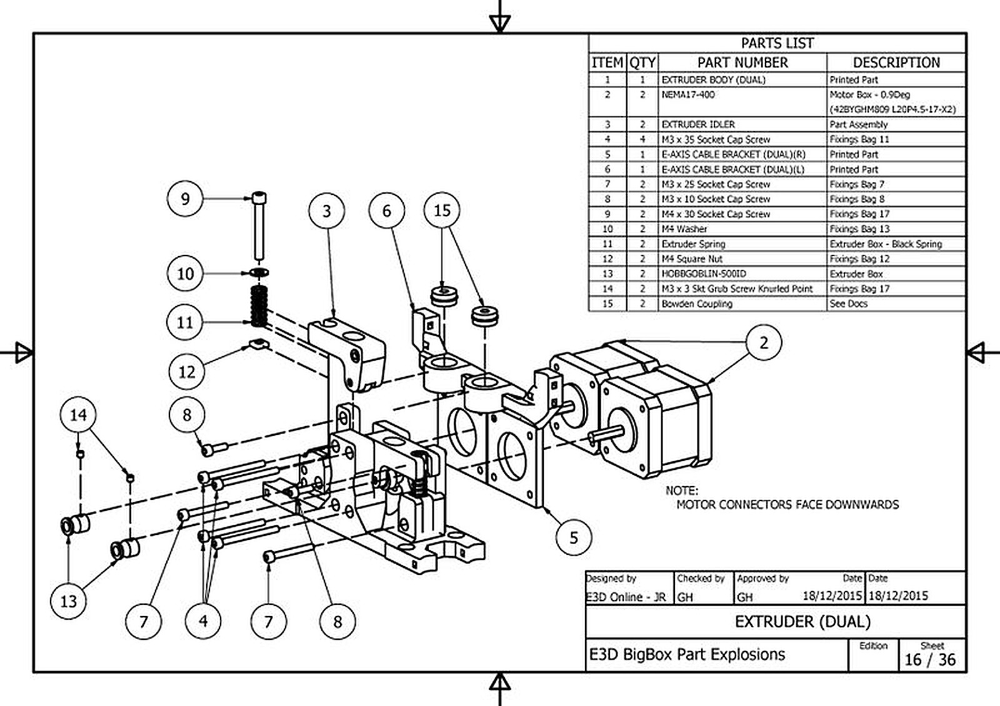

*Enlarged to twice the size from the wiki's low-resolution image; [the original](../docs/images/original/EXTRUDER_DUAL.jpg) is kept.*

*Bowden Coupler Parts.*

Note how the couplers (15) assemble with the lettering facing upwards.

**Note :** The couplers are in the Extruder Box, the Dual requires two.

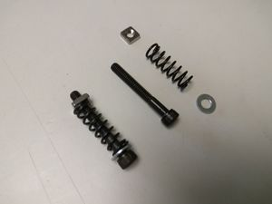

*Tension Springs.*

- 2 x M4 30mm (Bag 17).
- 2 x M4 Square Nut (Bag 12).
- 2 x M4 Washer (Bag 13).

Build two Filament Idler Tension Springs as shown.

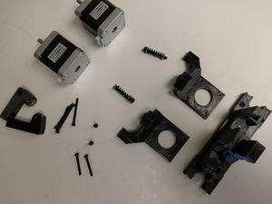

*Tension Springs.*

Fit two bowden couplers in the Left & Right Cable Brackets.

Assemble the parts required to build the Dual Extruder Top. Refer to the Exploded Diagram.

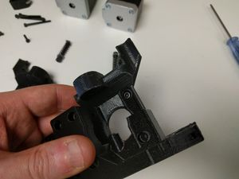

*Right Cable Bracket.*

- 1 x M3 10mm Screw (Bag 9).
- 1 x Right Cable Bracket (Printed Part).

Fit the M3 10mm Screw into the assembly.

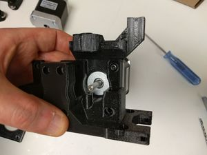

*Motor.*

Loosely attach the motor.

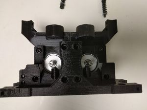

*Both Motors.*

Repeat on the other side.

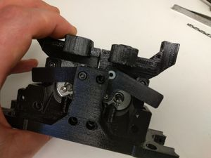

*Idlers.*

- 2 X M3 35mm Screw (Bag 11).

Slot in the Extruder Idlers. They can be a bit tricky.

Secure each one with an M3 35mm Screw.

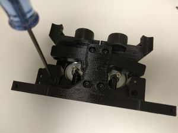

*Screws.*

- 2 X M3 35mm Screw (Bag 11).
- 2 X M3 25mm Screw (Bag 7).

Fit the remaining screws to secure the motors.

Tighten the M3 10mm Screw hidden behind the Idlers.

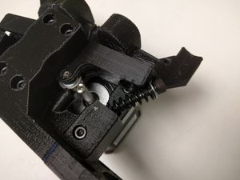

*Idler Spring.*

Position an idlers spring as shown.

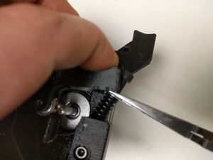

*Compress.*

Compress the spring and push the screw into the slot in the Idler.

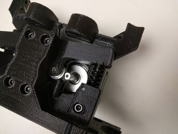

*Fitted.*

The washer sits in a recess in the Idler.

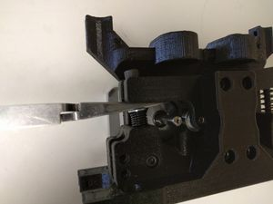

*Fitted.*

Repeat with the other side.

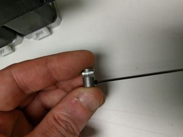

*Hob.*

- 2 x M3 3mm Grub Screw (Bag 17).
- 2 x HobGoblin (Extruder Box).

Assemble two Hobs.

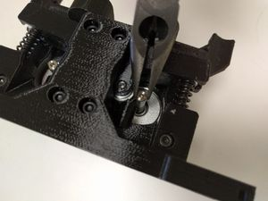

*shaft.*

Using pliers gently grab one of the Motor shafts.

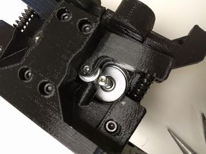

*Rotate.*

Position the shaft with the flat facing towards the spring.

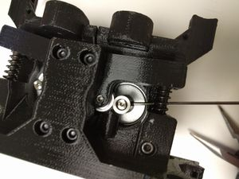

*Hobbed.*

Fit the hob over the shaft with the grub closest to the motor.

Gently screw in the grub, do not do it up, the hob needs to be able to move along the shaft.

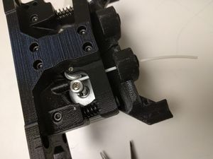

*Filament.*

Feed the length of scrap filament through the extruder.

Move the filament backwards and forwards, the hob should centre itself to the filament path.

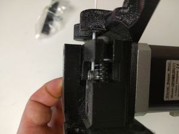

*Filament track.*

Tighten the grub screw when you are happy with the position.

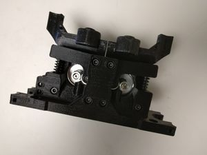

*Finished.*

Repeat with the other extruder.\
