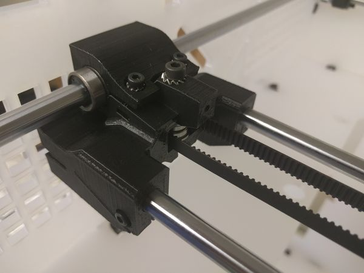

# Dual Direct-Drive X-Carriage

Rebuilt page · source: wiki.e3d-online.com/wiki/Dual_Direct-Drive_X-Carriage · [archive link (parent page)](https://web.archive.org/web/20160729070751/http://wiki.e3d-online.com:80/wiki/Printer_main_assemblies:_Step_By_Step_Assembly_Process)

Recovered from an older version of Printer main assemblies: Step By Step Assembly Process (20160729070751), section "(7) Dual Direct-Drive X-Carriage" — the separate wiki page is not in the archive.

\[image not archived: "Dual_x_carriage_assembly.jpg"\]

\[image not archived: "X_carriage_dual_fit.jpg" Caption: "Fit the Carriage."\]

Position the previously prepared [Dual X-Carriage](BigBox_Parts_Preparation.md "BigBox Parts Preparation") onto the bearings.

The 'legs' which mount the IR Sensor and Print Fan should be on the back and left respectively as you look at your printer.

\[image not archived: "X_carriage_dual_fit_clamps.jpg" Caption: "Fit the Clamps."\]

- 8 x M3 10mm Screws (Bag 8).
- 2 x Bearing Clamps (Printed Parts).

Secure the X-Carriage to the bearings using the two Bearing Clamps.

## (7.1) X-Carriage Belt

\[image not archived: "X_carriage_dual_fit_tensioner.jpg" Caption: "Fit the Tensioner."\]

- 1 x M3 18mm Screws (Bag 8).
- 1 x M3 Square Nut (Bag 6).
- 1 x Belt Tensioner (Printed Parts).
- 1 x GT2 Belt (Motion Box).

Fit the M3 Square Nut into the Belt Tensioner and thread in the M3 Screw.

Place the Tensioner into the X-Carriage.

Slot one end of the belt into the X-Carriage as shown. **Note**: Check the orientation of the belt teeth matches the groves in the X-Carriage.

*Belt.*

Feed the belt throuh the X-Idler.

\[image not archived: "X_carriage_dual_feed_back.jpg" Caption: "Belt."\]

Pass the belt around the 20T GT2 Pulley on the X-Axis Motor and return it towards the X-Carriage.

\[image not archived: "X_carriage_dual_grub.jpg" Caption: "Grub."\]

- 1 x M4 8mm Grub Screw (Bag 13).

Screw in the grub as shown.

**Do not over-tighten.**

\[image not archived: "X_carriage_dual_grubs.jpg" Caption: "Grubs."\]

- 1 x M4 8mm Grub Screw (Bag 13).

Pull the belt taught and cut to length, fix the belt end into the X-Carriage.

Secure using the Grub Screw.

**Do not over-tighten.**\
