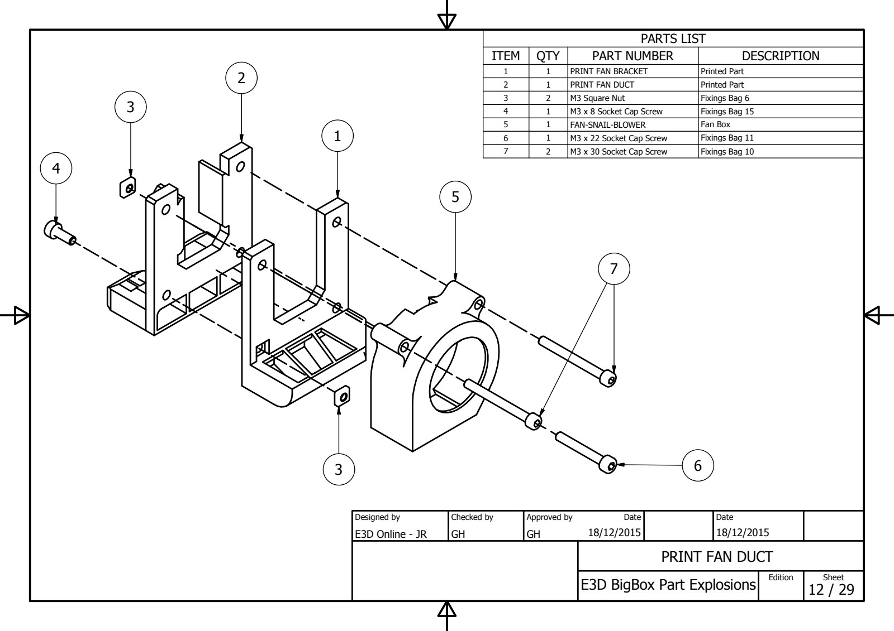
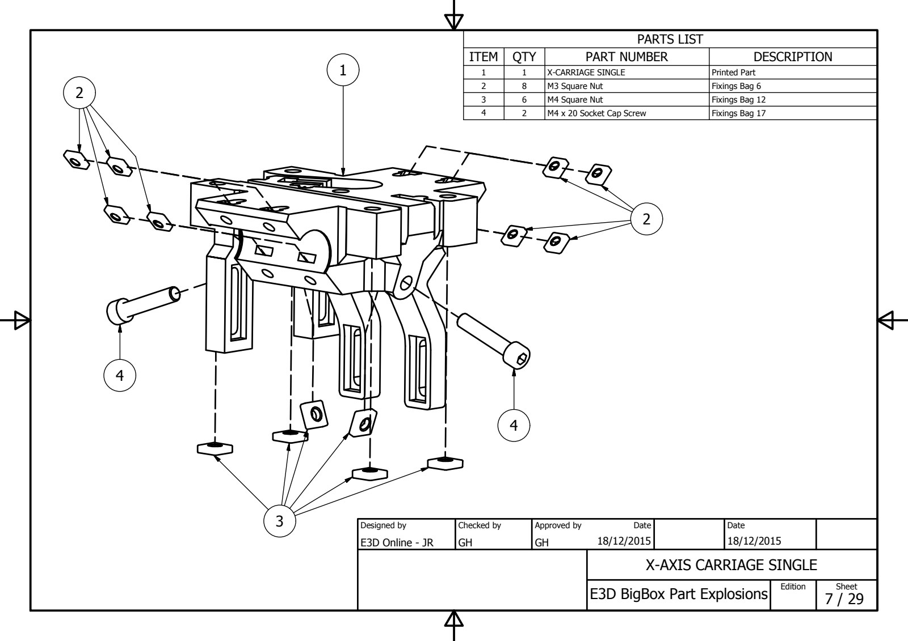
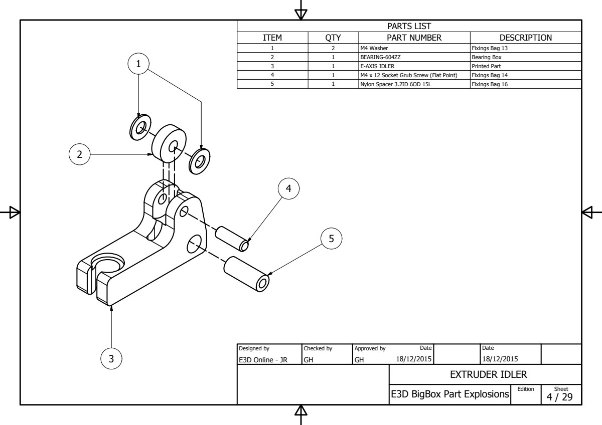
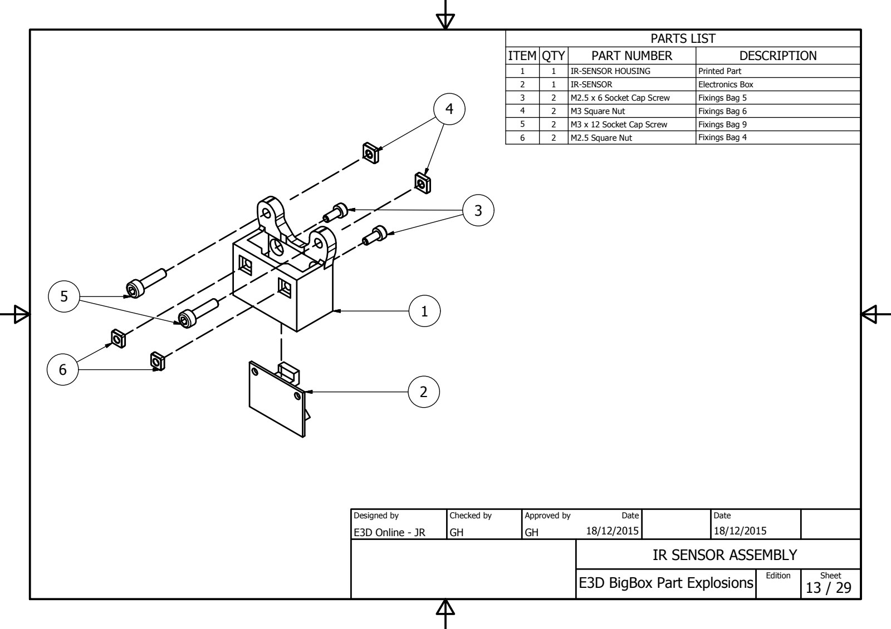
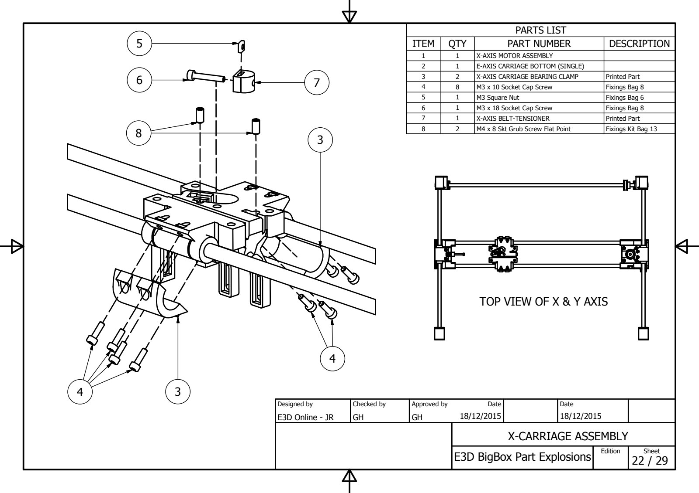

# Exploded Drawings

**Contents**

- [BigBox Parts Preparation](#bigbox-parts-preparation)
  - [Y-AXIS REAR (L)](#y-axis-rear-l)
  - [Y-AXIS FRONT (L)](#y-axis-front-l)
  - [Y-AXIS IDLER (L & R)](#y-axis-idler-l--r)
  - [X-AXIS IDLER CARRIAGE](#x-axis-idler-carriage)
  - [X-AXIS MOTOR CARRIAGE](#x-axis-motor-carriage)
  - [HEATED BED CORNERS](#heated-bed-corners)
  - [SPOOL-HOLDER OUTER (L)](#spool-holder-outer-l)
  - [SPOOL-HOLDER INNER](#spool-holder-inner)
  - [Y-AXIS MOTOR MOUNT](#y-axis-motor-mount)
  - [SPOOL-HOLDER CLAMP](#spool-holder-clamp)
  - [Z-AXIS DRAG CHAIN](#z-axis-drag-chain)
- [BigBox Printer Sub-assemblies](#bigbox-printer-sub-assemblies)
  - [EXTRUDER HYBRID TITAN DIRECT](#extruder-hybrid-titan-direct)
  - [EXTRUDER HYBRID NON-TITAN DIRECT](#extruder-hybrid-non-titan-direct)
  - [X-AXIS ASSEMBLY](#x-axis-assembly)
  - [ELECTRONICS COVER](#electronics-cover)
  - [FRAME-LUG DRAWING](#frame-lug-drawing)
- [Printer main assemblies: Step By Step Assembly Process](#printer-main-assemblies-step-by-step-assembly-process)
  - [X-AXIS ASSEMBLY](#x-axis-assembly-1)
  - [Y-AXIS FRONT ASSEMBLY](#y-axis-front-assembly)
  - [XY-AXIS ASSEMBLY](#xy-axis-assembly)
  - [X-AXIS MOTOR INSTALL](#x-axis-motor-install)
  - [MOUNT Y-AXIS MOTOR](#mount-y-axis-motor)
  - [REAR-RIGHT-BACK CABLE CONDUIT](#rear-right-back-cable-conduit)
  - [DOCK-BRACKET](#dock-bracket)
  - [MOUNT SPOOL-HOLDER OUTER](#mount-spool-holder-outer)
  - [SPINE](#spine)
  - [Z-AXIS BASE BRACKETS](#z-axis-base-brackets)
  - [E3D-v6 HOTEND](#e3d-v6-hotend)
  - [Z-AXIS TOP BRACKETS](#z-axis-top-brackets)
- [Dual Direct-Drive Extruders](#dual-direct-drive-extruders)
  - [EXTRUDER DUAL](#extruder-dual)
- [Print Cooling Fan](#print-cooling-fan)
  - [PRINT FAN DUCT](#print-fan-duct)
- [Pro & Lite X-Carriage](#pro--lite-x-carriage)
  - [X-AXIS CARRIAGE SINGLE](#x-axis-carriage-single)
- [Single Direct-Drive Extruder](#single-direct-drive-extruder)
  - [EXTRUDER (SINGLE)](#extruder-single)
- [Non-Titan Idler Arms](#non-titan-idler-arms)
  - [EXTRUDER IDLER](#extruder-idler)
- [Single & Dual Direct-Drive IR Sensor Bracket](#single--dual-direct-drive-ir-sensor-bracket)
  - [IR SENSOR ASSEMBLY](#ir-sensor-assembly)
- [Not shown in the manual](#not-shown-in-the-manual)
  - [X-CARRIAGE ASSEMBLY](#x-carriage-assembly)

*Every exploded drawing of the BigBox in one place: 35 sheets, each with its parts list. The exploded drawings [PDF](../docs/files/EXPLODED_DRAWINGS.pdf) has 26 of them; the rest (the hybrid and dual extruders, the Z axis and a few more) exist only as images on the wiki. The drawings follow the manual: the parts preparation steps first, then the sub-assemblies, then the step-by-step assembly. The parts lists were read from the PDF’s text and from the wiki’s images, see [the Bill of Materials](Bill_Of_Materials.md).*

## [BigBox Parts Preparation](BigBox_Parts_Preparation.md)

### Y-AXIS REAR (L)

[PDF sheet 1](../docs/files/EXPLODED_DRAWINGS.pdf#page=1) · shown in [(1) Y-Axis Rear Brackets (Left & Right)](BigBox_Parts_Preparation.md#1-y-axis-rear-brackets-left--right) · [full size](../docs/images/Y-AXIS_REAR.jpg)

| Qty | Part                                 | Description       |
| --- | ------------------------------------ | ----------------- |
| 1   | Y-AXIS REAR (L)                      | Printed Part      |
| 2   | M4 Square Nut                        | Fixings Bag 12    |
| 3   | M3 Square Nut                        | Fixings Bag 6     |
| 2   | M3 x 12 Socket Cap Screw             | Fixings Bag 9     |
| 3   | M3 Ext Lock Washer                   | Fixings Bag 6     |
| 1   | Y-AXIS REAR (L&R) BEARING RETAINER   | Printed Part      |
| 1   | BEARING-688ZZ                        | Bearing Box       |
| 1   | M3 x 16 Socket Cap Screw             | Fixings Bag 10    |
| 1   | Y-AXIS BACK (L) CORK (Self Adhesive) | Printed Parts Box |

### Y-AXIS FRONT (L)

[PDF sheet 2](../docs/files/EXPLODED_DRAWINGS.pdf#page=2) · shown in [(2) Y-Axis Front Brackets (Left & Right)](BigBox_Parts_Preparation.md#2-y-axis-front-brackets-left--right) · [full size](../docs/images/Y-AXIS_FRONT.jpg)

| Qty | Part                                      | Description       |
| --- | ----------------------------------------- | ----------------- |
| 1   | Y-AXIS FRONT (R)                          | Printed Part      |
| 1   | M3 Square Nut                             | Fixings Bag 6     |
| 2   | M4 Square Nut                             | Fixings Bag 12    |
| 1   | M3 x 18 Socket Cap Screw                  | Fixings Bag 8     |
| 1   | M3 Ext Lock Washer                        | Fixings Bag 6     |
| 1   | Y-AXIS FRONT CORK (L & R) (Self Adhesive) | Printed Parts Box |

### Y-AXIS IDLER (L & R)

[PDF sheet 3](../docs/files/EXPLODED_DRAWINGS.pdf#page=3) · shown in [(3) Y-Axis Belt Idlers](BigBox_Parts_Preparation.md#3-y-axis-belt-idlers) · [full size](../docs/images/Y-AXIS_IDLER.jpg)

| Qty | Part                                   | Description    |
| --- | -------------------------------------- | -------------- |
| 1   | Y-AXIS BELT TENSIONER                  | Printed Part   |
| 2   | BEARING-F604ZZ                         | Bearing Box    |
| 3   | M4 Washer                              | Fixings Bag 13 |
| 1   | M4 x 20 Socket Grub Screw (Flat Point) | Fixings Bag 13 |
| 1   | M4 Square Nut                          | Fixings Bag 12 |
| 1   | M4 Ext Lock Washer                     | Fixings Bag 12 |
| 1   | M4 x 20 Socket Cap Screw               | Fixings Bag 17 |

### X-AXIS IDLER CARRIAGE

[PDF sheet 5](../docs/files/EXPLODED_DRAWINGS.pdf#page=5) · shown in [(5) X-Axis Idler Carriage](BigBox_Parts_Preparation.md#5-x-axis-idler-carriage) · [full size](../docs/images/X-AXIS_IDLER_CARRIAGE.jpg)

| Qty | Part                     | Description    |
| --- | ------------------------ | -------------- |
| 1   | X-AXIS IDLER CARRIAGE    | Printed Part   |
| 1   | BEARING-LM8LUU           | Bearing Kit    |
| 2   | M3 x 10 Socket Cap Screw | Fixings Bag 8  |
| 2   | M3 x 12 Socket Cap Screw | Fixings Bag 9  |
| 4   | M3 Square Nut            | Fixings Bag 6  |
| 4   | M3 Ext Lock Washer       | Fixings Bag 6  |
| 2   | BEARING-F604ZZ           | Bearing Box    |
| 3   | M4 Washer                | Fixings Bag 13 |
| 1   | M4 Ext Lock Washer       | Fixings Bag 12 |
| 1   | M3 x 25 Socket Cap Screw | Fixings Bag 7  |
| 1   | M4 x 30 Socket Cap Screw | Fixings Bag 17 |
| 1   | M4 Square Nut            | Fixings Bag 12 |

### X-AXIS MOTOR CARRIAGE

[PDF sheet 6](../docs/files/EXPLODED_DRAWINGS.pdf#page=6) · shown in [(6) X-Axis Motor Mount](BigBox_Parts_Preparation.md#6-x-axis-motor-mount) · [full size](../docs/images/X-AXIS_MOTOR_CARRIAGE.jpg)

| Qty | Part                         | Description    |
| --- | ---------------------------- | -------------- |
| 1   | X-AXIS MOTOR CARRIAGE        | Printed Part   |
| 2   | M3 x 10 Socket Cap Screw     | Fixings Bag 8  |
| 2   | M3 x 16 Socket Cap Screw     | Fixings Bag 10 |
| 4   | M3 Ext Lock Washer           | Fixings Bag 6  |
| 4   | M3 Square Nut                | Fixings Bag 6  |
| 1   | BEARING-LM8LUU               | Bearing Kit    |
| 2   | M3 Hex Nut                   | Fixings Bag 3  |
| 1   | DRAG-CHAIN-END               | Motion Box     |
| 2   | M3 x 8 Csk Platite 30 Screws | Fixings Bag 2  |

### HEATED BED CORNERS

[PDF sheet 9](../docs/files/EXPLODED_DRAWINGS.pdf#page=9) · shown in [(10) Heated Bed Corners](BigBox_Parts_Preparation.md#10-heated-bed-corners) · [full size](../docs/images/HEATED_BED_CORNERS.jpg)

| Qty | Part                     | Description   |
| --- | ------------------------ | ------------- |
| 1   | HEATED BED CORNERS       | Printed Part  |
| 2   | M3 Square Nut            | Fixings Bag 6 |
| 2   | M3 x 12 Socket Cap Screw | Fixings Bag 9 |
| 1   | BEARING-LM8LUU           | Bearing Kit   |

### SPOOL-HOLDER OUTER (L)

[PDF sheet 10](../docs/files/EXPLODED_DRAWINGS.pdf#page=10) · shown in [(11) Outer Spools Rear (Left & Right)](BigBox_Parts_Preparation.md#11-outer-spools-rear-left--right) · [full size](../docs/images/SPOOL-HOLDER_OUTER.jpg)

| Qty | Part                     | Description    |
| --- | ------------------------ | -------------- |
| 1   | SPOOL-HOLDER OUTER (L)   | Printed Part   |
| 2   | BEARING-634ZZ            | Bearing Box    |
| 2   | M4 Washer                | Fixings Bag 13 |
| 2   | M3 x 16 Socket Cap Screw | Fixings Bag 10 |
| 1   | M4 x 20 Socket Cap Screw | Fixings Bag 17 |
| 1   | M4 Square Nut            | Fixings Bag 12 |
| 2   | M3 Square Nut            | Fixings Bag 6  |

### SPOOL-HOLDER INNER

[PDF sheet 11](../docs/files/EXPLODED_DRAWINGS.pdf#page=11) · shown in [(12) Spool Holder Outer Fronts](BigBox_Parts_Preparation.md#12-spool-holder-outer-fronts) · [full size](../docs/images/SPOOL-HOLDER_INNER.jpg)

| Qty | Part                     | Description    |
| --- | ------------------------ | -------------- |
| 1   | SPOOL-HOLDER INNER       | Printed Part   |
| 1   | M4 x 20 Socket Cap Screw | Fixings Bag 17 |
| 1   | M4 Square Nut            | Fixings Bag 12 |

### Y-AXIS MOTOR MOUNT

[PDF sheet 27](../docs/files/EXPLODED_DRAWINGS.pdf#page=27) · shown in [(14) Y-Axis Motor Mount](BigBox_Parts_Preparation.md#14-y-axis-motor-mount) · [full size](../docs/images/Y-AXIS_MOTOR.jpg)

| Qty | Part                               | Description                   |
| --- | ---------------------------------- | ----------------------------- |
| 1   | Y-AXIS MOTOR MOUNT                 | Printed Part                  |
| 1   | Y-MOTOR MOUNT CORK (Self Adhesive) | Printed Parts Box             |
| 1   | NEMA17-400                         | Motor Box - 400 Step Motor    |
| 1   | GT2-16T-5ID                        | Motion Box (16 Tooth, 5mm ID) |
| 4   | M3 x 10 Socket Cap Screw           | Fixings Bag 8                 |
| 4   | M3 Ext Lock Washer                 | Fixings Bag 6                 |
| 3   | M4 Square Nut                      | Fixings Bag 12                |

### SPOOL-HOLDER CLAMP

sheet 37 of 37 in the wiki’s newer drawings · shown in [(17) Spool Carrier Clamp](BigBox_Parts_Preparation.md#17-spool-carrier-clamp) · [full size](../docs/images/SPOOL-HOLDER_CLAMP.jpg)

| Qty | Part                     | Description                |
| --- | ------------------------ | -------------------------- |
| 1   | SPOOL-HOLDER CLAMP INNER | Printed Part               |
| 1   | SPOOL-HOLDER CLAMP OUTER | Printed Part               |
| 1   | M4 x 30 Socket Cap Screw | Fixings Bag 17             |
| 1   | M4 Square Nut            | Fixings Bag 12             |
| 3   | M4 Washer                | Fixings Bag 13             |
| 1   | Spool-Holder Spring      | Extruder Box-Silver Spring |
| 1   | BEARING-688ZZ            | Bearing Box                |

### Z-AXIS DRAG CHAIN

sheet 36 of 36 in the wiki’s newer drawings · shown in [(18) Z-Axis Drag Chain Anchors](BigBox_Parts_Preparation.md#18-z-axis-drag-chain-anchors) · [full size](../docs/images/Z-AXIS_DRAG_CHAIN.jpg)

| Qty | Part                          | Description   |
| --- | ----------------------------- | ------------- |
| 1   | DRAG-CHAIN-END FEMALE         | Motion Box    |
| 1   | DRAG-CHAIN-END                | Motion Box    |
| 1   | Z-AXIS DRAG-CHAIN ANCHOR BASE | Printed Part  |
| 1   | Z-AXIS DRAG-CHAIN ANCHOR BED  | Printed Part  |
| 4   | M3 x 8 Csk Platite 30 Screws  | Fixings Bag 2 |

## [BigBox Printer Sub-assemblies](BigBox_Printer_Sub-assemblies.md)

### EXTRUDER HYBRID TITAN DIRECT

sheet 18 of 41 in the wiki’s newer drawings · shown in [(3) Hybrid Titan Extruder (Direct)](BigBox_Printer_Sub-assemblies.md#3-hybrid-titan-extruder-direct) · [full size](../docs/images/EXTRUDER_HYBRID_TITAN_DIRECT.jpg)

| Qty | Part                                    | Description        |
| --- | --------------------------------------- | ------------------ |
| 2   | M3 Hex Nut                              | Fixings Bag 3      |
| 1   | E-AXIS CARRIAGE TOP HYBRID TITAN DIRECT | Printed Part       |
| 1   | NEMA17                                  | SEE NOTESONDRAWING |
| 4   | E3D-TITAN                               | SEE NOTESONDRAWING |

### EXTRUDER HYBRID NON-TITAN DIRECT

sheet 19 of 41 in the wiki’s newer drawings · shown in [(5) Hybrid Non-Titan Extruder (Direct)](BigBox_Printer_Sub-assemblies.md#5-hybrid-non-titan-extruder-direct) · [full size](../docs/images/EXTRUDER_HYBRID_NON-TITAN_DIRECT.jpg)

| Qty | Part | Description |
| --- | --- | --- |
| 1 | E-AXIS CARRIAGE TOP HYBRID NON-TITAN DIRECT GUIDE | Printed Part |
| 1 | E-AXIS CARRIAGE TOP HYBRID NON-TITAN DIRECT LEVER | Printed Part |
| 1 | E-AXIS CARRIAGE TOP HYBRID NON-TITAN DIRECT BODY | Printed Part |
| 1 | NEMA17-400 | Motor Box-0.9Deg |
| 1 | Bowden Coupling | See Docs |
| 1 | HOBBGOBLIN-500ID | Extruder Box |
| 1 | M3 x 3 Skt Grub Screw Knurled Point | Fixings Bag 17 |
| 1 | M4 x 30 Socket Cap Screw | Fixings Bag 17 |
| 1 | M4 Washer | Fixings Bag 13 |
| 1 | Extruder Spring | Extruder Box - Black Spring |
| 1 | M4 Square Nut | Fixings Bag 12 |
| 1 | Nylon Spacer 3.2ID 6OD 15L | Fixings Bag 16 |
| 1 | M3 x 25 Socket Cap Screw | Fixings Bag 7 |
| 2 | M3 x 30 Socket Cap Screw | Fixings Bag 10 |
| 2 | M3 Hex Nut | Fixings Bag 3 |
| 1 | M3 x 10 Socket Cap Screw | Fixings Bag 8 |

### X-AXIS ASSEMBLY

[PDF sheet 16](../docs/files/EXPLODED_DRAWINGS.pdf#page=16) · shown in [(7) X-Axis Assembly](BigBox_Printer_Sub-assemblies.md#7-x-axis-assembly) · [full size](../docs/images/X-AXIS_ASSEMBLY.jpg)

| Qty | Part                  | Description      |
| --- | --------------------- | ---------------- |
| 1   | X-AXIS IDLER CARRIAGE | Part Preparation |
| 1   | X-AXIS MOTOR CARRIAGE | Part Preparation |
| 2   | ROD-G.H.SS-8-484      | Rod Kit          |
| 2   | BEARING-LM8LUU        | Bearing Kit      |

### ELECTRONICS COVER

[PDF sheet 28](../docs/files/EXPLODED_DRAWINGS.pdf#page=28) · shown in [(8) Electronics Cover](BigBox_Printer_Sub-assemblies.md#8-electronics-cover) · [full size](../docs/images/ELECTRONICS_COVER.jpg)

| Qty | Part                      | Description    |
| --- | ------------------------- | -------------- |
| 1   | ELECTRONICS-COVER         | Laser Cut Part |
| 4   | ELECTRONICS-COVER-BRACKET | Printed Part   |
| 8   | M3 x 10 Socket Cap Screw  | Fixings Bag 8  |
| 4   | M3 x 20 Socket Cap Screw  | Fixings Bag 9  |
| 4   | M3 Hex Nut (Half)         | Fixings Bag 5  |
| 4   | M3 Microbarb Nut (Brass)  | Fixings Bag 2  |
| 1   | FAN-50-50-10              | Fan Box        |

### FRAME-LUG DRAWING

sheet 1 of 1 in the wiki’s newer drawings · shown in [(13.1) A Note on Nut-Traps](BigBox_Printer_Sub-assemblies.md#131-a-note-on-nut-traps) · [full size](../docs/images/FRAME-LUG_DRAWING.jpg)

| Qty  | Part                   | Description  |
| ---- | ---------------------- | ------------ |
| ~150 | BB_FRAME_M3_NUT_TRAP-1 | Printed Part |

## [Printer main assemblies: Step By Step Assembly Process](Printer_main_assemblies_Step_By_Step_Assembly_Process.md)

### X-AXIS ASSEMBLY

[PDF sheet 18](../docs/files/EXPLODED_DRAWINGS.pdf#page=18) · shown in [(1) Y-Axis Rear-Bar Assembly](Printer_main_assemblies_Step_By_Step_Assembly_Process.md#1-y-axis-rear-bar-assembly) · [full size](../docs/images/Y-AXIS_REAR_ASSEMBLY.jpg)

| Qty | Part                      | Description                   |
| --- | ------------------------- | ----------------------------- |
| 1   | Y-AXIS REAR (L)           | Part Preparation              |
| 1   | Y-AXIS BACK (R)           | Part Preparation              |
| 1   | ROD-SS-8-532              | Rod Kit (Longest)             |
| 2   | Nylon Washer 8 x 16 x 1.6 | Fixings Bag 13                |
| 1   | GT2-36T-8ID               | Motion Box (36 Tooth, 8mm ID) |
| 2   | GT2-20T-8ID               | Motion Box (20 Tooth, 8mm ID) |
| 1   | GT2-BELT-CLOSED-66T       | Motion Box                    |

### Y-AXIS FRONT ASSEMBLY

[PDF sheet 19](../docs/files/EXPLODED_DRAWINGS.pdf#page=19) · shown in [(3) X-Axis & Y-Axis Assembly](Printer_main_assemblies_Step_By_Step_Assembly_Process.md#3-x-axis--y-axis-assembly) · [full size](../docs/images/Y-AXIS_FRONT_ASSEMBLY.jpg)

| Qty | Part                     | Description      |
| --- | ------------------------ | ---------------- |
| 2   | ROD-G.H.SS-8-384         | Rod Kit          |
| 1   | X-AXIS CARRIAGE ASSEMBLY |                  |
| 1   | Y-AXIS FRONT (L)         | Part Preparation |
| 1   | Y-AXIS FRONT (R)         | Part Preparation |

### XY-AXIS ASSEMBLY

[PDF sheet 20](../docs/files/EXPLODED_DRAWINGS.pdf#page=20) · shown in [(4) X-Axis & Y-Axis Installation](Printer_main_assemblies_Step_By_Step_Assembly_Process.md#4-x-axis--y-axis-installation) · [full size](../docs/images/XY-AXIS_ASSEMBLY.jpg)

| Qty | Part                  | Description |
| --- | --------------------- | ----------- |
| 1   | Y-AXIS FRONT ASSEMBLY |             |
| 1   | Y-AXIS BACK ASSEMBLY  |             |

### X-AXIS MOTOR INSTALL

[PDF sheet 21](../docs/files/EXPLODED_DRAWINGS.pdf#page=21) · shown in [(5) X-Axis Motor Installation](Printer_main_assemblies_Step_By_Step_Assembly_Process.md#5-x-axis-motor-installation) · [full size](../docs/images/X-AXIS_MOTOR_INSTALL.jpg)

| Qty | Part                     | Description                   |
| --- | ------------------------ | ----------------------------- |
| 1   | Y-AXIS FRONT ASSEMBLY    |                               |
| 1   | NEMA17-400               | Motor Box - 400 Step Motor    |
| 4   | M3 x 10 Socket Cap Screw | Fixings Bag 8                 |
| 4   | M3 Ext Lock Washer       | Fixings Bag 6                 |
| 1   | GT2-20T-5ID              | Motion Box (20 Tooth, 5mm ID) |

### MOUNT Y-AXIS MOTOR

[PDF sheet 23](../docs/files/EXPLODED_DRAWINGS.pdf#page=23) · shown in [(10) Y-Axis Motor Install](Printer_main_assemblies_Step_By_Step_Assembly_Process.md#10-y-axis-motor-install) · [full size](../docs/images/MOUNT_Y-AXIS_MOTOR.jpg)

| Qty | Part                     | Description    |
| --- | ------------------------ | -------------- |
| 3   | M4 Ext Lock Washer       | Fixings Bag 12 |
| 3   | M4 x 20 Socket Cap Screw | Fixings Bag 17 |

### REAR-RIGHT-BACK CABLE CONDUIT

[PDF sheet 29](../docs/files/EXPLODED_DRAWINGS.pdf#page=29) · shown in [(12) X-Axis Cable Conduits](Printer_main_assemblies_Step_By_Step_Assembly_Process.md#12-x-axis-cable-conduits) · [full size](../docs/images/REAR-RIGHT-BACK_CABLE_CONDUIT.jpg)

*Drawn from sheet 29 of the exploded drawings PDF; the wiki's image of this drawing was low resolution and the PDF has it larger. [The wiki's original](../docs/images/original/REAR-RIGHT-BACK_CABLE_CONDUIT.jpg) is kept.*

| Qty | Part                     | Description   |
| --- | ------------------------ | ------------- |
| 3   | RRB-CABLE-CONDUIT        | Printed Part  |
| 3   | M3 Hex Nut               | Fixings Bag 3 |
| 3   | M3 x 25 Socket Cap Screw | Fixings Bag 7 |

### DOCK-BRACKET

sheet 35 of 36 in the wiki’s newer drawings · shown in [(14) Frame Top](Printer_main_assemblies_Step_By_Step_Assembly_Process.md#14-frame-top) · [full size](../docs/images/DOCK-BRACKET.jpg)

| Qty | Part                     | Description   |
| --- | ------------------------ | ------------- |
| 1   | DOCK-BRACKET             | Printed Part  |
| 5   | M3 Microbarb Nut (Brass) | Fixings Bag 2 |
| 5   | M3 x 10 Socket Cap Screw | Fixings Bag 8 |

### MOUNT SPOOL-HOLDER OUTER

[PDF sheet 25](../docs/files/EXPLODED_DRAWINGS.pdf#page=25) · shown in [(15) Spool Holder Brackets](Printer_main_assemblies_Step_By_Step_Assembly_Process.md#15-spool-holder-brackets) · [full size](../docs/images/MOUNT_SPOOL-HOLDER_OUTER.jpg)

| Qty | Part                     | Description    |
| --- | ------------------------ | -------------- |
| 1   | SPOOL-HOLDER INNER       | Part Prep      |
| 3   | M3 Hex Nut (Half)        | Fixings Bag 5  |
| 2   | M4 Washer                | Fixings Bag 13 |
| 2   | BEARING-634ZZ            | Bearing Box    |
| 3   | M3 x 20 Socket Cap Screw | Fixings Bag 9  |

### SPINE

[PDF sheet 24](../docs/files/EXPLODED_DRAWINGS.pdf#page=24) · shown in [(16) Cable Spine](Printer_main_assemblies_Step_By_Step_Assembly_Process.md#16-cable-spine) · [full size](../docs/images/SPINE.jpg)

| Qty | Part                     | Description    |
| --- | ------------------------ | -------------- |
| 1   | SPINE-LARGE              | Printed Part   |
| 2   | SPINE-MED                | Printed Part   |
| 2   | SPINE-SMALL              | Printed Part   |
| 2   | SPINE-Y                  | Printed Part   |
| 10  | M4 x 16 Socket Cap Screw | Fixings Bag 14 |
| 4   | M3 x 20 Socket Cap Screw | Fixings Bag 9  |
| 10  | M4 Hex Nut (Half)        | Fixings Kit 11 |
| 4   | M3 Hex Nut (Half)        | Fixings Bag 5  |

### Z-AXIS BASE BRACKETS

sheet 32 of 36 in the wiki’s newer drawings · shown in [(17.5) Z-Axis Lower Rod Brackets](Printer_main_assemblies_Step_By_Step_Assembly_Process.md#175-z-axis-lower-rod-brackets) · [full size](../docs/images/Z-AXIS_BASE_BRACKETS.jpg)

| Qty | Part                      | Description   |
| --- | ------------------------- | ------------- |
| 1   | Z-AXIS BASE BRACKET LOWER | Printed Part  |
| 1   | Z-AXIS BASE BRACKET UPPER | Printed Part  |
| 2   | M3 x 12 Socket Cap Screw  | Fixings Bag 9 |
| 2   | M3 Hex Nut (Half)         | Fixings Bag 5 |

### E3D-v6 HOTEND

[PDF sheet 26](../docs/files/EXPLODED_DRAWINGS.pdf#page=26) · shown in [(20.2) Assembly of the E3D HotEnds.](Dual_Direct-Drive_Printhead_Assembly.md#202-assembly-of-the-e3d-hotends); [(21.3) Assembly of the E3D V6 HotEnds.](Printer_main_assemblies_Step_By_Step_Assembly_Process.md#213-assembly-of-the-e3d-v6-hotends); [(19.3) Assembly of the E3D HotEnd.](Single_Direct-Drive_Printhead_Assembly.md#193-assembly-of-the-e3d-hotend) · [full size](../docs/images/E3D-V6_HOTEND_ASSEMBLY_BIGBOX.jpg)

| Qty | Part | Description |
| --- | --- | --- |
| 1 | E3D-v6 Nozzle (1.75mm x 0.4mm) | Extruder Box -\> E3D V6 Bag |
| 1 | E3D-v6 Heatbreak (1.75mm) | Extruder Box -\> E3D V6 Bag |
| 1 | E3D-v6 Heatsink (1.75mm) | Extruder Box -\> E3D V6 Bag |
| 1 | E3D-v6 Heater Block | Extruder Box -\> E3D V6 Bag |
| 1 | Bowden Coupling Body | Installed |
| 1 | Bowden Coupling Colet | E3D V6 Bag |
| 1 | PT100 | Extruder Box |
| 1 | HEATER-CARTRIDGE-24V-30W | Extruder Box |
| 1 | M3 x 3 Skt Grub Screw Knurled Point | Extruder Box -\> E3D V6 Bag -\> Fixings Kit |
| 1 | M3 x 10 Dome Head Socket Screw | Extruder Box -\> E3D V6 Bag -\> Fixings Kit |
| 1 | E3D-V6 Fan Duct | Extruder Box |
| 1 | E3D-v6 Heater Block | Extruder Box -\> E3D V6 Bag |
| 1 | 30x30x30 DC Fan (24v) | LCD / Fans Box (+ Extruder Box for Duals) |
| 4 | 2.5 x 15 Screws for Plastic | Extruder Box -\> E3D V6 Bag -\> Fixings Kit |
| 1 | PTFE-63 | Extruder Box -\> E3D V6 Bag |

### Z-AXIS TOP BRACKETS

sheet 38 of 38 in the wiki’s newer drawings · shown in [(32.2) Z Bed](Printer_main_assemblies_Step_By_Step_Assembly_Process.md#322-z-bed) · [full size](../docs/images/Z-AXIS_TOP_BRACKETS.jpg)

| Qty | Part                     | Description   |
| --- | ------------------------ | ------------- |
| 1   | Z-AXIS TOP BOTTOM        | Printed Part  |
| 1   | Z-AXIS TOP TOP           | Printed Part  |
| 1   | Z-AXIS TOP CAP           | Printed Part  |
| 1   | ROD-G.H.SS-8-364         | Rod Kit       |
| 2   | M3 Hex Nut (Half)        | Fixings Bag 5 |
| 2   | M3 x 12 Socket Cap Screw | Fixings Bag 9 |

## [Dual Direct-Drive Extruders](Dual_Direct-Drive_Extruders.md)

### EXTRUDER DUAL

sheet 16 of 36 in the wiki’s newer drawings · shown in [Dual Direct-Drive Extruders](Dual_Direct-Drive_Extruders.md) · [full size](../docs/images/EXTRUDER_DUAL.jpg)

*Enlarged to twice the size from the wiki's low-resolution image. [The wiki's original](../docs/images/original/EXTRUDER_DUAL.jpg) is kept.*

| Qty | Part                                | Description                 |
| --- | ----------------------------------- | --------------------------- |
| 1   | EXTRUDER BODY (DUAL)                | Printed Part                |
| 2   | NEMA17-400                          | Motor Box - 0.9Deg          |
| 2   | EXTRUDER IDLER                      | Part Assembly               |
| 1   | E-AXIS CABLE BRACKET (DUAL)(R)      | Printed Part                |
| 1   | E-AXIS CABLE BRACKET (DUAL)(L)      | Printed Part                |
| 2   | M3 x 25 Socket Cap Screw            | Fixings Bag 7               |
| 2   | M3 x 10 Socket Cap Screw            | Fixings Bag 8               |
| 2   | M4 x 30 Socket Cap Screw            | Fixings Bag 17              |
| 2   | M4 Washer                           | Fixings Bag 13              |
| 2   | Extruder Spring                     | Extruder Box - Black Spring |
| 2   | M4 Square Nut                       | Fixings Bag 12              |
| 2   | HOBBGOBLIN-500ID                    | Extruder Box                |
| 2   | M3 x 3 Skt Grub Screw Knurled Point | Fixings Bag 17              |
| 2   | Bowden Coupling                     | See Docs                    |

## [Print Cooling Fan](Print_Cooling_Fan.md)

### PRINT FAN DUCT

[PDF sheet 12](../docs/files/EXPLODED_DRAWINGS.pdf#page=12) · shown in [Print Cooling Fan](Print_Cooling_Fan.md) · [full size](../docs/images/PRINT_FAN_DUCT.jpg)

*Drawn from sheet 12 of the exploded drawings PDF; the wiki's own copy of this image was not archived.*

| Qty | Part                     | Description    |
| --- | ------------------------ | -------------- |
| 1   | PRINT FAN BRACKET        | Printed Part   |
| 1   | PRINT FAN DUCT           | Printed Part   |
| 2   | M3 Square Nut            | Fixings Bag 6  |
| 1   | M3 x 8 Socket Cap Screw  | Fixings Bag 15 |
| 1   | FAN-SNAIL-BLOWER         | Fan Box        |
| 1   | M3 x 22 Socket Cap Screw | Fixings Bag 11 |
| 2   | M3 x 30 Socket Cap Screw | Fixings Bag 10 |

## [Pro & Lite X-Carriage](Pro_%26_Lite_X-Carriage.md)

### X-AXIS CARRIAGE SINGLE

[PDF sheet 7](../docs/files/EXPLODED_DRAWINGS.pdf#page=7) · shown in [Pro & Lite X-Carriage](Pro_%26_Lite_X-Carriage.md) · [full size](../docs/images/X-CARRIAGE_SINGLE.jpg)

*Drawn from sheet 7 of the exploded drawings PDF; the wiki's own copy of this image was not archived.*

| Qty | Part                     | Description    |
| --- | ------------------------ | -------------- |
| 1   | X-CARRIAGE SINGLE        | Printed Part   |
| 8   | M3 Square Nut            | Fixings Bag 6  |
| 6   | M4 Square Nut            | Fixings Bag 12 |
| 2   | M4 x 20 Socket Cap Screw | Fixings Bag 17 |

## [Single Direct-Drive Extruder](Single_Direct-Drive_Extruder.md)

### EXTRUDER (SINGLE)

[PDF sheet 14](../docs/files/EXPLODED_DRAWINGS.pdf#page=14) · shown in [Single Direct-Drive Extruder](Single_Direct-Drive_Extruder.md) · [full size](../docs/images/EXTRUDER_SINGLE.jpg)

*Drawn from sheet 14 of the exploded drawings PDF; the wiki's image of this drawing was low resolution and the PDF has it larger. [The wiki's original](../docs/images/original/EXTRUDER_SINGLE.jpg) is kept.*

| Qty | Part                                | Description                 |
| --- | ----------------------------------- | --------------------------- |
| 1   | EXTRUDER BODY (SINGLE)              | Printed Part                |
| 1   | NEMA17-400                          | Motor Box - 400 Step Motor  |
| 1   | EXTRUDER CABLE BRACKET              | Printed Part                |
| 2   | M3 x 35 Socket Cap Screw            | Fixings Bag 11              |
| 1   | M3 x 25 Socket Cap Screw            | Fixings Bag 7               |
| 1   | M3 x 10 Socket Cap Screw            | Fixings Bag 8               |
| 1   | M4 x 30 Socket Cap Screw            | Fixings Bag 17              |
| 1   | M4 Washer                           | Fixings Bag 13              |
| 1   | Extruder Spring                     | Extruder Box - Black Spring |
| 1   | M4 Square Nut                       | Fixings Bag 12              |
| 1   | EXTRUDER IDLER                      | Part Assembly               |
| 1   | HOBBGOBLIN-500ID                    | Extruder Box                |
| 1   | M3 x 3 Skt Grub Screw Knurled Point | Fixings Bag 17              |
| 1   | Bowden Coupling                     | See Docs                    |

## [Non-Titan Idler Arms](Non-Titan_Idler_Arms.md)

### EXTRUDER IDLER

[PDF sheet 4](../docs/files/EXPLODED_DRAWINGS.pdf#page=4) · shown in [Non-Titan Idler Arms](Non-Titan_Idler_Arms.md) · [full size](../docs/images/EXTRUDER_IDLER.jpg)

*Drawn from sheet 4 of the exploded drawings PDF; the wiki's own copy of this image was not archived.*

| Qty | Part                                   | Description    |
| --- | -------------------------------------- | -------------- |
| 2   | M4 Washer                              | Fixings Bag 13 |
| 1   | BEARING-604ZZ                          | Bearing Box    |
| 1   | E-AXIS IDLER                           | Printed Part   |
| 1   | M4 x 12 Socket Grub Screw (Flat Point) | Fixings Bag 14 |
| 1   | Nylon Spacer 3.2ID 6OD 15L             | Fixings Bag 16 |

## [Single & Dual Direct-Drive IR Sensor Bracket](Single_%26_Dual_Direct-Drive_IR_Sensor_Bracket.md)

### IR SENSOR ASSEMBLY

[PDF sheet 13](../docs/files/EXPLODED_DRAWINGS.pdf#page=13) · shown in [Single & Dual Direct-Drive IR Sensor Bracket](Single_%26_Dual_Direct-Drive_IR_Sensor_Bracket.md) · [full size](../docs/images/IR_SENSOR_ASSEMBLY.jpg)

*Drawn from sheet 13 of the exploded drawings PDF; the wiki's own copy of this image was not archived.*

| Qty | Part                      | Description     |
| --- | ------------------------- | --------------- |
| 1   | IR-SENSOR HOUSING         | Printed Part    |
| 1   | IR-SENSOR                 | Electronics Box |
| 2   | M2.5 x 6 Socket Cap Screw | Fixings Bag 5   |
| 2   | M3 Square Nut             | Fixings Bag 6   |
| 2   | M3 x 12 Socket Cap Screw  | Fixings Bag 9   |
| 2   | M2.5 Square Nut           | Fixings Bag 4   |

## Not shown in the manual

### X-CARRIAGE ASSEMBLY

[PDF sheet 22](../docs/files/EXPLODED_DRAWINGS.pdf#page=22) · the manual does not show this drawing · [full size](../docs/images/X-CARRIAGE_ASSEMBLY.jpg)

*Drawn from sheet 22 of the exploded drawings PDF; the wiki never showed this sheet as an image.*

| Qty | Part                             | Description        |
| --- | -------------------------------- | ------------------ |
| 1   | X-AXIS MOTOR ASSEMBLY            |                    |
| 1   | E-AXIS CARRIAGE BOTTOM (SINGLE)  |                    |
| 2   | X-AXIS CARRIAGE BEARING CLAMP    | Printed Part       |
| 8   | M3 x 10 Socket Cap Screw         | Fixings Bag 8      |
| 1   | M3 Square Nut                    | Fixings Bag 6      |
| 1   | M3 x 18 Socket Cap Screw         | Fixings Bag 8      |
| 1   | X-AXIS BELT-TENSIONER            | Printed Part       |
| 2   | M4 x 8 Skt Grub Screw Flat Point | Fixings Kit Bag 13 |
