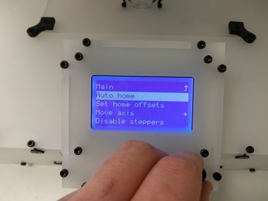

# Non-Hybrid Dual Calibrating Z Offset

Archived recovered from Printer_Commissioning 20160811132429 · source: wiki.e3d-online.com/wiki/Non-Hybrid_Dual_Calibrating_Z_Offset

Recovered from an older version of Printer Commissioning (20160811132429), section "(4.3.2) Calibrating Z Offset Dual" — the separate wiki page is not in the archive.

Auto Home.

Using the knob navigate to the **Prepare** menu.

Rotate the knob to select **Auto home**.

Check the printer is clear of potential hazards.

Push the knob.

The head(s) should move to (roughly) the origin i.e. X= 0.0 and Y = 0.0 and the bed should move up with the nozzles a short distance from the glass plate and then stop.

To see a video of the Dual correctly homing go here \| [https://youtu.be/DBDXf6ysArk](https://youtu.be/DBDXf6ysArk)

*\[image not archived: Display_disable.jpg\]*

Disable Steppers.

After the homing sequence has finished select **Disable Steppers** from the Prepare menu.

*\[image not archived: Move_to_centre.jpg\]*

Move.

Move the Printhead to the centre of the bed.

*\[image not archived: Undo_screws.jpg\]*

Moved.

Loosen off the screws holding the IR Sensor bracket and push the sensor up out the way.

*\[image not archived: Twist_tr8.jpg\]*

Rotate.

You now need to manually move the bed up towards the nozzle.

To do this you need to twist **both** leadscrews (clockwise as viewed from above) at the same time.

*\[image not archived: Dual_bed_up.jpg\]*

Adjust.

Move the bed until one or both of the nozzles are just touching against the glass bed.

*\[image not archived: Scrap_belt.jpg\]*

Belt.

Cut a length of belt approximately 30mm in length.

*\[image not archived: Scrap_belt_bed.jpg\]*

Belt on bed.

Place the belt on the bed directly under the IR Sensor.

Push the Sensor down against the belt.

*\[image not archived: Ir_tighten_dual.jpg\]*

Sensor.

Tighten the IR Sensor Bracket screws.

**Note**: Keep the IR Sensor pressed down with a finger while tightening the sensor.

*\[image not archived: Dual_move_axis.jpg\]*

Move.

On the LCD go to the Prepare menu and select **Move Axis**.

*\[image not archived: Dual_move_1mm.jpg\]*

1mm.

Select **Move 1mm**.

**This does NOT mean that the heads will immediately move 1mm !** It means that when you get to the menu where you see X (or Y or Z) 000.00 that turning the knob will THEN move the heads in increments of 1mm.

Move through the steps below until you see the axis you want to move in, select it you will then see 00.000 then move the knob and the heads will move.

*\[image not archived: Dual_move_z.jpg\]*

Z.

Select **Z**.

*\[image not archived: Drop_dual_bed.jpg\]*

Move Z.

Move the Z axis so the bed drops away from the Nozzles.

*\[image not archived: Drop_dual_bed_belt.jpg\]*

Clear.

Remove the belt from the heated bed.

*\[image not archived: Display_autohomed_dual.jpg\]*

Auto Home.

Using the knob navigate to the **Prepare** menu.

Rotate the knob to select **Auto home**.

Check the printer is clear of potential hazards.

Push the knob.\
