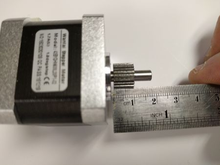

# Older Version Content

**Contents**

- [Slicer profiles (older Software page)](#slicer-profiles-older-software-page)
  - [Simplify3D](#simplify3d)
  - [Slic3r](#slic3r)
- [Simplify3D alpha profile (older First Print page)](#simplify3d-alpha-profile-older-first-print-page)
- [Slic3r alpha profile (older First Print page)](#slic3r-alpha-profile-older-first-print-page)
- [Hybrid Titan extruder steps (older Step By Step page)](#hybrid-titan-extruder-steps-older-step-by-step-page)

Content that appeared in older versions of this manual and was later removed, kept here for completeness. It is not part of the current build instructions. Current copies of the profiles and firmware are listed on the [Downloads](Downloads.md) page.

## Slicer profiles (older Software page)

From the BigBox Software page, version 20160601234712. Describes the Simplify3D and Slic3r profiles that were once offered, including the experimental dual-extruder profile. File and download links in this section pointed to files that the archive did not keep.

### [Simplify3D](https://www.simplify3d.com/)

The provided profiles are centered around printing E3D's Everyday PLA *(dead link; [archived copy](https://web.archive.org/web/20161105152053/http://e3d-online.com/All-Filament&filter=5,24,11))*, you will need to adjust the profile settings to suite your chosen filament.

Pro.fff *(dead link; [archived copy](https://web.archive.org/web/20160831005447/http://files.e3d-online.com/BigBox/Slicer%20Configs/Simplify3D/bigbox_pro.fff))*

This is the standard profile for Pro & Lite BigBox Printers.

Dual.fff *(dead link; [archived copy](https://web.archive.org/web/20160531182702/http://files.e3d-online.com/BigBox/Slicer%20Configs/Simplify3D/bigbox_dual.fff))*

This is the standard profile for Dual BigBox Printers.

Dual Experimental.fff *(dead link; [archived copy](https://web.archive.org/web/20160831005324/http://files.e3d-online.com/BigBox/Slicer%20Configs/Simplify3D/bigbox_dual_experimental.fff))*

This profile features an experimental *Layer-Change* script which removed the need to use a *Prime-Pillar* or an *Ooze-Sheild*. Use with caution. **Note**: This profile should only be used when printing with both extruders and using two filaments. Choosing this profile when only one extruder is in use will cause errors with your prints. You will need to change the *steps-per-mm* in the *Tool Change Script* to match your filaments.

### [Slic3r](http://slic3r.org/)

We have an alpha release of the BigBox Slic3r profile. It will work with all versions (Lite / Pro / Dual) but do note it is only for a single extruder.

BigBox_Slic3r_config_bundle.ini *(dead link)*

## Simplify3D alpha profile (older First Print page)

From the Your First Print page, version 20151230221140. Early single-extruder profile. File and download links in this section pointed to files that the archive did not keep.

We have an alpha release of the BigBox S3D profile. It will work with all versions (Lite / Pro / Dual) but do note it is only for a single extruder.

`https://dl.dropboxusercontent.com/u/54348751/BigBoxSingle-alpha-settings.fff` *(dead link)*

## Slic3r alpha profile (older First Print page)

From the Your First Print page, version 20151230221140. Early single-extruder profile. File and download links in this section pointed to files that the archive did not keep.

We have an alpha release of the BigBox Slic3r profile. It will work with all versions (Lite / Pro / Dual) but do note it is only for a single extruder.

`https://dl.dropboxusercontent.com/u/54348751/BigBox_Slic3r_config_bundle.ini` *(dead link)*

## Hybrid Titan extruder steps (older Step By Step page)

From the Printer main assemblies: Step By Step Assembly Process page, version 20160526045438. The Titan extruder bracket, nuts, motor and lid steps, as written in section (21.1) until June 2016, when they were replaced by a link to the Sub-assemblies page. Only the gear spacing note was kept there. The photos of these steps were never archived.

\[image not archived: "V1.1.jpg"\]

\[image not archived: "1.1_nuts.jpg" Caption: "Nuts."\]

- 2 x M2 Hex Half Nuts (Bag 3).
- 1 x Titan Extruder Bracket (Printed Part).

Push the two Nuts into the Bracket.

\[image not archived: "1.1_titan.jpg" Caption: "Titan."\]

- 2 x M4 16mm Screws (Bag 14).

Fit the Titan Extruder bracket to the V1.1 X-Carriage.

*Gear.*

- 1 x Stepper Motor (Motors Box).
- 1 x Pinion Gear (Titan Kit).
- 1 x Pinion Gear Grub Screw (Titan Kit).

Position the Pinion Gear onto the Motor shaft.

Some people like to smooth the corners off the flat on the motor shaft towards the end as they corners may wear the hole in the idler

**Leave 1.5mm Between the gear and the motor chassis.**

**Note**: The Grub Screw needs to be positioned towards the motor.

Tighten the grub screw to secure the gear.

\[image not archived: "1.1_titan_fit.jpg" Caption: "Fitting."\]

- 1 x M3 10mm Screw (Bag 8).
- 1 x Titan Body (Titan Kit).

Secure the Stepper Motor to the Titan Body using the M3 Screw in the lower right hole.

\[image not archived: "1.1_titan_motor.jpg" Caption: "Correct."\]

Make sure that the connector for the motor faces out towards the left side.

\[image not archived: "1.1_titan_bowden.jpg" Caption: "Remove."\]

Remove the clip from the Bowden Adapter.

\[image not archived: "1.1_titan_main_gear.jpg" Caption: "Gears."\]

- 1 x Titan Main Gear (Titan Kit).
- 1 x Bowden Adapter (Titan Kit).

Fit the Gear and Bowden Adapter.

\[image not archived: "1.1_titan_main_idler.jpg" Caption: "Idler."\]

- 1 x Titan PTFE Guide (Titan Kit).
- 1 x Titan Idler Lever (Titan Kit).
- 1 x Titan Idler Spring, Screw & Nut (Titan Kit).

Fit the Guide and Lever followed by the Idler Spring, Screw & Nut.

\[image not archived: "1.1_titan_lid.jpg" Caption: "Lid."\]

- 3 x M3 x 35mm Screw (Titan Kit).
- 1 x M3 x 25mm Screw (Titan Kit).

Secure the Lid to the Titan Extruder.\
