# Printer Commissioning

Archived 20210415222724 · source: wiki.e3d-online.com/wiki/Printer_Commissioning · [archive link](https://web.archive.org/web/20210415222724/https://wiki.e3d-online.com/Printer_Commissioning)

**Contents**

- [(1) Belts, Pulleys & Rods](#1-belts-pulleys--rods)
  - [(1.1) X-Axis](#11-x-axis)
  - [(1.2) Y-Axis](#12-y-axis)
    - [(1.2.1) Y-Axis Motor](#121-y-axis-motor)
  - [(1.3) Z-Axis](#13-z-axis)
  - [(1.4) Leadscrews](#14-leadscrews)
- [(2) Glass Build Plate](#2-glass-build-plate)
  - [(2.1) Clips](#21-clips)
  - [(2.2) Glass](#22-glass)
- [(3) Ooze Wiper Adjustment](#3-ooze-wiper-adjustment)
- [(4) Homing](#4-homing)
  - [(4.1) Pre-Checks](#41-pre-checks)
  - [(4.2) Power On](#42-power-on)
    - [(4.2.1) Pro & All Hybrid Extruders](#421-pro--all-hybrid-extruders)
    - [(4.2.2) Dual Extruders](#422-dual-extruders)
    - [(4.2.3) Z-Axis Leadscrew Steps-Per-MM](#423-z-axis-leadscrew-steps-per-mm)
  - [(4.3) Calibrating Z Offset](#43-calibrating-z-offset)
    - [(4.3.1) Pro, Lite & Hybrid Pro/Dual](#431-pro-lite--hybrid-produal)
    - [(4.3.2) Non-Hybrid Dual Calibrating Z Offset](#432-non-hybrid-dual-calibrating-z-offset)
- [(5) Zero X & Y](#5-zero-x--y)
- [(6) Z-Axis Calibration](#6-z-axis-calibration)
- [(7) Tightening the HotEnd](#7-tightening-the-hotend)
- [(8) Dual Nozzle Alignment](#8-dual-nozzle-alignment)
  - [(8.1) Levelling](#81-levelling)
  - [(8.2) Extruder Offset](#82-extruder-offset)
  - [(8.3) G-Code](#83-g-code)
- [(9) Bed levelling](#9-bed-levelling)
  - [(9.1) Auto-Levelling the Pro, Lite & Hybrid Models](#91-auto-levelling-the-pro-lite--hybrid-models)
  - [(9.2) Mesh Levelling the Non-Hybrid Dual](#92-mesh-levelling-the-non-hybrid-dual)
- [(10) The Finishing Touches](#10-the-finishing-touches)
- [Where next?](#where-next)

## (1) Belts, Pulleys & Rods

### (1.1) X-Axis

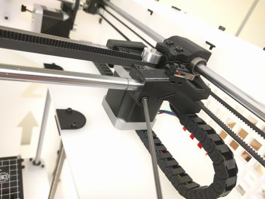

Rod clamps.

Move the Printhead to the front of the printer.

Tighten the clamps holding the X-Axis bars to the [X-Axis Motor Mount](BigBox_Parts_Preparation.md "BigBox Parts Preparation").

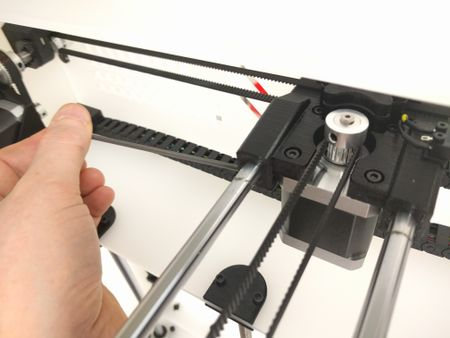

Rod clamps.

There are screws on both sides.

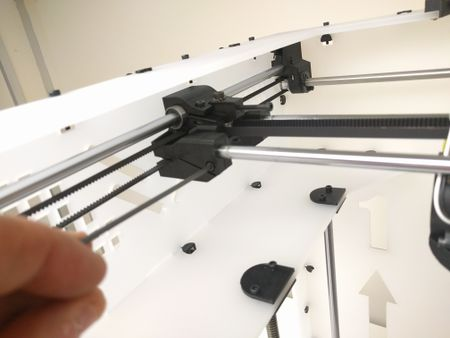

Rod clamps.

Repeat this on the [X-Axis Idler](BigBox_Parts_Preparation.md "BigBox Parts Preparation").

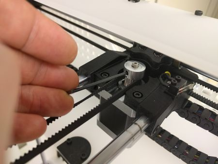

Pulley.

Position the X-Axis Pulley with a grub over the flat on the motor shaft. If necessary tighten the other grub screw a little to hold first grub screw in position adjacent to the flat on the shaft.

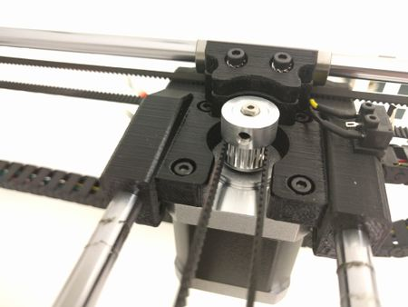

Pulley.

Tighten the grub in the pulley, leave about 1mm of space between the bottom of the pulley and the motor.

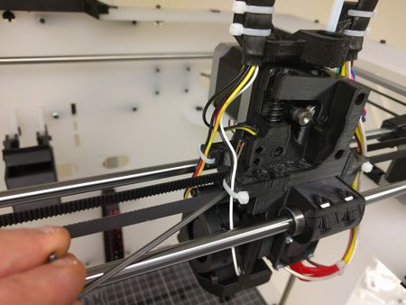

Tension.

Insert an 2.5 mm Allen Key into the slot in the Printhead. The slot is immediately below the limit (micro) switch.

Turning the Allen Key anticlockwise (undo) will tighten the belt.

Watch this video of the belt being tightened \| **[https://youtu.be/5X6I6plC3d8](https://youtu.be/5X6I6plC3d8)**

Watch this video of a correctly tensioned belt \| **[https://youtu.be/0RpnXo2UQ0Y](https://youtu.be/0RpnXo2UQ0Y)**

### (1.2) Y-Axis

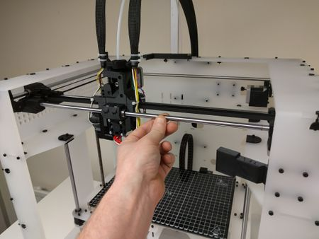

Slide forward.

Move the Printhead to the front of the printer.

**We are assuming you have not tightened any of the pulley grubscrews or done up any of the screws holding the Y-Axis components to the frame. If you have done so please loosen them off now.**

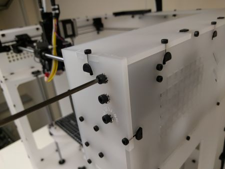

Front screws.

Making sure the Printhead is at the front of the printer, tighten the two screws holding the [Y-Axis Front Brackets](BigBox_Parts_Preparation.md "BigBox Parts Preparation") to the frame.

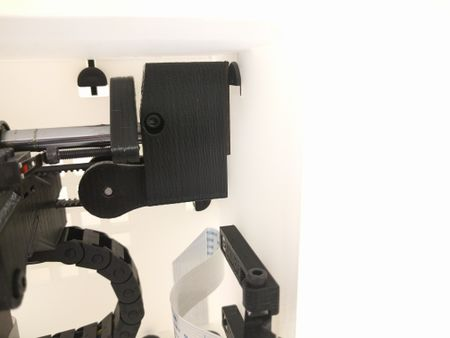

Cork.

Tightening up the screws will compress the cork pads on the Y-Axis Front Brackets. This is a good thing, however you will need to adjust the tension so the part sits squarely against the frame.

**Note**: The cork will compress by 0.5mm - 1mm.

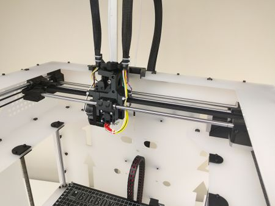

To the back.

After screwing up the both front Y-Axis Brackets move the Printhead to the back of the printer.

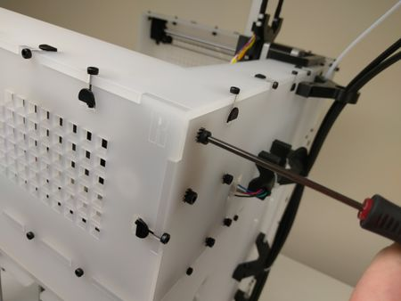

Tighten.

Tighten the two screws holding each of the [Y-Axis Rear Brackets](BigBox_Parts_Preparation.md "BigBox Parts Preparation") to the frame.

The cork pads will compress in a similar way to the front. Ensure the parts are square.

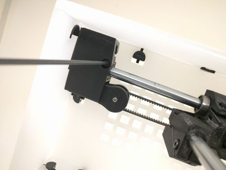

Front again.

Move the Printhead to the front of the printer again and tighten the screw in the side of the Y-Axis Front Brackets.

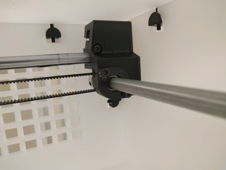

Back again.

Move the Printhead to the back of the printer again and tighten the screw in the side of the Y-Axis Rear Brackets.

Once complete the Y-Axis should run smooth and not feel lumpy or gritty. You may need to loosen some of the Y-Axis Brackets and re-adjust the position.

Watch this video to see a smooth Y-Axis \| **[https://youtu.be/PvswubV-zas](https://youtu.be/PvswubV-zas)**

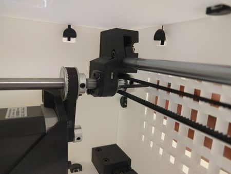

Push the pulley.

Using an Allen Key or similar push the pulley on the Y-Axis Rear Bar Assembly inwards against the nylon washer.

Repeat this with the other pulley.

**Note**: Don't push too hard, you want a little bit of play.

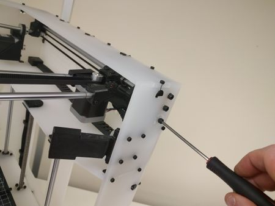

Tension the belt.

Adjust the tension on the belt by tightening the screw at the front of the printer.

Remember to do this for both belts.

Watch this video to see the belt tension setting \| **[https://youtu.be/dtdeFrBScJQ](https://youtu.be/dtdeFrBScJQ)**

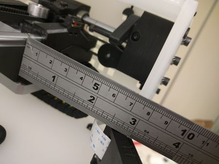

Measure.

Move the Printhead to the front of the printer.

Position the one side of the X-Axis a known distance from the front of the frame. In this case I have chosen 70mm.

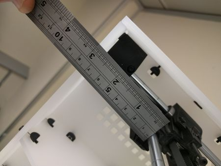

Measure the other side.

Measure the opposite side.

If there is any difference you can adjust it by holding one end in place and carefully moving the other end so they are both at the same distance. It may take a few goes to get it right. If you find it hard to adjust make sure the grubs on the pulleys are loose.

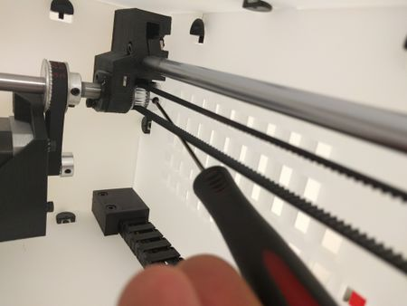

Tighten the grub screw.

Check the pulleys have not shifted while you have been adjusting the axes.

Tighten the grub screws in the Y-Axis pulleys.

**Note**: There are two screws in each pulley. There will be four in total.

#### (1.2.1) Y-Axis Motor

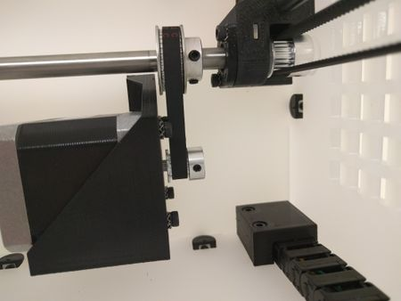

Align the parts.

Align the pulleys and belt as shown.

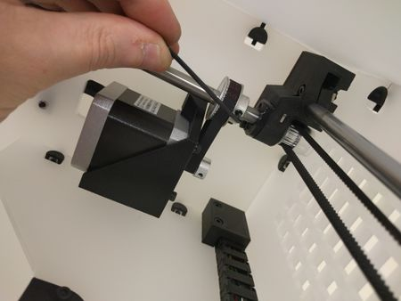

Tighten the grubs.

Tighten the two grub screws on each pulley.

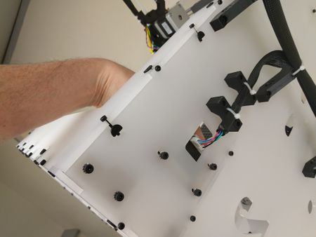

Push down.

Push down the motor to tension the belt.

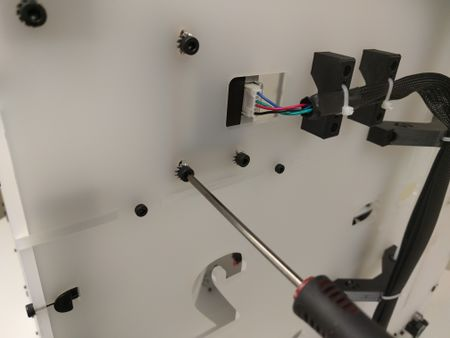

Tighten.

Tighten the three screws securing the [Y-Axis Motor Bracket](BigBox_Parts_Preparation.md "BigBox Parts Preparation").

**Make sure the motor stays horizontal. A misaligned motor can cause wear on the belts.**

### (1.3) Z-Axis

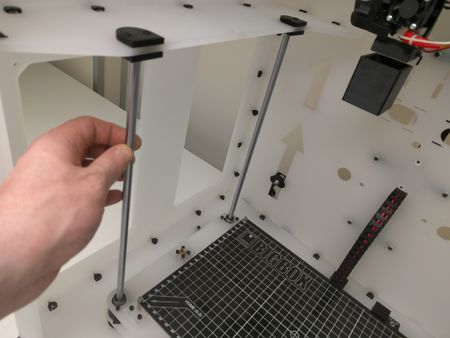

Check.

Make sure all the screws holding the Z-Bed printed corners are loose and that the parts are free to move. Check the Z-Tops are free too.

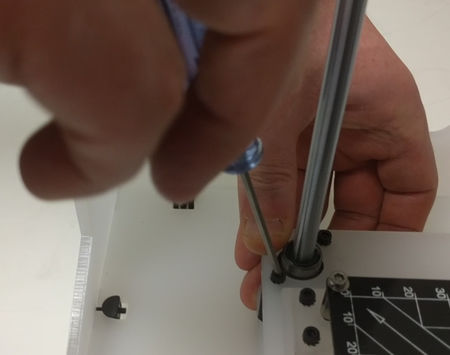

Bed.

Watch this video for instructions on Tramming the Z-Bed.

**[https://youtu.be/1v27cCMtCCI](https://youtu.be/1v27cCMtCCI)**

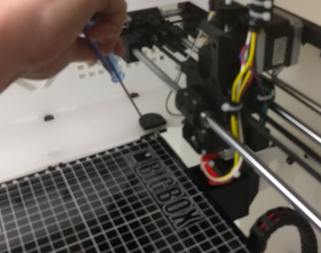

Rod Tops.

Watch this video for instructions on Tramming the Z-Rods.

**[https://youtu.be/Is6ddMdZ63E](https://youtu.be/Is6ddMdZ63E)**

### (1.4) Leadscrews

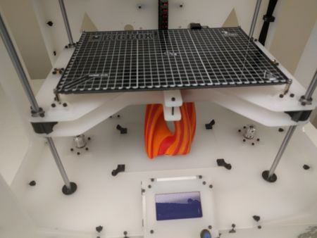

Up.

Raise up the bed and place an object underneath to keep it supported.

Make sure that it is possible to extract this object once you have finished the lead screw install WITHOUT having to raise the bed, as to do this you will have to rotate each lead screw by hand. Tip: You could use a few thick books under the bed, which would be easy to slide out again.

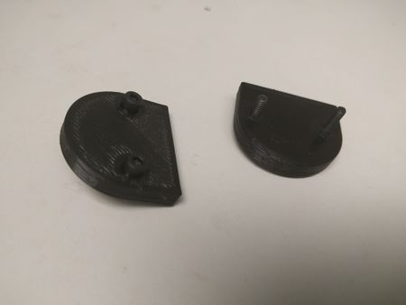

Cover.

- 2 x Z-Axis Driver Bottoms (Printed Parts).
- 4 x M3 Hex Half Nuts (Bag 5).

Push the nuts into the recesses.

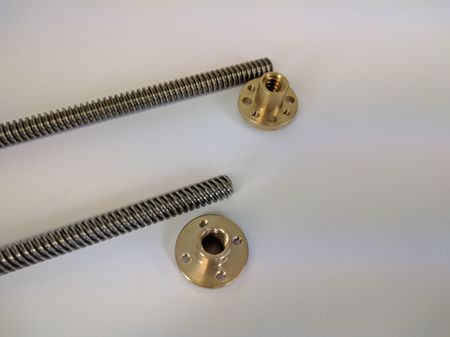

Leadscrews.

There are two versions of Leadscrews & Brass Nuts.

The older version has a 2mm pitch with 8 holes in the nuts.

The newer versions have an 8mm pitch and 4 holes in the nuts.

**Note**: Depending on the version you may need to change the Steps-Per-MM for Z. We will explain how to do this at a later stage.

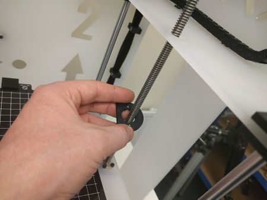

Leadscrew.

Pass a Leadscrew through the Bottom, and screw it into the nut.

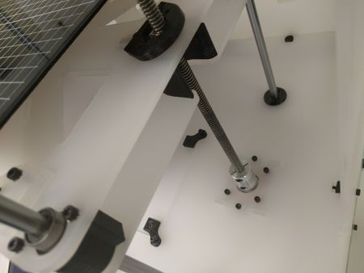

Coupler.

Continue to screw in the Leadscrew all the way down into the coupler until the bed begins to move upwards slightly. The Leadscrew needs to be in as far as it can go.

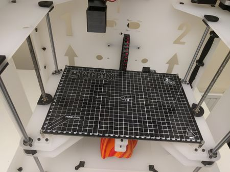

Both Leadscrews.

Repeat on the other side.

Cover.

- 2 x Z-Axis Driver Tops (Printed Parts).
- 4 x M3 12mm Screws (Bag 9).

Insert the screws into the Tops. Note the recesses for the screw caps.

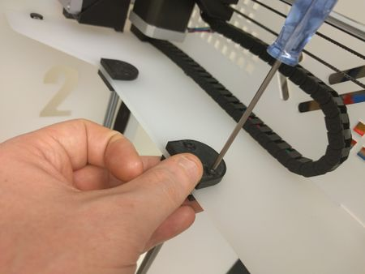

Fit the Tops.

Screw the tops to the Bottoms.

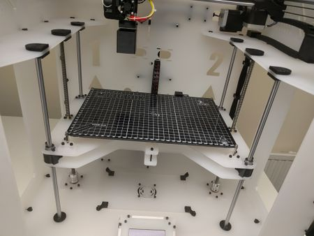

Fit the Tops.

Repeat on the other side.

Remove the support under the Z-Bed.

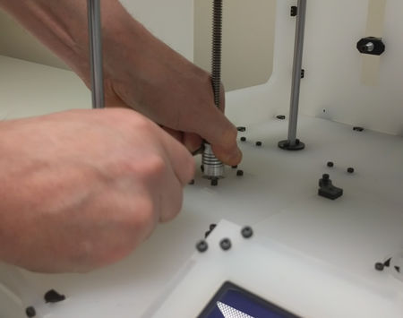

Couplers.

Watch this video for instructions on coupling the Leadscrews.

**[https://youtu.be/8A-qU3\_-mCk](https://youtu.be/8A-qU3_-mCk)**

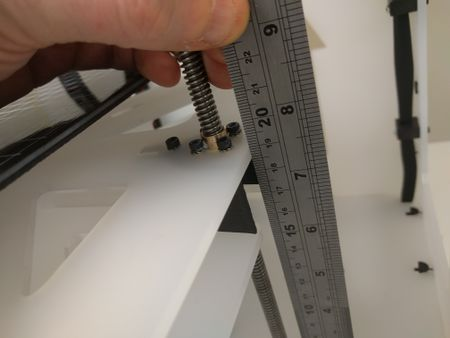

Measure.

Using a ruler, measure one side of the bed at the brass nuts from the lower support, to the top layer on the Z-Bed. Make note of its height.

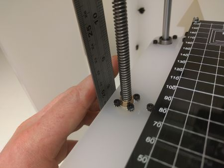

Measure again.

Measure the other end of the bed and adjust the height by twisting the Leadscrew. You may need to check each side a few times to get them perfectly aligned.

## (2) Glass Build Plate

### (2.1) Clips

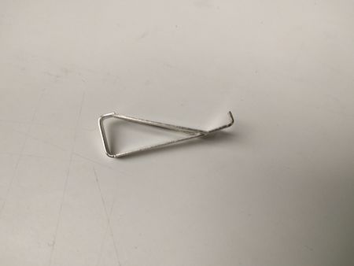

Rod clamps.

- 8 x Bed Clips (Stretch Box).

Select a clip from the bag.

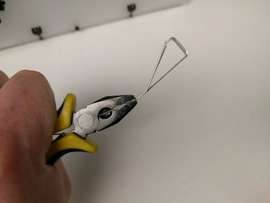

Squash.

Using a pair of pliers squash down the tip of the clip

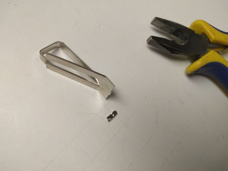

Break.

Break off the tip.

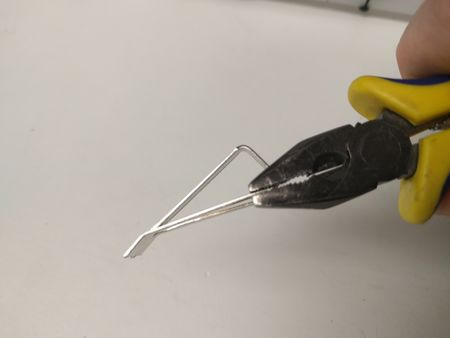

Prong.

Grip one of the prongs about 3mm from the end.

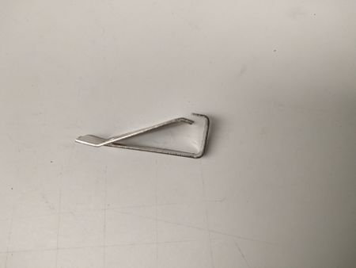

Bent.

Bend the ends as shown.

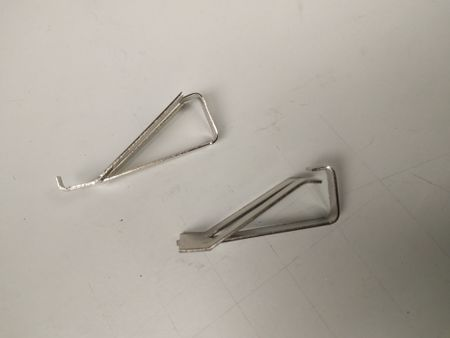

Before and After.

Before and after.

Repeat with all the clips.

### (2.2) Glass

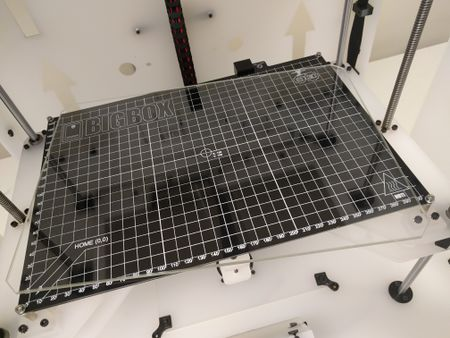

Glass Plate.

Pop the glass plate on the PCB

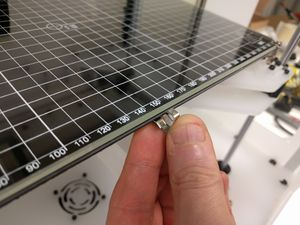

Clip on.

Fit a clip at the front of the bed and clip it over the glass.

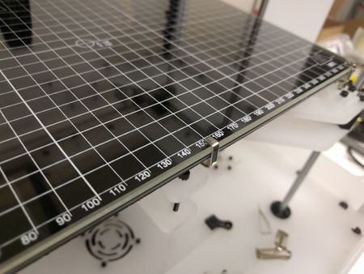

Clip on.

Fitted clip

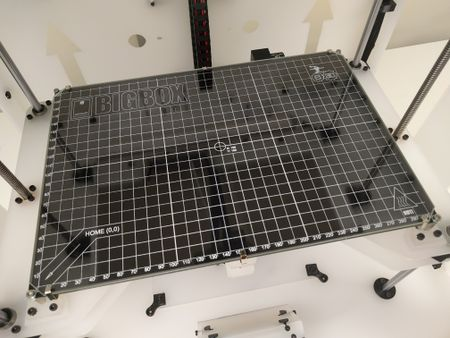

Clips on.

Fit six clips around the bed.

## (3) Ooze Wiper Adjustment

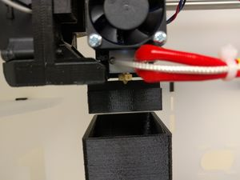

Ooze.

Move the Printhead to the rear of the printer, just in front of the rubber Ooze Wiper Blade.

See step below for adjusting the fans, you may have to perform this step before the nozzles will come into contact with the wiper.

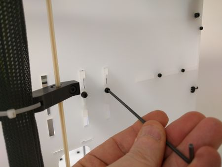

Loosen.

Loosen off the screws holding the Ooze Wiper & Dump Bucket to the frame.

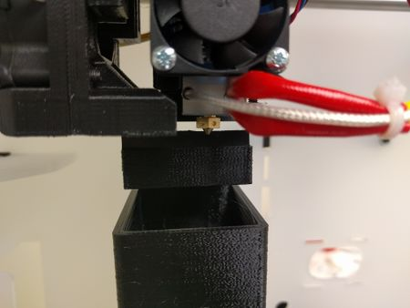

Adjust.

Adjust the Ooze Wiper up and down until just the tip of the nozzle will come into contact with the rubber.

Tighten up the screws on the frame to hold the wiper in place.

## (4) Homing

### (4.1) Pre-Checks

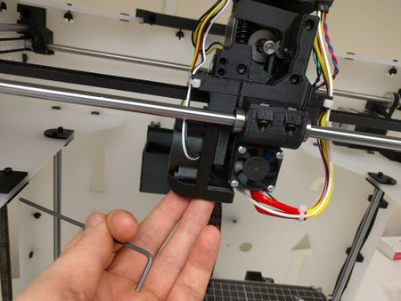

IR Sensor.

Loosen the two screws holding the Print Cooling Fan to the X-Carriage.

Move the fan up as far as it will go.

Tighten the screws up again.

If you have a BigBox Dual remember to move the second Print Cooling Fan.

Y Endstop.

Manually move the Printhead forward and check the Y-Axis Endstop is triggered.

X Endstop.

Manually move the Printhead left and check the X-Axis Endstop is triggered.

### (4.2) Power On

#### (4.2.1) Pro & All Hybrid Extruders

IR Sensor.

**Non-Hybrid Dual adjustment (4.2.2) is ten steps down the page**

Loosen the two screws holding the IR Sensor to the X-Carriage.

Move the Sensor down as far as it will go. It should protrude lower than the Nozzle.

Tighten the screws up again.

IF YOU HAVE ALREADY BUILT YOUR PRINTER AND YOU ARE FOLLOWING THIS PROCEDURE TO (RE) COMMISSION THEN YOU WILL NEED TO RESET THE DATA ON THE RUMBA, (OTHERWISE Z-AXIS CALIBRATION ETC WON'T WORK) BY SELECTING Restore failsafe.

Bootscreen.

Power on your BigBox.

Ready.

The BigBox is now awaiting your command.

Info.

Push the knob on the screen.

Control.

Rotate the knob to select **Control**.

Push the knob.

Motion.

Rotate the knob to select **Motion**.

Push the knob.

Z Offset:.

Rotate the knob to select **Z Offset:**.

Push the knob.

-05.00.

Rotate the knob to select until the value reads **-05.00**.

**Note**: The value is a negative number **-**.

Push the knob.

Control.

Rotate the knob to select **Control** to go back.

Push the knob.

Store memory.

Rotate the knob to select **Store memory** to save the offset.

Push the knob.

**Note**: The screen will not change when pressing the knob.

#### (4.2.2) Dual Extruders

If you are building an older **Non-Hybrid** Dual Extruders \| [Click Here](Dual_Extruders.md "Dual Extruders")

#### (4.2.3) Z-Axis Leadscrew Steps-Per-MM

Only carry out this step if you have identified that you have the newer 8mm-Pitch Leadscrews & Nuts.

Info.

Push the knob on the screen.

Control.

Rotate the knob to select **Control**.

Push the knob.

Motion.

Rotate the knob to select **Motion**.

Push the knob.

Zsteps/mm.

Rotate the knob to select **Zsteps/mm**.

Push the knob.

400\.

Rotate the knob to change the value from 1600 to **400**.

Push the knob.

Control.

Rotate the knob to select **Control** to go back.

Push the knob.

Store memory.

Rotate the knob to select **Store memory** to save the offset.

Push the knob.

**Note**: The screen will not change when pressing the knob.

### (4.3) Calibrating Z Offset

#### (4.3.1) Pro, Lite & Hybrid Pro/Dual

(Calibrating Z Offset **Dual** is in section **4.3.2** twenty steps below)

Auto Home.

Using the knob navigate to the **Prepare** menu.

Rotate the knob to select **Auto home**.

Check the printer is clear of potential hazards.

Push the knob.

To see a video of the printer correctly homing look here \| **[https://youtu.be/hDD1arof7YM](https://youtu.be/hDD1arof7YM)**

Centered.

After homing has completed the Printhead will stop in the middle of the build space.

5mm.

The display will show a Z height of 5mm.

The Nozzle is of course not 5mm above the bed, we need to correctly position the IR sensor and calibrate the Z Offset.

Loosen the screws holding the IR Sensor to the X-Carriage. Move the IR Sensor as far up as it will go.

Move Axis.

Navigate through to the **Prepare** menu.

Select **Move Axis**.

Push the knob.

0.1mm.

Select **Move 0.1mm**.

Push the knob.

Move Z.

Select **Move Z**.

Push the knob.

Move Z up.

Using the knob carefully move the bed up so that the tip of the Nozzle is just touching the glass.

Cut a strip.

Cut a short length of belt from the remaining scrap, about 50mm long.

Under the IR Sensor.

Place the strip of belt under the IR Sensor at the back of the Printhead.

Press down.

Press the sensor down against the belt. Make sure it sits level.

Tighten.

Tighten the screws holding the IR sensor to the X-Carriage.

Auto Home.

Navigate through the menu and run the **Auto home** sequence again.

Z.

The Nozzle will now be at the correct height above the glass and the IR Sensor will be clear of the bed too.

Now we need to adjust the Z Offset as it is still incorrectly set at 5mm.

Move Z.

Navigate through the menus to **Move Z** in **0.1mm** increments.

Correct.

Move the bed up until the Nozzle is very slightly above the bed.

Difference.

Note the change in height.

The adjustment is 0.5mm, we'll need to input that data into the Z Offset option in the Motion menu.

**This will likely be a different value for your BigBox.**

Z Offset.

Navigate through **Control**, **Motion**, **Z Offset**.

Set the Z Offset to -00.50mm

Store memory.

Navigate back and select **Store Memory**.

**Note**: The screen will not change when pressing the knob.

Z Calibrated.

Navigate the menu and begin the **Auto home** sequence. At the end of the autohome sequence the print head will NOT be offset from the bed at the distance you have set, it will be higher. This is fine.

Confirm the Z Offset is correct by moving the bed up to meet the Nozzle. It should stop at **00.00** with the Nozzle just above the glass.

#### (4.3.2) Non-Hybrid Dual Calibrating Z Offset

If you are building an older **Non-Hybrid** and Calibrating Z Offset \| [Click Here](Non-Hybrid_Dual_Calibrating_Z_Offset.md "Non-Hybrid Dual Calibrating Z Offset")

## (5) Zero X & Y

Zero.

The X & Y Axes will need Zeroing in relation to the build plate. The bed has 0,0 marked in the front left corner. We want to adjust the endstop triggers so the nozzle will be perfectly aligned to those coordinates.

If you have screwed the end stops screws a long way in, the zero point the X-Carriage goes to when you hit home in the sequence below will be close to the X-Axis edge of the glass plate and the "home" action may push these clips along/off. Adjust the Y-Axis end stop out a little to avoid this.

As the zero point is very hard to see on the dual, placing the edge of a thick piece of paper or an envelope along the Y zero axis and marking the edge of the glass plate you can see from the front will allow you to look along and see if the nozzle is aligned at zero.

Move X.

After the homing sequence has completed navigate through the menus and select **1mm** increments then **Move X**.

Move to 0.00.

Move the X-Axis to **00.00**

After the "home" sequence this 00.00 is where the machine THINKS 00.00 is (as it hits the X limit switch) Of course it may not be at 0. To adjust this first move the heads out of the way (PREPARE - MOVE AXIS menu sequence) then adjust the X endstop and run the HOME sequence again and check if X is at zero on the plate. Loop through this until X= 00.00 on screen is when the nozzle is at X = 0 on the plate.

Incorrect X.

If the Y-Axis Endstop trigger is not correctly set the 0 position for X will of course be wrong.

Adjust the screw.

Turning the screw clockwise will move the trigger point further to the left.

After you have made an adjustment re-run the Auto home sequence.

Correct position.

A correctly set X-Endstop Trigger.

Move Y.

Repeat the process for the Y-Axis. Run "home" to see where the Y Axis limit switch is triggered, check this on the plate, adjust the Y endstop (just above the Pi Cam) and run "home" again to see if Y = 00.00 on screen is actually Y = 0 on the plate. Loop round this process until they are.

Incorrect Y.

The incorrect position for Y.

Adjust Y.

Adjust the Y-Endstop Trigger.

Adjust Y.

Adjust the Y-Endstop Trigger.

X & Y Zeroed.

With both axes setup correctly you'll be able to position the Nozzle to **0,0**.

**Note**: If you have the Hybrid Printhead, the right extruder (**HE1**) should be aligned to **0,0**.

## (6) Z-Axis Calibration

Z-Bed Calibration.

To get the best from the Z-Axis one needs to align the Z-Axis Motors with the bed.

Begin by loosening the four screws holding the motors to the Lower Support. The motors should be able to freely wiggle around.

Grease.

Now is a good time to add a little lithium grease to the top of the leadscrews and rods.

All the way down.

Via the menus run the bed all the way down to the bottom.

Tighten.

Tighten the accessible screws holding the motors.

More grease.

Tighten the screws securing the Brass nuts.

Apply some more grease to the leadscrews.

Tighten.

Raise the Z-Axis and tighten the other motor screws.

## (7) Tightening the HotEnd

Lower the bed.

To ensure a leak-free nozzle we need to perform the final tightening. This is done with the nozzle at temperature.

It is worth at this point checking that you can access the heater block and nozzle with your spanners (before the temperature rises) as access is a little restricted.

Using the LCD lower the Z-Axis, somewhere around 200mm should be fine.

**Note**: There is a firmware bug which causes the bed to change height and reset to 0, please refer to the forum for support \| forum.e3d-online.com *(dead link; [archived copy](https://web.archive.org/web/20240324165937/https://forum.e3d-online.com/))*

Control.

On the LCD select **Control**.

Temperature.

Select **Temperature**.

Nozzle 1.

Select **Nozzle 1**.

**Note**: If you have a Pro or Lite BigBox you will only have the option of selecting a single Nozzle.

285\.

Set the temperature to **285°**.

Fans!

The HotEnd fan(s) are firmware controlled and programmed to come on at 40°. If this does not happen shutdown the printer and check your wiring.

Wait.

Wait for the temperature to reach it's mark.

Tighten.

While holding the Heater block securely in a pair of pliers, tighten the nozzle.

Precise instructions from the E3D v6 assembly documentation.

*When the HotEnd is at temperature, tighten the nozzle whilst holding the heater block with a spanner (5/8" may fit) . This will tighten the nozzle against the HeatBreak and ensure that your HotEnd does not leak. You want to aim for 3Nm of torque on the hot nozzle - this is about as much pressure as you can apply with one finger on a small spanner. The nozzle does not need to be torqued down incredibly tightly to form a good seal, when at lower temperatures the aluminium will contract and hold the Nozzle and HeatBreak together.*

Off.

After the nozzle has been tightened, turn it off.

From the **Prepare** menu select **Cooldown**.

The temperature will now be set to **0**.

**Note**: The display will not change when you press the knob. To check it has turned off the nozzle return to the main screen.

Nozzle 2.

For those with a Dual you will need to repeat this process with Nozzle 2.

## (8) Dual Nozzle Alignment

### (8.1) Levelling

Pin.

To get the best performance from the BigBox Dual it is important to spend a few minutes aligning and levelling the two nozzles. I will demonstrate the method I use to align the two together.

Find a suitably pointed object which we'll use as datum and reference point. I like to use pins, or you may find this printable tool helpful \| [Dual Extruder Alignment Tool](https://www.thingiverse.com/thing:1686515)

**Note**: Make sure the Printhead has been Autohomed before you begin, we'll need to use the X, Y & Z Axes to calculate the second extruder's offset.

Centre Pin.

After running the Autohome function place the pin at the centre of the heated bed approximately 5mm back from the front, i.e. Y is at 5mm on the grid.

Positioned.

Using the LCD lower the Z-Axis and move the Printhead so the left extruder sits as close to the top of the pin as you can get it without it actually touching. You will need to move the Axes in 0.1mm increments to get an accurate position.

Next Extruder.

Using the LCD move the Printhead along the X-Axis in 1.0 mm increments until the right nozzle is close to the pin. Stop before the nozzle touches it.

Fan Off.

Unclip the fan from the right HotEnd to access the front grubscrew.

Allen.

The right nozzle needs to have it's height adjusted level with the left nozzle.

I find using a short 2mm Allen key is the most effective tool to adjust the grub screws.

Fan Off.

Tighten the grub screws at both the back and front of the HotEnd. You won't need to turn the spanner much, maybe half a turn, to get the alignment close.

Check Right.

When there is enough clearance below the nozzle use the LCD to move the right nozzle over the top of the pin.

Check Left.

Using the LCD move the Printhead to change which nozzle is over the pin.

**Note**: Only adjust the height of the right extruder. It will take a few attempts to get it right, the longer you spend setting it up and the more precisely you can align the two nozzles the better your prints will be!

When you are finished put the fan back on the HotEnd. **DON'T** remove or move the pin yet, you will need it for the next stage of calibration.

### (8.2) Extruder Offset

Centre.

To print correctly your BigBox needs to know the X & Y difference between the two nozzles.

Align the left nozzle directly above the pin, Try to get it as close to central as you can. You will likely need to move both X & Y Axes.

X.

Take note of the X position, in this case it is 149.8.

X.

Move the printhead so that the right nozzle is exactly centered over the pin.

X.

Take note of the X position, in this case it is 114.6.

Y.

Now we want to move in the Y-Axis.

A small mirror on a stick is useful to see the Y alignment between the pin and the nozzle, place the mirror on the bed to the left or right of the X-Carriage and at about 45 degrees. Turn the mirror until the two nozzles line up at which point you can see the offset wrt the pin.

Y.

Make note of the starting position, 5.00.

Y.

Move the Printhead so the nozzle sits exactly over the pin.

Y.

Make note of the new Y position, 5.4.

Numbers.

Using our measurements we can calculate the extruder offset.

**X**

*149.8 - 114.6 =* ***35.2***

**Y**

*5.0 - 5.4 =* ***-0.4***

### (8.3) G-Code

M218.

The M218 G-Code command is used to set the extruder offset.

For an in depth explanation visit the RepRap Wiki \| [reprap.org](http://reprap.org/wiki/G-code#M218:_Set_Hotend_Offset)

**M218 T1 X35.2 Y-0.4**

The code needs to be sent to the BigBox each time the printer is turned on, or ideally just before a new print is started.

The easiest way is to add the command to the start-script of your slicers profile. For additional support please visit the forums \| forum.e3d-online.com *(dead link; [archived copy](https://web.archive.org/web/20240324165937/https://forum.e3d-online.com/))*

## (9) Bed levelling

### (9.1) Auto-Levelling the Pro, Lite & Hybrid Models

Autolevelling.

Check the printer is clear of potential hazards.

Run an **Auto home** sequence, then via the **Prepare** menu, select **Level Bed**.

To watch a video of the homing sequence click here \| **[https://youtu.be/2_GjLWiQV_I](https://youtu.be/2_GjLWiQV_I)**

If the Level Bed function performs correctly your printer is now correctly calibrated and levelled.

### (9.2) Mesh Levelling the Non-Hybrid Dual

If you are building an older **Non-Hybrid** and Mesh Levelling \| [Click Here](Mesh_Levelling_the_Non-Hybrid_Dual.md "Mesh Levelling the Non-Hybrid Dual")

## (10) The Finishing Touches

Stickers!

The Stickers have been provided with acrylic kits.

Gently peel.

They are a two part sticker with and they need the back removing first.

Gently begin to peel off the back.

Stickers!

The stickers should adhere to the tissue-like front covering.

Stickers!

Line up the BigBox sticker on the front left side.

Stickers!

Press the sticker against the acrylic and rub it over a few times with the tip of your finger.

Stickers!

Carefully peel off the front tissue-like covering.

Stickers!

The sticker should remain attached to the acrylic.

Stickers!

Do the same with the E3D Logo, it sticks to the front right of the BigBox as shown.

Stickers!

And repeat with the Made In Britain sticker.

This sticker goes at the top left of the frame.

Stickers!

For owners of the v1.1 we have supplied BigBox v1.1 stickers for the back panel!

Stickers!

The two Kickstarter logos fit one each to the sides.

Stickers!

Done!

## Where next?

Back to the [BigBox Main Assemblies](Printer_main_assemblies_Step_By_Step_Assembly_Process.md "Printer main assemblies: Step By Step Assembly Process")

Continue to the [BigBox Your First Print](Your_First_Print.md "Your First Print")

Home to the [BigBox Build Manual Main Index](BigBox_Build_Manual.md "BigBox Build Manual")
