# Printer main assemblies: Step By Step Assembly Process

Archived 20200127192408 · source: wiki.e3d-online.com/wiki/Printer_main_assemblies:\_Step_By_Step_Assembly_Process

**Contents**

- [(1) Y-Axis Rear-Bar Assembly](#1-y-axis-rear-bar-assembly)
- [(2) Y-Axis Rear-Bar Installation](#2-y-axis-rear-bar-installation)
- [(3) X-Axis & Y-Axis Assembly](#3-x-axis--y-axis-assembly)
- [(4) X-Axis & Y-Axis Installation](#4-x-axis--y-axis-installation)
- [(5) X-Axis Motor Installation](#5-x-axis-motor-installation)
- [(6) Single Direct-Drive X-Carriage](#6-single-direct-drive-x-carriage)
- [(7) Dual Direct-Drive X-Carriage](#7-dual-direct-drive-x-carriage)
- [(8) Hybrid X-Carriage](#8-hybrid-x-carriage)
  - [(8.1) X-Carriage Belt](#81-x-carriage-belt)
- [(9) Y-Axis Endstop](#9-y-axis-endstop)
- [(10) Y-Axis Motor Install](#10-y-axis-motor-install)
- [(11) Y-Axis Belts](#11-y-axis-belts)
- [(12) X-Axis Cable Conduits](#12-x-axis-cable-conduits)
- [(13) X-Axis Drag Chain](#13-x-axis-drag-chain)
- [(14) Frame Top](#14-frame-top)
- [(15) Spool Holder Brackets](#15-spool-holder-brackets)
- [(16) Cable Spine](#16-cable-spine)
- [(17) Frame Ancillaries](#17-frame-ancillaries)
  - [(17.1) Exhaust Fan](#171-exhaust-fan)
  - [(17.2) Spool Inner Brackets](#172-spool-inner-brackets)
  - [(17.3) Base Frame Struts](#173-base-frame-struts)
  - [(17.4) Z-Axis Motors](#174-z-axis-motors)
  - [(17.5) Z-Axis Lower Rod Brackets](#175-z-axis-lower-rod-brackets)
  - [(17.6) A/C IEC Socket](#176-ac-iec-socket)
- [(18) Control Connection](#18-control-connection)
  - [(18.1)USB](#181usb)
  - [(18.2) RJ45 (OctoPrint Upgrade)](#182-rj45-octoprint-upgrade)
- [(19) Single Direct-Drive Printhead Assembly](#19-single-direct-drive-printhead-assembly)
- [(20) Dual Direct-Drive Printhead Assembly](#20-dual-direct-drive-printhead-assembly)
- [(21) Hybrid Printhead Assembly](#21-hybrid-printhead-assembly)
  - [(21.1) Titan Extruder.](#211-titan-extruder)
  - [(21.2) BigBox Non-Titan Direct-Drive Extruder.](#212-bigbox-non-titan-direct-drive-extruder)
  - [(21.3) Assembly of the E3D V6 HotEnds.](#213-assembly-of-the-e3d-v6-hotends)
  - [(21.4) Print Cooling Fan](#214-print-cooling-fan)
  - [(21.5) IR Sensor](#215-ir-sensor)
  - [(21.6) X-Axis Endstop](#216-x-axis-endstop)
  - [(21.7) Dual](#217-dual)
  - [(21.8) Extruder Motor Cable](#218-extruder-motor-cable)
  - [(21.9) Printhead Cables](#219-printhead-cables)
  - [(21.10) Upper Spine](#2110-upper-spine)
  - [(21.11) Bowden Extruder](#2111-bowden-extruder)
    - [(21.11.1) Titan Bowden System](#21111-titan-bowden-system)
    - [(21.11.2) Non-Titan Direct-Drive Bowden System](#21112-non-titan-direct-drive-bowden-system)
  - [(21.12) Lower Spine](#2112-lower-spine)
- [(22) OctoPrint Upgrade Camera Install](#22-octoprint-upgrade-camera-install)
- [(23) Prepping The Wiring](#23-prepping-the-wiring)
- [(24) Fitting The Base](#24-fitting-the-base)
- [(25) Wiring](#25-wiring)
  - [(25.1) Single Extruder](#251-single-extruder)
  - [(25.2) Two Extruders](#252-two-extruders)
- [(26) Power-On Test](#26-power-on-test)
- [(27) Tuning The Stepper Drivers](#27-tuning-the-stepper-drivers)
- [(28) Closing Up the Base](#28-closing-up-the-base)
- [(29) Y-Axis Frame Endstop](#29-y-axis-frame-endstop)
- [(30) Spool Carrier](#30-spool-carrier)
- [(31) Ooze Wiper & Dump Bucket](#31-ooze-wiper--dump-bucket)
  - [(31.1) Single Extruder Dock](#311-single-extruder-dock)
  - [(31.2) Dual Extruder Dock](#312-dual-extruder-dock)
- [(32) Z-Axis](#32-z-axis)
  - [(32.1) Shaft Couplers](#321-shaft-couplers)
  - [(32.2) Z Bed](#322-z-bed)
  - [(32.3) Connecting the Heated Bed](#323-connecting-the-heated-bed)
- [Where next?](#where-next)

## (1) Y-Axis Rear-Bar Assembly

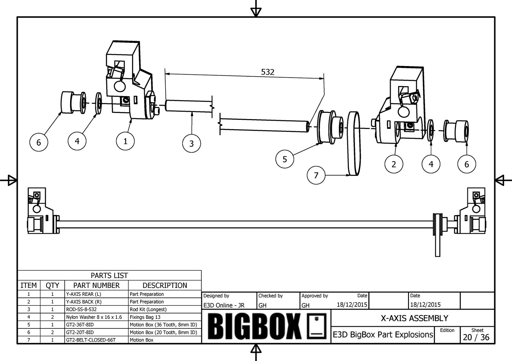

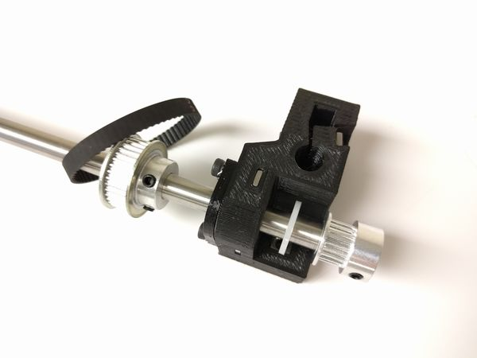

The correct order.

Build the Y-Axis Rear-Bar using the previously assembled [Y-Axis Rear Brackets](BigBox_Parts_Preparation.md "BigBox Parts Preparation").

Check the orientation of the boss on the Pulleys.

**Note :** Nylon Washers in Bag 16.

**Note :** Do not tighten the grub screws yet, this is done during printer Commissioning.

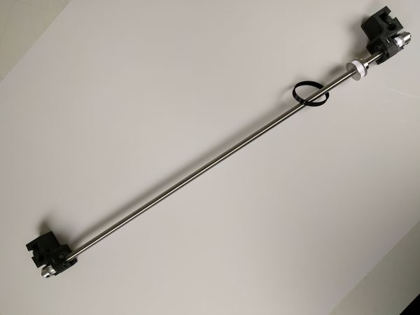

The assembled bar.

The finished bar.

## (2) Y-Axis Rear-Bar Installation

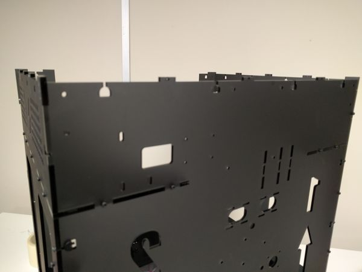

The Back Side.

- 1 x [BigBox Frame](BigBox_Printer_Sub-assemblies.md "BigBox Printer Sub-assemblies").
- 1 x [Y-Axis Rear-Bar Assembly](Printer_main_assemblies_Step_By_Step_Assembly_Process.md "Printer main assemblies: Step By Step Assembly Process").
- 4 x M4 16mm Screws (Bag 14).
- 4 x M4 Lock Washers (Bag 12).

Position the [Frame](BigBox_Printer_Sub-assemblies.md "BigBox Printer Sub-assemblies") so that the rear is facing towards you.

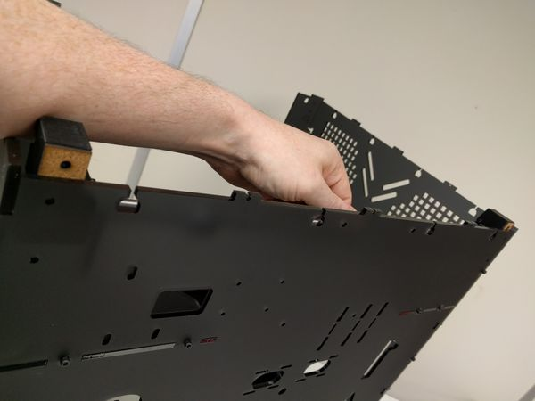

Position the Rear-Bar.

Move the Rear-Bar into position at the rear of the frame.

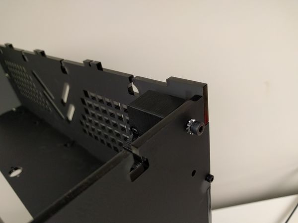

One Screw.

Secure one end of the bar with a single M4 16mm Screw and M4 Lock washer.

**Note**: Do not use a screwdriver to tighten the M4 screws. They need to only be finger tight at this stage.

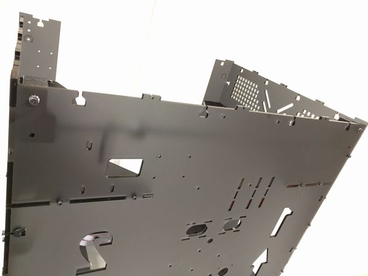

Both Ends.

Secure the other end.

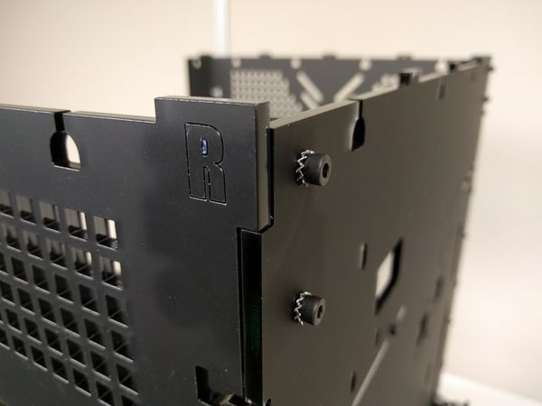

All four screws.

Fit the remaining two M4 screws and lock washers.

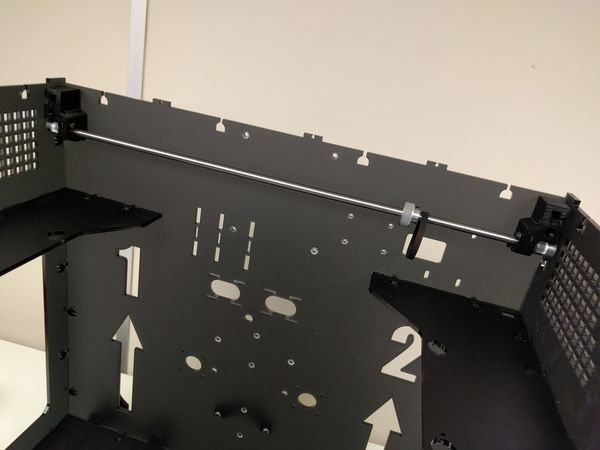

Rear-Bar installed.

The installed Rear-Bar

## (3) X-Axis & Y-Axis Assembly

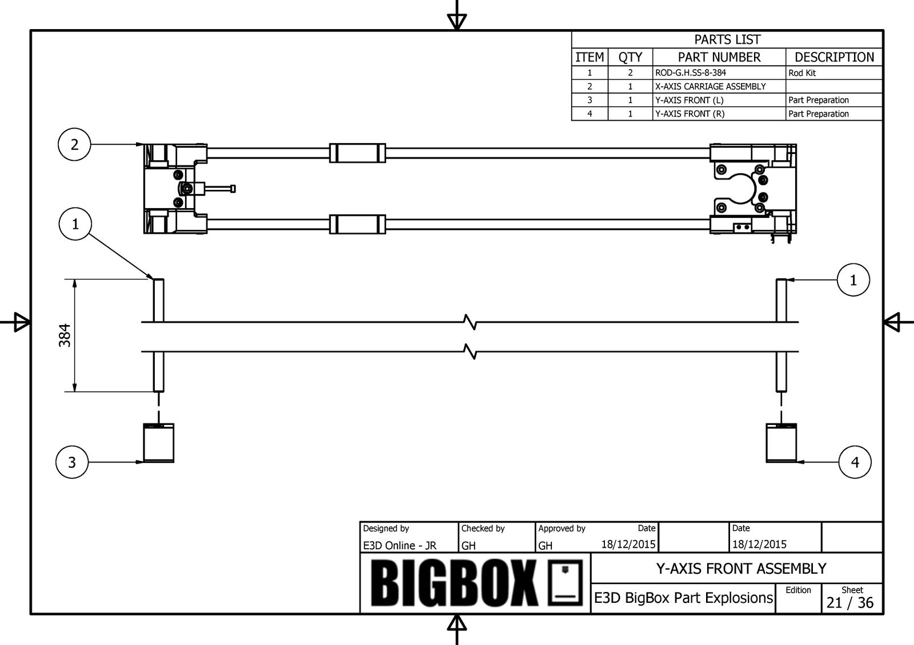

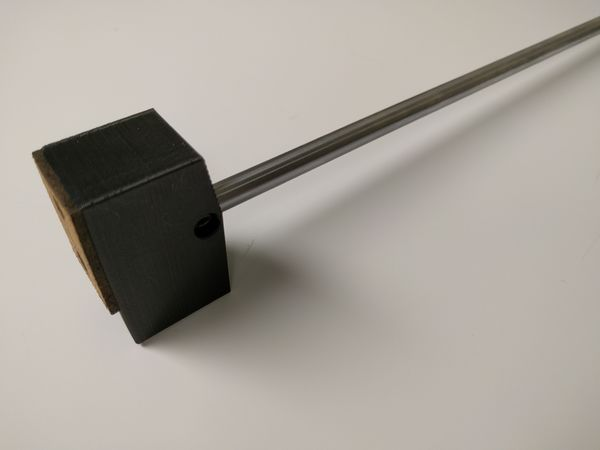

The Left Side.

- 1 x [X-Axis Assembly](BigBox_Printer_Sub-assemblies.md "BigBox Printer Sub-assemblies").
- 2 x [Y-Axis Front Brackets.](BigBox_Parts_Preparation.md "BigBox Parts Preparation")
- 2 x 384mm Rods.

Press a Y-Axis Front Bracket onto each of the two 382mm rods.

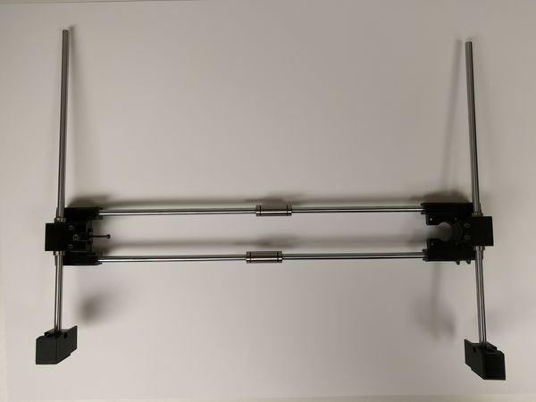

The Left Side.

Slide the two rods into the X-Axis.

**Note**: Make sure you get the left side on the left and the right on the right. The screws in the Y-Axis Front Backets should be facing inwards towards each other.

## (4) X-Axis & Y-Axis Installation

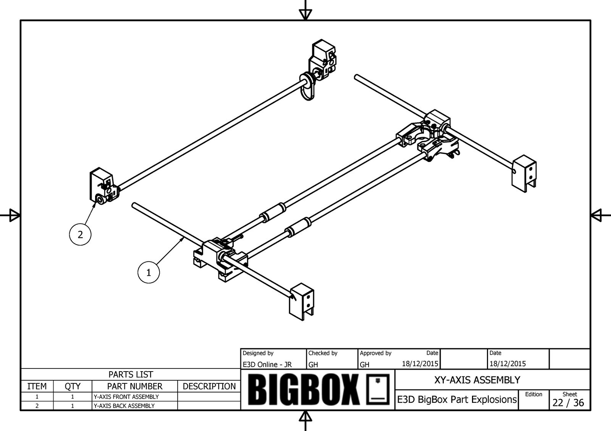

- 4 x M4 16mm Screws (Bag 14).
- 4 x M4 Lock Washers (Bag 12).

Review the video below demonstrating how fit the X-Axis / Y-Axis Motion System into the BigBox.\
**VIDEO** [https://www.youtube.com/watch?v=Xjmj0j0pcRM](https://www.youtube.com/watch?v=Xjmj0j0pcRM)

**Note**: Do not use a screwdriver to tighten the M4 screws. They need to only be finger tight at this stage.

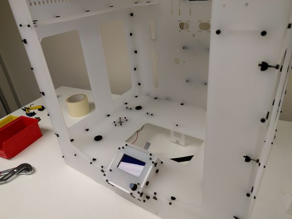

Screwed Frame.

After the Motion System has been fitted, finish installing the remaining Nut-Traps into the frame at the front.

## (5) X-Axis Motor Installation

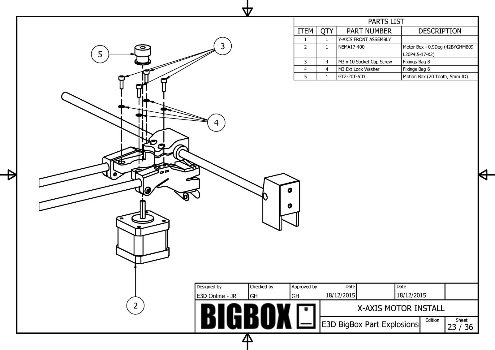

**Note**: Make sure the motor cable socket faces towards the right panel away from the print bed. Take note of the pulleys orientation with the boss facing upwards.

**selecting the correct stepper motor:** there are 5 stepper motors. Two are shorter than the others. These two are a matched pair for the Z axis, any of the remaining 3 can be used for the extruder, X and Y.

**Make sure to use the......** 20T GT2 **......and not the smaller Y-Axis 16T GT2 equivalent.**

**CHECK AGAIN YOU HAVE THE ....20T GT2..... IT IS A COMMON MISTAKE TO GET THESE THE WRONG WAY ROUND.**

REPEAT......USE THE 20T GT2.....

## (6) Single Direct-Drive X-Carriage

If you are building an older **Non-Hybrid** Single Direct-Drive X-Carriage \| Click Here

## (7) Dual Direct-Drive X-Carriage

If you are building an older **Non-Hybrid** Dual Direct-Drive X-Carriage \| Click Here

## (8) Hybrid X-Carriage

[800px](/index.php?title=Special:Upload&wpDestFile=V1.1_x_carriage_assembly.jpg "File:V1.1 x carriage assembly.jpg")

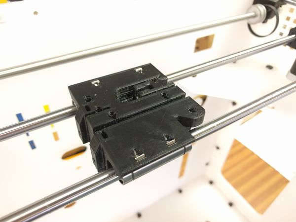

Fit the Carriage.

Fit the previously assembled [Hybrid X-Carriage](BigBox_Parts_Preparation.md "BigBox Parts Preparation") onto the bearings.

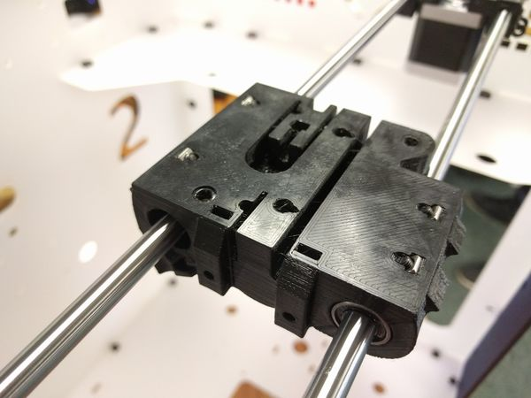

Clamp the Carriage.

- 8 x M3 10mm Screws (Bag 8).
- 1 x Hybrid X-Carriage Rear Bearing Clamp (Printed Parts).
- 1 x Hybrid X-Carriage Front Bearing Clamp (Printed Parts).

Secure the X-Carriage to the bearings using the clamps.

**Note**: The rear bearing is positioned to the right and the front bearing goes to the left.

### (8.1) X-Carriage Belt

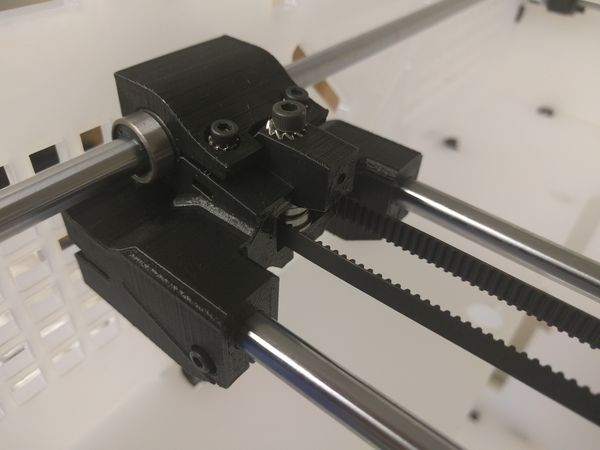

Belt.

Feed the belt through the X-Idler and around the X-Axis Motor Pulley.

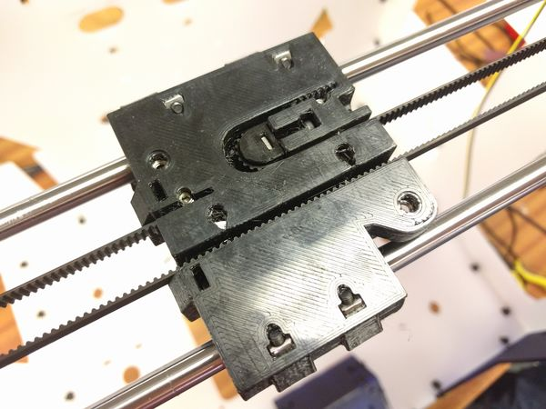

Secured.

- 2 x M4 8mm Grub Screws (Bag 13).
- 1 x M3 Square Nut (Bag 6).
- 1 x M3 18mm Screws (Bag 8).
- 1 x Belt Tensioner (Printed Parts).

Fit the belt tensioner into the X-Carriage.

Secure the belt using the Grub Screws.

## (9) Y-Axis Endstop

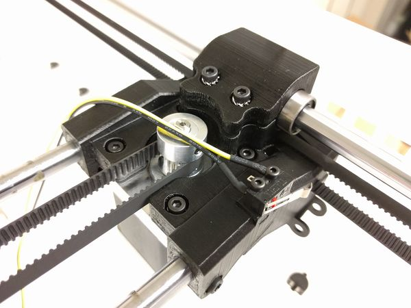

An Endstop

- 1 x Microswitch Endstop.
- 2 x M2 12mm Screws (Bag 3).

Affix the endstop to the X-Axis Motor Mount. '*Note*: Ensure the correction position of the switch arm.

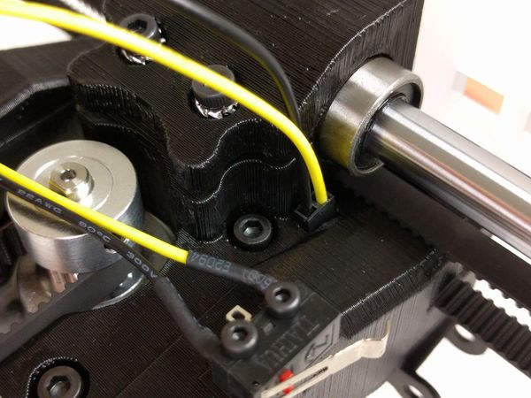

Through the gap.

Feed the cable through the hole.

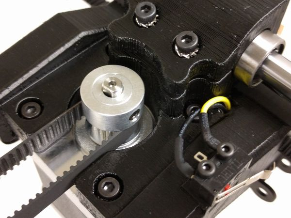

Done.

Pull the wires all the way through.

## (10) Y-Axis Motor Install

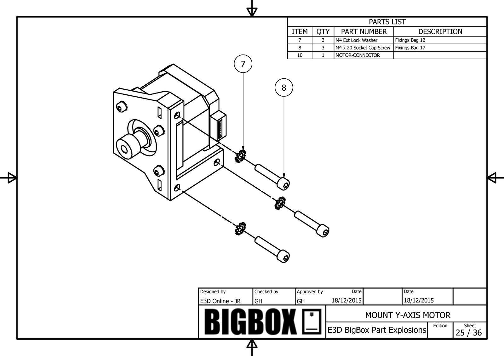

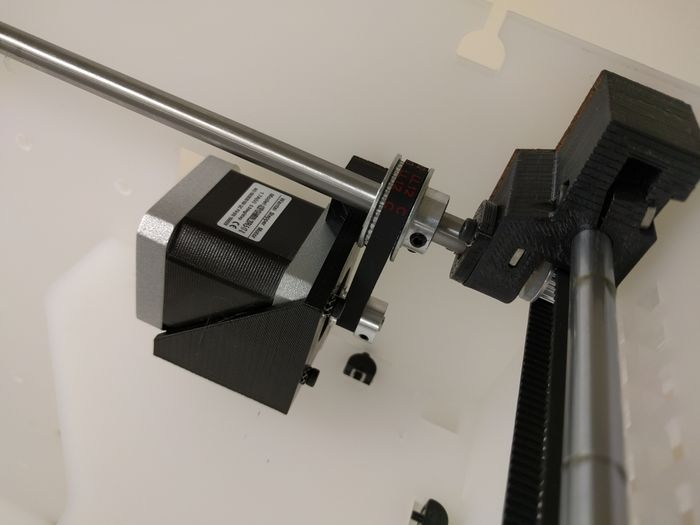

Y-Axis Motor.

Fit [Y-Axis Motor Mount](BigBox_Parts_Preparation.md "BigBox Parts Preparation") by hooking the belt loop over the pulley.

**Note**: Don't worry about belt tension for now - during the final stage of the build will be tightening everything at the same time

If you're using an astrosyn dampener note that you will need to attach the pulley with the grub screw nearest the motor.

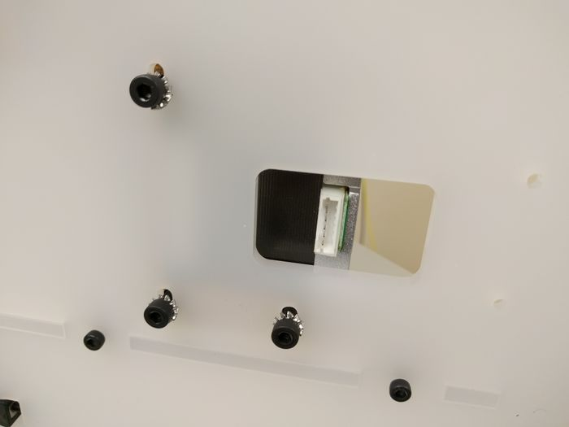

Rear View.

Note the position of the cable socket. **Do not tighten the M4 screws at this time, this will be done at a later stage.**

## (11) Y-Axis Belts

This can be quite a tricky step. If you are having problems fitting the Y-Axis belts please have a quick read through this post on the forum \| forum.e3d-online.com *(dead link)*

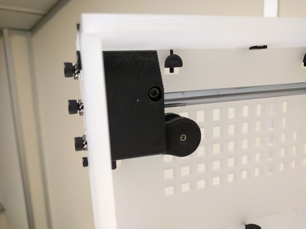

Y-Axis Idler.

- 2 x [Y-Axis Belt Idlers](BigBox_Parts_Preparation.md "BigBox Parts Preparation").
- 2 x M4 20mm Screws (Bag 17).
- 2 x M4 Lock Washers (Bag 12).

Install the two Y-Axis Idlers into the Y-Axis Front Brackets. **Note**: Only thread the idlers onto the screws a few turns, they will be adjusted later.

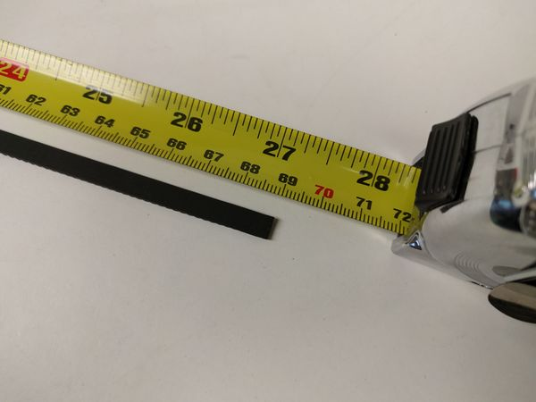

Cut to length.

Cut two 690mm lengths of GT2 Belt.

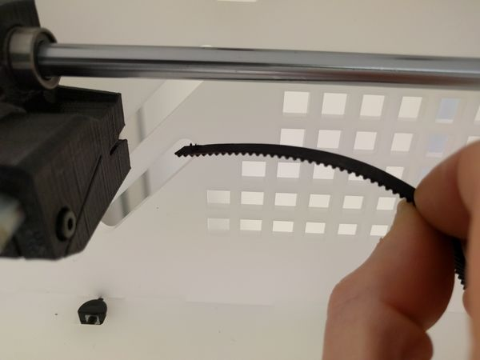

Approach the X-Axis Idler.

Take an end of one of the lengths of belt towards the X-Axis Idler.

*The belt is upside down in this photo*.

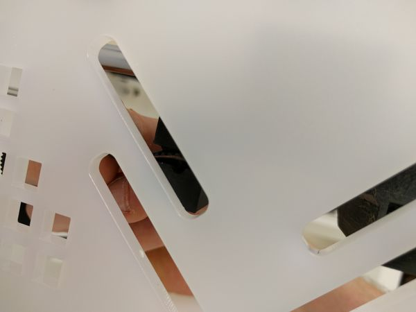

Through the Side.

Insert the belt into one of the openings in the Idler making sure the teeth face upwards. Pushing it all the way in with the tip of a screwdriver.

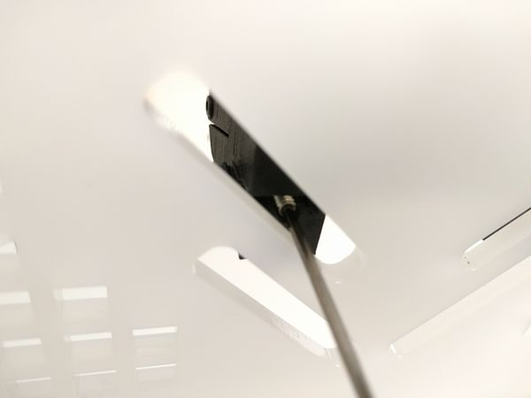

Secure with a grub.

- 1 x M4 8mm Grub Screw (Bag 13).

Secure the end of the belt with a grub screw.

**Note**: The grub screws will not do up completely tight and will keep turning. When they stop going into the part, stop turning.

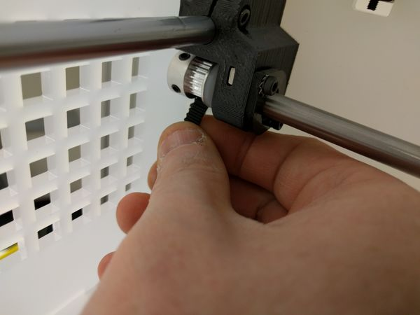

Around the Pulley.

Feed the free end of the belt through the pulley on the Rear-Bar.

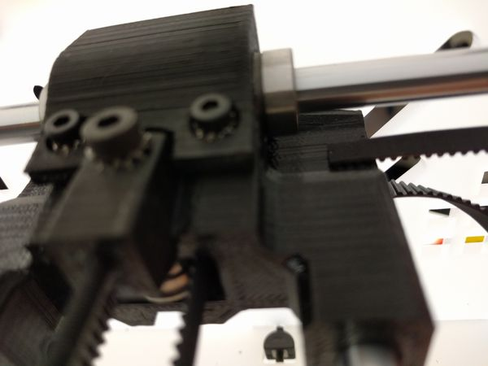

Through the Idler.

Continue to feed the free end of the belt through the X-Axis Idler.

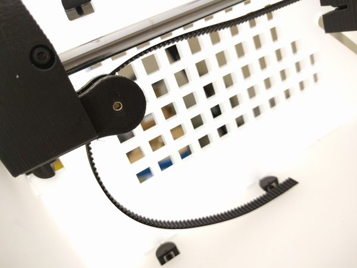

Around the tensioner.

Pass the belt through the idler from the top.

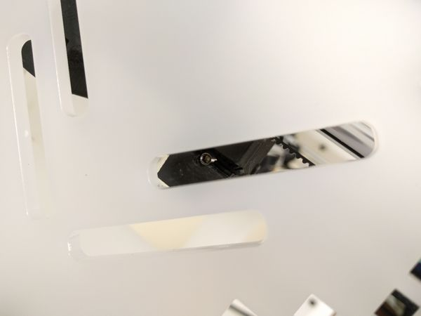

Secure again.

- 1 x M4 8mm Grub Screw (Bag 13).

Finally fit the free end into the X-Axis Idler and secure with a grub.

**Remember to repeat this on the other side for the X-Axis Motor Mount.**

## (12) X-Axis Cable Conduits

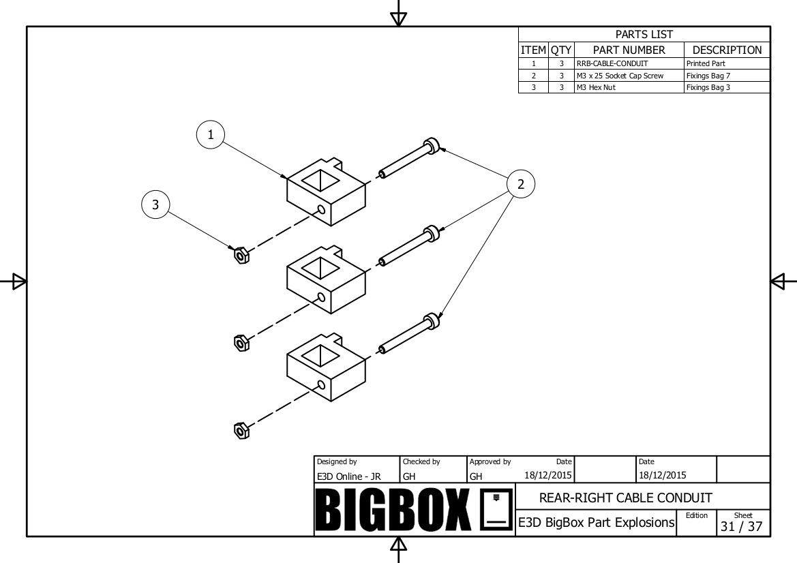

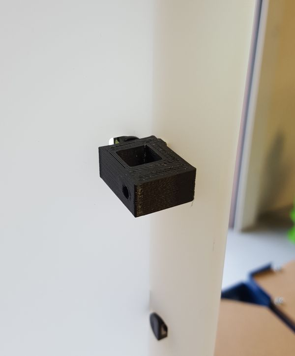

Image of the conduit in place

Push the Cable conduit printed parts into the slots on the fame as shown. You may need to file it slightly to make it fit snugly.

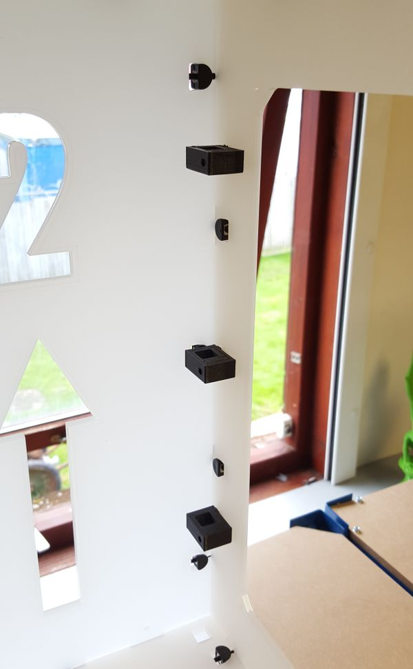

Image of the conduit in place

Once all the parts are in the frame, Screw into place with M3 x 25 socket cap screws.

Tighten the conduits firmly.

## (13) X-Axis Drag Chain

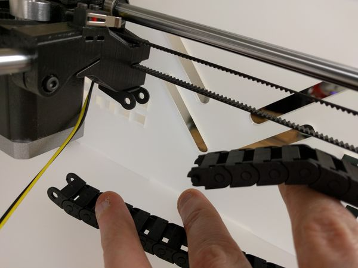

X-Axis Drag Chain

- 1 x Drag Chain (Motion Box).

Check the orientation of the Drag Chain against the X-Axis Motor.

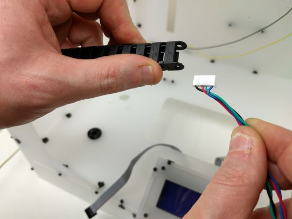

Matching Ends.

- 1 x 1700mm Twisted Pair Motor Cable (The longest cables in the Motor Box).

Take the end of the Drag Chain with the matching connector end to that on the X-Axis Motor Mount. In this case it is the ringed ends. Slightly angle the motor cable.

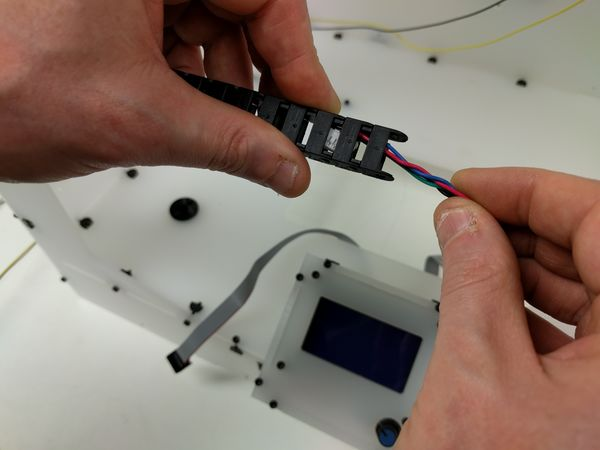

Push in the wire.

Feed the Motor Cable through the Drag Chain.

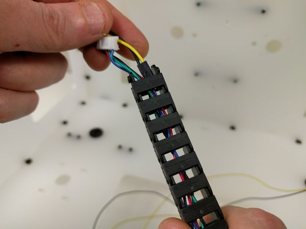

Endstop Cable.

Feed the Y-Axis Endstop cable back through the Drag Chain.

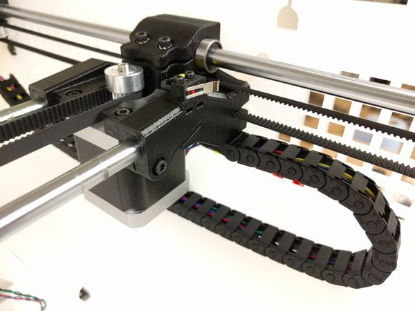

Drag Chain installed.

Feed the cables through the Drag Chain, plug the cable into the motor and then clip the Drag Chain onto the Motor Mount.

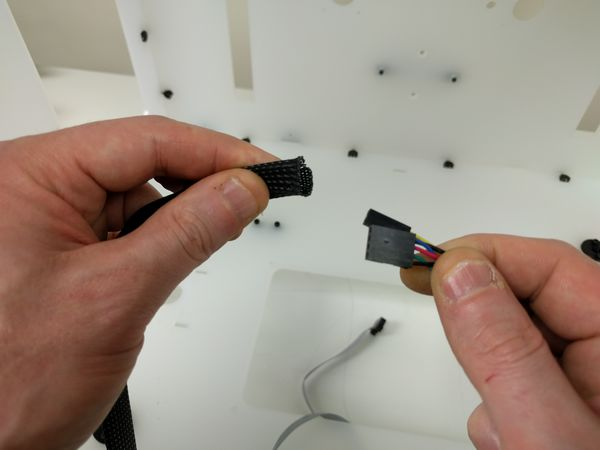

Braided Sleeve.

- 1 x 800mm Braided Sleeve (Bag 1).

Feed the ends of the Motor Cable and Endstop through the Braided Sleeve.

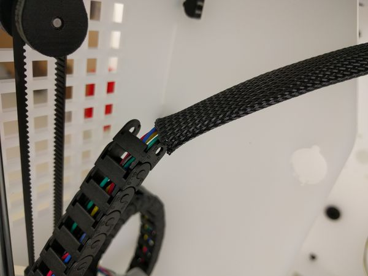

Fully inserted.

Feed the wires through the sleeve upto the Drag Chain.

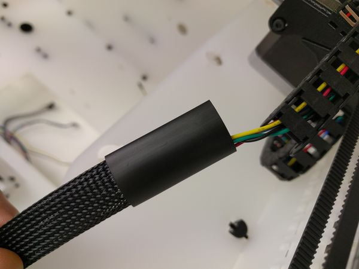

Heatshrink.

- 1 x 20mm x 40mm Heatshrink Tube (Bag 1).

Slide a length of heatsrink up the sleeve to the end nearest the Drag Chain.

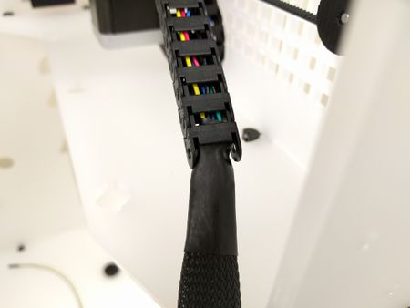

Heatshrunk.

Apply heat to the heatshrink to shrink it and insert it part way into the Drag Chain.

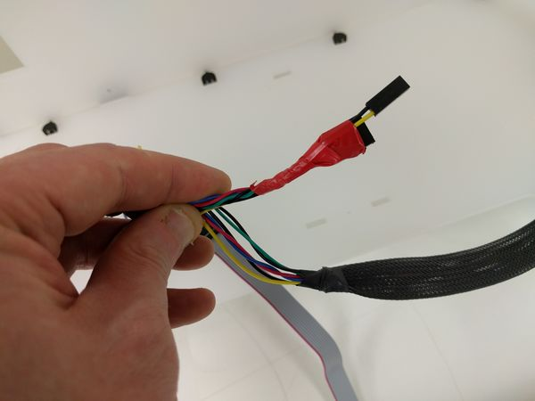

Bunched wires.

Bunches the wires together so they can bea easily passed through tight holes.

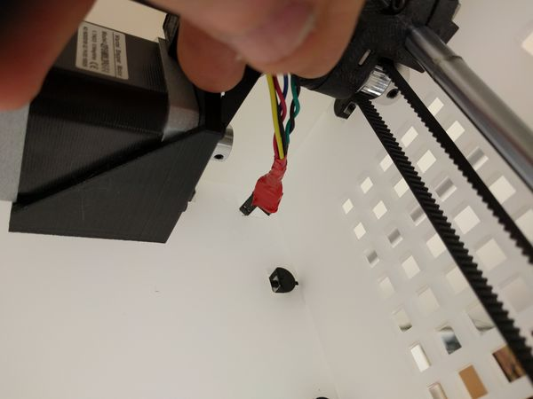

Through the hole.

Pass the wires through the hole at the back.

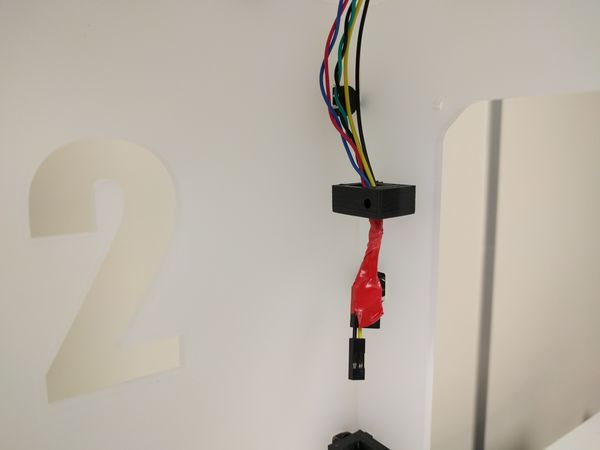

Through the Conduits.

Continue to pass the wires through the Cable Conduits.

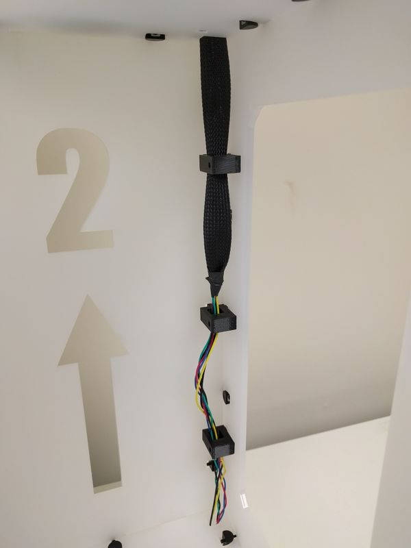

Feed the cable.

Pull the wires through taking care to feed the Braided Sleeve through the conduits. Lastly feed the wires through the hole in the Lower Support.

Bracket.

- 2 x M3 20mm Screws (Bag 9).
- 2 x M3 Hex Half Nuts (Bag 5).
- 1 x Drag Anchor Bracket.

Secure the Drag Chain with the Drag Anchor Bracket. The bracket has a lip which sits in the slots in the Drag Chain.

Fitted Bracket.

Secure the drag chain using the M3 Screws and Nuts.

## (14) Frame Top

Tighten the screws

Finger-tighten the four screws (two on the X-Axis Idler & two on the X-Axis Motor Mount) clamping the X-Axis bearings.

Top components

- 5 x M3 Microbarbs (Bag 5).
- 5 x M3 12mm Screws (Bag 9).
- 1 x Dock (Printed part).

Gather the laser cut part(s) of the frame top and additional components.

Fitted 'barbs.

Push the Microbarbs into the frame.

**Note**:The top is shown upside-down in this photo.

Broken Parts.

Do not use a hammer to fit the Microbarbs.

Fitted Dock.

Completed Top with Dock.

The Top.

Place the top onto the frame.

The Top attached.

Fix the top to the frame using M3 screws and Nut Traps.

## (15) Spool Holder Brackets

Completed spool holder

Spin the BigBox around so that the back is facing you.

Complete the assembly of the [Spool Holder (Inner)](BigBox_Parts_Preparation.md "BigBox Parts Preparation") with the bearings and washers shown above.

Add the M3 screws and present the assembly to the holes in the back of the BigBox.

Tilt the printer over and hold the nuts against the M3 screws and tighten.

For the Lite / Pro there are two of these.

For the Dual there are four.

## (16) Cable Spine

**Note**: Check the PTFE feed tube runs smoothly through the holes in the printed parts. If it is too tight run a 4mm drill through the holes.

## (17) Frame Ancillaries

### (17.1) Exhaust Fan

Fan Position.

- 1 x 60x60x10 Exhaust Fan (LCD & Fans Box).
- 4 x M4 20mm Screws (Bag 17).
- 4 x M4 Hex Half Nuts (Bag 11).

Position the fan inside the printer base.

**Note**: The labelled side should be against the frame, so that the fan extracts air from the base.

base fan in position

Affix with the screws and half nuts, screwing in from the exterior.

**Note**: The cable exits the fan at to the bottom-right corner.

### (17.2) Spool Inner Brackets

Spool Inner Brackets.

- 4 x M3 18mm Screws (Bag 8).
- 4 x M3 Square Nuts (Bag 6).
- 2 x Spool Inner Brackets (Printed Parts).

Attach the Spool Inner Brackets to the Lower Support. Note that these are mounted ON but UNDERNEATH the lower support.

**Note**: There will be four to attach for a Dual.

### (17.3) Base Frame Struts

Secured Nut.

Secure a square nut into one of the Nut Traps using a small piece of tape. I find Masking Tape to work quite well.

Strut.

Hold the Nut Trap in the Strut.

Secured Nut Trap.

Tape the nut into the Strut.

Both sides.

Attach a length of tape to the other side of the Strut so the Nut Trap can't fall out of move lose.

Installed Strut.

Affix the Struct into the Lower Support.

Five Struts.

Repeat until all five Struts have been fitted.

**Tip**: Don't fully tighten the M3 screws securing in the Struts. It will make fitting the Base to the frame a lot easier as you will be able to move the struts into position. Remember to tighten them up after.

### (17.4) Z-Axis Motors

- 2 x Z-Axis Motors (1.8°).
- 2 x Cork Pads (Printed parts Box).
- 8 x M3 10mm Screws (Bag 8).
- 8 x M3 lock Washers (Bag 6).

Remove the backing from the Cork Pads.

Firmly affix the Padss to the motors make sure to align the holes carefully.

Motors with Cork affixed

Motors with Cork affixed

Attach the motors to the Lower Support.

**Note**: The Motor Cable Connectors face towards the large opening in the Lower Support.

### (17.5) Z-Axis Lower Rod Brackets

Z bar base brackets, attached to inner frame base

Add to Inner Base panel (see image) with ‘hole side’ up,

affixing with screws & half nuts.

### (17.6) A/C IEC Socket

The IEC Cover.

- 1 x IEC Back Cover (Printed Parts).
- 1 x Cable Tie (Bag 1).

Feed the end of the Cable Tie through one of the holes in the cover.

Cable Tie loop.

Loop the Cable Tie back through the other hole.

The IEC.

Pass the wire from the previously assembled [IEC Socket](BigBox_Parts_Preparation.md "BigBox Parts Preparation") through the hole in the Back panel.

Wired.

Feed the wires through the loop and out the hole in the cover.

In place.

Move the cover up the wire and place it over the IEC socket firmly against he Back Panel.

**Note**: The cable from the IEC Socket faces towards the exhaust fan.

Fixed on.

- 2 x M3 16mm Screws (Bag 10).
- 2 x M3 Lock Washers (Bag 6).
- 2 x M3 Hex Half Nuts (Bag 5).

Secure the cover to the frame.

Cable Tied.

Pull tight the Cable Tie in the IEC cover and cut off the excess.

IEC Socket.

The fitted IEC Socket.

## (18) Control Connection

### (18.1)USB

**Note**: If you have opted for the OctoPrint Upgrade this cable is not included.

- 1 x USB Panel Mount Cable (Stretch Box).
- 2 x M3 12mm Screws (Bag 9).

Remove the 'knock out' below the USB symbol.

### (18.2) RJ45 (OctoPrint Upgrade)

- 1 x RJ45 Panel Mount Cable (OctoPi Box).
- 2 x M3 10mm Screws (Bag 8).

Remove the 'knock out' below the network symbol.

## (19) Single Direct-Drive Printhead Assembly

If you are building an older **Non-Hybrid** Single Direct-Drive Printhead Assembly \| [Click Here](Single_Direct-Drive_Printhead_Assembly.md "Single Direct-Drive Printhead Assembly")

## (20) Dual Direct-Drive Printhead Assembly

If you are building an older **Non-Hybrid** Dual Direct-Drive Printhead Assembly \| [Click Here](Dual_Direct-Drive_Printhead_Assembly.md "Dual Direct-Drive Printhead Assembly")

## (21) Hybrid Printhead Assembly

Assemble the Hybrid PrintHead in the same way for both Dual & Pro BigBoxes.

### (21.1) Titan Extruder.

Please refer to the [Hybrid Titan Extruder Assembly instructions](BigBox_Printer_Sub-assemblies.md#3-hybrid-titan-extruder-direct "BigBox Printer Sub-assemblies")

The extruder is attached to the X-Carriage using 2 x M4 16mm Screws (Bag 14).

### (21.2) BigBox Non-Titan Direct-Drive Extruder.

Please refer to the \[[Non-Titan Extruder Assembly instructions](BigBox_Printer_Sub-assemblies.md)\]

The extruder is attached to the X-Carriage using 2 x M4 16mm Screws (Bag 14).

### (21.3) Assembly of the E3D V6 HotEnds.

Wiring of the Hybrid Printhead is the same for both Titan & Non-Titan Extruders.

**This is only a rough assembly guide. For full instructions please read the Hotside Documentation.**

Thermal paste applied to the Heatbreak.

Apply the thermal paste to the Heat-Break and screw it into the Heat-Sink.

Heater Block.

- 1 x Grub Screw (Extruder Box, Hotend Fixings).
- 1 x M3 x 10mm Button-Head Screw (Extruder Box, Hotend Fixings).

Screw the fixings into the heater block.

Part-Assembled.

Thread the Heater-Block onto the Heat-Break.

The top of the Heater-Block needs to be level with the end of the Heat-Break thread.

Cute.

- 1 x 2mm ID PTFE Tubing (HotEnd Box).

**Titan** \| Measure and cut 83mm of 2mm ID PTFE Tubing.

**BigBox Direct-Drive** \| Measure and cut 67.5mm of 2mm ID PTFE Tubing.

**Note**: If you are building a BigBox V1.1 Dual assemble two HotEnds but only fit PTFE Tube to one.

Metal components.

Fit the Nozzle to the Heater-Block, push in the Bowden Clip and insert the PTFE tube.

Clip.

Raise the Bowden Clip out the top of the HotEnd while making sure the PTFE stays pushed down. Doing this will stop the PTFE moving around and help prevent blockages.

Fan.

Assemble a Hotend fan as shown in the photo.

Fans.

**Note**: If you are building a BigBox Dual assemble another Fan with the wires coming out from the opposite side.

Assembled.

- 2 x Cable Ties (Bag 1).

Assemble a single HotEnd as shown.

Assembled.

Assembled.

Fitted.

Insert the HotEnd into the Printhead and secure by tightening up the two M4 Grub Screws.

Ties.

- 2 x Cable Ties (Bag 1).

Insert the two ties into the rear of the Printhead as shown.

Plug.

Connect the cable to the PT100.

### (21.4) Print Cooling Fan

Single Print Fan.

- 1 x 40x40x20 Blower Fan (Electronics Box).
- 1 x Fan Housing.
- 1 x M3 22mm Screw (Bag 11).

**Pro** \| Fit the Blower Fan into the Housing as shown. Secure with the M3 Screw in the hole nearest to the vents.

Dual Print Fan.

- 1 x 40x40x20 Blower Fan (Electronics Box).
- 1 x Fan Housing.
- 1 x M3 22mm Screw (Bag 11).

**Dual** \| Fit the Blower Fan into the Housing as shown. Secure with the M3 Screw in the hole nearest to the vents.

Fan.

- 2 x M3 25mm Screws (Bag 7).

Attach the Print Cooling Fan to the Printhead using the two M3 Screws.

**Note**: If you are building a BigBox Dual **DO NOT** fit the fan at this stage.

Cables.

Route the cables from the HotEnd as shown.

### (21.5) IR Sensor

IR.

- 1 x 3-Wire IR Sensor Cable (Electronics Box).
- 1 x Cable Tie (Bag 1).
- 2 x M3 20mm Screws (Bag 9).

Affix the previously assembled [Hybrid IR Sensor Bracket](BigBox_Parts_Preparation.md "BigBox Parts Preparation") to the Printhead using the M3 Screws.

Plug in the Cable making sure it is plugged in with the Red wire on Vcc.

### (21.6) X-Axis Endstop

Endstop.

- 1 x Endstop (Electronics Box).
- 2 x M2 12mm Screws (Bag 3).

Attach the Endstop to the Printhead using the M2 Screws as shown.

### (21.7) Dual

Extra.

- 1 x 800mm of 2mm ID PFTE Tube (Extruder Box).

Assemble another HotEnd making sure the cables are routed to the left-hand side of the Hotend.

**Note**: Use a long length of PTFE tube.

Clip.

Remember to pull-up the clip.

Insert.

Push the HotEnd into the Printhead, feeding the PTFE through the hole in the Printhead.

Unclip.

Unclip the fans and tighten the grub screws holding in the extra (Bowden) Hotend.

Lightly do up the grubs screws holding in the Direct HotEnd.

Refit.

Refit the two HotEnd Fans.

Cables.

- 3 x Cable Tie (Bag 1).

Refit the two HotEnd Fans.

Attach the Print Cooling Fan as described above.

Secure the HotEnd cables to the Printhead and the Print Cooling Fan & IR Sensor Cable to the bracket on the left side of the Printhead.

### (21.8) Extruder Motor Cable

Cable.

- 1 x 1700mm Motor Cable (Motors Box).

Plug in the cable to the motor.

### (21.9) Printhead Cables

Bunches.

**Dual** \| Group together the cable from the Bowden Hotend and the X-Axis Endstop.

Taped.

**Dual** \| Tape the ends of the cables together.

Braided.

- 1 x 1500mm Braided Sleeve (Bag 1).
- 1 x Heatshrink (Bag 1).

**Dual** \| Feed the bunch through the braided sleeve and secure the end with heatshrink.

Cable Tied.

- 2 x Cables Ties (Bag 1).

**Dual** \| Secure the wires to the Printhead as shown.

Wires.

Group the wires together and secure the end with electrical tape.

Braided.

- 1 x 1500mm Braided Sleeve (Bag 1).
- 1 x Heatshrink (Bag 1).
- 2 x Cable Ties (Bag 1).

Feed the wires through the braided sleeve as before, heat shrink the heatshrink and secure using the two cables ties.

Hybrid.

A correctly wired Hybrid Printhead.

### (21.10) Upper Spine

Spine.

Pass the two wire groups through the loop at the top of the rear spine.

PTFE.

**Dual** \| Feed the 4mm OD / 2mm ID PTFE Tube through the spine brackets.

Y-Axis Motor Cable.

- 1 x 800mm Braided Sleeve (Bag 1).
- 1 x 20mm x 40mm Heatshrink (Bag 1).
- 1 x 1000mm Y-Axis Motor Cable (Motors Box).

Prepare the Y-Axis Motor Cable by threading the wire through the Braided Sleeving and securing the end with the Heatsink.

Ties.

- 6 x Cable Ties (Bag 1).

Insert the Cables Ties into the Spine Brackets as shown.

Cable Tied.

Plug the Y-Axis Motor Cable into the motor and secure using the Cable Ties.

### (21.11) Bowden Extruder

The Bowden is only required for Dual Hybrid installations.

#### (21.11.1) Titan Bowden System

Gear.

- 1 x Stepper Motor (Motors Box).
- 1 x Pinion Gear (Titan Kit).
- 1 x Pinion Gear Grub Screw (Titan Kit).

Position the Pinion Gear onto the Motor shaft.

Leave **2.5mm** Between the gear and the motor chassis.

**Note**: The Grub Screw needs to be positioned towards the motor.

Tighten the grub screw to secure the gear.

Titan Body.

- 1 x M3 12mm Screw (Bag 9).
- 1 x Titan Body (Titan Kit).

Affix the Titan body to the back of the frame.

**Note**: Check the orientation of the body. The filament exits from the top!

Titan Innards.

- 1 x Bowden Adapter (Titan Kit).
- 1 x Black Filament Guide (Titan Kit).
- 1 x Acetal Gear with Filament Drive Shaft (Titan Kit).

Install the above listed parts into the Titan.

Titan Guts.

- 1 x Idler Lever (Titan Kit).
- 1 x Idler Spring, Screw & Nut (Titan Kit).

Install the above listed parts into the Titan.

Titan Lid.

- 1 x Lid (Titan Kit).
- 3 x M3 35mm Screw (Titan Kit).
- 1 x M3 25mm Screw (Titan Kit).
- 3 x M3 Washers (Bag 7).

Install the above listed parts into the Titan.

**Note**: Use the M3 washers on the longer 35mm screws.

PTFE.

Feed 4mm OD - 2mm ID PTFE Tube into the Titan.

Add an extra length into the Titan feed.

#### (21.11.2) Non-Titan Direct-Drive Bowden System

Main Block.

- 1 x Main Block (Printed Part).

Gather the required parts

Support.

Turn over the Main Block to show the underside with printed support.

Support removed.

Carefully remove the support from the part.

Coupler.

- 1 x Embedded Bowden Coupler (Printed Parts Bag).

Press the coupler into the Main Block.

Frame.

- 1 x 0.9 Stepper Motor.
- 1 x M3 25mm Screw (Bag 7).

Nearest to position 1, secure the Mainblock from the outside of the frame through to the Motor, the Bowden Coupler should be facing upwards. Ensure the Cable Plug for the motor is facing downwards.

**Note**: Do not tighten the screw fully just yet.

Feed.

- 1 x Filament Feed Guide.
- 1 x M3 30mm Screw (Bag 10).

Position the Filament Feed Guide behind the Main Block and secure with the 30mm screw.

**Note**: Do not tighten the screw fully just yet.

screw.

- 1 x M3 8mm Screw (Bag 15).

Fit the screw as shown.

**Note**: Do not tighten the screw fully just yet.

Spring.

- 1 x M4 30mm Screw (Bag 17).
- 1 x M4 Washer (Bag 13).
- 1 x M4 Square Nut (Bag 12).
- 1 x Black Spring (Printed Parts Bag).

Assemble the idler spring as shown.

Fitted.

- 1 x Filament Idler.

Position the Idler and Spring as shown.

Screwed.

- 1 x M3 30mm Screw (Bag 10).

Affix the Idler using the M3 Screw.

Tube.

Push the Extruder as far to the left as it will go and then tighten the screws.

Feed the PTFE tube into the Bowden Coupler.

Hob.

- 1 x M3 3mm Grub Screw (Bag 17).
- 1 x Hobgoblin (Printed Parts Bag).

Position the Hobgoblin so that the teeth are aligned with the filament path. Secure with the grub screw.

### (21.12) Lower Spine

Only install the Bowden Motor Cable if you have a Dual BigBox.

Cable.

- 1 x 800mm Braided Sleeve (Bag 1).
- 1 x 20mm x 40mm Heatshrink (Bag 1).
- 1 x 1000mm Y-Axis Motor Cable (Motors Box).

Prepare the Bowden Extruder Motor Cable in the same way that was done for the Y-Axis Motor.

Cable.

Plug the Motor Cable into the Motor.

Cable Group.

Group the wires together.

Cable Tied.

- 1 x 1000mm 4mm OD - 3mm ID Thin-Walled PTFE Tube (Stretch Box).

Secure the cables to the spine using the Cable Ties. Cut off the excess.

Feed the PTFE Tube through the holes in the spine.

Turn.

Rotate the printer so the side is facing you.

Insert.

- 1 x Cable Ties (Bag 1).

At the top of the loop of cables and PTFE tubeing push a cable tie through one of the braided sleeve, be careful not to catch any wires.

Loop.

Loop the cable tie through the other braided sleeve and around the two PTFE tubes. Loosely close the cable tie and cut off the excess.

Side.

Lay your BigBox on it's side and feed the wires through the hole at the bottom of the spine.

Check all the cable ties have been tightened up.

Put your BigBox back into the upright position.

## (22) OctoPrint Upgrade Camera Install

Raspberry Pi Camera.

- 1 x Raspberry Pi Camera Module (Pi Box).

Unclip.

Unclip the [FFC](https://en.wikipedia.org/wiki/Flexible_flat_cable) [ZIF](https://en.wikipedia.org/wiki/Zero_insertion_force) socket clip.

Long FFC.

- 1 x 750mm FFC (Pi Box).

Remove the 15cm FFC supplied with the camera and insert the 75cm FFC.

Angle FFC.

Bend the FFC as shown in the image.

Mount.

Place the camera module into the Camera Mount as shown.

**Note**: The camera sits at a slight angle in the Mount.

Screwed.

- 2 x M2 8mm Screws (Bag 4).

Secure the camera to the Mount with the screws. **Note**: The screws grip into holes in the plastic so be careful not to over tighten them.

FFC Conduit.

- 2 x FFC Conduits (Pi Box).

Note the position of the groove in the FFC Cable Conduit. This groove needs to be seated against the frame so the FFC can pass through it.

FFC Conduits.

- 4 x M3 12mm Screws (Bag 9).
- 4 x M3 Hex Half Nuts (Bag 5).

Secure the two FFC Conduits to the inside of the frame as shown.

Camera Brackets.

- 2 x M3 16mm Screws (Bag 10).
- 2 x M3 Square Nuts (Bag 6).
- 2 x Top & Bottom Camera Brackets (Pi Box).

Assemble the camera bracket Brackets.

Lower.

- 2 x M3 10mm Screws (Bag 8).
- 2 x M3 Square Nuts (Bag 6).

Attach the lower Bracket to the frame.

Camera Arm.

- 1 x Camera Arm (Pi Box).

Place the camera Arm onto the lower Bracket.

Both Brackets.

- 2 x M3 10mm Screws (Bag 8).
- 2 x M3 Square Nuts (Bag 6).

Attach the upper Bracket to the frame.

FFC.

Feed the FFC through the slot in the camera arm.

**Note**: Check the cable is in the correct orientation.

Clip on.

Clip the camera Mount on to the camera arm.

**Note**: The clip can be very right. Be careful when clipping the two together.

Camera FFC.

Take hold of the FFC as shown.

Camera FFC.

Thread the FFC through the slot in the frame.

Camera Conduits.

Continue to pass the FFC through the FFC Cable Conduits.

Lower Support.

Feed the FFC through the slot in the Lower Support.

Camera FFC.

The FFC should look like this.

Bend FFC.

You will need to add a 90° bend in the FFC.

**To get a better understanding of how the FFC needs to be bent read through the next few steps before fully bending the cable.**

Kink.

Pinch the FFC at the bend where you think the 90° bend needs to be.

90° Fold.

Once you are sure of the 90° location bend and flatten the cable.

Strip.

- 1 x Adhesive Strip (Pi Box).

Attach the double-sided strip to the back of the FFC as shown.

FFC stuck.

Remove the backing to the adhesive strip, position the FFC against the frame and press the strip firmly against the frame.

Finished.

The Camera is now installed.

## (23) Prepping The Wiring

Heated Bed Drag Chain.

**Position the printer onto it's left side.** Before tipping on its left side SECURE THE X-CARRIAGE or MOVE IT FULLY LEFT TO AVOID IT CRASHING INTO THE STOP.

Take the previously assembled [Z-Axis Drag Chain](BigBox_Printer_Sub-assemblies.md "BigBox Printer Sub-assemblies") and pull the plugged-end so it is 120mm from the drag chain.

Wires.

Feed the cables through the hole in the Lower Support.

Attached.

- 2 X M3 20mm (Bag 9).
- 2 x M3 Hex Half Nuts (Bag 5).

Secure the Chain Anchor with the nuts and screws.

Strut.

Pass the cables from the Heated Bed through the Strut near the large opening in the Lower Support.

Sleeving.

Cut the Braided Sleeving to length.

Be exeptionally careful not to cut any wires!

Timmed.

Trimmed Cables.

Timmed.

- 1 x Cable Tie (Bag 1).

Group the wires together near the Back panel. Make sure to include the cables from the X-Axis on the right side.

Cable Tied.

- 4 x Cable Tie (Bag 1).
- 4 x 20mm x 40mm Heatshrink (Bag 1).

Cap the ens of the wires with the Heatshrink and Cables Ties.

Wires.

Pass all the wires through the centre hole.

Wires.

If you have the OctoPrint Upgrade you'll have the extra camera FFC.

## (24) Fitting The Base

Base.

Take the previously assembled \[BigBox_Printer_Sub-assemblies#Base_Assembly\|Base Assembly\]\], and with the BigBox on it's side, align the base to the frame.

PSU.

Connect the IEC cable to the PSU.

**Note**: The Green/Yellow goes to Earth, Blue to Neutral and Brown to Live.

If you are not absolutely certain of how to connect the IEC cable to the PSU please seek the advice and help of a professional electrician. Do not guess.

Check the PSU.

Now is a good time to confirm you have set the PSU to the correct voltage, check the [mains A/C power supply in your country](https://en.wikipedia.org/wiki/Mains_electricity_by_country) and move the switch to match. **The PSU is set to 230V by default.**

Fan.

Plug in the Exhaust Fan wires. Red to positive(+), black to negative(-).

Motor.

Plug in the lowest Z-Motor Cable.

Motor.

Plug in the other Z-Motor Cable.

RJ45.

If you opted for the BigBox OctoPrint Upgrade plug the RJ45 connector into the Raspberry Pi.

FFC.

If you opted for the BigBox OctoPrint Upgrade plug the Camera FFC connector into the Raspberry Pi. The FFC cable fits perpendicular to the Pi, lift the little white clip insert cable then press the clip down again.

**Note**: Take care then connecting the FFC, make sure it is the correct way around.

Shut.

Close up the Base to the Frame.

Screwed.

Begin by fitting a few Nut Traps and screws around the Base to stop it from dropping off.

Don't fit them all in case you need to pop the base back off in the next stage.

**Tip**: You will need to align the Struts with the slots in the base. Use a screw driver to wiggle them around until they pop into place.

## (25) Wiring

Wires.

Pop the printer back onto it's feet and make sure all the wires are coming out the hatch.

LCD Wires.

Begin with the LCD Wires.

LCD Wires & Rumba.

Pass the wires under the Rumba and plug into the two sockets.

### (25.1) Single Extruder

Scroll down 20 images for Dual

Connections.

Pro Wiring connections *(dead link)*.

PT100.

Plug the PT100 Wire to the Amplifier board.

Hotend Wires.

Beginning with the Hotend wires.

Extruder Wires.

Plug in the Extruder Motor Wires into the port marked **E0**.

The black wire should be to the left.

Hotend Fan Wires.

Pass the thin black and red wires (these are for the Hotend Fan) under the Rumba and into position **FAN1** as marked on the Rumba.

**Note**: Note the polarity.

Heater-Cartridge.

Next the two yellow Heater-Cartridge wires.

Tips.

Squash the tips of the ferrules using pliers.

Flat tips.

They will be easier to fit into the screw terminals.

Fitted wires.

Fit the Heater-Cartridge wires into the screw terminals labelled **HE0**.

The polarity is not important. Line up the flat tips horizontal to the edge of the PCB. They should just pop right in.

Tighten the terminals.

Y-Axis Endstop & X-Axis Motor.

Select the wires from the [X-Axis Drag Chain](Printer_main_assemblies_Step_By_Step_Assembly_Process.md "Printer main assemblies: Step By Step Assembly Process").

Cable loop.

There can be some excess cable, I have tied it into a bunch to keep it out the way.

X & Y wires.

Plug the X-Axis Motor Cable into the socket marked **X**.

Plug the Yellow & Black Y-Axis Endstop Cable into the position marked **Y-**.

Wires.

The remaining cables.

Cooling Fan.

Plug the Black & White wire from the Print Cooling Fan into the **FAN0** slot.

Heated Bed.

Insert the thick Black & Red wires with the ferrules into the screw terminals marked **HB-OUT**.

**Note**: Check the polarity.

Heated Bed Thermistor.

Connect the remaining Red & Black wires from the Heated Bed Thermistor connector to the **THB** port.

X-Axis Endstop.

Push the remaining Yellow & Black wire onto the **X-** pins.

Y-Axis Motor Cable.

Plug on to the port marked **Y** the Y-Axis Motor Cable.

Z-Axis IR Probe.

Connect the IR Sensor Cable for the Z-Axis Endstop to the position marked **Z-**

**Note**: Check the polarity.

Electronics Cover Fan.

Finally the [Electronics Cover Fan](BigBox_Printer_Sub-assemblies.md "BigBox Printer Sub-assemblies") plugs into the connector marked **12V**.

**Note**: Check the polarity.

### (25.2) Two Extruders

Connections.

Dual Wiring connections *(dead link)*.

Seperate.

Seperate the two Cable Groups from the lose wires.

R&B Wires.

Find the thick Black & Red Wires which come from the Heated bed, they have crimps on their ends.

Insert.

Check the screw terminals labelled **HB-OUT** are loose and insert the Heated Bed Cables.

Plug.

Plug the thinner Black & Red wires with the connector on the end into the Connector Labelled **THB**.

Plug.

Plug the thinner Black & Yellow wires with the connector on the end into the Connector Labelled **Y-**.

You may find that of the two "black and yellow pairs" that there isn't a "thinner" pair.

The two (yellow & black) pairs are the "X" and "Y" endstop micro-switches. The "Y" endstop is on the "X" Axis Motor Carriage (in front of the motor) with the two endstop and four motor wires running through the chain and down the back right of the printer and under the lower support so you will see these two emerging from the sleeving under the inspection hatch.

Cables.

Find the two Motor Cables, one will be longer that the other. The shorter one will also have a yellow and black end stop in the same braided sleeve. This is the Y end stop.

Connected.

The longer one is for the X-Axis and should be plugged into the socket marked **X**.

The short one is from the Y-Axis and goes into the socket marked **Y**.

Small Bunch.

Take the two Sleeved Cable Groups.

Select the **small** Cable Group, this group is for the right Extruder.

The larger group has the extra wires for the X-Axis Endstop and the IR Sensor Probe Cable, we will come to those later.

Heater-Cartridge.

Remove the tape from the cables and select the two yellow Heater Cartridge Cables.

Tips.

Squash the tips of the ferrules using pliers.

Flat tips.

They will be easier to fit into the screw terminals.

Insert.

Pass the Cables under the Rumba.

Loosen the '*HE1* Screw Terminals and insert the Cables.

Tighten the screws to secure the wires.

PT100.

Plug the PT100 into the Amplifier closest to the USB connector.

HotEnd Fan.

Feed the thin Red & Black HotEnd Fan cable with the connector under the Rumba.

HotEnd Fan Cables.

Cut off the connector, strip and twist the end of the cables.

Terminals.

Affix the wires to the **FAN1** screw terminals.

Fan.

Repeat this with the Black & White wires from the right Print Cooling Fan and connect them into **FAN0**.

Extruder.

Plug the Right Extruder Motor Cable into **E1**.

So far.

This is how the wiring should look so far.

Unbunch.

Remove the tape from the larger Cable Group.

This group of wires pertains to the left Extruder.

PT100.

Plug in the PT100 connector to the Amplifier board.

X.

Plug in the Black & Yellow X-Endstop connector to the pins marked **X-**.

Z.

Plug in the Red, Black & Yellow IR Sensor connector to the pins marked **Z-**.

**Check the polarity is correct.**

HotEnd.

Select the heater cartridge cable, squish the ends as before and fit into **HE0**.

Fan.

Plug the thin-wired Red & Black HotEnd Fan into **FAN1**.

Fan.

Plug the thin-wired white & Black Print Cooling Fan into **FAN0**.

Extruder.

Plug the Extruder Motor Cable into **E0**.

done.

The completed wiring should look like this.

Cover.

Finally plug in the [Electronics Cover](BigBox_Printer_Sub-assemblies.md "BigBox Printer Sub-assemblies") Fan into the position marked **12v**.

## (26) Power-On Test

IEC.

- 1 x IEC Cable (Not supplied).

Check the switch on the back is in the Off Position (as shown).

Plug your IEC lead into the printer.

Power!

Flip the switch to turn on the power.

**Note**: The machine will display a **MINTEMP BED** error because the Heated Bed has not been wired in yet. This is perfectly normal. You will not be able to control the printer at this time.

**If your LCD does not come on or light up, turn off the power and swap around the two cables from the LCD. Turn the power back on and the LCD should now work.**

If you continue to have problems, turn off the power and check your wiring is correct. Refer to the BigBox Troubleshooting documentation.

## (27) Tuning The Stepper Drivers

Multimeter.

- 1 x [Multimeter](http://thelittlebox.co/theshop/index.php?route=product/product&path=66_77&product_id=107) (Not supplied).
- 1 x [Ceramic Screwdriver](http://e3d-online.com/index.php?route=product/product&product_id=356) (Not supplied).

Set your Multimeter to measure DC volts. You'll need to be able to measure to two decimal places.

**Note**: The Rumba will need to be powered on while tuning the drivers.

Black Probe.

Place the Black (negative, -) probe against the negative input terminal on the Rumba.

Be exceptionally careful not to touch any other components on the Rumba.

Red Probe.

Place the Red (positive, +) probe against the potentiometer on the X-Axis Stepper Driver.

The meter will display a value, in this case it is 0.79v. We want the value to be between **0.55v** - **0.60v**.

Be exceptionally careful not to touch any other components on the Stepper Driver or the Rumba.

Adjusted.

Use the ceramic screwdriver to turn the potentiometer in the **clockwise** direction, this will lower the metered value.

If you go too far do not worry, simply turn it back anti-clockwise.

7'o Clock.

The flat part of the potentiometer should be somewhere in the **7'o Clock** position.

All adjusted.

Adjust the other Stepper Drivers to be within the **0.55v** - **0.60v** range.

## (28) Closing Up the Base

Base.

Once the electronics have been verified as functional and everything is receiving power we can finish fitting the Base.

Lay the BigBox on it's side. MOVE THE X-CARRIAGE FULLY LEFT OR **SECURE IT** BEFORE TIPPING THE BigBox on its side.

Secure the base to the frame fitting the remaining Screws, Nuts and Nut Traps.

Lower Support.

Pop the BigBox back onto it's feet.

Tighten up the five screws securing the Struts.

Brass Inserts.

- 4 x M3 Microbarb Brass Inserts (Bag 5).
- 1 x M3 10mm Screws (Bag 8).
- 1 x M3 Nylon Spacer (Bag 1).

On the Lower Support at the corner to the Electronics Hatch fit a Brass Insert. You can pull them into position as shown.

Inserted insert.

Remove the screw and spacer.

Fit an insert into each corner.

**Note**: You can return the Nylon space and M3 10mm screw to their bags when you have finished fitting the inserts.

Closed up.

Place the Electronics Cover into the Lower Support.

## (29) Y-Axis Frame Endstop

Base.

- 1 x Y-Axis Endstop (Printed Part).

Base.

- 1 x M3 20mm Screw (Bag 9).

Fit the screw into the endstop. Make sure the screw fits all the way through the hole.

The screw is a very tight fit. You may find it helps to run a 2.5mm drill through the hole. It may take a 2.6mm drill or a little filing too so that you don't split the printed part.

**Note the direction the screw is fitted to the part.** It is the opposite side to the slots for the square nuts

Fitted.

- 2 x M3 12mm Screw (Bag 9).
- 2 x M3 Square Nut (Bag 6).

Attach the endstop to the frame (front right side). HINT... The screws fit from the outside top right front.

## (30) Spool Carrier

Rods.

Align the rods from the previously assembled [Spool Carrier](BigBox_Printer_Sub-assemblies.md "BigBox Printer Sub-assemblies") with the holes at the back of the printer.

Slide in.

Slide the assembly into the frame.

**Note**: The rods might need a little wiggling to align with the Inner Spool Brackets.

Clamp.

Find the [Spool Carrier Clamp](BigBox_Parts_Preparation.md "BigBox Parts Preparation") made in an earlier stage.

Algined.

Align the clamp in the arrow, with the bearing outside of the frame and facing downwards.

Fitted.

Push the Spool Carrier into the frame and slide the clamp down.

## (31) Ooze Wiper & Dump Bucket

### (31.1) Single Extruder Dock

Fit together as shown.

- 2 x M3 12mm Screws (Bag 9).
- 2 x M3 Square Nuts (Bag 6).
- 1 x Rubber Stip (Extruder Box).

- 2 x M3 18mm screws (Bag 8).
- 2 x M3 flat washers (Bag 7).
- 2 x M3 Square Nuts (Bag 6).
- 2 x Nut Traps (Stretch Box).

Affix to the frame assembly as shown (Dual bucket will be wider) **Note**: Use flat washers on the M3 Screws.

### (31.2) Dual Extruder Dock

The Dual is assembled in the same way and uses the same hardware as the smaller Pro & Lite Dock shown above.

## (32) Z-Axis

### (32.1) Shaft Couplers

Couplers.

- 2 x 5mm - 8mm Aluminium Couplers (Motion Box).

Get the two couplers from the Motion Box.

Remove the grub screw from the 8mm (upper) end of each coupler. This removal is listed later when the coupler is fitted, but removing the grub screw now off the printer saves the grub screw dropping inside the printer by accident.

THESE GRUB SCREWS YOU HAVE JUST REMOVED ARE NOT NEEDED AGAIN, DO NOT REINSTALL THEM.

Allen key.

Place an Allen Key or a suitably sized spacer over one of the holes where the Z-Axis Motors protrude.

You can use just about anything. This is simply to space the couplers.

Line up the grub.

Position one of the couplers over the motor stub.

**Note**: Make sure to align the grub screw with the flat on the motor shaft. Also check the 5mm hole is facing downwards.

Tighten the grub.

Tighten the grub screw.

Tighten the clamp.

Tighten the clamp screw.

Remove the screw.

Remove the top grub screw from the coupler. (may have been done earlier as above)

Repeat.

Repeat with the other motor shaft.

### (32.2) Z Bed

Box.

Place the Motors Box on to the Lower Support as shown.

Bed.

Position the Z Bed onto the box. Before you position the bed just take a quick look at where the six pin connector is UNDERNEATH and at the back of the bed. This is where the connector on the drag chain fits, further down in the assembly sequence.

Top Bottoms.

- 4 x Z-Axis Top Bottoms (Printed Parts).
- 8 x M3 Hex Half Nuts (Bag 5).

Fit M3 nuts into the recesses in the parts. Make sure the nuts are a tight fit as this part is fitted with the nuts facing DOWN.

Rods.

- 4 x 364mm Rods.

Slide a 364mm rod through a Top Bottom.

Slide it in.

Pass the rod through the hole in the upper sort and down into and through one of the bearings in the corner of the bed. The rod will press into the sockets in the Lower Support.

All four.

Repeat with the remaining corners.

Caps.

- 4 x Caps (Printed Parts).

Caps.

Pop a cap onto the end of each shaft.

**Note**: Check the position of the caps as they have small recesses for the screws.

Tops.

- 4 x Top Tops (Printed Parts).
- 8 x M3 12mm (Bag 9).

Fit the screws into the tops. **Note**: The Tops have recesses for the screw caps to fit into.

Tops On.

Screw the Top over the cap.

**Do not fully tighten the screws, the caps need to be able to move freely.**

Top Job!

Fit the remaining tops.

Remove the box.

Raise the bed and remove the box.

### (32.3) Connecting the Heated Bed

Drag Chain.

Drag Chain.

Unwind the Drag chain, loop the cable under the printed part.

Plugged in.

Plug in the cable, with the clip facing towards the back.

In place.

Slide the printed part between the top and bottom layers of the Z-Bed.

In place.

- 2 x M3 35mm Screws (Bag 11).
- 2 x M3 Hex Half Nuts (Bag 5).
- 2 x M3 Lock Washers (Bag 6).

Bolt the Drag Chain in place.

## Where next?

Back to the [BigBox Sub-Assemblies](BigBox_Printer_Sub-assemblies.md "BigBox Printer Sub-assemblies")

Continue to the [BigBox Commissioning](Printer_Commissioning.md "Printer Commissioning")

Home to the [BigBox Build Manual Main Index](BigBox_Build_Manual.md "BigBox Build Manual")
