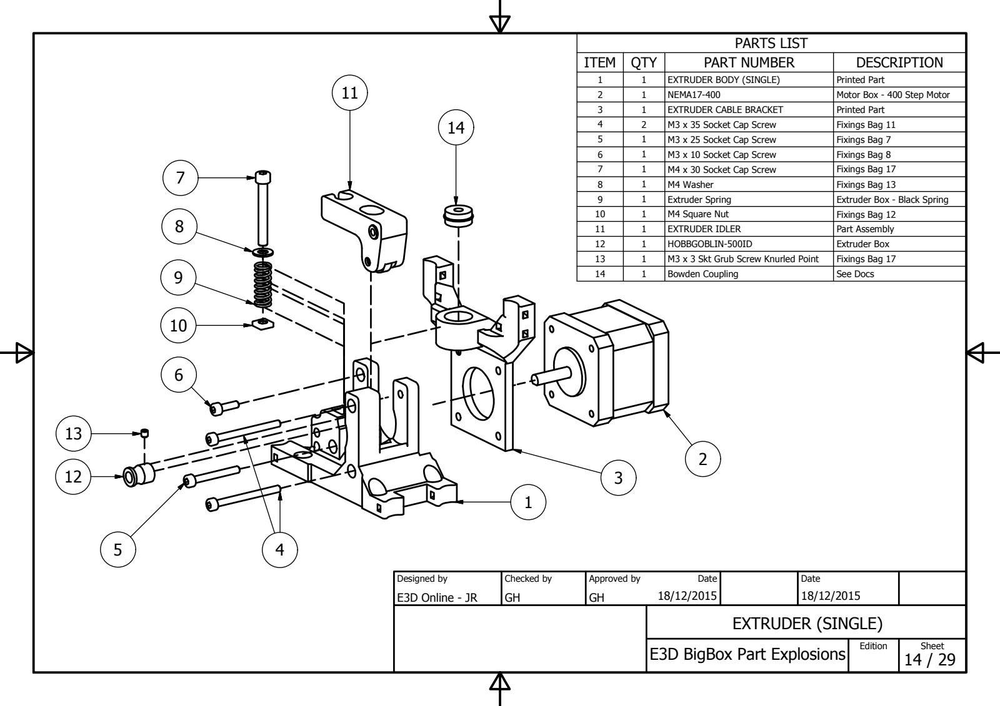
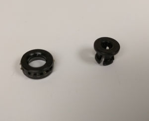
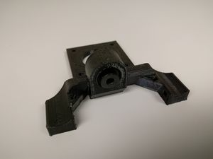
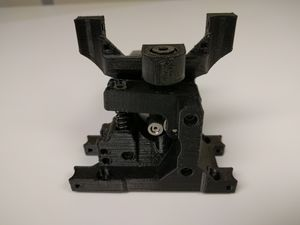

# Single Direct-Drive Extruder

Archived 20191220164342 · source: wiki.e3d-online.com/wiki/Single_Direct-Drive_Extruder

Bowden Coupler Parts.

Note how the coupler (14) assembles with the lettering facing upwards.

**Note :** The couplers are in the Extruder Box.

Bowden Coupler fitted to cable bracket.

The bowden is pushed into the cable bracket.

You can see it fitted flush with the top surface in the next picture.

The function of the bowden coupler (when the inner clip is fitted) is to hold the ptfe tube which directs the filament into the hotend. The ptfe tube pushes into the clip when in use and can be removed by pushing down on the clip. (Don't insert the ptfe now ! this is just for explanation)

Completed Single Extruder

The Motor Cable Connector faces downwards.

**Note :** For detailed assembly instructions please refer below to the Dual Extruder.\</span\>

Fit the *[Extruder Filament Idler](BigBox_Parts_Preparation.md "BigBox Parts Preparation")*, assembled during the previous assembly stage, to the extruder **after** the motor has been attached.\
