# Titan Assembly

Archived 20230509125052 · source: wiki.e3d-online.com/wiki/Titan_Assembly · [archive link](https://web.archive.org/web/20230509125052/https://wiki.e3d-online.com/Titan_Assembly)

**Contents**

- [What's in the Box](#whats-in-the-box)
  - [Plastic Parts](#plastic-parts)
  - [Fixings Kit](#fixings-kit)
  - [Gears](#gears)
  - [Bearings](#bearings)
  - [Other](#other)
- [Disassembly](#disassembly)
- [Assembly Steps](#assembly-steps)
  - [Extruder Body](#extruder-body)
  - [Gears](#gears-1)
  - [Heatsink / Bowden Adaptor & Filament Guide](#heatsink--bowden-adaptor--filament-guide)
  - [Idler Lever](#idler-lever)
  - [Lid](#lid)
  - [Gear Alignment Check](#gear-alignment-check)
  - [PTFE in Idler](#ptfe-in-idler)
- [Mirrored Titan](#mirrored-titan)
  - [Mounting Options](#mounting-options)
  - [Assembly & Commissioning](#assembly--commissioning)
- [Usage](#usage)
  - [Firmware Calibration](#firmware-calibration)
  - [Loading and Unloading](#loading-and-unloading)
  - [Adjusting Idler Force](#adjusting-idler-force)
  - [HotEnd Removal](#hotend-removal)
- [Downloads](#downloads)
- [FAQ](#faq)
  - [Weight](#weight)
  - [Wear on Idler](#wear-on-idler)
- [Troubleshooting](#troubleshooting)
  - ["Clicking" sound during retractions](#clicking-sound-during-retractions)
  - [Filament slipping off hobbed area of Filament Drive Shaft](#filament-slipping-off-hobbed-area-of-filament-drive-shaft)
  - [Drive gear hard to turn when lid tightened](#drive-gear-hard-to-turn-when-lid-tightened)
  - [HotEnd is wobbly](#hotend-is-wobbly)

## What's in the Box

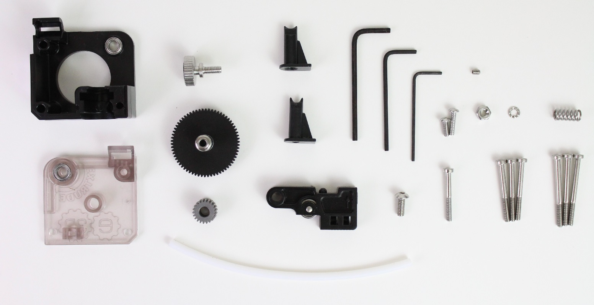

### Plastic Parts

- Body
- Lid
- Idler Lever
- Filament Guides
  - 1.75mm filament
  - "3mm" filament

### Fixings Kit

- 3 Hex Wrenches
  - 1.5mm
  - 2mm
  - 2.5mm
- Mounting Screws for 2mm mounting plate.
  - 3 x M3 x 30
  - 1 x M3 x 8
- Mounting Screws for 7mm mounting plate. (Not compatible with motor on product page, not shown in above photo.)
  - 3 x M3 x 35
  - 1 x M3 x 12
- Lid Screw
  - 1 x M3 x 25
- M4 Thumbscrew
- M4 x 10 Button Head Screw
- M4 Nut
- Idler Spring,
- Pinion Gear Grub Screw

The reason there are two sets of mounting screws is to ensure that Titan is compatible with the widest possible range of through-hole mounting situations. There are further notes on spacings in the Assembly section.

### Gears

- Steel Pinion Gear
- Acetal Gear with Filament Drive Shaft

### Bearings

- Already pressed into Body, Lid and Idler

### Other

- PTFE for Idler

## Disassembly

If you are taking a functional printer out of service to install Titan, make sure you **read all the docs first**. You may need to print a mounting bracket or spacer for your printer.

## Assembly Steps

Herewith the assembly steps for Titan. Titan is easy to assemble, but there are a few little tricks, so make sure you read it all!

**Note on spacings between motor face and extruder body:**

1. A spacer, or a mounting bracket sandwiched between the extruder body and the motor face, is always required.
2. The spacer or bracket must be at least 2mm thick. This ensures that the pinion gear clears the face of the motor.
3. If your mounting circumstances mean the extruder will be held less than 2mm off the face of the motor, you need to print a [customisable spacer](http://www.thingiverse.com/thing:1472259).
4. If your mounting circumstances requires more than 2mm then you may need to use the longer mounting screws.
   1. Note that the motor offered on the extruder product page does not support spacing of more than 3mm since the shaft is not long enough to fully support the idler.
5. If you run into problems with the screws being too long, **we have put a [customisable spacer](http://www.thingiverse.com/thing:1472259) on Thingiverse for you.** Here is a list of through-hole mounting thicknesses and associated screw lengths & spacer thicknesses you will need.

- - 2mm - Short Screws - No Spacer
  - 3mm - Long Screws - 4mm Spacer
  - 4mm - Long Screws - 3mm Spacer
  - 5mm - Long Screws - 2mm Spacer
  - 6mm - Long Screws - 1mm Spacer
  - 7mm - Long Screws - No Spacer

1. The STL of the [E3D Titan Bracket](http://www.thingiverse.com/thing:1477900) sold in our store can be found on Thingiverse. Drawings and SCAD to follow soon.

### Extruder Body

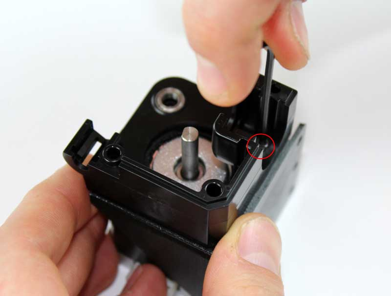

- Use M3 x 8 or M3 x 12 screw to hold the extruder body to the motor face, with the mounting bracket or spacer between them.

### Gears

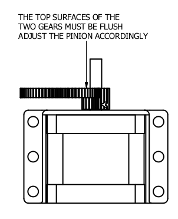

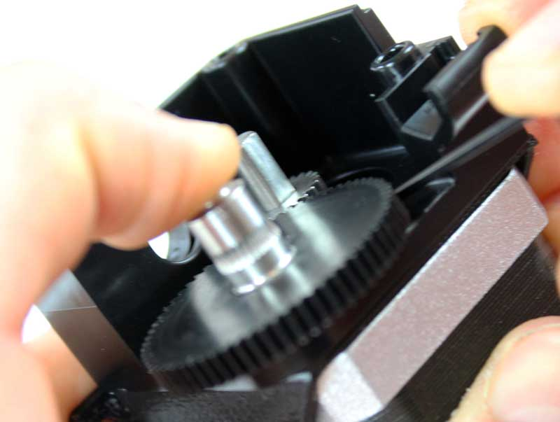

- Screw the M3 Grub Screw loosely into the Steel Pinion Gear.

&nbsp;

- Slide the Steel Gear onto the motor shaft, oriented such that the grub screw is closest to the motor.
  - To set the height of the steel gear, drop the Acetal Gear with Filament Drive Shaft into the bearing, then line up the top surfaces (facing away from the motor) of the gears so that they are flush.
  - To ensure that positioning is accurate, squeeze the assembly together to ensure that the everything is sitting where it will be once it’s all tightened up.

&nbsp;

- Tighten the Grub Screw to secure the Steel gear in place. If your motor shaft has a flat section do tighten the grub screw down onto the flat for optimal grip.

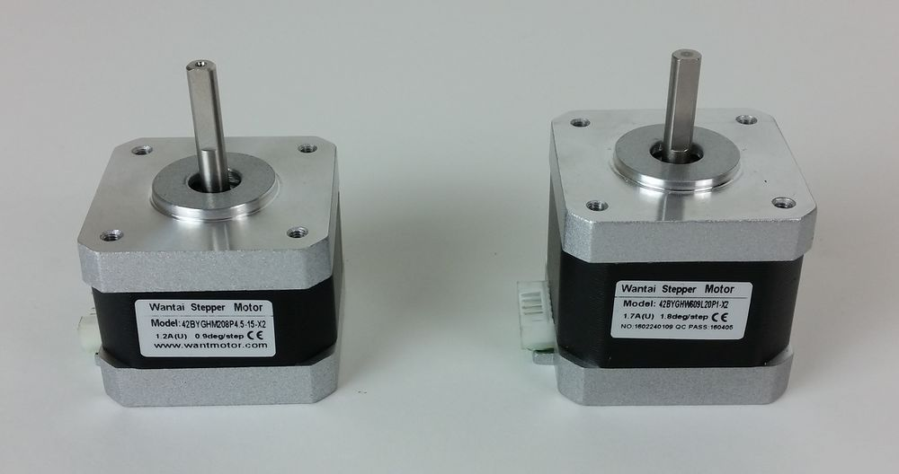

**Note**

The motor supplied with Titan has recently been upgraded, leading to a few slight differences:

- The new motor has 400 steps/rev, giving higher resolution than the older one with 200 steps/rev. This must be taken into account when setting the firmware.
- The shaft on the newer model is slightly longer to allow for the use of thicker mounting brackets.
- In addition to the shaft being longer on the new model, the shaft flat does not extend as close to the motor face plate as the old model. This means that for thinner mounting brackets it may not be possible to tighten the gear on to the flat section, don't worry, as the grub screw will still cope with enough torque to run the the extruder when tightened on to the round portion of the shaft.

You can tell which motor you have by checking the model number or degrees per steps written on the sticker on the side of the motor:

- New: 42BYGHM208P4.5-15-X2 & 0.9deg/step (Left image)
- Old: 42BYGHW609L20P1-X2 & 1.8deg/step (Right image)

### Heatsink / Bowden Adaptor & Filament Guide

**1.75mm Direct**

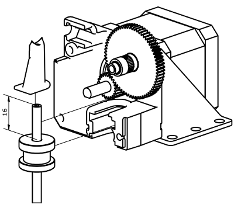

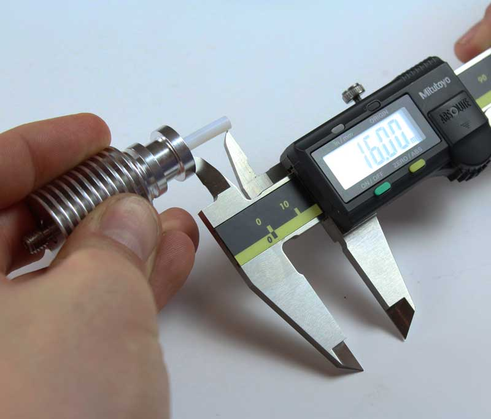

We are going to cut the PTFE to length so that it fully lines the filament path all the way from the top of the filament guide down into the heat-break.

1. Screw the heatsink and heat-break together. **Note: the little black bowden collet must not be installed.**
2. Insert the PTFE from the top, so that it is up against the heat-break.
3. Measure 16mm from the top of the heatsink and cut the PTFE. This will ensure an optimal filament parth. Note;
   1. If the PTFE is too long, when you screw the heat-break in place it may crush the PTFE, constricting the filament path.
   2. If the PTFE is too short, there will be a gap between the top of the PTFE and the filament guide which may cause slight problems with loading.
   3. It is better that the PTFE is slightly too short.
4. Place the black filament guide onto the PTFE and slide the whole assembly into the groove-mount hole in the extruder body. The HotEnd should be held firmly in place.

**3mm Direct**

There is no PTFE in the system for 3mm Direct. Simply place the heatsink into the groove-mount hole, followed by the white filament guide. Ensure the top of the filament guide is flush with the extruder body.

**1.75mm and 3mm Bowden**

1. Slide the Bowden Adaptor into the groove-mount. It may feel a little loose.
2. Slide the filament guide (black for 1.75mm, white for 3mm) into the groove-mount. The Bowden Adaptor should now be held firmly in place. Ensure the top of the filament guide is flush with the extruder body.
3. Insert the PTFE into the Bowden Adaptor until you feel it hit up hard against the filament guide. Note that in 1.75 - the PTFE will go all the way up into the guide, stopping short only a few mm before the drive gear.
4. Pull the collet in the Embedded Bowden Coupling whilst pushing the PTFE into the coupling, this will ensure that the tube is locked in place and that there is minimal backlash in the system.

### Idler Lever

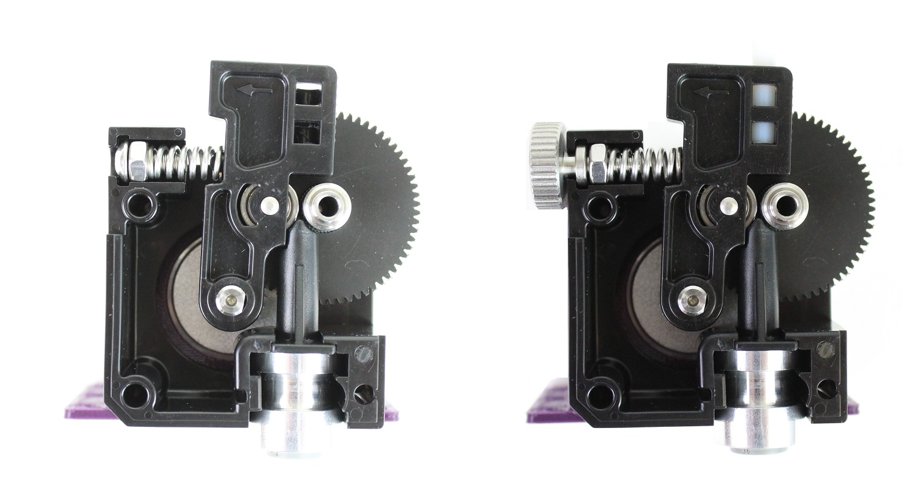

There are 2 options for adjusting the tension on a Titan. An M4 button head screw (left) or an M4 thumbscrew (right). The thumbscrew allows you to adjust the tension without tools whereas the button head does not, however it is more compact. Otherwise they are functionally the same, so the choice is purely your own preference.

1. Screw the M4 Nut all the way onto the M4 Screw or Thumbscrew.
2. Locate the spring around the threaded part of the screw.
3. Drop this assembly into the nut-channel in the extruder body.
4. Warning: Do not compress the spring without the lid on, and always ensure the idler tension is set to minimum before removing the lid. Failure to do so can cause the spring / screw to pop out and fly to the other side of the room. In the best-case this will be a waste your time spent looking for it, worst-case it may hit someone in the face.
5. Slide the idler lever onto the motor shaft, ensuring that the spring locates onto the bump on the back of the idler.

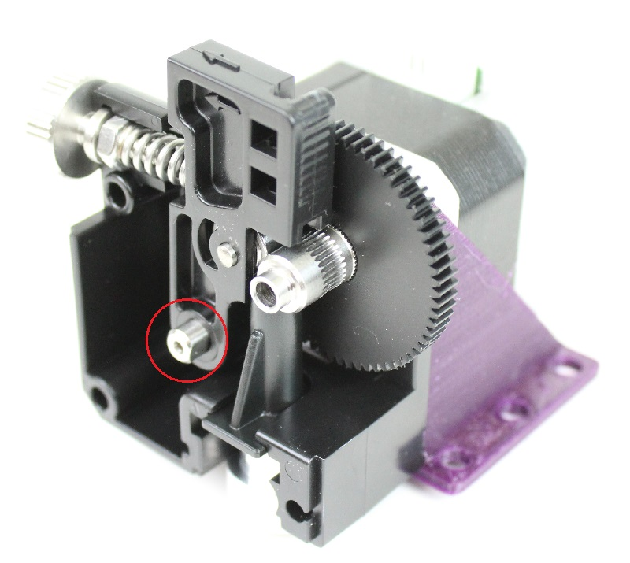

Note: it is normal that the pin sticks out slightly on one side of the lever.

### Lid

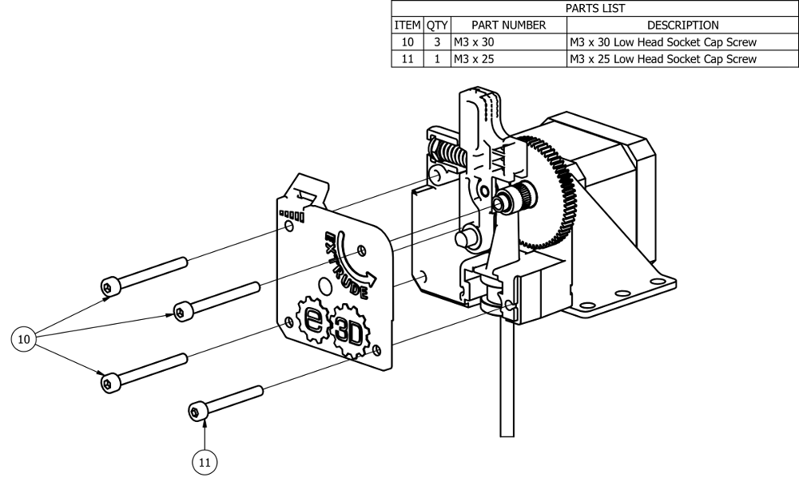

1. Put the lid on the assembly and install the M3 x 30 (or M3 x 35) screws in the 2 left positions.
2. The top-right screw which goes through the filament drive shaft uses the same screw as before, however with this one, you must be careful not to over-tighten. Tighten only enough to hold the assembly together.
   1. If supplied, use the shake-proof washers under the head of the top-right screw to minimise risk of loosening during service.
   2. All the force applied to this screw is transmitted through the miniature bearings for the filament drive shaft. Over-tightening will cause unnecessary load on the motor and in extreme cases may result in the bearings failing prematurely.
3. The remaining screw is the M3 x 25 in the bottom right position. This screws into the brass insert in the back of the extruder body and holds the HotEnd in place.

### Gear Alignment Check

Now that you have completed the assembly, check that the large Acetal gear moves smoothly and that it fully meshes with the steel gear.

- If the gear is hard to move, loosen off the corresponding M3 screw in the lid until it moves freely.
  - If the gear is still hard to move - check the position of the steel pinion gear, it may be too far forward.
- If the gear exhibits “backlash” (improper meshing), loosen all screws on the lid and rotate the body such that the gears fully mesh. Re-tighten up the screws on the lid.

### PTFE in Idler

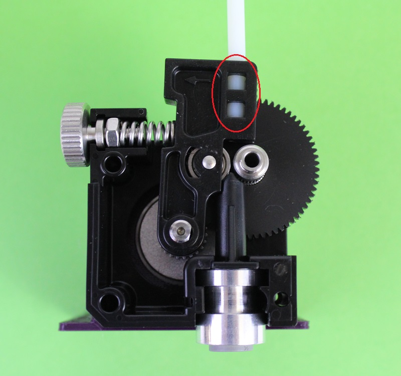

When the Extruder is ready to use, ensure that you put a piece of 4mm OD, 2mm ID PTFE tubing into the hole in the top of the idler. This will provide guidance for the filament. Without this, the filament risks coming off the hobbed area of the extruder. This is not required for 3mm filament.

## Mirrored Titan

A mirrored version of Titan is to be launched in mid March 2017, which is functionally the same as the standard version, however the nozzle is offset on the opposite side to usual.The main intent of the mirrored Titan is to be used for dual extrusion, maximising build space when using a pair of direct extruders, such as in the configuration below.

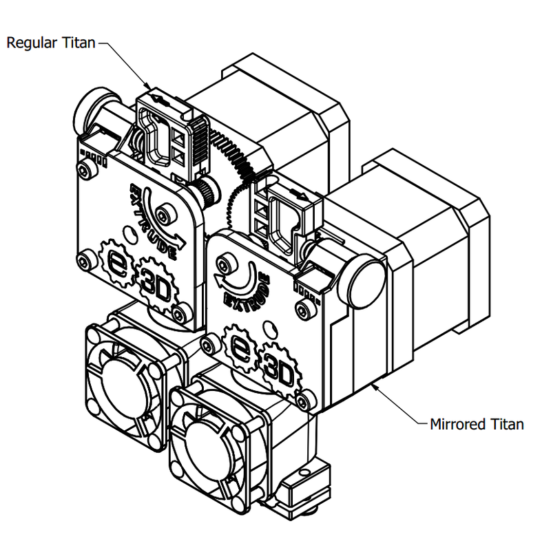

### Mounting Options

There are a couple of recommended ways to mount a pair of Titans:

- Simple method, where the 2 extruders are offset in X only, this will yield an extra 30mm of X build space compared to using 2 standard Titans.

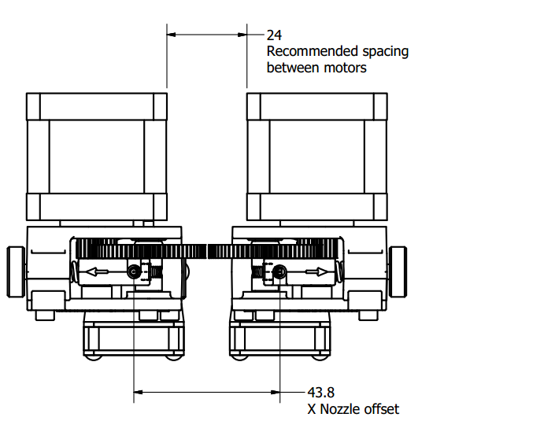

- Maximum X Build Method, where the 2 extruders are offset in X and Y, allowing the gears to overlap. This will gain 47mm of X build space, however this is at the cost of 10mm of Y build space.

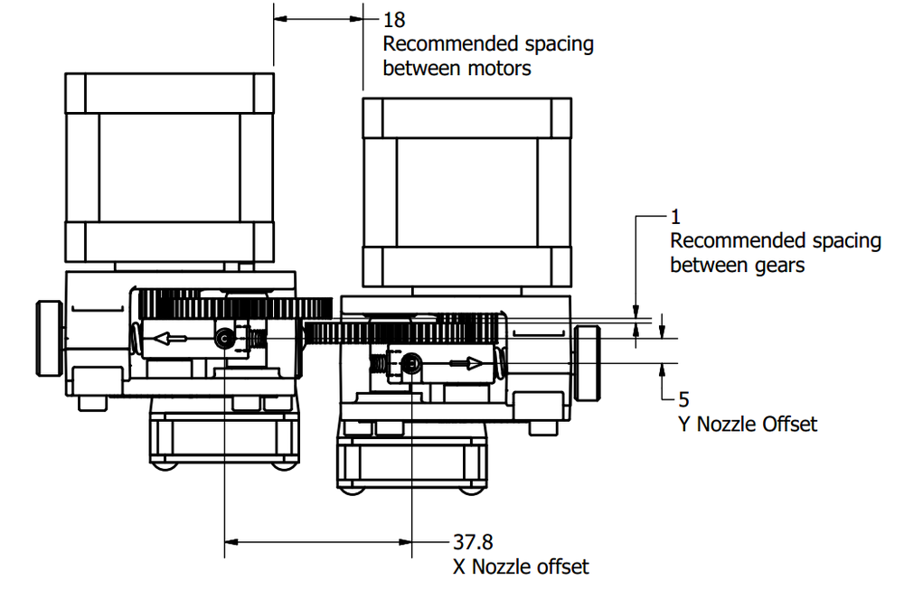

When deciding on mounting options, do also consider adjustability in the Z direction, the closer the 2 nozzles are in Z the better print quality will be.

### Assembly & Commissioning

The assembly process of a mirrored Titan is the same as a standard Titan, however the following parts are mirrored and therefore not interchangeable with a standard Titan:

- Body
- Lid
- Filament Guides ,these are marked on the base with “1.75L” or “2.85L”
- Idler Lever, the injection molded part is the same, however the pin that retains the idler bearing has been pressed from the other side to prevent interference with the large plastic gear.

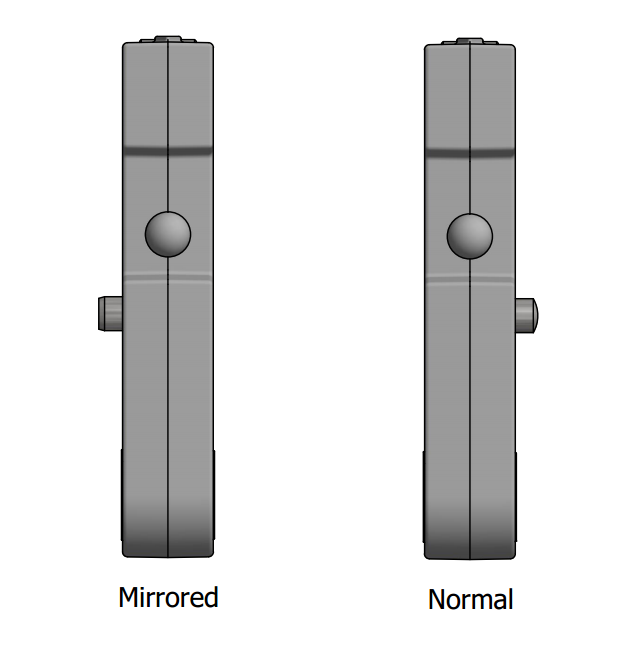

Before running your first print you must calibrate the XY offset of the nozzles, this needs to be calculated accurately to ensure good print quality. There is a good guide for how to do this on the Bigbox wiki [BigBox Dual Nozzle Alignment Section](Printer_Commissioning.md#8-dual-nozzle-alignment "Printer Commissioning")

## Usage

### Firmware Calibration

Because Titan uses a known gearing ratio and a consistently machined drive gear, we can offer a fairly accurate steps / mm set-point.

Steps per Unit (Extruder) = Motor Steps \* Micro-stepping \* Gear Ratio / (Hobb Diameter \* Pi)

- Standard motor steps / rev = 400 for the new style motor or 200 for the old style motor (Refer to assembly steps if unsure which motor you have).
- Standard micro-stepping = 16x
- Gear Ratio = 3
- Hobb Diameter (Effective) = 7.3

200 \* 16 \* 3 / (7.3 \* 3.142) = 418.5\
400 \* 16 \* 3 / (7.3 \* 3.142) = 837

To test your value, mark the filament 120mm from the extruder then extrude 100mm slowly. If you do not measure 20mm after extrusion has finished, you may need to tweak this value.

### Loading and Unloading

**To load filament**

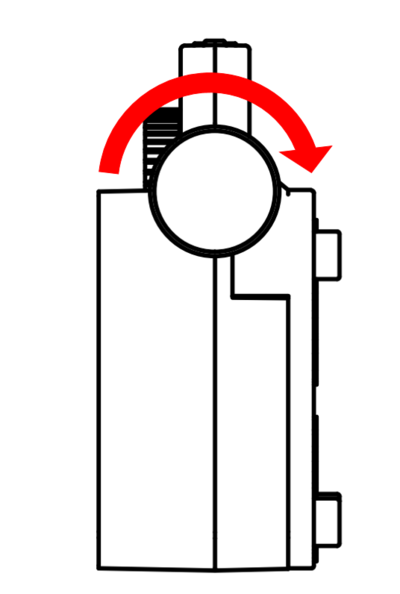

- Slightly reduce the idler force by turning the adjustment wheel clockwise.

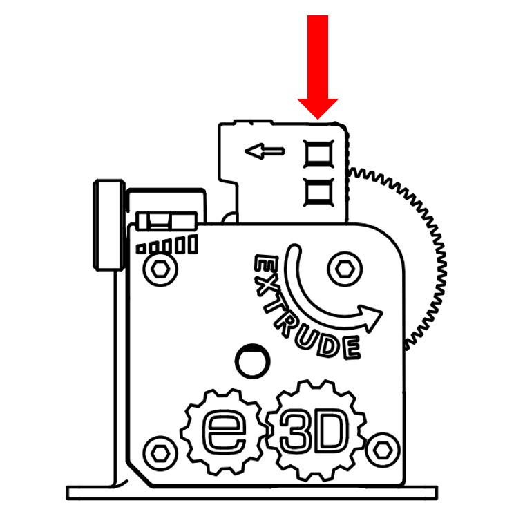

- Feed the filament through the top of the idler.

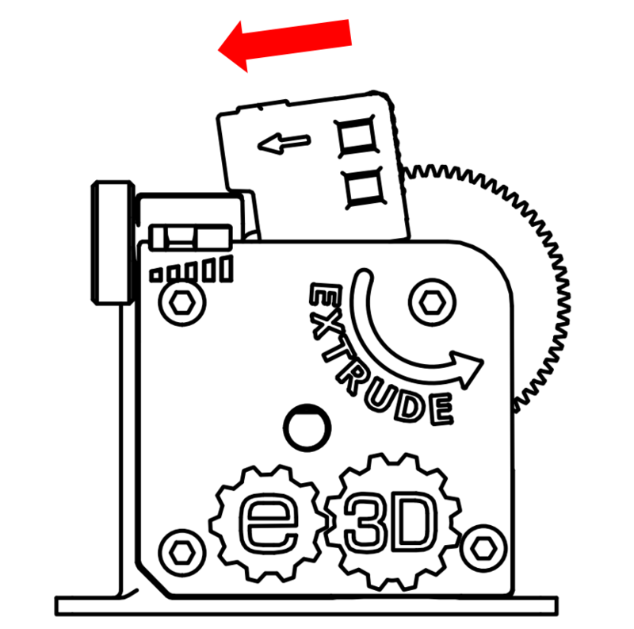

- Pull the idler back and continue to feed the filament into the extruder.

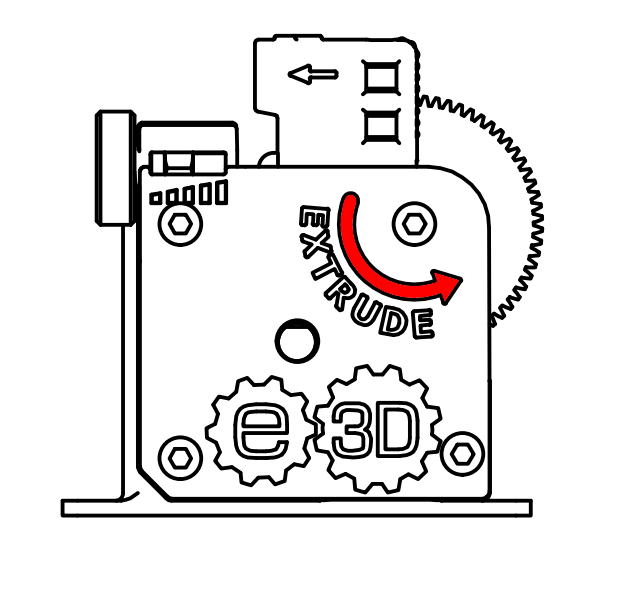

- Rotate the large gear by hand to feed the filament the remainder of the way into the hotend. You will know you have reached the hotend as the gear will start to put up more resistance.

**To unload filament, simply do the loading procedure in reverse.**

### Adjusting Idler Force

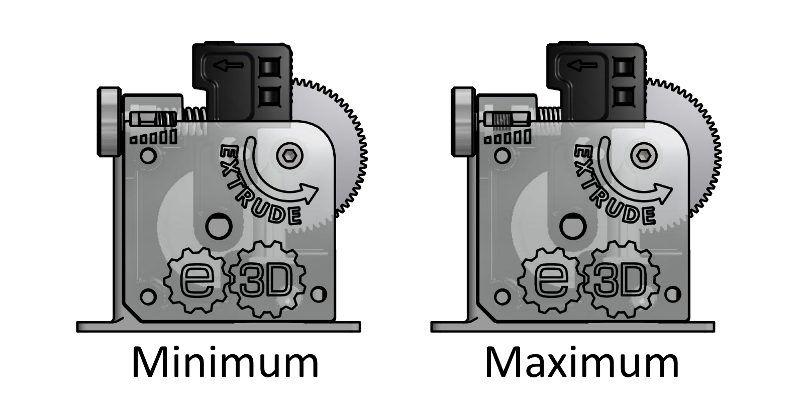

The idler force can be adjusted using the thumb wheel on the side of the extruder. The nut and spring that actually apply the force can be viewed through the lid, giving a quick indicator of the force being applied.

The force required will depend on a range of parameters, such as filament material, filament diameter, extrusion rate etc. As a general rule softer filaments (such as flexibles) will need less force than harder ones as the hobb can more easily grip them. The idler force does not need to be perfect in order to print, however to get the best settings for your printer and material combination we advise a little bit of experimentation to find a setting that feels right.

### HotEnd Removal

To remove the HotEnd, relieve tension in the idler then remove the front 4 screws and pull the HotEnd out forwards.

## Downloads

- Supplementary Assembly Drawings / Notes *(dead link; [archived copy](https://web.archive.org/web/20160527143731/http://files.e3d-online.com/Titan/Titan_Assembly_Supplementary.pdf))*
- [NEMA17 Face-Plate Spacer](http://www.thingiverse.com/thing:1472259)
- Model of Assembled Titan in STL format *(dead link)*
- Model of Assembled Titan in STP format *(dead link; [archived copy](https://web.archive.org/web/20170910104341/http://files.e3d-online.com/Titan/ASM_EX_THUMB_SCREW.stp))*
- [E3D Titan Bracket](http://www.thingiverse.com/thing:1477900)
- Mounting Bracket Engineering Drawing *(dead link)*

## FAQ

### Weight

60g without motor

#### Wear on Idler

The idlers are made from Delrin 500CL which is an acetal homopolymer with impregnated chemical lubricant. This resin is designed specifically for low wear and friction against metals. This idler runs plain against a ground steel motor shaft which is very smooth causing absolutely minimal wear. If you have a D-shaped shaft there is a small possibility that a bur is present on one of the edges - this could cause issues in the long-term and so if found should be removed.

## Troubleshooting

### "Clicking" sound during retractions

If you can hear the gears clicking against each other during printing (normally on retraction) this is most likely caused by backlash (the gears being able to move very slightly, independently of one and other). You can check for this by trying to move the large gear by hand, it will probably move freely over a very small angle.

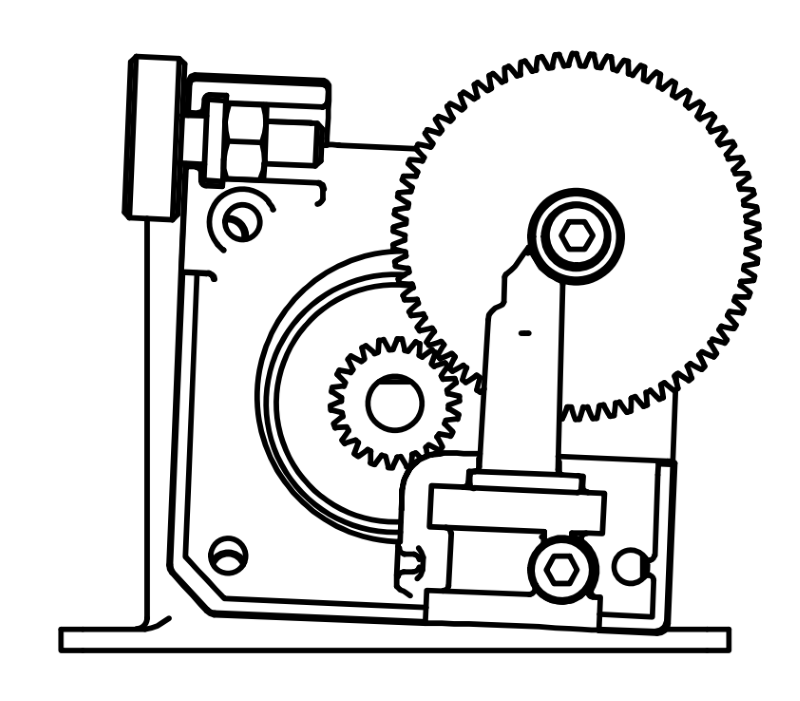

Backlash is caused by poor gear alignment, a highly exaggerated example of this is shown in the picture. The fix is simple, loosen the 3 screws that hold the body to the motor and rotate the extruder such that the gears are fully meshed. You know they are fully meshed when the large gear is no longer able to move freely. Re-tighten the screws on the lid and the problem should be fixed.

If you are unable to get the gears to fully mesh by removing the screws on the lid, it may be necessary to loosen the screw behind the groove-mount and adjust the body position.

### Filament slipping off hobbed area of Filament Drive Shaft

- Ensure the PTFE is installed in the Idler.
- Ensure that the steel pinion gear is not too far back towards the motor, allowing the idler to slide back and forth along the motor shaft.

### Drive gear hard to turn when lid tightened

Be sure that the steel pinion gear is not above the height of the Acetal gear. If it is, the idler will pinch it when the lid is fitted.

### HotEnd is wobbly

This is normally because the PTFE guide has not been inserted. Please refer to the relevant section of the documentation and ensure that this part is fitted. If you are still having trouble, please contact support.
