# Your First Print

Archived 20201204013802 · source: wiki.e3d-online.com/wiki/Your_First_Print · [archive link](https://web.archive.org/web/20201204013802/https://wiki.e3d-online.com/Your_First_Print)

**Contents**

- [Loading Filament](#loading-filament)
- [Calibrating The Filament](#calibrating-the-filament)
- [Printing](#printing)
- [Where next?](#where-next)

## Loading Filament

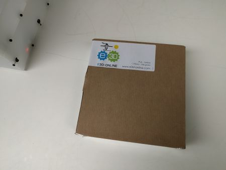

Box Of Filament.

We recommend E3D Online's range of Everyday & Premium Filament *(dead link; [archived copy](https://web.archive.org/web/20160902222958/http://e3d-online.com:80/All-Filament&filter=5,24))* for your daily printing needs!

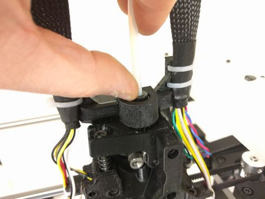

Clip.

Press down the Bowden clip on the top of the Extruder.

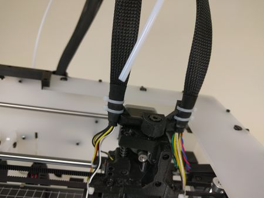

Remove the tube.

Pull the feed tube free.

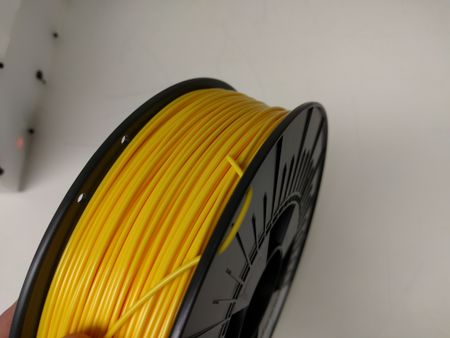

Opened.

Remove the filament from it's packaging.

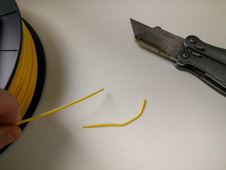

Trimed.

Cut off the kink.

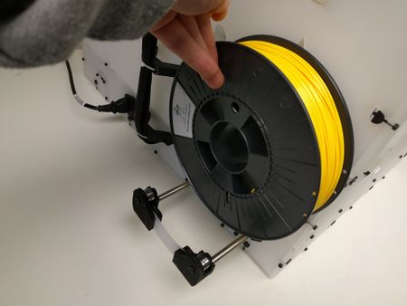

Rear.

Pull back the Spool Carrier at the rear of the printer and place the spool on it.

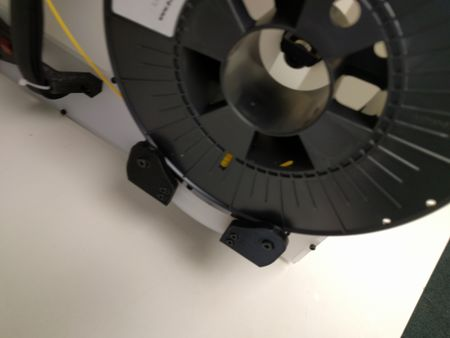

Carrier.

Slide the Carrier forward.

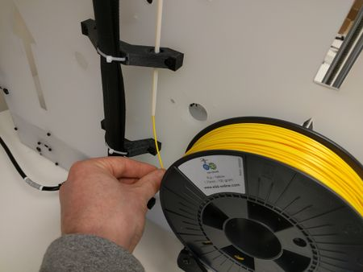

Tube.

Feed the lose end of the filament up into the guide tube.

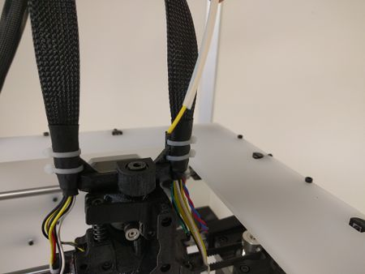

Feed.

Continue feeding until the filament comes out the end of the guide tube.

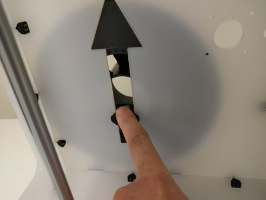

Clamp.

Lock the spool onto the Carrier with the Spool Clamp.

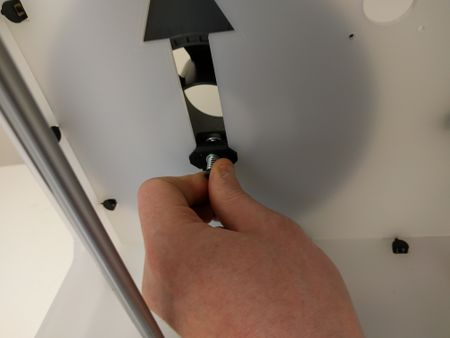

Clamp.

Tighten the screw to hold the clamp in position.

Check the spool can freely rotate on the carrier

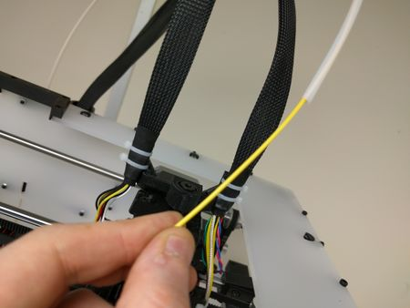

Pull.

Pull the filament through the tube.

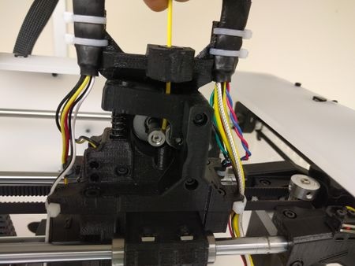

Insert.

Feed it into the extruder.

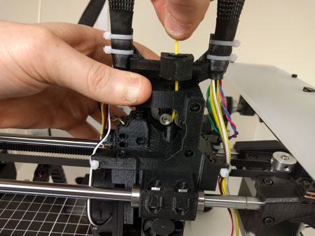

Push down.

Push down the filament idler arm and feed the filament past the gear into the feed hole.

Feed the filament as far down as it will go.

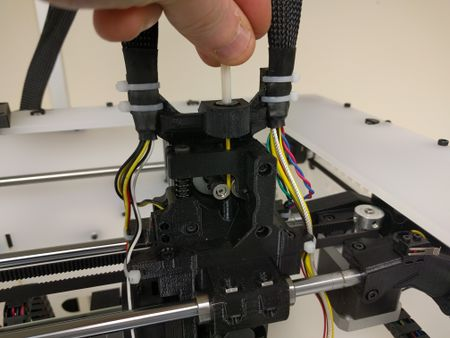

Re-fit the tube.

Put the guide tube back into the Bowden Coupler.

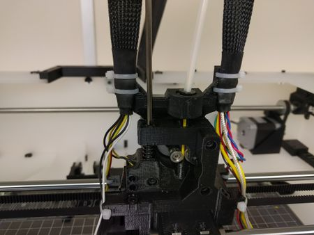

Idler.

Adjust the tension of the Filament Idler

## Calibrating The Filament

**Extruder Steps-Per-MM**

To set the Steps-Per-MM via the LCD, press the LCD knob and navigate to *Control* **\>** *Motion* **\>** *Esteps / mm*

**0.9° Stepper Motors**

- Non-Titan Hybrid Extruders using the larger 0.9° Stepper Motors set the Steps-Per-MM to **304**.
- Titan Hybrid Extruders using the larger 0.9° Stepper Motors set the Steps-Per-MM to **852**.

**1.8° Stepper Motors**

- Motors Non-Titan Hybrid Extruders using the smaller 1.8° Stepper Motors set the Steps-Per-MM to **152**.
- Titan Hybrid Extruders using the smaller 1.8° Stepper Motors set the Steps-Per-MM to **417.5**.

Please note that we are using PLA during this guide. If you are using a different material please refer to the manufacturer's specification for printing temperate information.

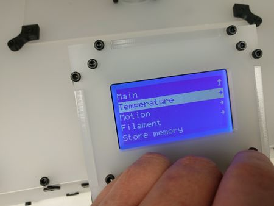

Temperature.

To get the best from your printer you will need to calibrate the correct number of Steps-Per-mm for each filament you wish to use. This is a very simple process and only needs to be done once for each filament spool. The increase in print quality is well worth the extra few minutes spent.

Navigate through the **Control** menu, select **Temperature**.

Push the knob.

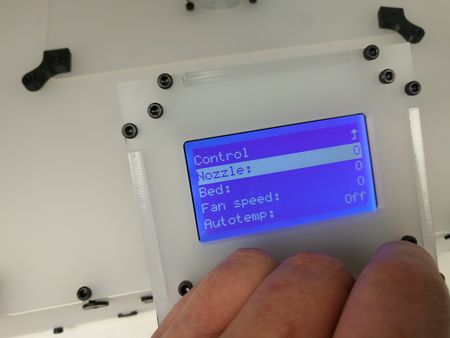

Nozzle.

Select **Nozzle:**.

Push the knob.

210°C.

Adjust the temperature to **210**.

Push the knob.

**Note**: Check the manufacturers print temperature for the filament you want to calibrate. During this instructional section we are using E3D's Everyday PLA.

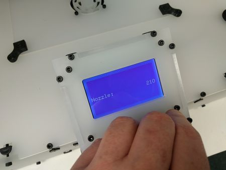

210°C.

The Hotend will now heat up to 210°C.

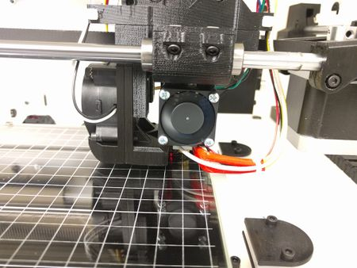

40°C.

The Hotend fan will come on at 40°C.

If the fan does not come on check the fan wiring. If you can not immediately fix the problem turn off the printer and refer to the BigBox Troubleshooting pages.

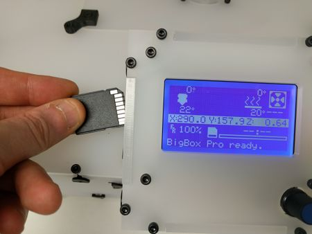

SD Card.

Insert the provided SD card into the side of the LCD.

If you do not have the files pre-loaded on your SD Card they are available from **`http://files.e3d-online.com/BigBox/SD_Card/` *(dead link; [archived copy](https://web.archive.org/web/20161102033305/http://files.e3d-online.com/BigBox/SD_Card/))***

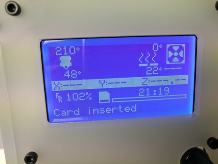

Card Inserted.

If the card has been inserted and detected a message will display on the screen.

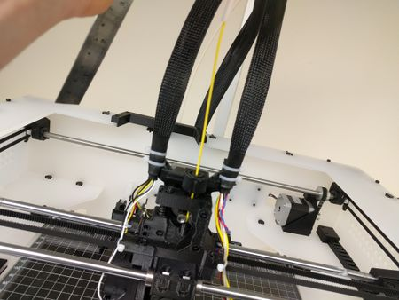

Pull out.

Unclip the feed tube from the Bowden Clip and pull back the tube to expose some filament.

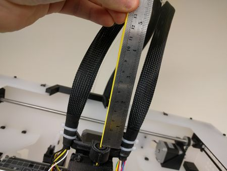

Ruler.

Place a ruler against the clip and run the filament along it.

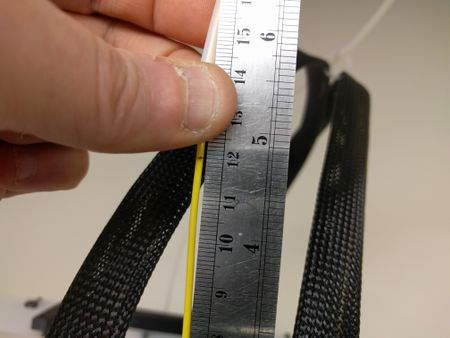

Mark.

Using a felt-tip pen or other implement mark the filament at the 120mm (12cm) line.

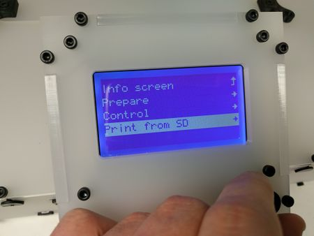

Print.

Navigate the LCD menu and select **Print From SD**.

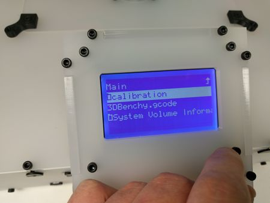

calibration.

Highlight **calibration**.

Push the knob.

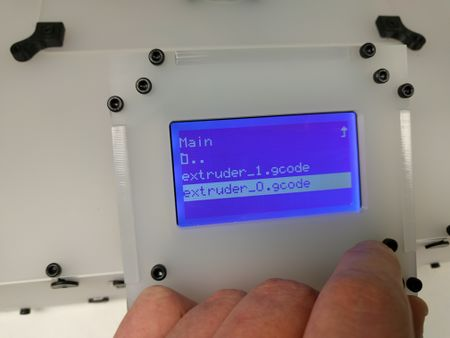

calibration.

Highlight **extruder_0.gcode**.

Check the nozzle temperature has reached 210°C and make sure the printer is free from obstruction.

Push the knob.

To watch a video of the calibration click here \| **[https://youtu.be/pwVBydX4xyA](https://youtu.be/pwVBydX4xyA)**

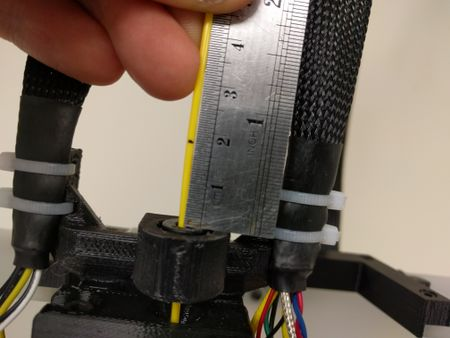

Measure.

When the filament has finished extruding measure the position of the mark. In this instance it reads 18mm.

Taking our original measurement of 120mm and using some simple arithmetic we can deduce the extruder extruded 102mm, instead of the requested 100mm.

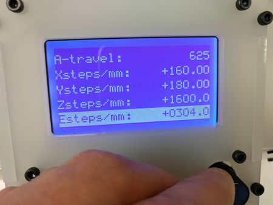

Current steps.

Navigate via the menus to **Control** then **Motion**.

Scroll to the bottom and you will see the current steps-per-mm, listed as **Esteps/mm: +304.0**

To calculate the required values;

*current steps-per-mm \* 100 / measured value in mm*

*304 \* 100 / 102 = 298*

The new steps-per-mm is 298.

Note: This **will** be different for your printer.

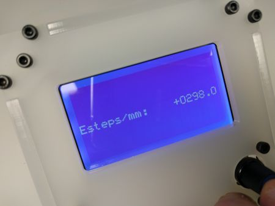

New steps.

Adjust the value for E to 298.

Remember to select **store memory** to save the new value.

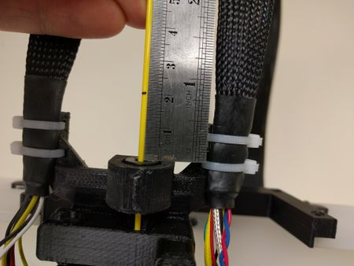

Correct.

Re-run through the measuring portion of the calibration again.

If the values calculated are correct the extruder should use exactly 100mm of filament.

**Note**: It may take a few attempts to find the correct number of steps.

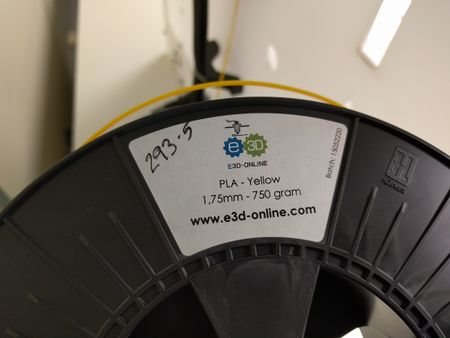

Marked.

When you have the right value it is a good idea to write the steps-per-mm on the filament spool so you can quickly setup the printer when you change filaments.

**Note**: The values for each filament will be specific to your printer. If you use your filament on another machine it is very likely the values will be different.

## Printing

Please note that we are using PLA during this guide. If you are using a different material please refer to the manufacturer's specification for printing temperate information.

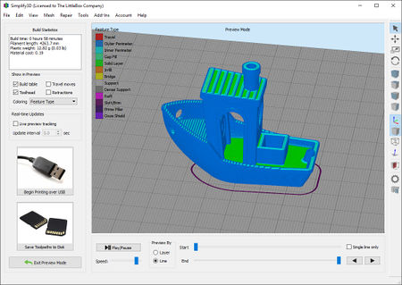

\#3DBenchy.

We have preloaded the SD card with gcode for the [\#3DBenchy](http://www.3dbenchy.com/). The STL file is included on the card too.

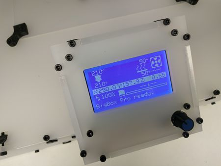

Temperatures.

Check that the printer is clear from obstructions.

Perform the **Auto home** then **Level bed** functions via the LCD.

Navigate via **Control** - **Temperatures**

Set the nozzle temperature to 210°C and the bed to 50°C.

Wait a few minutes while the Hotend and Heated Bed warm up.

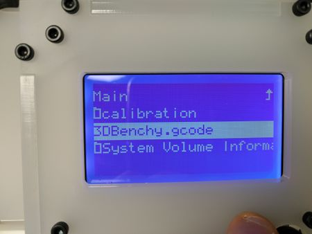

Benchy.

Select **3DBenchy.gcode** from the SD Card.

Check the temperatures are at their required values.

Push the knob.

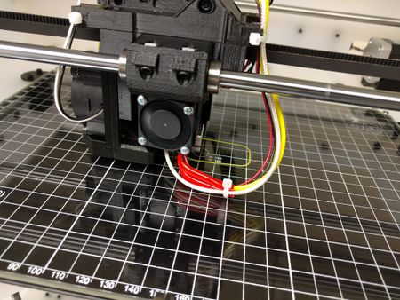

Benchy in progress.

Action shot.

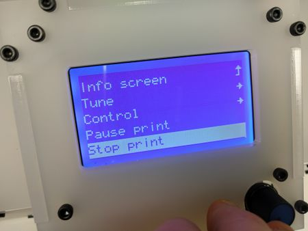

Stopped.

If you need to stop the print for any reason, to change the offset for example, use the function via the LCD.

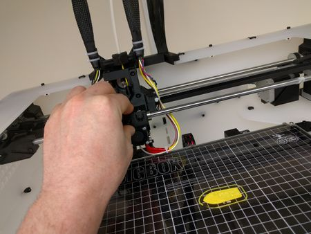

Move it.

You will be able to push the Printhead out of the way by hand once the print has been stopped. I recommend moving it into the docked position.

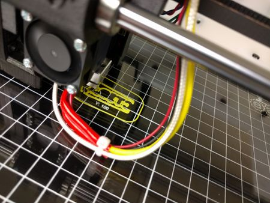

Restarted.

Before restarting the print you need to run the **Auto home** sequence and you'll also need to run **Level Bed** if you are using a Pro or Lite BigBox.

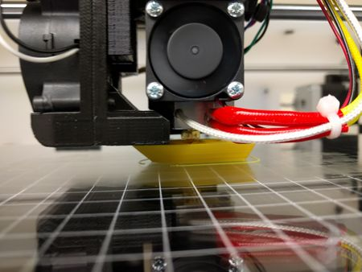

Benchy.

Smooth lines.

*\[image not archived: Benchy_finished.jpg\]*

Benchy finished.

The Benchy takes 1 hour 15 minutes to complete.

Never leave your printer unattended while it is printing.

## Where next?

Back to [Printer Commissioning](Printer_Commissioning.md "Printer Commissioning")

Continue to the [BigBox OctoPrint Upgrade](BigBox_OctoPrint_Upgrade.md "BigBox OctoPrint Upgrade")

Home to the [BigBox Build Manual Main Index](BigBox_Build_Manual.md "BigBox Build Manual")
